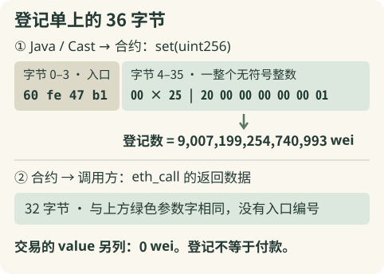

# 第 13 课 · 从 JVM 切到 EVM：少掉的 1 wei 在哪一步？

联调单 R-13 要登记 **9007199254740993 wei**，不收款。Java 后台导出的单据末位是 `3`，同事把金额放进网页的 `Number` 再导出，末位成了 `2`。合约回执还显示成功。谁登记了哪个数？先不要查付款方余额：要核对的是客户端发出的 **36 字节**、合约按什么类型读它，以及入块后读回的整数。回执不会替你核对单据。

先修是[第 09 课的账户状态](accounts.html)和[第 11 课的交易与回执](evm.html)：会区分交易的 `to`、`value`、`input` 和回执的 `status` 即可。这里 `wei` 是单据的约定单位，1 ETH = 10¹⁸ wei；`uint256` 本身并不附带单位。全课只用自己启动的本地链，不使用钱包文件、私钥或公网 RPC。

## 先把工单写成两个入口

[AmountRegister.sol](m04/src/AmountRegister.sol) 只有一个持久状态 `uint256 private amountWei`，部署后默认为 0。它是可被下一次写入覆盖的实验登记栏，不是历史流水，也不是任何人的欠款余额。

```solidity
function set(uint256 nextWei) external returns (uint256) {
    amountWei = nextWei;
    return nextWei;
}

function get() external view returns (uint256) {
    return amountWei;
}
```

`set` 把值写进这个合约自己的存储，再把传入值返回给调用方；`get` 是不改状态的读取入口。`external` 说明这是合约对外提供的函数，不等于有写入权限控制。**任何调用者都可以覆盖这张练习单**。`private` 限制的是 Solidity 源码层面的访问，不会对读链的人保密。两个入口都没有标 `payable`，不接收调用随附的非零原生金额。本课写交易的 `value` 始终为零，发交易的测试账户仍需支付执行费。

Java 的 `register.set(n)` 看起来像一次本地方法调用，参数有静态类型，返回值交给当前线程。跨到合约边界后，地址选定**哪份部署**，输入字节选定**哪段代码和哪些实参**，调用还有发送者、附带金额和 gas 预算。另一个合约调用它时，当前调用帧的 `msg.sender` 是直接调用者，不一定是最初发交易的人。调用可能回滚；客户端向节点提交写交易拿到的是交易哈希，不是一个 Java `BigInteger` 返回值。

## 拆开两端都必须同意的 36 字节

ABI 是应用二进制接口：它规定输入和输出如何排成字节，却不会把类型名称或 `wei` 字样塞进每个值。同一串字节按不同接口解码，可能得到看似合理但无关的结果。先拿到目标部署对应的接口，再谈「解出来了」。

1. 选入口。取规范签名 `set(uint256)`（不加空格、参数名或返回类型），用 **Keccak-256** 哈希，取最左 4 字节：`60 fe 47 b1`。`uint` 在规范签名里要展开成 `uint256`。这个 selector 是分发线索，不证明地址、合约身份或调用者权限；四字节并非全球唯一。
2. 编实参。单个 `uint256` 是一个 32 字节无符号大端字，左侧补零。9007199254740993 = 2⁵³ + 1，对应末尾 7 字节 `20 00 00 00 00 00 01`，前面补 **25 个零字节**。这里 `0x` 是十六进制文本前缀，不算字节。
3. 拼输入、拆输出。`set` 的输入是 selector 加参数字，`4 + 32 = 36` 字节；节点模拟执行时返回的只有 `32` 字节结果，没有第二个 selector。动态 `bytes`、字符串或数组还有偏移与长度规则，不能把「每个参数就填一个字」照搬过去。

<figure class="lesson-figure"><a href="../assets/figures/m04/abi.svg"></a><figcaption>按字节位置核对默认工单。竖线只为分组，不写进数据；别把绿色参数字当成转账金额，交易的 value 是另一栏。</figcaption></figure>

默认工单的**完整预期字节**，可逐位和终端输出比对：

```text
calldata = 0x60fe47b10000000000000000000000000000000000000000000000000020000000000001
return   = 0x0000000000000000000000000000000000000000000000000020000000000001
```

## 哪一份数据会留到下一次调用？

| 位置 | 在这个例子里是什么 | 生命周期与误判 |
| --- | --- | --- |
| calldata | 调用帧只读输入；`set` 的前 4 字节分派，其余按 ABI 读为 `nextWei` | 一次执行中不能改写这份输入。外部交易的输入也会被记录，但不会自动成为合约状态；标量参数不需要在源码上写 `calldata` |
| memory | 当前调用帧的临时工作区，例如组装要交出的返回数据 | 不是全局 Java 堆，后一次调用没有前一次的临时对象；返回数据交给调用方不表示保存到了链上 |
| storage | 当前地址的持久状态；本例只有 `amountWei`，按此布局占 0 号槽 | 写交易成功入块后，后续调用可从新状态读取；模拟和回滚都不会提交这次修改。换一份合约或布局，不要照猜 0 号槽 |

如果下节要把「单个金额」改成「每个地址的应领额」，会用到 `mapping(address => uint256)`。给定键和映射的存储槽，编译器能推导对应值的位置；它不像 Java 的 `Map` 那样还维护可遍历的键集合，没有 `.size()` 或 `.entrySet()`。未写过的键和写过零的键都能读到 0。需要知道「出现过哪些收款人」时，要另行设计索引（例如从事件建立查询列表）；不能循环扫 mapping 来证明没有遗漏。

<a id="m04-tools"></a>

## 全卷工具准备：先下载并核验，随后断网构建

在**仓库根目录**、同一个终端内操作。需要 Bash、Python 3.11+ 标准库、`lsof`、JDK 17+（`java` 和 `javac` 都可用）。[安装器](m04/setup.sh)支持 macOS arm64 / x86_64、Linux x86_64，下载时还用到 `curl`、`tar`、`awk` 和 `openssl`。不需要 sudo、Docker、Node.js、Maven 或第三方 Solidity 库。首次取工具要联网；没有本机适配的二进制或摘要不匹配就停，不从随机镜像补一个不同版本。

```bash
bash labs/m04/setup.sh
export PATH="${XDG_CACHE_HOME:-$HOME/.cache}/chain-course/m04/bin:$PATH"
export FOUNDRY_SOLC="${XDG_CACHE_HOME:-$HOME/.cache}/chain-course/m04/bin/solc"
unset ANVIL  # 让回环启动器也选择上面 PATH 中的 anvil
command -v forge cast anvil lsof
forge --version
cast --version
anvil --version
"$FOUNDRY_SOLC" --version
java -version
javac -version
python3 --version
(cd labs/m04 && forge build --root . --offline src/AmountRegister.sol)
```

前三个 Foundry 工具应为 **1.7.1**，编译器应含 **`0.8.28+commit.7893614a`**。安装器把三个指定平台归档的 SHA-512 和编译器的 SHA-256 与脚本固定的摘要逐一比对，再将二进制放入本机缓存。来源可核对 [Foundry v1.7.1 发布记录](https://github.com/foundry-rs/foundry/releases/tag/v1.7.1)与 [Solidity 编译器的二进制及校验说明](https://docs.soliditylang.org/en/v0.8.28/installing-solidity.html#static-binaries)；摘要一致不等于证明这些程序没有缺陷。

这就是本卷的编译器预热：离线前已取得可执行的 `solc`，`FOUNDRY_SOLC` 直接指向它；不靠第一次 `forge build` 临时联网选版本。[foundry.toml](m04/foundry.toml) 固定 Cancun、启用优化且 `optimizer_runs=200`。最后一条命令成功，才表示当前终端能用指定编译器构建；仅有 `.sol` 或旧产物不是证据。换终端时重新导出这两个变量；缓存还在则不必重新下载。第 14–16 课沿用同一工程。

## 先不启节点：两套编解码器交叉读

从根目录执行。Java 用源文件模式直接运行 [AmountAbi.java](m04/AmountAbi.java)，Cast 按同一份接口独立编码，两者没有互调：

```bash
n=9007199254740993
cast sig 'set(uint256)'
j=$(java labs/m04/AmountAbi.java encode "$n")
c=$(cast calldata 'set(uint256)' "$n")
printf 'Java %s\nCast %s\n' "$j" "$c"
test "$j" = "$c" && echo '36 bytes match'
java labs/m04/AmountAbi.java decode-call "$c"
cast decode-calldata --json 'set(uint256)' "$j"
```

`cast sig` 的预期输出是 `0x60fe47b1`。Java 只为这个固定接口保存这一个常量，用指定版 Cast 校准；改签名必须重新校准。不要用 JDK `MessageDigest.getInstance("SHA3-256")` 代替以太坊的 Keccak-256，两者的填充不同。`encode` 直接将十进制文本读入 `BigInteger`，先检查非负且不超过 256 位，再补足 64 位十六进制数字；解码检查 selector 和精确长度，以 `new BigInteger(1, word)` 明确按无符号数读。它不是通用 ABI 库。两次交叉解码都应还原原数；Cast 的 JSON 是单元素数组，不是额外一个参数。

为什么原工单会少 1？本例能放进 Java `long`，**不能**用 `double` 或 JavaScript 的 `Number` 精确表示：2⁵³ 附近相邻的较大浮点整数相隔 2，2⁵³ + 1 按最近偶数规则舍入成 2⁵³。若先舍入再交给两套编解码器，它们会忠实编出同一个**错数**，这时逐字节相等也救不回原单。保留上游十进制原文，跨 JSON 边界优先用字符串表示金额；端到端最后还须对原单。反过来，`BigInteger` 不受 256 位限制，不能直接把 `toByteArray()`（有符号、变长）原样拼进去。Solidity 0.8 的普通算术默认检查溢出，但显式缩窄如 `uint64(n)` 会丢掉高位；例如 2⁶⁴ + 1 缩窄后是 1，不会自动替你拒单。

## 发同一份字节：先模拟，再入块读槽

仍从根目录运行 [一键对照程序](m04/abi_lab.py)。它在临时目录编译 Java 类、离线构建合约，借用[回环启动器](anvil_lab.py)开一条新的 `127.0.0.1:18613` 链（chainId 31337，Cancun，临时解锁测试账户，自动挖块）；不接受外部地址参数。端口已占用就先协调释放，不连接旧服务。

```bash
python3 labs/m04/abi_lab.py
```

跟着一份 `setter` 请求看三个不同的结果：

1. **模拟的返回数据。** 程序从部署回执取得地址，把同样的 `from`、`to`、`data`、`value=0` 交给 `eth_call`，在部署块状态上执行 `set`。这是模拟，不是强制函数只能 `view`，临时写入不会提交。将节点**实际返回**的同一串字节分别交给 `decode-result` 和 `cast decode-abi --json 'set(uint256)(uint256)'`（默认解输出）。两边都应解出 9007199254740993，再调 `get()` 却仍读到 0。
2. **入块交易的回执。** 程序现在发送同一个 `data`，取得哈希，再等状态为 1 的回执，并按哈希取回交易、核对 `input` 和 `value`。普通交易回执没有 `set` 的 Solidity 返回值；不能把刚刚模拟的返回数据冒充交易回执。若模拟与入块之间已有其他写入，两次执行的起始状态也可能不同。
3. **入块后的状态。** 在回执指定高度 `eth_call(get)`，应读回登记金额。按本合约已知布局读同块的 0 号槽，应与上面的 32 字节结果完全一致。最后 `eth_getBalance(合约地址, 同一高度)` 应读到 **0 wei**。所以这张单能确认登记，不能作收款证明。

默认输入的**预期关键字段**如下；`…` 表示省略本轮地址或哈希，提交日志时不要省略：

```text
INPUT java_wei=9007199254740993 cast_wei=9007199254740993
DEPLOY chain_id=31337 address=… tx=…
RETURN data=0x0000000000000000000000000000000000000000000000000020000000000001 java_wei=9007199254740993 cast_wei=9007199254740993
SIMULATION stored_wei=0
MINED tx=… block=2 block_hash=… status=1 value_wei=0
STATE get_wei=9007199254740993 slot0=0x0000000000000000000000000000000000000000000000000020000000000001 contract_balance_wei=0
```

对不上时，先核 `CALLDATA` 两行的前四字节、长度和末字节，再核 `INPUT` 与工单原文。`RETURN` 对而 `SIMULATION` 为零是预期；`MINED` 缺失则没有入块依据。最后才核 `STATE` 所读的合约地址、回执块和单位，不要通过改成浮点显示来「修正」差异。

## 只改金额：超出一个字，还能登记吗？

把 `--amount-wei` 从原单改成 **2²⁵⁶**；这是超上界一个单位，不是可编码的 32 字节零。其余条件不动：

```bash
n=$(python3 -c 'print(1 << 256)')
if python3 labs/m04/abi_lab.py --amount-wei "$n"; then rc=0; else rc=$?; fi
printf 'exit=%s\n' "$rc"
```

预期 `STOP wei outside uint256`、`exit=2`，且没有 `DEPLOY` 或 `MINED`。这是 Java 在编码前的拒绝，**不是**合约回滚。截取末 64 位十六进制数字虽然能凑够长度，却会变为零，业务含义完全不同。相反，确实输入 `--amount-wei 0` 是合法的零值登记；这种输入即使交易成功，前后状态数值也可能相等。

## 独立作业：最高位是 1，不是负号

新的工单要求登记 **2²⁵⁵ + 9 wei**，仍然不是付款。不要沿用默认输出：先给出你预期的 selector、32 字节参数的首尾字节、模拟后的存储、入块后合约余额，再运行并保存证据：

```bash
n=$(python3 -c 'print((1 << 255) + 9)')
python3 labs/m04/abi_lab.py --amount-wei "$n" > abi-homework.log && cat abi-homework.log
```

交一份工具版本与实际日志，包含两套完整 `CALLDATA`、两次解码、回执哈希与区块、`STATE`。判据：selector 不变，参数首字节 `80`、中间 30 个 `00`、末字节 `09`；两端应解出同一个**正整数** `57896044618658097711785492504343953926634992332820282019728792003956564819977`。模拟后存储为 0，成功入块后 getter 和槽 0 表示原数，合约余额仍为 0。若 Java 解成负数，先查是不是用了单参数的 `new BigInteger(byte[])`。最后回答交班问题：「只有一份 status=1 的凭条，能签字说收到了这么多 wei 吗？」不能；这份交易的 `value` 为零，改变的是登记栏。

## 查证原文

- [Solidity 0.8.28 ABI 规范](https://docs.soliditylang.org/en/v0.8.28/abi-spec.html#function-selector)：规范签名、参数大端编码、静态类型与返回值布局。
- [Solidity 类型与数据位置](https://docs.soliditylang.org/en/v0.8.28/types.html#data-location)、[映射的槽位计算](https://docs.soliditylang.org/en/v0.8.28/internals/layout_in_storage.html#mappings-and-dynamic-arrays)：区分只读输入、帧内临时区与持久槽。
- [Cast 输入解码](https://www.getfoundry.sh/reference/cast/decode-calldata)、[Cast 输出解码](https://www.getfoundry.sh/reference/cast/decode-abi)：一个要求保留 selector，另一个默认按函数返回字段解释。
- [Java 17 BigInteger](https://docs.oracle.com/en/java/javase/17/docs/api/java.base/java/math/BigInteger.html)、[Ethereum JSON-RPC：eth_call](https://ethereum.org/en/developers/docs/apis/json-rpc/#eth_call)：核对带符号构造器，以及模拟执行与发送交易的区别。
