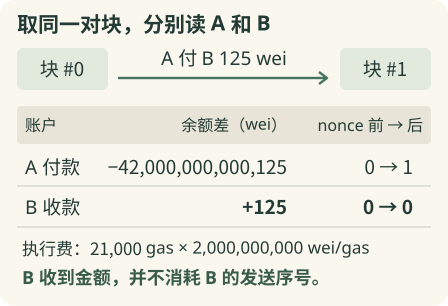

# 第 09 课 · 账户与执行：收款人的余额变了，为什么序号没动？

小店 B 在查 A-09，应收 A 的 **125 wei**（以太币的最小单位）。付款前后，屏幕上「B 发出过几笔」都是 **0**，余额也都显示 `10.0000 ETH`。客服能据此告诉 A「没收到，请再付一次」吗？

不能。第一栏数的是 B **发出的**交易，A 付钱不需要 B 发交易；第二栏只显示四位小数，看不出 125 wei。来看原账：前一块结束时 B 有 `10000000000000000000` wei；下一块只有一笔，就是 A 向 B 成功转入 125 wei，块末 B 有 `10000000000000000125` wei。两数相减正好 125，这张单在这个块里金额相符，不该催付。它还不是「这笔账已最终确定」的证明。

**只改实际转入额。** 订单仍要 125 wei，如果 A 只转 124 wei 且执行成功，怎么答？B 的发送笔数仍是 0，但同一对块上 B 只增加 124 wei：应记录「少 1 wei」，不是「没收到」，也不是「付清」。

只想读懂账页，可以[去第 10 课看付款人的发送序号怎样防止重复付款](nonce.html)。以下选做：在本地节点按区块查出这两笔余额读数。

先修是[第 04 课的链与节点核验](networks.html)。如果学过[第 06 课的 UTXO 对账](bitcoin.html)，留意这里没有要挑选的旧输出，也没有找零输出：以太坊执行层按地址维护状态。下面只看本地链上的**原生测试 ETH**，不读代币合约，不用真实钱包。[完整程序](accounts.py)与[共用启动器](anvil_lab.py)放在同一目录。

## 先定账页，再查地址

假设付款恰在两次查询之间入块。你先用 `latest` 查 A，拿到付款前的余额；再用 `latest` 查 B，拿到付款后的余额。两次请求都可能完全正确，拼起来却像「没人扣钱，商户多了 125 wei」。这与 Java 服务中两次读数据库不在同一版本的快照里，是同一类对账错误。把两个 RPC 放在一个批请求里，也没有让 `latest` 成为固定版本。

本课的读法是先取块头，记下 **`chainId`、高度、块哈希**。高度是位置，哈希才指向这一份区块；若当前主链发生重组，同一高度可能换成另一个块。对 A 和 B 的每次查询都传同一个 `{"blockHash": ..., "requireCanonical": true}`，这是 [EIP-1898](https://eips.ethereum.org/EIPS/eip-1898) 的区块选择器：按哈希取数据，要求节点在查询当下仍将它视为主链块。遇到不支持、缺历史状态、块不再在主链等错误，不能退回 `latest` 凑数；这一组快照不完整。即使这次读完了，也不意味着它今后不会被重组。

| 同一地址、同一块末尾，查什么 | 结果怎么读 | 不能据此判断什么 |
| --- | --- | --- |
| `eth_getBalance(address, at)` | 原生 ETH 余额，以整数 wei 表示。1 ETH = 10¹⁸ wei | 余额不是收款流水；不包含 ERC-20 余额，也不说明哪笔订单已付 |
| `eth_getTransactionCount(address, at)` | 账户的 `nonce`。本实验中普通外部账户发出并入块一笔交易，就消耗一个发送序号 | 收钱不会消耗发送序号；即便是付款方，也不能拿 nonce 增量代替成功回执 |
| `eth_getCode(address, at)` | 此块末尾该地址的代码字节；`0x` 是零字节，不是一个值为零的字节 | 空代码不证明这是某个客户的钱包、有人持钥，甚至不证明此地址在状态中已有账户记录 |
| `eth_getStorageAt(address, "0x0", at)` | 该地址持久存储的 **0 号槽**，返回一个 32 字节的字；本次全零 | 此槽为零不等于全部槽都为零，更不能从它推算余额。读合约变量要知道存储布局 |

账户记录承诺余额、nonce、代码哈希和存储根；上表后两项 RPC 分别取**代码本身**和**指定槽的内容**，不是直接打印两个根或哈希。响应里的 `0x0`（整数零）、`0x`（空字节串）、32 个零字节与查不到对象时的 JSON `null` 不是四种写法的同一个值。实验的两个账户来自本次 Anvil 创建的测试账户名单，这才是知道角色的来源。只给你一串陌生地址，不能拿这张表给它出具身份鉴定。反过来，有代码也不是万用分类器：支持 [EIP-7702](https://eips.ethereum.org/EIPS/eip-7702) 的链允许外部账户设置代码委托，并可在处理授权时增加 nonce；合约创建子合约时也会涉及创建者的 nonce。本实验固定 Cancun，无委托、无合约创建。

## 一笔外部交易，不等于一串独立转账

**外部交易**是可签名、可广播、可被选进区块的指令。本单的发送者 A 授权「给地址 B 转 125 wei」，使用 A 的当前序号。区块里的这笔普通直转没有额外数据，B 是没有代码的普通测试收款账户；不需要 B 签收，B 也没有发出第二笔交易。钱包能管理账户，却不是链上的账户本身。

换一个需求：A 不直接付 B，而是调托管合约 C；C 验收通过后，用 EVM 的 `CALL` 给 B 放款。**A → C** 是外部交易的入口；**C → B** 是执行期间的内部消息调用。后者使用这笔外部交易的执行预算，无须再向交易池广播一份 C 的签名，也不会多出一份有独立交易哈希和回执的链上交易。浏览器列的「内部交易」通常来自执行跟踪；不能只看外层 `to=C` 就断言 B 没收到，也不能只看到代码尝试过 `CALL` 就断言 B 已收到。子调用失败可能被调用方处理；若顶层执行回滚，内部转账效果也会回滚。通过 RPC 做 `eth_call` 又是另一件事：那是请求节点在给定状态上模拟一次调用，不是提交交易。托管例子是机制说明，本课没有部署 C。

**同样输入为什么能复算？** 执行客户端取同一父块末尾状态，使用相同的协议版本、区块上下文（如时间戳、费用参数）、同一批按相同顺序排列的交易及协议规定的块级输入，执行后应得到相同的新状态根。执行不是让每台机器各自读本地时钟或向商户 HTTP 接口问结果。例如 A 有两笔交易，后一笔需要用到前一笔消耗后才轮到的序号；把次序调换就不是同一输入。一个尚未获选为主链的候选块也可能执行正确：**算得对**与**最终采纳哪一页**是不同问题。

## 用 125 wei 做一对快照

工具：Python **3.11** 标准库、Foundry Anvil **1.7.1**、系统 `lsof`；缺 Anvil 可看[第 04 课工具说明](networks.html#network-tools)。从仓库根目录运行，`anvil` 在 `PATH` 中，或将环境变量 `ANVIL` 设为二进制的路径：

```bash
python3 labs/accounts.py
```

脚本只启动自己的 `127.0.0.1:18549`，链号 **31337**，区块规则 Cancun，两个临时解锁账户在创世状态各有 **10 测试 ETH**。`eth_sendTransaction` 在这个受控环境才让节点代测试账户签名；不要接第三方 RPC，也不要传入自己的密钥。节点只有本程序这一笔写入，自动出块，结束时清理。订单预先规定「发给本轮 B，原生 ETH，金额恰好等于 125 wei」；实际交易的 `value` 是另一个输入。

<figure class="lesson-figure"><a href="../assets/figures/m03/accounts-ledger.svg"></a><figcaption>默认输入的账页预期。余额差是「块 #1 末尾减块 #0 末尾」，不是两账户余额相减。两行用同一对块，支付额从 A 到 B，执行费只计在付款方支出。</figcaption></figure>

顺着 [accounts.py](accounts.py) 的三个动作看输出：

1. **先抄创世块的两行。** `snapshot` 从块头构造 `at`，将它交给四个状态 RPC，分别读 A、B，再把余额和 nonce 从十六进制整数转成十进制。Java 对应用 `BigInteger`，不要用 `double` 或 `long` 来减这两列：仅创世余额 `10000000000000000000` wei 就超过 `Long.MAX_VALUE`。屏幕上四舍五入的 ETH 只能展示，不能参加差额比较。
2. **证明两张余额表之间只有这一笔。** 从 `TX.block_hash` 找付款那一页，核对它就是第二行 `BLOCK` 的 `hash`；再拿那一行的 `parent_hash` 与第一行 `BLOCK.hash` 比。相等才是相邻两页，不用猜中间是否漏过一块。第二页还必须有 `tx_count=1`，且唯一交易的哈希、`from`、`to`、`value` 与本单相符，回执 `status=1`。在本轮两名普通账户、一次直转的条件下，这才足以把差额归于本单；真实区块可以混有别的付款、内部调用或费用收入，余额差不能自动充当单笔流水。
3. **对照两张账页。** 在付款块再次调用 `snapshot`。默认算例使用固定的 `gasPrice=2,000,000,000 wei/gas`；这种空数据普通直转用 `21,000 gas`，执行费为 `42,000,000,000,000 wei`。程序用回执的 `gasUsed × effectiveGasPrice` 得到费用，不把费用从 B 的收款额里扣。A 的余额差应为 `−125 − 42,000,000,000,000`，B 的应为 `+125`。B 的发送序号还是 `0`，所以「收款人 nonce 不动就拒绝入账」是错的。其他类型交易不应套用这份 gas 数字。

以下是默认运行的**部分预期字段**（省略位置用 `…` 表示）。地址、交易哈希和两个块哈希应留本轮真实整串，不会要求跨轮相同：

```text
ORDER chain_id=31337 payer=… payee=… due_wei=125
BLOCK height=0 hash=… parent_hash=… tx_count=0
ACCOUNT role=A height=0 address=… balance_wei=10000000000000000000 nonce=0 code=0x slot0=…
ACCOUNT role=B height=0 address=… balance_wei=10000000000000000000 nonce=0 code=0x slot0=…
TX hash=… block_hash=… from=… to=… value_wei=125 status=1 gas_used=21000 price_wei_per_gas=2000000000 fee_wei=42000000000000
BLOCK height=1 hash=… parent_hash=… tx_count=1
ACCOUNT role=A height=1 address=… balance_wei=9999957999999999875 nonce=1 code=0x slot0=…
ACCOUNT role=B height=1 address=… balance_wei=10000000000000000125 nonce=0 code=0x slot0=…
DELTA A_wei=-42000000000125 B_wei=125 A_nonce=1 B_nonce=0
MATCH_AMOUNT due_wei=125 received_wei=125
```

`MATCH_AMOUNT`（退出 0）只表示本地这个块里的付款符合金额要求，不是放货许可或 PoS 最终性证明。完整输出的 `slot0` 是 `0x` 后跟 **64 个十六进制零**，不是这里的省略号。

## 只改交易金额：零金额交易算不算执行过？

先预测 A、B 哪个序号会动、费用由谁承担。从同一个根目录另起一轮，订单应收仍是 125 wei，只把交易的 `value` 改成零：

```bash
python3 labs/accounts.py --value-wei 0
```

**预期判据：**回执仍为 `status=1`；A 只减少 `42,000,000,000,000 wei`，nonce 仍从 0 到 1；B 的余额和 nonce 均不动。最后一行 `HOLD_AMOUNT due_wei=125 received_wei=0`，退出 **3**。这不是节点拒绝交易，而是节点执行了用户真的提交的零金额指令，后续对账发现订单未收足。如果回执查不到、节点启动失败、状态读取报错，则没有这组证据，不要把异常也登记成「实收 0」。

## 谁决定这份状态还能不能改？

在以太坊 PoS 公网，**执行客户端（EL）**接收交易、按规则执行区块的执行载荷，核验新状态根，向应用提供余额、代码和回执等 RPC。**共识客户端（CL）**处理信标块及验证者的投票，按分叉选择规则跟踪链头，按检查点规则跟踪最终化；它与 EL 经 Engine API 交换载荷的有效性和所选链头等信息。普通全节点不质押也能独立校验区块；要参与提议、投票，还须有验证者客户端与质押。不能因为本机 EL 成功执行 A 发的交易，就代全网宣布哪个块已经最终化。

`eth_getBlockByNumber` 的三个标签是三个观察位置，不是三种交易状态。**同一次共识视图中**，最终化块是安全块的祖先（或同块），安全块是最新块的祖先（或同块）。留证时把所用标签解析成高度与哈希，不要把会移动的标签本身当凭证。

| 标签 | 你在问什么 | A-09 应怎样使用 |
| --- | --- | --- |
| `latest` | 节点此时采纳的最新执行块；新块会推进它，短期重组也可能换掉这一页 | 向用户快速显示「已在块中看到」；先不作不可撤销交付 |
| `safe` | 共识层给出的安全链头，在网络同步性与诚实参与等假设下不预期被重组，但不等于最终化 | 政策允许时出暂记对账单，并保留撤销路径；核对付款块在这条链上 |
| `finalized` | 共识层最近最终化的检查点所对应的执行块；其祖先也受这项最终性保障 | 若政策要求最终化，确认付款块就是该块或其祖先，再核业务条件；单看高度不够 |

例如，收据指向高度 42 的块 `X`；即使 `finalized` 的高度已到 44，若沿其父链回到 42 得到的是 `Y` 而非 `X`，仍不能给这份收据盖章。最终化依赖验证者按质押权重对检查点的投票与协议规则，正常推进需要代表至少三分之二权重的相应支持；它不是「再等固定 N 个块」的倒计时。节点未同步、标签不可用或最终化停滞，就保留待核，而不是改读 `latest` 冒充最终化。

脚本在 `DELTA` 后另查三个标签，逐条输出 `LOCAL_TAG tag=… height=… hash=…`，或明确记录 `result=null` / `rpc_error=…`。**这几行只描述本地 Anvil 如何回答接口。** 这里没有分布式验证者、没有按质押权重投票，也没有演练真实重组；即使三行偶然指向相同块，都不是公网的三重确认。区分执行有效、当前链头与最终化后，再读[第 12 课的回执状态](receipts.html)。

## 独立作业：复核一张少 1 wei 的回单

收银方仍坚持 A-09 应收 125 wei，同事只交来一句「B 的余额大于 125，交易也成功了」。请在仓库根目录执行 `python3 labs/accounts.py --value-wei 124`，不要用默认轮的哈希补作业。留存本轮 `ORDER`、两个 `BLOCK`、四个 `ACCOUNT`、`TX`、`DELTA`、三个 `LOCAL_TAG` 和末行判断；只交脚本打印的本地公开字段。另写给客服一句结论，解释为什么不能仅凭 B 的余额、nonce 或 `status` 核销。

**交接判据：**同轮 #1 的 `parent_hash` 对上 #0 的 `hash`，#1 的 `tx_count=1`，`hash` 对上 `TX.block_hash`，交易的 `to` 对上订单地址。在这一对块里，B 的整数余额差为 **124 wei**，nonce 差为 0；A 的余额差为 **−42,000,000,000,124 wei**，nonce 差为 1。订单差 **1 wei**，应输出 `HOLD_AMOUNT due_wei=125 received_wei=124`、退出 3。若误把块 #0 的 B 与块 #1 的 A 配成「付款后截面」，会漏记全部 **124 wei** 的 B 收款。圈出这两行不同的块号，指明换回哪一行。最后注明三条标签是本地观察；只交一张成功回执，不能说明收足或最终化。

## 协议与工具原文

- [Ethereum 账户字段](https://ethereum.org/en/developers/docs/accounts/)与[执行状态转换](https://ethereum.org/en/developers/docs/evm/#the-ethereum-state-transition-function)；[Solidity：Message Calls](https://docs.soliditylang.org/en/latest/introduction-to-smart-contracts.html#message-calls)。
- [JSON-RPC 的块参数与数据编码](https://ethereum.org/en/developers/docs/apis/json-rpc/#block-parameter)、[EIP-1898：用块哈希关联多次状态读取](https://eips.ethereum.org/EIPS/eip-1898)。
- [Engine API 的三个块哈希](https://github.com/ethereum/execution-apis/blob/main/src/engine/paris.md#forkchoicestatev1)、[节点中两类客户端的分工](https://ethereum.org/en/developers/docs/nodes-and-clients/)与[PoS 最终化](https://ethereum.org/en/developers/docs/consensus-mechanisms/pos/#finality)。
- [Anvil 官方概览](https://getfoundry.sh/anvil/overview/)：本地内存状态、预置余额与自动出块是实验条件，不是主网承诺。
