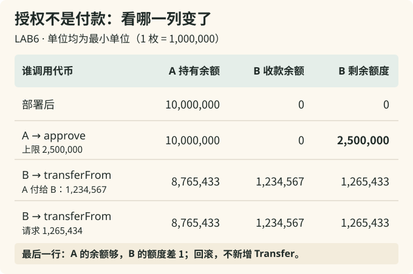

# 第 22 课 · 授权 2.5 枚，为什么一枚也没到账？

在 LAB6 的账本上，付款人 A 有 10 枚，商户 B 原有 0 枚。A 刚批准「B 最多可扣 **2.5 LAB6**」，这次操作也成功了。收银员打开凭单：B 可扣 2.5 枚，B 已收 0 枚。现在该把多少记为收入？

**记 0 枚。** 成功的是「设上限」这件事；钱还在 A 名下，也没有被冻结。只改一个条件：授权之后，B 又成功从 A 扣给自己 **1.234567 LAB6**。这回呢？B 实收 1.234567 枚，剩余可扣 `2.5 − 1.234567 = 1.265433` 枚。两栏各有用途：入账要查这次扣款的转移记录和两端余额；下次还能扣多少，才看剩余额度。

只想读懂授权凭单，可以[翻到第 23 课：报价和实际成交](swap.html)。以下选做：用两只自建代币和临时账户在本地复核成功扣款，再看超过限额一个最小单位的失败回执。无需连接钱包。[第 13 课](abi.html)教你辨认整数调用参数，[第 17 课](rpc.html)讲怎样按回执的块查账，[第 21 课](siwe.html)区分登录签名和付款许可。721、1155 和签名授权只用于对照，不对第三方资产写入。

## 把「谁可以扣」和「谁已经收到」分两列

把代币合约想成独立记账的账簿。`balanceOf(A)` 是 A 在**这一本账**里的余额，不是 A 的 ETH；`allowance(A,B)` 是 A 允许 B 作为调用者代扣的**剩余上限**。A 是持有人（owner），B 是获准调用 `transferFrom` 的地址（spender）。本例 B 同时是收款人，方便两账户对账；这不是协议限制。实际收款人是 `transferFrom(from,to,value)` 的 `to`，不必是 B。在一笔直接调用中，交易的 `to` 却是**代币合约**。把这三个角色都叫「目标地址」，页面就很容易展示错人。

`A → token.approve(B, cap)` 的作用是在该代币上写 `allowance[A][B] = cap`。它不是给 B 转账，不冻结 A 的余额，也不是给某个订单号预留资金。A 可以另行花掉自己的币。等到 B 自己调用 `token.transferFrom(A,B,x)`，合约才检查余额与额度，扣 A、加 B、减额度。在这份无手续费、供给固定的合约中，每笔成功扣款同时满足 **A 减少量 = B 增加量 = 本次消耗额度**。普通的 `A → token.transfer(B,x)` 则直接花 A 自己的钱，不消耗 B 的额度。

<figure class="lesson-figure"><a href="../assets/figures/m06/allowance.svg"></a><figcaption>看同一合约、同一对地址的三列整数。最后 A 有 8,765,433 个最小单位，够付请求；真正不够的是 B 在这份合约上的权限。</figcaption></figure>

`approve` 设的是新上限，不是给旧上限做加法。界面要列完整链号、代币地址、spender、数量与单位；用户换链或换账户就重新读取，不能用同名代币沿用旧决定。本例只从零授有限额度。实际需要替换已有非零额度时，ERC-20 建议客户端先设为零，确认回执、复核当前状态再设新值；这既不能撤回已发生的扣款，也不是对未来扣款时点的保证。普通 ERC-20 的额度没有标准到期时间，退出网站不会撤销它。

## 同样写着「授权」，有的管数量，有的管整套藏品

拿「只允许交付一件」这样的需求来对照。先确定链与合约，再决定要不要显示 ID、数量或整套资产的权限。一个 `approve(address,uint256)` 方法名甚至选择器，都区分不了 ERC-20 和 ERC-721 的业务语义。

| 合约问的是什么 | 为了交付，应该读什么 | 谁能做什么，凭什么验收 |
| --- | --- | --- |
| ERC-20：同一种币有多少个最小单位？ | `balanceOf(A)`、`allowance(A,B)`；若提供 `decimals()`，用它显示数量。无 `tokenId` | `approve(B,7)` 设 7 **个最小单位**的上限；`Approval` 不是到账，到账查匹配合约的 `Transfer` 与余额 |
| ERC-721：这一件编号 7 的物品归谁？ | `ownerOf(7)` 查唯一持有人；`balanceOf(A)` 只是这个系列中 A 有几件，不告诉你是哪几件 | `approve(B,7)` 指定这一件，`getApproved(7)` 查被授权者，物品转移时这项单件授权清除。`setApprovalForAll(B,true)` 却允许 B 操作 A 在此合约的所有 NFT，另查 `isApprovedForAll(A,B)` |
| ERC-1155：一个合约中的某类物品，某人有几份？ | `balanceOf(A,7)` 查 A 持有 ID 7 的份数；可用 `balanceOfBatch` 查询多组账户与 ID | 标准授权是 `setApprovalForAll` 的持有人／操作员开关，不是「ID 7 的 2 份」额度。单笔转移带 ID 与数量，批量转移把 ID 与数量按位置配对；查 `TransferSingle` 或 `TransferBatch` |

例如 A 持有 ID 7 的三张券和 ID 9 的一张券：这是可用 1155 表达的库存，不能用 `ownerOf(7)` 猜唯一持有人；也不能为了让商户收两张就把 operator 开关标成「最多 2 张」。721/1155 实现 ERC-165 接口声明，仍应以受信发布清单与 ABI 确定接入对象。对第三方资产只做只读核验；同一个 symbol 不表示同一个资产。ERC-20 的 `symbol`、`decimals` 都是可选元数据，读取失败应显示「精度未知」或原始单位，不擅自补 18。

## 同样 2.5 枚，两种精度怎样结算？

[LabToken.sol](m06/src/LabToken.sol) 构造时把固定供应量全部发给部署者，发出 `Transfer(0地址, 部署者, supply)`。`decimals` 只说明展示刻度，**转账参数和事件永远传整数**。两个实例各发 10 枚给 A，各给 B 上限 2.5 枚。下面是**默认输入的预期值**，地址、交易哈希、块哈希则必须来自自己这一轮。

| 资产 | 2.5 枚的上限（最小单位） | 已同意的第一笔扣款（最小单位） | 成功后 B 实收（枚） | 剩余可扣（枚） |
| --- | --- | --- | --- | --- |
| LAB6 · 6 位 | 2500000 | 1234567 | 1.234567 | 1.265433 |
| LAB18 · 18 位 | 2500000000000000000 | 1234567000000000001 | 1.234567000000000001 | 1.265432999999999999 |

在 LAB18 上，A 的余额应从 10 降为 **8.765432999999999999 LAB18**。第 18 位的 `1` 和 LAB6 的最小单位不是同一个量；两笔也不能因为显示前六位相同就合并。Java 从十进制文本用 `new BigDecimal(text).movePointRight(d).toBigIntegerExact()` 得到原始整数，再检查业务范围和 `uint256` 范围；展示时从 `BigInteger raw` 用 `new BigDecimal(raw, d).toPlainString()`。不经 `double`。本课 Python 直接拆文本、将小数部分右补零，例如 `1.25` 在 6 位资产上拼成 `1250000`；不接受比资产精度更长的小数字符串。归档中的原始数量用十进制**字符串**，不指望浏览器 `Number` 容下 18 位账。

## 从仓库根目录生成本轮凭单

依赖：Python 3.11 标准库、Bash、lsof、curl；[第 13 课工具准备](abi.html#m04-tools)的 Forge、Cast、Anvil **1.7.1** 与 solc **0.8.28**。工具备齐后无需联网、安装 Python 包或导入密钥。确保本机 **18622** 空闲。脚本只启动 `127.0.0.1:18622` 的内存链（Cancun，chain ID 31337），不接受外部 RPC；两账户各有 10 测试 ETH 付 gas，与 10 枚代币是不同的账。

```bash
export PATH="${XDG_CACHE_HOME:-$HOME/.cache}/chain-course/m04/bin:$PATH"
export FOUNDRY_SOLC="$(command -v solc)"
unset ANVIL
WORK=$(mktemp -d)
python3 labs/m06/allowance.py --out "$WORK/A22" --hold
```

终端 A 待命。把输出的 `VOUCHER=file:///…/voucher.html` 中完整的 `file:` 地址放进浏览器，打开**本轮**凭单。它会列出链、完整 owner 与 spender、两份代币合约地址、各自的上限和每一步结果。展开「查看交易和区块凭证」，可以抄下哈希；末尾链接的 `evidence.json` 保存原始 RPC 回执和块末读数。页面不请求钱包权限，不自动刷新；关闭标签页不会重发扣款。脚本在已存在的 `--out` 目录上会停止，换一个新目录保留新一轮，不覆盖旧账。

读[实验脚本](m06/allowance.py)的 `settle()`，按以下顺序对账。部署、带块号的 `eth_call`、写入与确认用[共用链工具](m06/chain.py)，不是浏览器本地改数字：

1. 对每个地址先读 `decimals()`，与此次部署期望精度一致才继续。部署块末读 `balanceOf(A)`、`balanceOf(B)`、`allowance(A,B)`，应是 `(supply, 0, 0)`。这对地址在第二个合约上的额度又从零开始；授权不会跨合约继承。
2. `send(rpc, owner, token, 'approve(address,uint256)', spender, cap)`：回执 `from=A, to=token, status=0x1`。要求惟一日志的发布地址就是这个 token，`topics[0]` 是规范签名 `Approval(address,address,uint256)` 的 Keccak-256，接着两项是左补零的 owner、spender，`data` 是 32 字节上限。该块 A、B 余额未动；只要拿这张回执去做收入，就会多记 2.5 枚。
3. 换成 **B 发交易**调用 `transferFrom(A,B,debit)`。源码读 `allowance[from][msg.sender]`，不是 `allowance[from][to]`。成功后核 `Transfer` 的发布者、签名、两个 indexed 地址与 `data` 的金额；再用这张回执的 `blockNumber` 同块读取三列，对照上表。ERC-20 并不要求 `transferFrom` 再发一条 `Approval`；只靠累加或倒推 `Approval` 日志不能得出现时额度。真实接入还须处理某些 ERC-20 方法返回 `false` 而没有 revert 的情况：写交易的顶层 `status=0x1` 不自带 ABI 返回值，本课合约成功则返回 `true` 并产生匹配事件。
4. 不重新授权。以 LAB6 为例，先读成功扣款那个块的三列原始整数：A 还有 `8765433`，B 实收 `1234567`，额度只剩 `1265433`。现在 B 请求 `1265434`，即 **1.265434 LAB6**。A 付得起，B 却多要了一个最小单位；按本合约的检查顺序，失败的是额度检查。脚本用 `send(..., success=False)` 等一张已打包的 `status=0x0` 回执，不把发送前的费用预估当回执。对照失败前后的三列：全都没动，`logs=[]`，只有 `gasUsed` 非零。B 花了 ETH 作执行费，却没多收到一份 LAB6。

本课每次调用只涉及这一份已知源码的单层代币，成功调用各有一条相关日志，无转账税、弹性供应或手续费扣币。`status=0x0` 本身不含可读失败原因；这里能定位额度，是因为事先知道代码检查顺序、调用参数、块前余额和额度。线上处理多合约交易不能套用「取第一条日志」或「从输入值推到账」的捷径。

## 关掉页面，怎么按哈希找回结果？

保持终端 A 的 `--hold` 未回车，但**关闭凭单标签页**。到终端 B（仓库根目录），粘贴 A 打印的 `ARCHIVE=` 后面的绝对路径。这里模拟客服只剩工单中的一个哈希：先从归档定位 LAB18 的超额请求，再**向活节点**查它，不是渲染本地成功提示。

```bash
printf '本轮 ARCHIVE 路径：'; IFS= read -r R
TX=$(python3 -c 'import json,sys; print(json.load(open(sys.argv[1]))["assets"][1]["steps"]["over"]["receipt"]["transactionHash"])' "$R/evidence.json")
curl --noproxy '*' -fsS http://127.0.0.1:18622 -H 'Content-Type: application/json' \
  --data "{\"jsonrpc\":\"2.0\",\"id\":22,\"method\":\"eth_getTransactionReceipt\",\"params\":[\"$TX\"]}" \
  > "$R/recovered.json"
python3 - "$R" <<'PY'
import json, sys
from pathlib import Path
p = Path(sys.argv[1]); archive = json.loads((p / 'evidence.json').read_text())
a = archive['assets'][1]; old = a['steps']['over']['receipt']
wire = json.loads((p / 'recovered.json').read_text())
assert 'error' not in wire and wire['id'] == 22
r = wire['result']; assert r is not None, '本节点现在没有该回执'
assert (r['transactionHash'], r['blockHash']) == (old['transactionHash'], old['blockHash'])
assert r['from'].lower() == archive['spender'].lower() and r['to'].lower() == a['token'].lower()
assert r['status'] == '0x0' and not r['logs'] and int(r['gasUsed'], 16) > 0
print('已找回失败凭证：', r['transactionHash'], r['blockHash'], 'status=' + r['status'])
PY
```

想独立核一次精度？仍在终端 B，从本轮归档取地址和原回执块号，发只读调用。下列三个输出应依次为 `18`、`1234567000000000001`、`1265432999999999999`（后两个是默认输入下的最小单位；Cast 可能另附科学计数提示）。这不是重新执行历史交易，是在指定块末读合约的状态。

```bash
export PATH="${XDG_CACHE_HOME:-$HOME/.cache}/chain-course/m04/bin:$PATH"
read -r TOKEN A B HEIGHT < <(python3 - "$R/evidence.json" <<'PY'
import json, sys
r = json.load(open(sys.argv[1])); t = r['assets'][1]
print(t['token'], r['owner'], r['spender'], int(t['steps']['over']['receipt']['blockNumber'], 16))
PY
)
RPC=http://127.0.0.1:18622
cast call "$TOKEN" 'decimals()(uint8)' --block "$HEIGHT" --rpc-url "$RPC"
cast call "$TOKEN" 'balanceOf(address)(uint256)' "$B" --block "$HEIGHT" --rpc-url "$RPC"
cast call "$TOKEN" 'allowance(address,address)(uint256)' "$A" "$B" --block "$HEIGHT" --rpc-url "$RPC"
```

回到 A 按回车关闭节点。归档此后仍可离线阅读，但重启出的另一条 31337 内存链不是本轮历史。查不到旧哈希可能是错实例、未见、节点离线等问题，不等于「已失败」；应分别处理 RPC 错误、`result:null` 与真实失败回执。别为了找旧状态就在新链重发原订单。

## 如果产品说「签一下免 gas」，哪一步才改链？

本课代币走普通 `approve`，**未实现 permit**。支持 [ERC-2612](https://eips.ethereum.org/EIPS/eip-2612) 的代币才可走下列协议路径；这些是规范步骤，不是上面实验多跑出来的一组回执。

1. 钱包先读取该代币的 `nonces(owner)` 与签名域，展示 EIP-712 的域与 `Permit(owner,spender,value,nonce,deadline)`。常见域含名称、版本、`chainId` 与 `verifyingContract`；按该合约实际域核验。`value` 是上限的最小单位，`nonce` 是此合约对这个 owner 的授权序号，**不是账户的交易 nonce**；`deadline` 是签名可提交的最后区块时间（Unix 秒）。
2. owner 在链下签结构化消息，给出可提交的签名。仅签名不会写 `allowance`、不会发 `Approval`，也没有交易哈希。但它不是「无害登录」：有效且未到期的签名可以由别人提交。不要把签名当作作业证据对外分享。用户拒签，本次流程应停止。
3. owner 或中继者另发链上交易调用 `permit(owner,spender,value,deadline,v,r,s)`，提交方付原生币 gas。合约确认非零 owner、签名对应该域与当前 nonce、`block.timestamp <= deadline`，才将额度**设为 value**、nonce 加一、发 `Approval`。过期或 nonce 不符会 revert。同一份签名的提交截止时间，**不是已建立额度的自动失效时间**。
4. 扣款仍靠 `transferFrom`；可由业务合约在一笔交易中先应用 permit 再扣款，但这两步的含义和证据不能合并成「签了就到账」。[第 21 课](siwe.html)的 SIWE 签的是网站登录挑战，既不创建这个 allowance，也不能拿来替代 `permit`。界面至少分「已签、待提交」「授权已上链」「已扣款」；合约或域不匹配就不发起签名。

## 独立作业：额度刚好用尽，另一只币只扣最小一份

先在纸上写好两笔可扣金额和两笔超额请求，再在**关闭前一轮后**从根目录另开新链。用上面终端 A 的工具环境，运行：

```bash
WORK2=$(mktemp -d)
python3 labs/m06/allowance.py --out "$WORK2/edge" --spend6 2.5 --spend18 0.000000000000000001 --hold
```

提交新 `voucher.html`、`evidence.json`、用新 `ARCHIVE` 恢复的 `recovered.json`。另列两行：合约地址、decimals、被授权者、超额请求的 raw、失败交易及块哈希、失败块末双方余额和额度。不要提交节点目录、助记词、私钥或钱包签名。

**判据：** LAB6 的合法扣款用光额度，A / B / 额度为 **7.5 / 2.5 / 0 LAB6**，再要 **1 个最小单位**也不行。LAB18 只收 **1 个最小单位**，A 余 **9.999999999999999999 LAB18**，授权余 **2.499999999999999999 LAB18**，再要整 **2.5 LAB18** 时仍差 1；两笔失败都不留 `Transfer`。换回各自资产的原始整数能复算，不把两个实验实例的地址混在一行。最后尝试 `python3 labs/m06/allowance.py --spend6 0.0000001`：应在启动节点前报告精度错误，无交易哈希；说明这与有哈希的真回滚有什么不同。演练后回车停链。

## 查证原文

- [ERC-20：可选 decimals、bool 返回值、approve 与 Transfer/Approval](https://eips.ethereum.org/EIPS/eip-20)。
- [ERC-721：ownerOf、单件授权及 operator](https://eips.ethereum.org/EIPS/eip-721)；[ERC-1155：按 ID 查余额、批量转移与全量操作权](https://eips.ethereum.org/EIPS/eip-1155)。
- [EIP-712：结构化数据与域](https://eips.ethereum.org/EIPS/eip-712)；[ERC-2612：permit 的参数、nonce 与 deadline 条件](https://eips.ethereum.org/EIPS/eip-2612)。
