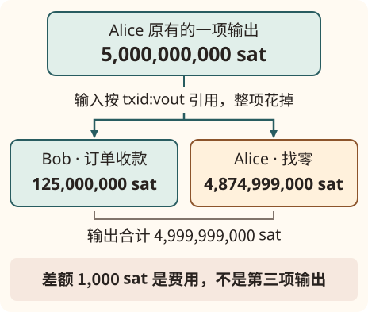

# 第 06 课 · 亲手核对一笔付款：Bob 收到 1.25 BTC，为什么 Alice 少了更多？

Alice 说她付了 `1.25 BTC`。Bob 的订单应收 `125000000 sat`，钱包也收到这么多；Alice 的钱包却少了 `125001000 sat`。客服问：「差的 `1000 sat` 是不是从货款里扣的？现在能发货了吗？」先把这笔钱对平，再把付款凭证与订单相对：即使一笔交易合法、已入块，只要订单多要 1 sat，也不能按足额付款放行。

先修 M01 与第 05 课的确认数。沿用上一课的本地 regtest，但这次不盯链尖，改做一张能回到前序交易的付款凭证。金额全程用整数聪（sat）：`1 BTC = 100000000 sat`。Alice、Bob 是两个钱包，不是两个节点验证者；`miner` 是第三个专收后续奖励的钱包，不参加买卖。没有真实资金。

## 一笔钱进来，几笔钱出去？

假设你在 Java 里建账：不要先给 Alice 写一行 `UPDATE balance`。先用一行列出她将花掉的旧输出，再给这次交易的每项新输出各开一行。原来的 50 BTC 整项消耗：不是只剪下 1.25 BTC，其余继续留在原行。

<figure class="lesson-figure"><a href="../assets/figures/m02/06-payment-ledger.svg"></a><figcaption>按默认订单绘制。横向两格才是新输出；下方是对它们求和后算出的差额。谁是 Bob，要用他的订单收款脚本认，不能按格子大小认。</figcaption></figure>

这个账页只解开了第一问：Bob 拿足货款，Alice 的减少额还包括矿工可领取的费用。下面用真实的 RPC 回答更难的三问：输入金额不是自己编的吗？哪一项真属于 Bob？两个钱包是不是在说同一个区块里的同一笔付款？

<a id="bitcoin-tools"></a>

## 准备环境：四课共用的 Core 工具

使用 macOS、Linux 或 WSL2 的 Bash、Python **3.11**（仅标准库）和带钱包支持的 Bitcoin Core **30.5**。本节命令都从**仓库根目录**开始。`labs/` 中必须同时有[安全入口 bitcoin.sh](bitcoin.sh)、[付款逻辑 bitcoin_payment.py](bitcoin_payment.py)、[临时节点与单位换算 regtest.py](regtest.py)；只有网页时，在一个空目录下建 `labs/` 并把三份原文件放进去，该空目录就是这里的根目录。**不能只下载 `.sh`。**

已有对应版本且 `bitcoind`、`bitcoin-cli` 都在 `PATH`？直接运行下面三行。入口不接受地址、端口或钱包参数；想保存本次凭证，可用 `bash labs/bitcoin.sh > payment.txt`。

```bash
bitcoind --version
bitcoin-cli --version
bash labs/bitcoin.sh
```

**没有安装 Core？** 在同一个 Bash 终端从根目录执行下面整段；需要 `curl`、`tar`、`awk` 以及 `shasum` 或 `sha256sum`。归档与校验清单取自官方同一发行目录，程序解到新建的临时工具目录，不全局安装。最后的 `export` 在**当前终端**生效，后面四课都能找到工具。摘要一致只能排除与清单不符的归档，不能独立证明清单的发布者；需要验证来源时，请在解包前按[官方签名验证指南](https://bitcoincore.org/en/download/#verify-your-download)用已核对指纹的发布者公钥验证同一版本的清单签名。

```bash
btc_course_tools=$(mktemp -d)
(
  set -eu
  cd "${btc_course_tools:?未能建立工具目录}"
  case "$(uname -s)/$(uname -m)" in
    Darwin/arm64)  target=arm64-apple-darwin ;;
    Darwin/x86_64) target=x86_64-apple-darwin ;;
    Linux/x86_64)  target=x86_64-linux-gnu ;;
    Linux/aarch64) target=aarch64-linux-gnu ;;
    *) echo '此架构请在官方发行目录选择兼容的程序包。' >&2; exit 1 ;;
  esac
  base=https://bitcoincore.org/bin/bitcoin-core-30.5
  pkg=bitcoin-30.5-$target.tar.gz
  curl --fail --show-error --location -o "$pkg" "$base/$pkg"
  curl --fail --show-error --location -o SHA256SUMS "$base/SHA256SUMS"
  awk -v name="$pkg" '$2 == name {print}' SHA256SUMS > selected.sum
  test -s selected.sum
  if command -v sha256sum >/dev/null; then
    sha256sum -c selected.sum
  else
    shasum -a 256 -c selected.sum
  fi
  tar -xzf "$pkg" bitcoin-30.5/bin/bitcoind bitcoin-30.5/bin/bitcoin-cli
)
if [ "$?" -eq 0 ]; then
  export PATH="$btc_course_tools/bitcoin-30.5/bin:$PATH"
else
  echo '工具未安装成功；请先处理上面的下载、校验或解包错误。' >&2
fi
```

然后仍在根目录运行 `bash labs/bitcoin.sh`。`btc_course_tools` 只装工具，不是钱包数据目录。关闭终端会丢失这次 `PATH` 设置；用完本卷，可删除这个新建的临时工具目录。不需要 JDK、交易所账户、API Key 或水龙头；只有下载工具需要联网。

程序在新的临时数据目录里创建三个空钱包：`alice` 付款、`bob` 收款、`miner` 接收后续出块奖励。RPC 只走 `127.0.0.1` 的临时端口，使用目录内的认证 cookie。先看 `NODE`：程序会检查 `chain=regtest height=0 networkactive=False peers=0`，不符就不创建钱包；另用 `version=300500` 核对本课工具版本。程序不读取日常钱包，不打印私钥、助记词或认证信息，结束时会关闭子节点并清除临时目录。**不要另开一个不带这些隔离参数的 `bitcoin-cli` 来补做某一步。**

## 从一笔区块奖励找到能花的钱

账户系统常有一行 `account.balance`。比特币节点验证的却是 **UTXO（未花费的交易输出）**：过去某笔交易中的一项输出，有金额和“谁能花”的锁定条件。它的主键是 `(txid, vout)`，即交易号和从 0 起算的输出序号。一个钱包可以控制许多输出；钱包余额是按归属、成熟度、确认状态等规则算出来的视图，而不是链上可直接扣减的字段。

在新链上没有存款。脚本用 `generatetoaddress` 先生成一个区块，指定把奖励给 Alice。区块里的第一笔特殊交易叫 **coinbase**，不从某个老用户扣款。后续奖励全部发给 `miner`，这样 Alice 和 Bob 的对账单不会混入额外收入。

从[上一课的成熟度记录](confirmations.html)接过这张付款单。高度 100 时，Alice 的钱包还能看到 `5000000000 sat` 未成熟收入，却选不到输入；高度 101 时，看 `MATURITY` 的 `trusted_sat=5000000000 selectable=1`。这是本次付款能选中旧输出的起点，不是给 Bob 放货的门槛。

找 `UTXO` 行。`listunspent` 是钱包的选币候选；`gettxout(txid, vout)` 是节点的当前未花费输出查询。脚本让两者的金额、旧主键对上，并检查 `coinbase=True` 和原收款地址确实是 Alice 的。记录自己的**奖励** `txid:vout` 和 `input_sat`，别抄作稍后的**付款**交易号。付款一旦确认，旧输出就不能再从当前 UTXO 集查到了。

## 从签名后的输入，倒查它到底值多少

这笔交易恰好只有一个输入。`createrawtransaction` 用旧主键作 `vin`；Bob 的货款和 Alice 的找零写进新的 `vout`。它不签名、不广播，也不会自动补找零。不设找零又保持 Bob 的输出不变，巨大差额就成了所构造交易的费用，而不是钱包里没动的钱（节点或钱包的高费用保护可能会拦住提交）。

现在看交易，先盖住 Alice 的余额。**输入 `vin` 给你的是索引，不是金额**；用签名后实际解码的 `vin.txid` 找前一笔交易，再用 `vin.vout` 选它的特定输出：

```python
vin, = tx['vin']  # 这里已用 decoderawtransaction 解码真正的签名结果
parent = rpc('getrawtransaction', vin['txid'], 1, reward_block)
prev = parent['vout'][vin['vout']]
prev_sat = sat(prev['value'])
```

`1` 是详细程度；`reward_block` 是第一次出块时记录的区块哈希，所以无需 `txindex`，也不需要上网找浏览器。`PREVOUT` 给出这个块哈希、前序交易号、输出序号、前序金额和脚本；和先前 `UTXO`、稍后 `SIGNED` 的引用逐项连起来。旧 UTXO 被花掉不会抹掉包含它的历史交易。换成多输入，必须对**每个** `vin` 重做这次连接，再对金额求和；不能拿其中某个钱包的余额代替。

旧输出的条件是原生 P2WPKH（第 07 课展开脚本）。`signrawtransactionwithwallet` 让 Alice 在钱包里签名；解码后的 `scriptSig` 是空的，`txinwitness` 才有两项：签名（含签名哈希类型字节）和公钥。`SIGNED` 记录它们的字节数，脚本还把第二项与 Alice 原收款地址的公钥相对。节点会检查公钥哈希是否匹配旧输出，再用公钥校验签名。两个栈项不是“两份签名”，一串公开的 `txid:vout` 也不是花费授权。此时 `complete=True`，Bob 还没有任何确认。

## 谁拿了找零？费率又是多少？

本实验先由 Bob 自己生成订单地址，再由 Alice 调 `getrawchangeaddress` 取内部找零地址。`getaddressinfo` 给出各自地址对应的输出脚本，Alice 的钱包还告诉你 `ischange=True`。拿 `OWNERSHIP` 两个脚本与两条 `OUTPUT.script_hex` 逐字节匹配，不按位置、重复出现的地址或金额大小猜。陌生人若只有原始交易，看不到 Alice 钱包里的“内部找零”标记。拿到实测的 `n` 后，Bob 的收款凭证应指向**付款 txid:n**，不是旧奖励的主键。

| 从终端抄取 | 对账含义 | 预期值 / sat |
| --- | --- | --- |
| `PREVOUT.value_sat`（同时核对 `UTXO.input_sat`） | 旧输出的全部金额 | 5000000000 |
| `OUTPUT` 中匹配 `bob_receive` 的 `value_sat` | Bob 收款 | 125000000 |
| `OUTPUT` 中匹配 `alice_change` 的 `value_sat` | Alice 找零 | 4874999000 |
| 输入和减输出和 | 留给打包矿工的手续费 | 1000 |

脚本在构造时指定 `1000 sat` 的**绝对费用**。`btc()` 只在 RPC 边界把整数 sat 写成 BTC 十进制字符串；读回用 `sat()` 精确还原，不经 `double`。解码后再从前序金额减去**所有**输出，得 `5000000000 − (125000000 + 4874999000) = 1000 sat`；这个算式不依赖钱包声称的费率。`testmempoolaccept` 对同一份签名交易按本节点当前规则做预检，再独立读出 `fees.base` 与复算值相对。`allowed=True` 表示它此刻可被本机接纳，不等于已经广播。

**绝对费用不等于单价。** 看 `PREFLIGHT.vsize`（虚拟字节，vB；含见证时不等于裸交易文件长度），再算 `fee_sat / vsize`。例如如果是 `141 vB`，`1000 / 141 ≈ 7.092 sat/vB`。这是算例，实测按自己那次的 `vsize`；`rate_sat_vb` 仅在显示时保留三位小数。不要把单价乘回去的舍入数当作原始 sat，更不要把这个实验费率当作主网报价。

## 跟同一笔付款，看两个钱包的回执

1. **本机受理**：`sendrawtransaction` 将已签名交易交给本节点，返回付款 `txid`，与旧奖励的 `txid` 不同。`getmempoolentry` 能按这个新 ID 查到交易。此时 `MEMPOOL` 中 Bob 的 `confirmations=0`、`bob_pending_sat=125000000`。内存池是本节点尚未入块的候选集合，不是账本的另一个名字。
2. **进入区块**：再挖第 102 块，奖励仍给 `miner`。`getblock` 从该块的交易列表找到付款（`BLOCK.includes_tx=True`）；不含内存池地用 `gettxout` 回查旧主键，已是空值（`old_utxo_spent=True`）。要把这笔支出与收入配成一对，分别在 `wallet='alice'` 和 `wallet='bob'` 调 `gettransaction(付款 txid)`。比较两条 `RECEIPT`：`txid` 相同，两边的 `blockhash` 都等于 `BLOCK.hash`，双方 `confirmations` 都是 1；脚本还要求两个钱包的 `lastprocessedblock.hash` 都等于此次观察的链尖。只比相同的高度不够，两条分支可能同高不同块。
3. **核算到账**：Alice 回执的 `amount_sat=-125000000` 是货款，`fee_sat=-1000` 是另外支付的费用；Bob 的 `category=receive` 明细中，`vout`、`address`、`amount_sat` 应与解码出的 Bob 输出一致。再抄 `BALANCES` 四个数，分别算 `Bob 后 − Bob 前`、`Alice 前 − Alice 后`。两个钱包没有其他买卖收入，后续奖励也进了独立钱包，所以这次余额差可以用来交叉检查；有并发转账的生产钱包不能用“余额刚好变了”给特定订单归因。

第 103 块仍给 `miner`，不再次付款。脚本用**原付款 txid** 重查两个钱包。交易的包含块仍是第 102 块，观察链尖才是 103，控制台应有 `DEPTH height=103 confirmations=2`。节点退出并删掉临时钱包后，账对平会给出：

```text
PASS bob_credit_sat=125000000 alice_debit_sat=125001000 difference_sat=1000
```

`PASS` 证明本实验交易账对平，**不是**对任意订单发货的口令。每次地址、交易号、区块哈希可能变化；比较引用关系和金额不变量，不比截图中的随机字符串。提交交接时至少保留网络、前序主键、收款输出主键、脚本、金额、包含块哈希、观察高度与两端确认数。记账可按 `(网络, txid, vout)` 标识收款输出，避免重复轮询反复计入；确认数会随链重组回退，不是永久状态。

## 不改交易，只改订单，会改哪一行？

现在固定证据：收款脚本是 Bob 在付款前给出的脚本，Bob 的收款明细是 `125000000 sat`。账务方另存了 `ORDER_DUE_SAT`，不能从到账金额倒填“应收”。本工单要求**金额恰好匹配、至少 2 个确认**。付款实验把同一证据套入原约定和一个反事实约定，不是拿这笔钱核销两个订单。默认输入应得到：

| 观察时点 | 应收 / sat | 实收 / sat | 实收减应收 / sat | `ORDER.decision` |
| --- | --- | --- | --- | --- |
| 102，原订单 | 125000000 | 125000000 | 0 | `WAIT_DEPTH`：只有 1 个确认 |
| 103，原订单 | 125000000 | 125000000 | 0 | `MATCH` |
| 103，假设订单原先就多要 1 sat | 125000001 | 125000000 | −1 | `HOLD_SHORT`：少付，不放行 |

最后两行对应同一份链上凭证；没有重签、没有多挖、手续费也没变。多付则返回 `HOLD_OVER`，交人工按约定处理；“金额不符”不等于节点拒绝交易。这里已经先核对网络和收款脚本；仅比较金额和深度，无法识别钱付给了别人。

## 故障定位：先找最后一条证据

| 现象 | 先查什么 | 怎么处理 |
| --- | --- | --- |
| 缺少 `bitcoind` / `bitcoin-cli`，或启动时有架构错误 | 用 `command -v` 查看两个程序，`uname -sm` 查看系统架构 | 在 Bash 中用本页对应架构的官方归档；不要用只有图形应用的包代替两个命令。WSL2 使用 Linux 包。 |
| 归档校验不通过或 `selected.sum` 为空 | 文件名、版本、清单是否属于同一官方发行目录 | 丢弃该次下载，重新从官方目录取得归档与清单；不要跳过校验继续解压。 |
| RPC 启动超时，或 `NODE` 不满足前提 | 查节点启动时的首条错误、回环端口和系统临时目录权限 | 确保允许本机回环监听、临时目录可写；重新运行让脚本分配新端口，不要改连既有节点。 |
| 看到奖励但没有可选输入 | 看 `MATURITY` 的链高、`immature_sat`、`selectable` | 第 100 块仍为 0 是预期；等脚本生成第 101 块。不要导入有钱的真实钱包。 |
| 预检拒绝交易或金额对不上 | 看 `SIGNED` 的旧主键及 `OUTPUT` 两个地址，再按 sat 复算 | 恢复脚本原值；不要用浮点数或把 sat 直接作为 RPC 的 BTC 金额。 |
| `confirmations=0`，看到了交易却没有确认入账 | 区分最后一行是 `MEMPOOL`、`BLOCK` 还是 `DEPTH` | 不要据 `txid` 判定成功；让脚本完成两次观察和订单比对。中断可从零重跑。 |
| `PASS` 出现，却有 `HOLD_SHORT` | 比较 `ORDER.case`、`due_sat` 与 Bob 明细 `amount_sat` | 若是 `counterfactual`，这是有意的少付边界，不要让矿工再确认一次来“补钱”。 |

## 独立作业：少付一聪，账是不是仍然平？

**先交原单。** 从仓库根目录执行 `bash labs/bitcoin.sh > payment.txt`。遮住 `PREFLIGHT`、`ORDER` 和 `PASS`，从 `PREVOUT`、两行 `OUTPUT` 和 `BALANCES` 各算一次手续费；从两行 `RECEIPT` 和 `BLOCK` 写出“哪一块里，谁实际收了哪个输出”。若不能指出奖励主键与收款主键的区别，不能用 `txid` 截图代替。

**答案**：旧输入减输出为 `5000000000 − 125000000 − 4874999000 = 1000 sat`。从钱包侧再算一次：Alice 支出 `125001000` 减 Bob 净增 `125000000`，同样为 `1000 sat`。两端余额只在没有其他奖励和转账干扰时能这样直接对账，这正是让后续奖励都进 `miner` 的原因。

**再交异常单。** 这次不提高应收，模拟付款方少付：把三份源码拷到一个新目录（仍保留 `labs/`），只把副本 `bitcoin_payment.py` 中的 `PAY_SAT = 125_000_000` 改成 `124_999_999`，不动独立的 `ORDER_DUE_SAT`、手续费和确认门槛。下面是根目录下的准备和运行命令，两段之间用编辑器完成上述一处修改：

```bash
work=$(mktemp -d)
mkdir "$work/labs"
cp labs/bitcoin.sh labs/bitcoin_payment.py labs/regtest.py "$work/labs/"
```

```bash
bash "$work/labs/bitcoin.sh" > "$work/short.txt"
```

**验收判据**：从 `short.txt` 提交 Bob 的实际 `txid:vout`、前序主键、两项输出、包含块哈希，以及 103 高度的原订单差异。Bob 应收 `125000000`，实得 `124999999`；找零 `4874999001`，Alice 净减 `125000999`，费依旧 `1000 sat`。双方都认可同一付款且确认数达到 2，`case=agreed` 却仍 `delta_sat=-1 decision=HOLD_SHORT`。若程序靠等第三个确认或把费用补进货款才让账“平”，判定不合格。交两份文本日志即可，不交钱包、密钥或 RPC 凭据。

**换一个方向自查**：如果在副本里改为付 `200000000 sat`，原订单仍不动，找零应为 `4799999000`，Alice 净减 `200001000`；测得 `HOLD_OVER` 才与“精确匹配”的规则相符。新的实验钱包和交易不应要求复现旧 txid。

## 官方资料

- [Bitcoin Core 30.5 官方发行归档与校验清单](https://bitcoincore.org/bin/bitcoin-core-30.5/)；[官方安装及签名验证说明](https://bitcoincore.org/en/download/)。
- [Bitcoin 开发者指南：交易与未花费输出](https://developer.bitcoin.org/devguide/transactions.html)；[开发者示例：regtest 与 101 个区块](https://developer.bitcoin.org/examples/testing.html#regtest-mode)。
- [Core RPC：listunspent](https://bitcoincore.org/en/doc/30.0.0/rpc/wallet/listunspent/)、[gettxout](https://bitcoincore.org/en/doc/30.0.0/rpc/blockchain/gettxout/)、[getbalances](https://bitcoincore.org/en/doc/30.0.0/rpc/wallet/getbalances/)：分别查钱包候选、节点 UTXO 集及钱包余额分类。
- [Core RPC：getrawtransaction](https://bitcoincore.org/en/doc/30.0.0/rpc/rawtransactions/getrawtransaction/)：用明确的块哈希取出前序交易；[getaddressinfo](https://bitcoincore.org/en/doc/30.0.0/rpc/wallet/getaddressinfo/)：区分地址可推导的脚本和钱包专有的归属信息。
- [Core RPC：signrawtransactionwithwallet](https://bitcoincore.org/en/doc/30.0.0/rpc/wallet/signrawtransactionwithwallet/)、[testmempoolaccept](https://bitcoincore.org/en/doc/30.0.0/rpc/rawtransactions/testmempoolaccept/)、[gettransaction](https://bitcoincore.org/en/doc/30.0.0/rpc/wallet/gettransaction/)：核对签名完整性、节点预检和钱包收款记录。
- [BIP 141：P2WPKH 见证与虚拟大小](https://github.com/bitcoin/bips/blob/master/bip-0141.mediawiki)：两项见证的条件、weight 与 vsize 的定义。上述 RPC 在线手册导出自 30.0 系列；本课二进制固定为 30.5，以对应版本命令帮助为准。
