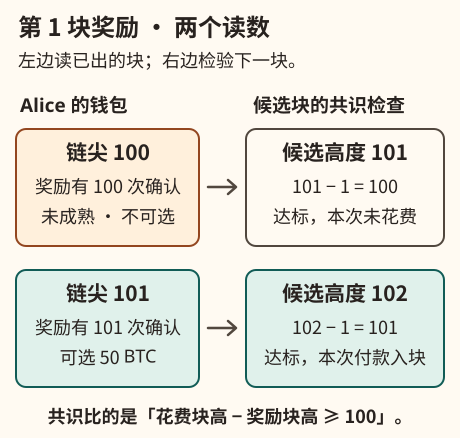
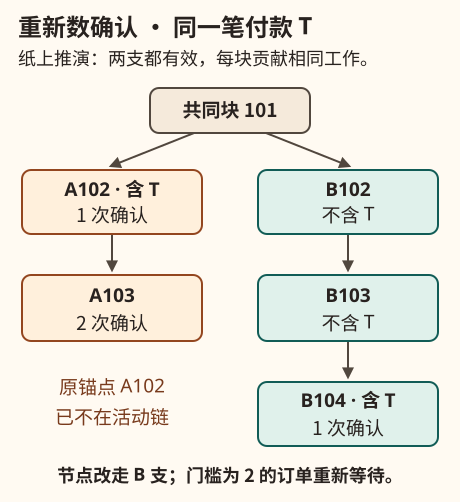

# 第 05 课 · 链、工作量与确认

Bob 的仓库约定：这张订单要收到 **1.25 BTC（125,000,000 sat）**，而且至少有 **2 次确认**才发货。收款员已核对收款地址和金额：货款记在第 102 块。放货单左栏是刚出第 102 块时的记录，右栏是同一条链又接上第 103 块时的记录。仓库第一次能发货吗？第二次呢？

**第一次等，第二次可以发。** 付款所在的块就算第 1 次确认；沿同一条链，在它后面再接一块，才到第 2 次。右栏的「2 次确认」不是 Bob 收了两笔钱，也不保证这笔记录以后绝不会变。

**只改订单：**仓库如果要求 **3 次确认**，拿右栏同一张记录，还能发吗？不能。收款金额没变，但眼下只有 2 次，还差一次。门槛由商户约定，不是比特币规定每个仓库都等几块。

只想读懂放货单，可以直接去[第 06 课：怎么核对这笔钱确实付给了 Bob](bitcoin.html)。以下是选做实操。先用[第 04 课的方法判断节点是不是本机的练习链](networks.html)，再分别观察第 1 块给 Alice 的奖励何时能花、Bob 收到的货款何时能放行。这是两笔交易，不共用一个确认数。

## 先取证：用同一次运行留下四组读数

在仓库根目录打开 Bash。需要带钱包的 Bitcoin Core **30.5**（`bitcoind`、`bitcoin-cli` 都在 `PATH`）、Python **3.11** 标准库和 `grep`；缺 Core 可先看[工具准备](bitcoin.html#bitcoin-tools)。[启动入口 bitcoin.sh](bitcoin.sh) 调用[双钱包付款实验](bitcoin_payment.py)，其[临时节点启动器](regtest.py) 使用新的数据目录，RPC 只走回环，断开 P2P。不要传自己的地址、钱包或数据目录。装好工具以后可以断网做。

```bash
bitcoind --version
bitcoin-cli --version
python3 --version
log=$(mktemp "${TMPDIR:-/tmp}/btc-05.XXXXXX")
bash labs/bitcoin.sh > "$log" && grep -E '^(NODE|MATURITY|MEMPOOL|BLOCK|RECEIPT|DEPTH|PASS) ' "$log"
printf '实验日志：%s\n' "$log"
```

只在脚本成功、日志末有 `PASS` 时继续；若中断，留下的是不完整的运行，不是「零确认」的证据。保持这个终端开着，后面的 `$log` 就是刚才那份文件。先核对 `NODE`：是全新的 `regtest`、没有对等连接。`MATURITY` 的主语是 Alice 的奖励；从 `MEMPOOL` 到 `DEPTH` 跟的是 Bob 的同一笔货款，两行 `RECEIPT` 是双方钱包各自查到的记录。下文给的是默认输入的**预期读数**，提交作业时用你自己的日志。

## 已经挖到的 50 BTC，怎么会「余额有、却选不到」？

区块的第一笔交易叫 **coinbase**，它没有用普通输入去花某人的旧钱。它的输出可以领取两部分：**补贴**是按该链规则和块高允许新发行的钱，**手续费**是本块普通交易的输入金额减输出金额的差额之和，来自已有的钱。矿工可以少领，不能超领。一个没有普通交易的块照样需要 coinbase，能领补贴，手续费是零。

脚本用 `generatetoaddress` 出第 1 块，把奖励指定给 Alice；从第 2 块起奖励都去独立的 `miner` 钱包。于是 Alice 此时只有一笔待跟踪的收入：第 1 块补贴 `50 BTC = 5,000,000,000 sat`，没有别的付款混在里面。为什么不让她收到它立刻去付钱？如果第 1 块被另一条分支取代，这笔凭它产生的奖励就没有了。让 coinbase 输出先等一段，避免刚产生的奖励立即带出一串依赖它的付款；等待不保证这个块永远不会被替换。

读日志的三行 `MATURITY`。`gettransaction` 查的是奖励交易；`getbalances` 把 Alice 的未成熟收入和可信余额分开，`lastprocessedblock.height` 表明这个钱包读数对应的块高。`listunspent` 默认不列未成熟的奖励；这里把返回的输出个数记为 `selectable`。1 BTC 有 100,000,000 sat，金额列都是整数聪，不是 BTC 小数。

| 钱包处理到的高度 | 奖励确认数 | 未成熟 `immature_sat` | 可信 `trusted_sat` | 可选输出个数 |
| ---: | ---: | ---: | ---: | ---: |
| 1 | 1 | 5,000,000,000 | 0 | 0 |
| 100 | 100 | 5,000,000,000 | 0 | 0 |
| 101 | 101 | 0 | 5,000,000,000 | 1 |

为什么在 100 这一行看到 100 次确认，仍然没有可选的输出？先分清题目里的两个高度：**钱包**读的是链尖上已经发生的历史；**共识规则**是在检查「把花费写进某个候选块行不行」。下面的右栏只检查成熟度，还没代替签名等其他检查。

<figure class="lesson-figure"><a href="../assets/figures/m02/05-maturity.svg"></a><figcaption>横着读同一行：左边已经出块，右边还在问下一块可以写什么。右栏的 101 是最早可能的花费块高，不是本次实际付款块高。</figcaption></figure>

先用**第 1 块的奖励**回答两个问题：

- **矿工最早能把这笔奖励的花费写进哪一块？** 用候选花费块高减奖励块高，至少要相差 100。想写进第 100 块，`100 − 1 = 99`，不行；想写进第 101 块，`101 − 1 = 100`，就成熟度这一条而言，可以。
- **这次 Alice 的钱包什么时候列出了它？** 看 `MATURITY height=100`：奖励自己已有 `100 − 1 + 1 = 100` 次确认，但 `selectable=0`。再读 `height=101`：`trusted_sat=5000000000`、`selectable=1`，脚本这时才从钱包选出这笔钱。第 101 块已经出了，所以 Alice 随后签的付款实际进了 **第 102 块**。

前一问查规则，后一问读钱包。拿钱包的 `selectable=0` 不能断言候选块不合法；拿规则算出的最早高度也不能当作实际付款的块高。Bob 收到的是普通付款，不必再等 coinbase 的成熟期。

## 谁有权把 Bob 的付款写进第 102 块？

Alice 的付款用未花费输出（UTXO，相当于凭 `txid` 和输出序号能找到的一笔旧款）作输入。签完后，脚本先预检，再用 `sendrawtransaction` 交给节点。此刻 `getmempoolentry` 能按付款 `txid` 查到本节点内存池中的记录；Bob 的 `gettransaction` 却是 `confirmations=0`。这两项并不矛盾。把它们交给三个不同的人问：

| 谁在判断 | 能决定什么 | 不能保证什么 |
| --- | --- | --- |
| 本节点的内存池 | 按当前已知输入、共识要求和本地接纳策略，是否暂存、转发这笔交易 | 别的节点一定也有它、一定轮到它、它不会被逐出 |
| 构造候选块的矿工 | 在区块空间等限制内选择交易；有依赖的交易需按可验证顺序放入。可考虑整组交易的费用与占用空间，也可不收这笔 | 不能因为手续费高就接受错误签名，或在同一条链上再花一次已花的输入 |
| 收到块的全节点 | 独立验块：父块及难度目标、工作量证明、区块承诺和重量、输入可用与花费条件、金额与奖励上限等 | 不会仅因自己从未在内存池见过某笔交易，就宣布含它的块无效 |

所以，`MEMPOOL` 的 `bob_pending_sat=125000000` 是 Bob 钱包看见的待确认款；既非其他节点的承诺，更非付款人购得的排队号。为什么矿工愿意收这笔？本例付款给出 `1,000 sat` 手续费。如果高度 102 的块除了 coinbase 只打包这笔，在这个 regtest 高度，矿工**最多**可领 `5,000,000,000 + 1,000 = 5,000,001,000 sat`。这是按实验输入推算的上限，不是本课日志打印的矿工余额。在这笔费用之上再领 1 sat，全节点就应拒绝这个块。补贴取决于网络和高度，不要拿这里的 50 BTC 当成当前主网的常数。

## 两个矿工都找到了块，凭什么相信其中一个？

矿工尝试不同的 80 字节块头，直到其双 SHA-256 哈希按整数解释**不大于**该块规定的目标。节点会核对目标符合难度规则，矿工不能自己把门槛调松。父块哈希也在块头里，旧块改变，后面的链就不能原样接上。难找、好验的这种凭据叫**工作量证明**（PoW）。它不会告诉你这位矿工究竟尝试了几次。

做个**纸上缩小模型**：假设一次哈希均匀落在 `0..255`。目标 31，合格值有 32 个，每试一次成功概率 `32/256`，平均要试 8 次；目标 15 只剩 16 个，平均要试 16 次。即使某个矿工第一次就成功，块的工作量仍取决于**目标**，不是实际耗时，也不是哈希碰巧小到什么程度。Bitcoin 用 256 位哈希，原理相同。把各块由目标折算的工作量累加，就有了 `getblock` 返回的 `chainwork`（十六进制）。

节点在自己验证为有效的分支中选择**累计工作量最大**的，而不数支持的机器、也不单比块高；累计工作相等时，不同节点可能暂时采用不同链尖。相同难度下分支多一块意味着多一份工作，所以在本课简单场景里数块是有用的。regtest 把找块变得容易，`generatetoaddress` 才能按实验节奏得到块；同一台机器等到了两块，并不能量出主网重组概率或推算准确等待分钟数。

## 从内存池、包含块，走到放货门槛

在日志里找到 `MEMPOOL` 的 `txid`（付款交易号）。拿它与 `RECEIPT wallet=bob` 的 `txid` 对照，再把这行的 `blockhash` 与 `BLOCK` 的 `hash` 对照：交易号相同、块哈希相同，且 `BLOCK` 有 `includes_tx=True`，才把这张收款记录认到这个 102 号块。只对高度不够：不同分支都可能有自己的第 102 块。

出第 103 块后，脚本又拿**原交易号**查双方钱包：它们报的包含块仍须是原块哈希，已经处理到的链尖则须是新块哈希；不一致，脚本便停止。这样才可以用链尖高度 `H` 和包含块高度 `h` 算确认数 `H − h + 1`，对照 Bob 钱包报的 `confirmations`。

| 找哪行 | 这次实际要找的证据 | 默认门槛 2（预期） |
| --- | --- | --- |
| `MEMPOOL` | 按本次 `txid` 查到池项；收款钱包报 `confirmations=0` | `HOLD`：待打包，不是付款失败 |
| `BLOCK` | `height=102`，`getblock` 的交易列表确实含该付款；钱包回执指向这个块的 `hash`，`confirmations=1` | `HOLD`：已入块，深度还不够 |
| `DEPTH` | 同一笔付款仍在 102；链尖 `height=103`，钱包报 `confirmations=2` | `RELEASE`：这张订单满足深度条件 |

注意第 103 块没有「再付一笔」。它接在第 102 块后面，因此计数为 `103 − 102 + 1 = 2`。这不是 Bob 又收了 125,000,000 sat。第 06 课会[核对收款输出和两端流水](bitcoin.html)；这里的放行示例以款项已匹配这张订单为前提，只演示深度门槛。

**改变一个输入，不重跑付款。** 继续在刚才的 Bash 里执行下段。它读同一个 `$log`，先用约定的默认门槛 2，再只把门槛改成 3。程序从你实际运行的每一行取 `confirmations`，不是靠标签猜深度；若不具备三次观察或付款实验没跑完，就不给判断。

```bash
for required in 2 3; do
  python3 - "$log" "$required" <<'PY'
import sys
from pathlib import Path

log, required = Path(sys.argv[1]), int(sys.argv[2])
lines = log.read_text().splitlines()
observations = []
for line in lines:
    tag, _, rest = line.partition(' ')
    if tag in ('MEMPOOL', 'BLOCK', 'DEPTH'):
        fields = dict(word.split('=', 1) for word in rest.split() if '=' in word)
        observations.append((tag, int(fields['confirmations'])))
if [tag for tag, _ in observations] != ['MEMPOOL', 'BLOCK', 'DEPTH'] or not any(
        line.startswith('PASS ') for line in lines):
    sys.exit('记录不完整：停止判断')
for tag, depth in observations:
    state = 'RELEASE' if depth >= required else 'HOLD'
    print(f'{tag} confirmations={depth} required={required} {state}')
PY
done
```

末次观察的预期分别是 `DEPTH confirmations=2 required=2 RELEASE` 和 `DEPTH confirmations=2 required=3 HOLD`。两轮中 `BLOCK` 都应为 `HOLD`。门槛变高不会改变一个块、重签交易或拒收这笔钱；改变的是仓库此刻是否应放货。两个门槛均为教学约定，非协议建议。现实订单还要核对网络、收款输出、金额以及是否已经入过同一张单。

## 若第 102 块不再是活动链的一部分

下图是**纸上重组**，不在上面的单节点实验中制造分叉。A、B 的 102 都是有效块，却有不同的块哈希。假设从共同块 101 起每块贡献相同工作；先采用 A 链，后来 B 链累计工作更大，节点断开旧分支并连接新分支，这叫**重组**（reorg）。图中同一笔付款 T 在新分支晚了两个高度才被收录。

<figure class="lesson-figure"><a href="../assets/figures/m02/05-reorg.svg"></a><figcaption>箭头按出块顺序从父块指向子块。别从旧 A102 数到新 B104：它们不在同一条分支上。</figcaption></figure>

切换后 `104 − 104 + 1 = 1`：T 仍是那笔 T，但在新链上只达到一次确认；门槛 2 的订单要重新等待。若新分支**根本未收录** T，就不能把已失效的 A102 当锚点继续累加。原交易可能重新进入本地内存池，也可能因冲突等原因不再可接纳；不要把「离开旧块」自动记成「现在已在池中」。按块哈希查 `getblock`，旧块不在活动链时其 `confirmations` 为 `-1`；这是**块**的读数。钱包 `gettransaction` 的负确认则表示**交易冲突**，不是所有重组都会给交易这个值。

给 Java 服务留证时，至少存网络、付款 `txid` 和输出序号、包含块哈希与高度、观察时的链尖和门槛；块发生变化，就按新链复核。不要把 `confirmed=true` 写成一个永不更新的订单字段，也不要因为重新看到同一输出，就重复记一笔收款。已经发出的包裹不能靠改数据库撤回，应该保留旧判断、停止尚未执行的放行并交异常处理。**确认越深意味着替换该段通常需要越多工作，不意味着到了某个整数之后协议宣布不可逆。**

## 独立作业：替接班人判一张延迟放货单

交两张小单。第一张取自本次日志：抄下 `MEMPOOL` 的付款 `txid`、`BLOCK` 的完整块哈希、高度与 `DEPTH` 的链尖高度，把门槛分别写成 2 和 3，各给一句能发或暂缓的理由。再抄高度 100 的奖励可选数，说明为什么它不能证明「第 101 块共识禁止花第 1 块的奖励」。留存本地日志即可，不导出钱包或认证 cookie。

第二张不要用实验里的高度。**新工单，纸上输入**：门槛是 3；旧活动链的 210 号块收录了已匹配金额的普通货款，旧链尖是 212。接班时节点已切到另一条有效分支，同一货款在新分支的 212 号块被收录，新链尖为 213。写出切换前、后的确认数和放行状态，以及不该重发的那一个业务动作。

**答案判据：**第一张必须能追到同一运行的付款和包含块；深度 2 在门槛 2 时放行、在门槛 3 时暂缓；高度 100 的 `selectable=0` 是钱包当时的视图，不否定 `101 − 1 = 100`。第二张应分别算出 `212 − 210 + 1 = 3`、`213 − 212 + 1 = 2`，即从满足门槛退到暂缓；更新包含块锚点，不重复发货。如果写成 `213 − 210 + 1`，混用了两支的高度。

## 协议与 RPC 原文

- [Bitcoin Developer Guide · 区块、工作量与分叉](https://developer.bitcoin.org/devguide/block_chain.html#proof-of-work)：对照块头目标、有效分支和 coinbase 奖励来源。
- [Bitcoin Core 30.5 · 共识常量](https://github.com/bitcoin/bitcoin/blob/v30.5/src/consensus/consensus.h) 与[输入校验](https://github.com/bitcoin/bitcoin/blob/v30.5/src/consensus/tx_verify.cpp)：找 `COINBASE_MATURITY` 和 `nSpendHeight - coin.nHeight`，确认究竟比较哪两个高度。
- [getbalances](https://bitcoincore.org/en/doc/30.0.0/rpc/wallet/getbalances/) 与 [listunspent](https://bitcoincore.org/en/doc/30.0.0/rpc/wallet/listunspent/)：对照余额分类、`lastprocessedblock` 与默认不包括未成熟奖励的查询选项。
- [getblock](https://bitcoincore.org/en/doc/30.0.0/rpc/blockchain/getblock/) 与 [gettransaction](https://bitcoincore.org/en/doc/30.0.0/rpc/wallet/gettransaction/)：分别查块的 `chainwork` / `confirmations`、钱包交易的 `blockhash` / `confirmations`。网页是 Core 30.0 系列接口说明，实验用 30.5。
