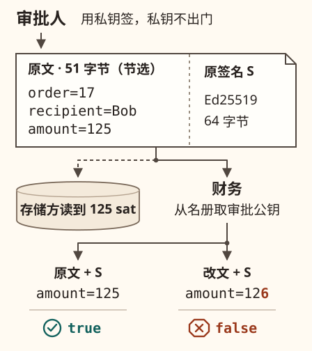
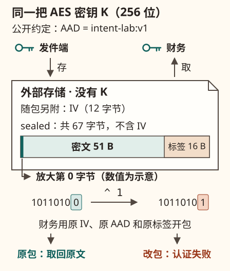

# 第 02 课 · 哈希、签名与加密

订单 17 要给 Bob 付 **125 sat**。审批人说签过了，财务收到的单子上却写着 **126 sat**。只差 1 聪，也不能照付。请审批人把当时签的原件拿出来，先看看这一聪差在哪儿。sat 是聪，1 BTC 等于 100,000,000 聪。

这就是原件。从 `l` 到最后一个 `t`，包括中间的竖线，都是付款指令的一部分。双方约好用 UTF-8，字段按这个顺序写，最后不加换行。`lab-only` 表示它只是练习用的文本，不能拿去链上付款。

```text
lab-only|order=17|recipient=Bob|amount=125|unit=sat
```

<figure class="lesson-figure"><a href="../assets/figures/m01/crypto-sign.svg"></a><figcaption>顺着同一份签名走两遍：存储方不用钥匙就能读，财务却不能把 125 上的签名挪给 126。</figcaption></figure>

审批人把私钥留在自己手里，交出来的是**原文和签名**。财务从审批人名册取出事先登记的公钥，把这三样一起交给验签器。原文加原签名，验得过；只把 `125` 改成 `126`，原签名就验不过。此时该退回 **126 那份**，而不是让财务把数字改回去再付。如果公钥也是随包附赠的陌生钥匙，即使验得过，财务也不知道签字的人有没有审批权。

接下来自己当一次财务。用到第 01 课的一个经验：核对内容之前，先找可信的参照。只要能在终端运行 Java 就能做，不需要钱包、节点或联网。

## 两张单都是 51 字节，差在哪里？

从仓库根目录进入 `labs`，用 macOS 或 Linux 的 shell 运行下面这段。需要完整的 JDK 17 或更新版本，自带 `jshell`，不用装依赖。我们让它打印三样东西：整张单有多长、金额占了哪些字节、整张单的 SHA-256 摘要是什么。

```bash
cd labs
jshell --version
jshell --execution local - <<'EOF'
import java.nio.charset.StandardCharsets;
import java.security.MessageDigest;
import java.util.HexFormat;
String intent = "lab-only|order=17|recipient=Bob|amount=125|unit=sat";
var sha = MessageDigest.getInstance("SHA-256");
var hex = HexFormat.of();
for (String s : new String[] {intent, intent.replace("125", "126")}) {
    byte[] b = s.getBytes(StandardCharsets.UTF_8);
    System.out.printf("bytes=%d amount_hex=%s sha256=%s%n", b.length, hex.formatHex(b, 39, 42), hex.formatHex(sha.digest(b)));
}
/exit
EOF
```

下面是预期值。金额和编码都写死了，所以每次应该一样：

```text
bytes=51 amount_hex=313235 sha256=7c2942bdb3eb0db17e552f9239d7229650cc29171996e6963b0f7fc2a2804ced
bytes=51 amount_hex=313236 sha256=a56887c3d64733cf58781ab486638bfa1c59092c518f5de47027922cb7fac89f
```

字节从 0 数，`[39,42)` 取第 39、40、41 个位置。两张单的金额前两位都是 `31 32`，也就是字符 `1` 和 `2`。手指放在第 41 号字节上：原件是 `35`（字符 `5`），另一张是 `36`（字符 `6`）。这里签的不是一个 Java `int`，别去找整数 125 的十六进制 `7d`。`sha.digest(b)` 吃进去的是**整张单**，出来的是 32 字节摘要，打印成 64 个十六进制字符。

**把这两行拿去查一次归档。** 假设财务自己在审批当天记下第一行的完整摘要。一个月后从仓库取出的单子却算出第二行。摘要不同，足够判定取回的不是留档原件；该查版本，不能报“原件无误”。反过来，若文件和所谓的“原件摘要”都从同一个不可信仓库取，仓库只要换掉两样，你重新计算也会对上。

**再换到仓库那一侧。** 假设仓库只拿到第二行的完整摘要，没拿到原文，但知道模板和收款人，也知道这档付款只可能是 125 或 126 sat。它先填 125，算出 `7c2942bd…`，和手上的不一样；再填 126，完整的 32 字节都对上了。两次就猜出金额，根本不用把 SHA-256 “倒着算”。所以，归档可以用摘要校对；对金额保密，不能靠删掉明文、留下公开摘要。

## 让 Java 验签，再试试财务的重试按钮

继续留在 `labs` 目录。若只下载了 [IntentLab.java](IntentLab.java)，就从该文件所在目录运行。下面直接用 JDK 运行源码，不需要 Maven。每次启动，程序都会在内存里新建一对签名钥匙和另一把加密钥匙，不读取或保存密钥文件。

```bash
java -version
java IntentLab.java
```

预期输出如下。随机密钥每次不同，看的不是密钥值，而是每次都应走到的三个分支：

```text
signature: original=true changed_amount=false
decryption: matches_original=true
altered_ciphertext=rejected
```

先只看第一行。在 [IntentLab.java](IntentLab.java) 里，`signing.initSign(signer.getPrivate())` 选定私钥；`signing.update(message)` 送进去的是那 **51 字节原文**，不是上面打印的摘要，也不是截图。`signing.sign()` 生成签名。这套签名方法叫 Ed25519。

然后代码让财务验两次。留意两行的最后一个参数没换：

```java
boolean original = verify(signer.getPublic(), message, signature);
boolean changed = verify(signer.getPublic(), bytes(intent.replace("125", "126")), signature);
```

第一行返回 `true`，第二行返回 `false`。签名没把 `Bob` 和 `125` 藏起来；只要仓库收到的是这份包，它就读得到这两个字段。财务多知道的一件事是：持有对应私钥的一方签过**第一串字节**。至于钱付了没有，这两行都没查。

**如果请求超时，按钮又点了一次呢？** 看一段假设的工单记录。09:00，财务验订单 17，结果为 `true`，系统建了一笔待付记录，回给前台的响应丢了。09:01，前台原封不动重发。还是同一把公钥、同一串字节、同一个签名，答案当然还是 `true`。若每见一个 `true` 就新建一笔，两笔都执行便会付出 **250 sat**。正确做法是让两次请求争同一条订单记录，例如对这个付款方的订单号加唯一约束；第一次建成功，第二次只返回已有状态。若第一笔还在处理中，就回“处理中”，不要假称到账。这里防的是重复付款，不是伪造签名。

**如果页面上都是 125，为什么一次验不过？** 假设导出程序在末尾加了一个 LF，也就是字节 `0a`。页面把换行藏在行尾，两份看着一样；验签器收到的却分别是 `… 73 61 74`（`sat`）和 `… 73 61 74 0a`。第二份是 52 字节，用原签名会得到 `false`。先留存收到的字节，再查导出程序；不要先 `trim()` 再宣布“收到的原件验过了”。字段如果需要统一格式，应在签署前就约好。

## 不想让仓库看见 125，该寄什么？

别寄“原文加签名”那包了。这次让发件端和财务事先各持有**同一把秘密钥匙**，仓库没有。发件端把 51 字节原文加密，只把下面这个信封存过去。图画的是一种交接方式；实验没有第三台机器，一个 Java 进程先装封、再拆封。

<figure class="lesson-figure"><a href="../assets/figures/m01/crypto-seal.svg"></a><figcaption>看密文的第一个字节：只变最右一位，财务再用原标签验这个包，就拿不到明文。</figcaption></figure>

把图和 `crypt` 方法对起来读：

1. **钥匙不入包。** `generator.init(256)` 选 256 位 AES 密钥。双方用它加密和解密，跟前面那对 Ed25519 钥匙无关。`iv = new byte[12]` 装的是另行生成的 12 字节起始值（IV）。IV 可以公开，但同一把密钥每次加密必须用不同的 IV；实验每次启动都换钥匙，一把只加密一次。
2. **写清哪些东西可见。** `updateAAD(bytes("intent-lab:v1"))` 把这个公开的版本标记也纳入校验，但不加密它。这种额外校验的数据叫 AAD，两端代码都写着同一个值，无须跟包再寄一份。`doFinal(message)` 返回的 `sealed` 才是袋里的东西：**51 字节密文 + 16 字节标签 = 67 字节**，不含 IV、AAD 或钥匙。仓库看得到袋的长度和里面的密文字节，不等于读得到金额。
3. **验好才交给业务。** `AES/GCM/NoPadding` 是这里选的认证加密方式。`GCMParameterSpec(128, iv)` 的 `128` 是标签的**位数**。拿同一把钥匙、同样的 IV 和 AAD 打开原包，`Arrays.equals` 确认取回的 51 字节和原文完全一样，对应第二行 `matches_original=true`。

现在动手的是程序里的 `sealed[0] ^= 1`。它只翻转**第一个密文字节的最低一位**，不是把明文金额加一；末尾 16 字节标签照旧。拿这个包再调用解密的 `doFinal`，Java 抛出 `AEADBadTagException`，所以第三行是 `altered_ciphertext=rejected`。给财务的结果是“没有可用明文”，不是“解出乱码，请人工猜”。本次知道变的是哪一位，因为是我们自己改的；单凭这个异常，不能断定一定是仓库改包，钥匙、IV 或 AAD 不匹配也可能导致认证失败。

**既要保密，又要认出审批人呢？** 只收到能解开的 AES 包，还不能说“是那位审批人发的”：握有共享钥匙的财务自己也能造出有效的包。可以先签原文，再把原文和签名一起加密；财务先认证解密，再用登记公钥验签。别另外给仓库抄送一份明文。实验故意把两步拆开：它加密的是 51 字节原文，没有把签名塞进 `sealed`，也不演示怎么分发钥匙。

## 这份签名能发到链上吗？

同事看见 Ed25519，问：“Solana 也用这个，我能不能直接广播订单 17？”不能。Solana 普通交易签的是按它的协议排好的交易消息。这里签的是以 `lab-only|` 开头的字节，签名方法相同，签的东西不对。

另一个常见误会是“两个钱包都写着 secp256k1，总能互相验吧”。**secp256k1 是一条椭圆曲线，不是签名方案。** Ethereum 普通外部账户的 EIP-1559 交易用这条曲线上的 ECDSA，按协议对类型字节和指定字段编码后求 Keccak-256 摘要来签。Bitcoin Taproot 密钥路径花费则用这条曲线上的 BIP 340 Schnorr 签名。只看曲线名，还选不出验签器。

至于 AES，它是对称分组密码，不存在一把“AES 公钥”。本实验选 GCM 模式才同时有保密和认证。看到任一算法名，先问清要核对的是原文、签字人还是密文，再找输入和钥匙。

## 独立作业：相同订单为什么被拒，重复订单为什么通过？

轮到你接手导出记录。不要改仓库里的源文件；在 `labs` 目录先建一份临时副本：

```bash
work=$(mktemp -d)
cp IntentLab.java "$work/"
```

1. 在副本的 `main` 里找到 `boolean changed = …;`。在它下一行加两次带标签的打印：`System.out.println("lf=" + verify(signer.getPublic(), bytes(intent + "\n"), signature));` 和 `System.out.println("retry=" + verify(signer.getPublic(), message, signature));`。先记下预测，再用 `java "$work/IntentLab.java"` 运行。原来的三项检查都要保留。
2. 在前面的 `jshell` 命令中给输入数组补上 `intent + "\n"`，记录字节数和**完整**摘要。然后自己做一个不同于换行的变体：交换文本中 `order=17` 与 `recipient=Bob` 两个字段的位置，只把收到的这份改动送去验原签名。预测金额、总长度、验签结果各变不变，再记录实际值。
3. 交一份短记录：JDK 版本、命令、改过的输入、输出，以及财务该重取原件、复用已有订单还是另付一笔。另答一句：为什么不能把归档摘要发给外包仓库，就当金额加密过？只交合成数据，不附任何密钥、钱包文件或客户资料。

**判据：** LF 版本是 52 字节，摘要以 `01e572e2` 开头，`lf=false`；原样重发仍是 51 字节，`retry=true`，不应新增付款。交换字段后，金额仍为 125 sat，长度仍为 51 字节，原签名却验不过。原程序的 `altered_ciphertext=rejected` 不应变化。若用新的签名把改动后的指令又签一遍，证明的是新签名，不是原始审批。

同一个边界也适用于一次性登录：验签之外，还要核对域名和有效期，并原子地消费挑战值。不要指望 GCM 的 IV 给订单或登录去重；也不要指望加密一份附件就能隐藏公链上公开的地址、时间和调用关系。

下一课用这个边界检查钱包备份：能验证签名，跟能恢复签名能力，是两件事。四课学完，再到[卷末工单](networks.html#卷末验收接手一张异常付款工单)判断哪些记录真的够资格核销。

## 对照原文

- JDK 17：[MessageDigest](https://docs.oracle.com/en/java/javase/17/docs/api/java.base/java/security/MessageDigest.html) 定义摘要输入与复位；[Signature](https://docs.oracle.com/en/java/javase/17/docs/api/java.base/java/security/Signature.html) 定义 `sign` / `verify`；[Cipher](https://docs.oracle.com/en/java/javase/17/docs/api/java.base/javax/crypto/Cipher.html) 说明 GCM 的 IV 唯一性、标签和 AAD 的调用顺序。
- 签名方案与协议输入：[RFC 8032](https://www.rfc-editor.org/rfc/rfc8032) 给出 Ed25519 及测试向量；[Solana 交易的 Signatures 字段](https://solana.com/docs/core/transactions/transaction-structure#signatures) 指定签名的实际消息；[EIP-1559](https://eips.ethereum.org/EIPS/eip-1559#specification) 列出 Ethereum 类型 2 交易的签名字段；[BIP 340](https://bips.dev/340/) 和 [BIP 341](https://bips.dev/341/) 分别定义 Schnorr 签名方案及 Bitcoin Taproot 花费规则。
