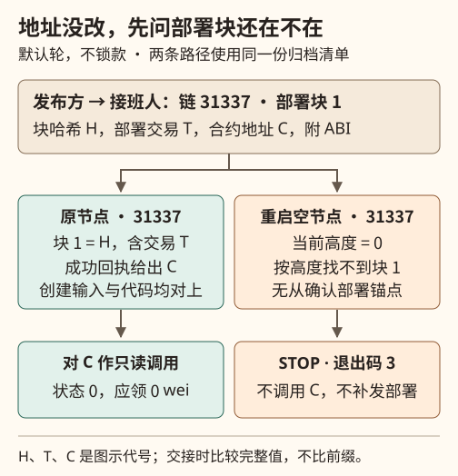

# 第 16 课 · 部署交接：这个地址真是昨晚那份托管吗？

接班人拿到昨晚的发布单 D-416：网络编号 **31337**，托管合约建在**第 1 块**，截止时间是创世后 3,600 秒。今天节点仍报 31337，但这本新账只记到**第 0 块**。同事等着打开付款入口。你该交出旧地址，还是告诉他暂缓？现在能不能说「这个托管的余额是零」？

先暂缓。网络编号相同，说明两边使用同一编号，不说明眼前这本账包含昨晚的历史。当前连第 1 块都没有，按发布单找不到创建回执；**没有读数，不是读到了零**。不要把收款地址交给同事，也不用为了验证地址试付一笔。

只改一个条件：眼前账本的高度从 0 变成 **1**。这就能放行了吗？仍不能，但现在可以取第 1 块，和清单上的**完整块哈希**对照；同高度不一定是同一块。还要在这个块中找到指定的创建交易，把回执里的合约地址、实际代码和角色参数都与清单对上，才能按这个地址查询。原实验查到的是尚未锁款、应领 0 wei；这是核对过实例后的读数。

只想判断这份清单能不能用，可以[翻到第 17 课：服务怎样回答回执查询](rpc.html)。以下是选做的发布、接班与卷末工单。动手时会用到[用块哈希认回执](receipts.html)、[按 ABI 解参数](abi.html)、[区别已锁与已结算](escrow.html)和[用不变量验账](invariants.html)。使用同一份[托管源码](m04/src/MilestoneEscrow.sol)与[构建配置](m04/foundry.toml)。[发布程序](m04/deployment.py)可以在自己的开发节点提交交易；[接班程序](m04/handoff.py)只读，不需要合约工程、Forge、Cast 或解锁账户。

## 清单里的三个指纹，各自回答一个问题

Java 服务能用 Git 提交号、JAR 摘要和运行端口定位版本。合约还要回答：**哪条链上的哪一次创建？** 同一份构建可在不同地址部署，参数可以不同；同一地址字符串在不同链上也可以代表不同东西。ABI 是参数和返回值的编解码约定，不是链给代码开具的身份证明。接班人应该从受信发布渠道拿清单，再向受信节点核对，不能让节点刚刚返回的地址直接充当订单期望地址。

| 归档字段 | 从哪里取、用在哪里 |
| --- | --- |
| `build.sourcePath/sourceSha256`、`configSha256`、`compiler`、`settings`、`forgeVersion` | 源码、`foundry.toml` 原始字节和工具输出。这里用 solc **0.8.28+commit.7893614a**、优化开启、`runs=200`、目标 `cancun`。200 是优化时对代码执行次数的权衡参数，不是部署限额或测试次数。这里只有一个源码单元、没有第三方 Solidity 库或待链接库地址。 |
| `build.artifactSha256`、`abiSha256`、`creationCodeSha256`、完整 `abi` | 分别对应归档 `artifact.json` 的原文件、键排序/紧凑 UTF-8 JSON 的 ABI、解成字节后的创建代码。工具换了 JSON 排版，文件摘要可以变，即使可执行字节没变；所以复编比较的是 ABI、有效设置和创建输入，不是终端打印长得像。 |
| `chainId`、`deploymentTransactionHash`、`deploymentBlockNumber/Hash`、`contractAddress` | `eth_chainId`、部署交易与成功回执，加上按高度找到的规范块。地址取自创建回执的 `contractAddress`，不是普通调用回执的 `to`。只有高度不能排除同高度的另一个块。 |
| `deployer`、`constructor.payee/deadline`、`runtimeSha256` | 部署者就是付款方；参数给出收款方和绝对截止时间（Unix 秒）。运行时代码摘要取自部署块的 `eth_getCode`，不是本地 `.sol` 文件摘要。读 `payer()/payee()/deadline()` 再与清单核对。 |

以上 SHA-256 均用于**文件或字节归档**。第 13 课取 selector 用的是规范函数签名的 Keccak-256，不要把 `hashlib.sha256` 或 `sha3_256` 的前四字节当 selector。摘要能揭示与可信原件不一致，不能给发布人签名；若对方能同时替换清单和所有期望摘要，仅比较清单自身不足以证明来源。

## 一条命令，从高度 0 到只读交接

准备 Python 3.11、`lsof` 和[本卷固定的工具链](abi.html#m04-tools)。以下命令都从**仓库根目录**执行。安装只需准备时联网；安装好后导出路径，构建禁用下载，节点与读端只访问 `127.0.0.1:18556`。保留空闲端口，不接入已有节点。`anvil_lab.py` 确认本次子进程拥有监听端口，账户来自随机的临时钱包；不用输入、传递或导出密钥。

```bash
export PATH="${XDG_CACHE_HOME:-$HOME/.cache}/chain-course/m04/bin:$PATH"
export FOUNDRY_SOLC="${XDG_CACHE_HOME:-$HOME/.cache}/chain-course/m04/bin/solc"
unset ANVIL  # 不复用前几卷可能留下的节点程序路径
WORK=$(mktemp -d)
python3 labs/m04/deployment.py --out "$WORK/release-a"
```

`--out` 要求一个**尚不存在**的目录，避免用新回执覆盖旧档；也可省略，由程序创建并打印 `ARCHIVE` 路径。命令返回时会停本次节点，归档保留。预期摘要如下；真正的交易哈希、块哈希、两个角色地址、绝对截止时间随轮次变化，以你目录里的完整值为准。

```text
REBUILD creationArgsMatch=true constructorBytes=64 compiler=0.8.28+commit.7893614a …
HANDOFF chainId=31337 deployBlock=1 readBlock=1 state=0 payeeCreditWei=0 escrowBalanceWei=0
```

**第一步，封存输入。** 发布程序复制源码及配置，再在临时空目录中运行 `forge build --root . --offline --extra-output metadata`。它从产物里的编译器元数据读实际编译版本、优化设置和 EVM 版本，而不是只抄工程配置的意图。源文件的相对路径同样是构建输入：注释或路径变了也可能改变元数据和字节码。带库的工程还须锁库版本、导入映射和链接地址；本卷不用库，并检查只有托管那个源码单元。

**第二步，把创建和调用分开。** 发布方读取创世块时间 `t₀`，用第一个临时账户发送一笔没有 `to` 的创建交易。最后一段输入是 `abi.encode(payee, t₀ + 3600)`：地址是 `12 个零字节 + 20 字节地址`，秒数是 32 字节大端无符号整数，共 `32+32=64` 字节，**没有函数 selector**。前面是初始化代码。初始化代码执行构造函数并返回要安装的运行时代码；之后对新地址发 `eth_call` 执行的是后者。不要拿整笔创建输入的摘要直接和 `eth_getCode` 比。构造阶段写入运行时代码的 `immutable` 值也可能使两个实例的运行时指纹不同。

拿到交易哈希后，发布方要等待**原哈希**的回执；本机的自动挖块并不保证 `eth_sendTransaction` 返回时查询就已能读到它。短暂的 `null` 不是失败回执，不另发一笔创建。超过等待时限则暂停发布、保留原哈希待查；只有核过 `status` 和区块位置才交付。

**第三步，拿链上的创建交易当对照。** 清单可以写「用这份源码建成」，但要怎样查？在没有缓存和 `out/` 的新目录，用归档源码和配置再次编译，先核 ABI 和编译设置。把新编出来的创建代码放前面，接上清单中收款地址和截止时间编码成的 64 字节。另一边，按部署交易哈希向节点取原交易的 `input`，不要拿本地上一次编译的产物当答案。两串字节从头到尾相等，`REBUILD` 才报 `creationArgsMatch=true`。如果清单只把截止时间改了 1 秒，前面的代码可以完全一样，末尾那个参数字却对不上。归档中 `deployment-input.hex` 留这份原输入，`receipts.json` 留创建结果，`manifest.json` 另记已安装代码的 SHA-256；相符只支持这次本地部署与归档相符，不是安全审计或公开验证徽章。

**第四步，另一个进程接手。** 发布程序在空工作目录用 Python 隔离模式启动 `handoff.py`。给它的唯一业务文件是 `manifest.json`，RPC 端点是读程序固定的本机约定。它按这个次序执行：

1. 查节点版本与链号，再按**高度**取部署块，并比较完整块哈希。旧块即使还能按哈希查到，也不能替代当前规范链上该高度的块。
2. 检查该块包含部署交易，回执 `status=0x1`、地址和块位置都对应；原交易确为本次部署者创建、无转账金额，输入尾部是清单两参数，去掉尾部后是记录过的创建代码指纹。
3. 固定当前读块，用 `{blockHash, requireCanonical:true}` 读合约代码与状态。运行时摘要不符就停止。按 ABI 取 getter 的输入和返回类型，计算 selector，用 `eth_call` 查询付款方、收款方、期限、枚举及应领；返回单个静态值要有完整的 32 字节。`credit(address)` 的 calldata 长 **36 字节**：4 字节 selector 后才是地址参数，不是直接拼 20 字节地址。
4. 接班人将**实际读到的** `readBlockHash`、角色、期限、`state`、`creditCalldata`、`payeeCreditWei` 和同块 `escrowBalanceWei` 交回 `handoff.json`。此处独立发布刚部署且没存款，故枚举 `0=Awaiting`、两个金额均为 0。若只看金额为 0 而不核锚点，可能根本没找到这份合约。

<figure class="lesson-figure"><a href="../assets/figures/m04/deployment.svg"></a><figcaption>左支的零是一次 ABI 调用读回来的；右支没有调用，不能把「没找到部署」记成「余额为零」。</figcaption></figure>

## 只改节点历史：链号、端口、清单一字未改

```bash
if python3 labs/m04/deployment.py --reset --out "$WORK/reset"; then rc=0; else rc=$?; fi
printf 'exit=%s\n' "$rc"
```

本轮先重新部署并验收；在**这一轮内部**，程序随即关闭节点，启动另一条同版本、同端口、同链号但只有创世块的空链，把**这一轮同一份**清单交给同一读端。正常读端先交出 `HANDOFF`；第二次预期 `STOP chainId=31337 missing deployment block 1`，没有第二份读数，退出码 `3`，原因保存在 `refusal.txt`。这是主动更换本地内存链，不是回滚原链上一笔已确认交易。若看到连接拒绝、编译失败或端口占用，那是环境错误，不能当作本题的拒绝证据。

## 旧入口怎样停用，未提的钱怎么走？

这份托管是**直接部署、不可升级**的单笔状态机。发布方没有管理员开关，不能在旧地址换代码，也不能替别人把 `credit` 提走。若发新版本，新建实例、复编和生成**新的**清单；不要让旧清单原地改地址。一个可执行的停用单是：

1. 在订单服务停止向新单分配旧地址；界面撤下旧地址的「新建/锁款」按钮，保留旧单查询。记生效时间、旧/新完整清单与对应订单范围。**这不是链上暂停**：对仍在 `Awaiting` 且未截止的旧实例，原付款方仍可能直接调用；要通知当事人，不许声称已经禁用合约。
2. 逐旧单核对角色、状态、余额和事件。`Locked` 的单仍须走原约定：截止前由 `payer` 决定是否 `settle`，到期后由 `payer` 发 `refund`；时钟到点不替人发交易。终态且有 `credit` 的，保留正确链/旧地址/旧 ABI 的 `withdraw()` 入口与说明，让受益人用自己的身份领取。客服不能用新地址清偿旧地址的余额。
3. 把旧地址标为只接存量单，持续核对两方 `credit` 和提款回执，不凭「余额已降」推断是谁领取。恢复错误路由可修正后续请求，但不能撤销已执行交易、替用户改旧账或把已付手续费退回。需要补偿时另立经授权的业务流程。

若选**可升级代理**，入口地址可不变：代理经 `delegatecall` 借用实现代码，状态仍在代理的存储中。迁移负担从「用户切地址」部分移到「谁能授权切实现、谁核存储布局与初始化、客户端何时切 ABI」。不是所有代理都可升级。接手这类项目不能只记代理的代码摘要，还要按生效块记录代理地址、实现地址/代码、升级权限和变更凭据；切回旧实现也不会自动撤销新版已经写入的状态。这些是设计对照，实验里**没有**代理、管理员或升级交易。

## 本课作业：让一份只改了截止时间的清单过不了关

终端 A 从仓库根目录运行 `python3 labs/m04/deployment.py --hold`，保留打印的 `ARCHIVE` **绝对路径**。程序在正常验收后等待回车，节点仍在。终端 B 也从仓库根目录运行下面的命令，按提示粘贴该路径。别动原清单，只把一个副本的秒数加 1。先预测拒绝发生在回执、构造参数还是 getter 这一关。

```bash
printf '粘贴本轮 ARCHIVE 绝对路径：'; IFS= read -r R
python3 -I labs/m04/handoff.py "$R/manifest.json"
python3 - "$R" <<'PY'
import json, pathlib, sys
p = pathlib.Path(sys.argv[1]); m = json.loads((p/'manifest.json').read_text())
m['constructor']['deadline'] += 1
with (p/'wrong-deadline.json').open('x') as f: json.dump(m, f)
PY
if python3 -I labs/m04/handoff.py "$R/wrong-deadline.json"; then rc=0; else rc=$?; fi
printf 'exit=%s\n' "$rc"
```

原件应返回带实际 `readBlockHash` 的 JSON；副本的链、块、回执、地址全是真的，但创建输入最后 32 字节没有跟着改，预期 `STOP constructor argument mismatch`、退出 `3`。交回原件读数、被改字段的两个实际整数与拒绝原因；回终端 A 按回车关闭自己启动的节点。**判据：**没有第二次部署或写交易；能指出「同一地址」和「构造参数符合交付单」需要两种不同证据。

<a id="m04-checkout"></a>

## 卷末接手工单 E-416：前端今天切换，应领款还在旧地址吗？

同事交来一份不同的需求：付款期限改为创世后 **5,400 秒**，测试金额为 **9,007,199,254,741,017 wei**（`2⁵³+25`）。在新链先部署，再由付款方锁款、结算，但**不提现**。你是第二班，不能只读发布者的终端：要用实际 `Settled` 日志、读端应领和合约余额各自复算；决定能否关闭旧单的提现页面。这不是让你重新编一个托管合约。

先写下预计的状态、已付给受益人的金额、应领金额。下面从仓库根目录执行，沿用前面的工具环境；`CASE` 保存在本终端。先留第 15 课的真实测试记录，再启动一条新链：

```bash
CASE=$(mktemp -d)
(cd labs/m04 && forge test --offline) > "$CASE/tests.log" && cat "$CASE/tests.log" &&
python3 labs/m04/deployment.py --ttl 5400 --settle-wei 9007199254741017 --out "$CASE/old"
```

若测试未通过，不放行。`receipts.json` 的 `deploy/lock/settle` 分别是三笔真实交易的回执；先看清 `Settled(address,uint256)` 的收款地址是 indexed，进 `topics[1]`，金额非 indexed，在 `data`。下面的**离线复核**只用归档，不读节点，把日志同另一个进程的 `handoff.json` 对起来：

```bash
TOPIC=$(cast keccak 'Settled(address,uint256)')
python3 - "$CASE/old" "$TOPIC" <<'PY'
import hashlib, json, pathlib, sys
p = pathlib.Path(sys.argv[1]); load = lambda f: json.loads((p/f).read_text())
m, r, h = map(load, ('manifest.json', 'receipts.json', 'handoff.json'))
assert hashlib.sha256((p/'artifact.json').read_bytes()).hexdigest() == m['build']['artifactSha256']
assert hashlib.sha256((p/m['build']['sourcePath']).read_bytes()).hexdigest() == m['build']['sourceSha256']
a = load('artifact.json'); addr = m['constructor']['payee']; deadline = m['constructor']['deadline']
creation = bytes.fromhex(a['bytecode']['object'][2:]); words = bytes(12) + bytes.fromhex(addr[2:]) + deadline.to_bytes(32, 'big')
assert deadline - m['genesisTimestamp'] == 5400 and creation + words == bytes.fromhex((p/'deployment-input.hex').read_text().strip()[2:])
assert [int(r[k]['blockNumber'],16) for k in ('deploy','lock','settle')] == [1, 2, 3]
assert all(r[k]['status'] == '0x1' for k in ('deploy','lock','settle'))
assert r['deploy']['blockHash'] == m['deploymentBlockHash'] and r['settle']['blockHash'] == h['readBlockHash']
log, = r['settle']['logs']; assert log['address'] == m['contractAddress'] and log['topics'][0] == sys.argv[2]
assert bytes.fromhex(log['topics'][1][2:]) == words[:32] and h['payee'].lower() == addr.lower()
amount = int(log['data'], 16)
assert amount == int(h['payeeCreditWei']) == int(h['escrowBalanceWei']) == 9007199254741017 and h['state'] == 2
assert len(bytes.fromhex(h['creditCalldata'][2:])) == 36
print('settleTx=', r['settle']['transactionHash'], 'readBlockHash=', h['readBlockHash'], 'owedWei=', amount)
PY
```

**交接判据：**

- 交出本轮测试摘要、清单、构建输入与产物、三笔回执及独立读端的回报，注明所用版本。清单部署块是 **1**，读数却属于**块 3**；两者各有自己的完整块哈希，不能混成「3 号块部署」。用本轮真实值写出付款/收款角色，说明 `creditCalldata` 中哪 32 字节是收款地址。
- 三笔回执都成功，日志金额、收款方应领、隔离实例的余额都是 **9,007,199,254,741,017 wei**，状态 **2=Settled**。本轮无 `withdraw` 交易，已从托管转给受益人的金额仍为 **0 wei**。多笔外部收支时不能把任意余额净差当作订单金额；这张单有自己的角色、事件、状态和独占的资金流。
- 给客服一句可执行指令：「停发旧地址的新单，保留该旧地址的查询和本人提现；收到成功 `Withdrawn` 回执并核对应领后再结案。」请同事另选非零整数（不超过 `10¹⁸` wei），换一个全新 `--out` 走一遍，用自己的数替换复核工单金额。若只会在演示固定地址上得到一个绿色输出，不算接过了发布。

实验归档只含本机合成业务及公开链字段，不含助记词、私钥、真实订单。关闭节点后能复核文件、自行重新构建，不能凭归档恢复已销毁的链状态；另起节点是新部署，不是同一个地址的在线服务，更不是主网最终性证明。

## 查证原文

- [Solidity 0.8.28：合约元数据与复现构建](https://docs.soliditylang.org/en/v0.8.28/metadata.html)；[ABI 规范：函数 selector、参数字与事件](https://docs.soliditylang.org/en/v0.8.28/abi-spec.html)。
- [Ethereum Execution APIs：交易与回执](https://github.com/ethereum/execution-apis/blob/main/src/eth/transaction.yaml)；[EIP-1898：按块哈希读取规范链状态](https://eips.ethereum.org/EIPS/eip-1898)。
- [OpenZeppelin：代理、实现与升级权限的区别](https://docs.openzeppelin.com/contracts/5.x/api/proxy)。用于比较设计，本实验不导入代理库。
