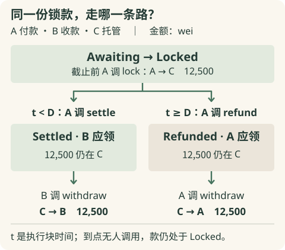

# 第 14 课 · 托管状态机：已结算，为什么还没到账？

工单 M-14：付款方 A 把 **12,500 wei** 锁进托管合约 C。收款方 B 交了货；A 在截止前一秒验收，页面出现 `Settled`，C 的余额却还是 12,500 wei。财务要不要再给 B 打一笔？不要。先查 C 欠谁多少钱，再看谁领走了钱。反过来，假如 A 的验收晚一秒才执行，同样一笔锁款就不能判给 B 了。

先修：[第 13 课的 ABI、调用数据与持久状态](abi.html)，以及[第 12 课的回执与确认](receipts.html)。本课用 **一份合约管一笔原生测试 ETH**。A 同时是部署者和验收人；B 是供应方；没有第三方仲裁者。合约替双方执行约定，不替双方判断货是否合格。这里只在 Forge 的内存 EVM 中操作，不需要钱包、节点或私钥。

## 先把发货、结算、领取拆成三张单

物流单能说明 B 声称已经交货，不能改 C 的存储；C 没有读物流系统的接口。A 在链下验收后，必须在截止前成功调用 `settle()`。这一步只形成 C 对 B 的**应付账款**，即 `credit(B)`。B 再调用 `withdraw()`，C 才把 ETH 转给 B。合约没有 `ship()`，也没有「平台管理员手工改成已到账」的入口。

单据的区别会改变交付决策。B 看见锁款可以知道钱进了 C，但 A 仍可能一直不验收，等超时后退款。因此这不是保证供应方一定拿到货款的仲裁托管。A 看见 `Settled`，也不能承诺钱已经进了 B 的地址；B 要看自己的应领或领取记录。若业务要求快递签收自动放款、双方都能仲裁或分期收款，要另立需求，不能靠界面换个按钮名字得到。

<figure class="lesson-figure"><a href="../assets/figures/m04/escrow.svg"></a><figcaption>从上往下只选一支。中间两格是债权归属，不是转账；钱实际移动的地方是 A 锁款给 C，以及最后 C 付给领取人。D 是截止的 Unix 秒数。</figcaption></figure>

## 把合同条款写成转移表

部署 C 时，构造函数把 **这次部署的调用者**定为 `payer`，把另一个非零地址定为 `payee`，并要求 `deadline` 严格晚于部署块时间。这三个值不可改。`State` 是枚举，`state()` 依次用 `0/1/2/3` 表示 `Awaiting/Locked/Settled/Refunded`；新合约的默认值是第一项。`credit(address)` 查询指定地址的应领，默认是零。这里的 `public` 是可以查，不是可以改。

设执行当前调用的块时间为 `t`，截止为 `D`；表中 `m` 始终指实际锁入的正整数 wei。

| 原状态 | 谁、何时、做什么 | 新状态及资金效果 | 成功事件 |
| --- | --- | --- | --- |
| `Awaiting` | A，`t < D`，`lock{value: m}()`，`m > 0` | `Locked`；A → C，记录这单的 `m` | `Locked(A, m)` |
| `Locked` | A，`t < D`，`settle()` | `Settled`；给 B 记 `credit(B)=m`，不转 ETH | `Settled(B, m)` |
| `Locked` | A，`t >= D`，`refund()` | `Refunded`；给 A 记 `credit(A)=m`，不转 ETH | `Refunded(A, m)` |
| `Settled` 或 `Refunded` | 有非零应领的那个人，`withdraw()`，无时间限制 | **仍在原终态**；自己的应领清零，C → 自己，金额 `m` | `Withdrawn(领取者, m)` |

**为什么等号要单独写？** `block.timestamp` 是执行块的 Unix **秒**，不是 `System.currentTimeMillis()` 的毫秒，不是下单时间，也不是钱包弹出签名窗口的时间。锁款和结算共用 `< D`，退款用 `>= D`，在 `D` 没有两个选项同时可选，也没有无人有权处理的一秒。真实链不保证恰有一个块的时间戳等于 D；实际能退款的是第一个满足条件且执行该调用的块。发送得早、打包得晚的结算仍可能失败。

时间推进只改变**下次允许的操作**，不会唤醒代码。`Locked` 的单子过了 D 而 A 未操作，`state()` 仍是 `Locked`，A 暂时也没有应领。A 必须先 `refund()` 再 `withdraw()`。若截至 D 连钱都没锁，状态仍是 `Awaiting`，随后锁款将被拒绝；这时没钱可退。

## 读实现：钱从哪来，授权看哪一层

打开[唯一的业务合约 `MilestoneEscrow.sol`](m04/src/MilestoneEscrow.sol)。沿着 `lock → settle/refund → withdraw` 读，不用先记语法大全。

1. **入金。** `lock()` 是 `external payable`：允许这次外部调用附原生 ETH；不会自动要求附款，也不规定金额。`onlyPayer` 比的是当前这层调用的 `msg.sender`，不是前端传进来的姓名，也不是整条调用链最初的 `tx.origin`。合约随后检查起始状态、截止以及 `msg.value != 0`。通过才把 `msg.value` 存进 `deposit` 并改状态。第二次调 `lock()` 不能给原单追加金额；普通空数据直转也不是这张单的锁款入口。
2. **裁决。** `settle()` 和 `refund()` 均要求 `state == Locked`，但检查相反的时间区间，且分别把 `deposit` 记给 B 或 A。它们不按 `address(this).balance` 判金额：那个值是整个地址持有的 ETH，不是这张订单的入金凭证。`deposit` 保存原始锁款额，`credit` 是当前还欠多少，已结算时不能把这两个数加起来当作欠款。终态没有回到待付款的入口，所以一次成功裁决只记一次应领。
3. **付款。** `withdraw()` 没有收款地址参数。下面是实现中的关键四句；执行前已从 `credit[msg.sender]` 读出非零 `amount`。先消掉债权，再做外部调用；收款若失败，最后的 `revert` 使本次领取整体回退，清零也撤销。已经成功提交的上一次结算不因此取消。

```solidity
credit[msg.sender] = 0;
(bool sent,) = payable(msg.sender).call{value: amount}("");
if (!sent) revert WithdrawalFailed();
emit Withdrawn(msg.sender, amount);
```

为什么不在 `settle()` 中顺便打款？结算只需改变本合约的状态；打款可能执行接收方合约的代码，也可能被拒收。把两步分开，付款者的验收不必同步等供应方接受 ETH，但**不保证收款地址能领**。部署条款时须确认收款方能发起领取并接受 ETH；这里只有自己领，没有代领或改收款地址的后门。

四个业务事件均有一个 `indexed` 地址和一个未索引的 `uint256 amount`。例如真实回执里，C 是发出日志的地址，`Settled(address,uint256)` 的签名哈希在 `topics[0]`，B 在 `topics[1]`，金额在 `data`。B 是受益人，不是发起结算的人。日志用于追溯成功动作，getter 用于读某个块的结果；对账时还要核链、合约地址及回执所在块，不能凭同名事件就放货。Forge 下面还会显示测试夹具自己的记录，它们不属于 C 的 ABI。

## 跟一轮账：在 D−1 结算

依赖：[本卷工具与安装](abi.html#m04-tools)，Foundry **1.7.1**、已安装或缓存的 solc **0.8.28**；[工程配置](m04/foundry.toml)固定 Cancun、优化 200 runs。没有第三方 Solidity 库。先从仓库根目录进入工程；本课后续命令都在 `labs/m04/`，使用 Bash 或 zsh：

```bash
cd labs/m04
forge --version
set -o pipefail
forge test --offline --match-contract EscrowTransitionsTest --match-test '^testSettleAtDMinusOne' -vvvv | tee /tmp/m04-settle.trace
```

[`EscrowTransitions.t.sol`](m04/test/EscrowTransitions.t.sol) 的 `setUp()` 为每个测试重新部署。`vm.deal` 给内存地址 A、B 分别配 **25,000、12,500 wei** 测试余额；`vm.prank(A)` 令下一次部署或调用的直接调用者为 A，不是签名服务；`vm.warp` 设置本地执行时间，不会修改部署好的 D。这些接口只在测试夹具中出现。取 `T0=1700000000`、`D=T0+60=1700000060`，把第一笔 12,500 wei 在 T0 锁入，令决定时的 `t=1700000059`。

在输出中找 `[PASS] testSettleAtDMinusOne()` 和 `emit Ledger`。下表是**预期账页（不是实跑记录）**；`Ledger` 是测试从 `state()`、C 的余额、`credit(A)` 和 `credit(B)` 读值并核对后才发的观察记录。四个数的顺序与事件相同，后三列均为 wei。

| `Ledger.step` | `state` | C 实存 | A 应领 | B 应领 |
| --- | --- | ---: | ---: | ---: |
| `awaiting` | 0 | 0 | 0 | 0 |
| `locked` | 1 | 12,500 | 0 | 0 |
| `early-refund-rejected` | 1 | 12,500 | 0 | 0 |
| `settled` | 2 | 12,500 | 0 | 12,500 |
| `withdrawn` | 2 | 0 | 0 | 0 |

读 trace 的缩进：在 `MilestoneEscrow::refund()` 里看到 `TooEarly()`，这是测试**预期的拒绝**，说明还差一秒才到退款窗口。随后 `settle()` 成功，`settled` 那行的实存和应领是同一笔钱的资产、负债两面。最后 `withdraw()` 下才有 C 带值调用 B 和 `Withdrawn(B,12500)`，夹具核对 B 的余额增量恰为 12,500 wei。`vm.expectEmit` 会先列一条测试端的期望模板；只把 **C 的调用内部**那条当作 C 发出的事件，不能把金额加两次。

这是 Forge 测试内的调用树，不是三笔带交易哈希的公网回执。测试里的余额差不含模拟角色单独发送交易的 gas 费；在真实外部领取交易中，领取者若也付 gas，钱包余额净增不会简单等于应领。gas 数、合约地址、显示缩进不是本题判据。

## 只把决定推迟一秒

保持 A、B、D、C 的初始条款和入金不变。先预测：若仍由 A 调 `settle()`，`t` 从 `D−1` 改为 `D`，哪一格会变？再跑第二个独立场景：

```bash
forge test --offline --match-contract EscrowTransitionsTest --match-test '^testRefundAtD' -vvvv | tee /tmp/m04-refund.trace
```

预期 `deadline-without-call` 为 `(1,12500,0,0)`；时间已经到点，但钱未自动退。A 的 `settle()` 应以 `DeadlineReached()` 拒绝，`late-settle-rejected` **还是** `(1,12500,0,0)`。现在 A 改走 `refund()`，`refunded` 才变成 `(3,12500,12500,0)`；A 领取后 `withdrawn` 为 `(3,0,0,0)`。成功事件应是 `Locked(A,12500)`、`Refunded(A,12500)`、`Withdrawn(A,12500)`，不是 `Settled`。这个对照用 `vm.warp(D)` 精确检查代码的等号，不是在承诺真实区块按秒产生。

## 哪些请求必须被拒绝？

检查拒绝不能只看「报过错」：先让其他条件都合法，再断言**指定错误**以及**原账页未改**。例如 B 有测试余额，B 尝试锁款失败才确实能区分「没权限」和「付不起」。从同一目录运行其余测试；去掉 `--match-test` 即运行本课全部六个用例：

```bash
forge test --offline --match-contract EscrowTransitionsTest --match-test '^testReject' -vvvv | tee /tmp/m04-reject.trace
```

| 夹具场景 | 被拒的调用 | 预期错误及留下的证据 |
| --- | --- | --- |
| `testRejectBadLocks` | A 零入金；B 带足款锁；A 在 D 首次锁 | 依次 `ZeroDeposit`、`PayerOnly`、`DeadlineReached`；均为 `(0,0,0,0)` |
| `testRejectWrongDecisionMaker` | 已锁，B 在 D−1 结算；B 在 D 退款 | 两次 `PayerOnly`；仍是 `(1,12500,0,0)` |
| `testRejectSecondSettlement` | 已结算，A 再结算；A 冒领；B 成功领后再领；A 试图重开 | 依次 `WrongState`、`NoCredit`、`NoCredit`、`WrongState`；第二次结算后 B 仍只应领 12,500，最后 `(2,0,0,0)` |
| `testRejectInvalidTerms` | 部署时 B 为零地址、等于 A，或 D 恰等于部署时刻 | 前两次 `InvalidPayee`，末次 `DeadlineNotFuture`；三次都不产生可用的新实例 |

若测试本身 `[FAIL]`，先看失败发生在「预期某个 revert」还是 `Ledger` 校验；前者从调用者、前态和执行块时间找差异，后者逐项核对 `state()`、C 的余额和两个地址的应领。失败调用的业务改账与日志会回退，但真实链上的失败交易若已入块，仍会付费。

## 独立工单：过期的是订单，还是领取权？

客服收到一张**已在 D−1 成功结算、到 D+3600 仍无人领取**的单子。A 请求退款，B 则认为自己错过了领取时间。不要修改业务合约。在你自己的练习副本中，给 `EscrowTransitionsTest` 新增 `testHomeworkLatePickup()`：先锁款、在 D−1 结算，再将时间移至 D+3600，依次尝试 A 退款、B 领取，保留调用前后账页。可复用夹具里的 `_lock()`、`_settle()`、`_row()`、`_withdraw()`；不要只在 Java 端模拟状态。方法写好后运行：

```bash
forge test --offline --match-contract EscrowTransitionsTest --match-test '^testHomeworkLatePickup' -vvvv | tee /tmp/m04-late-pickup.trace
```

交付新增测试源码、含**一个匹配并通过的测试**的完整 trace，以及给财务的一句话处理意见。答案判据：A 虽然等到 D 之后，仍因前态是 `Settled` 得 `WrongState()`；失败后 C 实存和 B 应领各 12,500 wei；B 领走 12,500 后两者都归零而 `state` 仍为 2。应告诉财务「不再付款；以这次由 C 发给 B 的 `Withdrawn` 与账页对上原单」，不能说「到了 D，结算自动作废」。

## 原文核对

- [Solidity 0.8.28：区块与交易上下文](https://docs.soliditylang.org/en/v0.8.28/units-and-global-variables.html#block-and-transaction-properties)：核对 `block.timestamp`、`msg.sender` 和 `msg.value` 的单位与作用范围。
- [Solidity 0.8.28：常见合约模式](https://docs.soliditylang.org/en/v0.8.28/common-patterns.html)：比较状态机与拉取式付款；本单自己的边界仍由合同条款决定。
- [ABI 规范：Events](https://docs.soliditylang.org/en/v0.8.28/abi-spec.html#events)：核对日志地址、topics 与 data 的分工。
- [Foundry：读 Forge 调用跟踪](https://www.getfoundry.sh/forge/debugging)：用 `-vvvv` 查看通过场景的内部调用、返回和回退。
