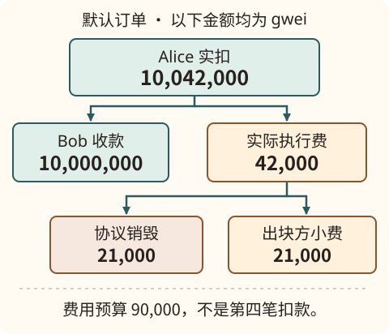

# 第 11 课 · Gas 与收支平衡：用 Java 核对一笔 ETH 转账

财务要给 Alice 报销一笔手续费。她给 Bob 付了 0.01 测试 ETH；钱包写着「手续费最多 90,000 gwei」，这笔付款的回执却只算出 42,000 gwei。两行用的是同一种金额单位。该按哪一行报销？还要找谁退回差的 48,000 吗？

看凭据是怎么来的：钱包允许最多用 30,000 份工作量（gas），每份最多 3 gwei；回执记的是实际用了 21,000 份，每份实付 2 gwei。**报销 `21,000 × 2 = 42,000 gwei`。** 另一行是花钱前的上限，不是已经扣过的款，没有一笔 48,000 gwei 的退款要追。单凭这张费用单还不能证明 Bob 收足货款，要另外核对收款账户。

只把总单价上限从 3 提到 4 gwei/gas，本块基础价仍是 1、小费最多也是 1，每份实付会涨吗？不会。买一份工作量仍只需 `1 + 1 = 2 gwei`；预算升到 120,000 gwei，实际仍报 42,000。Bob 的应收额也不变。

能分清「获准花多少」与「实际花多少」，只想读懂的读者可以转到[第 12 课：拿到交易编号后，何时算付款完成](receipts.html)。以下是选做的本地对账实验；需要用到[第 04 课的链号核对](networks.html)、[第 09 课的同块余额比较](accounts.html)和[第 10 课的发送序号判断](nonce.html)。

## 哪一张单上的数可以结账？

先统一单位：**gas 是工作量单位，不是金额**；wei 是 ETH 的最小金额单位。`1 gwei = 10⁹ wei`，`1 ETH = 10⁹ gwei = 10¹⁸ wei`。因此本单 `value = 0.01 ETH = 10,000,000 gwei`。报价写“3 gwei”时应追问：总共 3 gwei，还是每单位 gas 收 3 gwei？Java 用 `BigInteger` 存 wei：连 10 ETH 的 wei 数都放不进有符号 `long`，用 `double` 也无法逐 wei 核销。

| 依据 | 从哪里读 | 回答的问题 |
| --- | --- | --- |
| 签过的交易 | `eth_getTransactionByHash`：`value`、`gas`、`maxFeePerGas`、`maxPriorityFeePerGas` | `gas` 是 gasLimit，限定本次最多可用多少 gas；`maxFeePerGas` 限制每 gas **含小费**的总价，`maxPriorityFeePerGas` 另限其中的小费，两项上限不相加 |
| 纳入交易的区块 | 按回执的 `blockNumber` 取块，并核对 `blockHash` 与交易列表；看 `baseFeePerGas` | 本块每 gas 必付的基础费是多少？不是发送时读一次 `latest` 得到的报价。以太坊 L1 的基础费随父块的 gas 用量相对目标调整，超目标通常上调，低于目标通常下调 |
| 已执行的回执 | `eth_getTransactionReceipt`：`status`、`gasUsed`、`effectiveGasPrice` | 这次是否成功、**本笔**实际用了多少 gas、每 gas 最终付多少 wei？`cumulativeGasUsed` 是块内累计量，一般不能替代 `gasUsed` |

本实验中，两方都是**无代码的普通账户**。Alice 向 Bob 转原生 ETH，不带调用数据或访问列表。在选定的 Cancun 规则下这笔交易本身需要 21,000 gas；钱包给 30,000 gas 的上限，不会让这笔交易多消耗 9,000 gas。上限若低于固有开销，交易连执行都进不去；已通过校验的合约调用也可能在执行中耗尽 gas 或主动回滚。后一类交易入块后有失败回执，并非“没有花费”。合约、代币和带数据的交易不能照抄本例的 21,000。

**先问能不能进这个块，再问实际单价。** 发送者须能覆盖 `value + gasLimit × maxFeePerGas`，且总单价上限不低于小费上限。如果总单价上限连本块的 base 都付不起，这笔交易不能在此块执行；不是把 base 打折。能够纳入时，留给小费的空间只剩 `maxFeePerGas − baseFeePerGas`：

```text
每 gas 小费 = min(maxPriorityFeePerGas, maxFeePerGas − baseFeePerGas)
每 gas 实价 = baseFeePerGas + 每 gas 小费
实际执行费 = gasUsed × 每 gas 实价
```

## 从 Alice 的扣款追到三处归属

现在把凭据拆成两份收入和支出：本地实验把下一块基础费固定为 1 gwei/gas，算出每 gas 小费 `min(1, 3 − 1) = 1 gwei`。Bob 应收 10,000,000 gwei，Alice 应扣 `10,000,000 + 42,000 = 10,042,000 gwei`。图中最后两格解释这 42,000 的去向，不是 Bob 要承担的费用。

<figure class="lesson-figure"><a href="../assets/figures/m03/evm-fee-ledger.svg"></a><figcaption>读图时先从 Alice 减去 Bob 的收款，再核右边两个去向。gwei 在这里是总金额，不是每 gas 的价格。图是按默认参数推算的，下面用自己的块和回执查证。</figcaption></figure>

这是一笔成功的普通 L1 Type 2 付款：其中 `gasUsed × baseFeePerGas` 由协议**销毁**（burn），不是转给某个销毁地址；`gasUsed × 每 gas 小费` 归本块费用接收地址（fee recipient，块的 RPC 字段沿用 `miner`）。**Bob 并非本块的费用接收者**，因此只增收 `value`。两端的余额净变化不为零，并不意味着少了一笔交易；差额既不全给出块方，也不全被销毁。图不涉及发行、提现或其他交易。

## 准备两个工具和一份源文件

环境为 macOS 或常见的 glibc Linux（Windows 可用 WSL2），需要 Bash、curl、tar、OpenSSL、两个终端和完整 JDK。已有 JDK 17 或 21 即可；固定复现版本为 OpenJDK 21.0.2+13。首次下载工具需要联网，对账时不访问公网；不需要 Maven、Docker、钱包或 Solidity。

**边界**：只在自己刚启动的 Anvil 内存链上工作。不导入助记词，不连接浏览器钱包，不充值；[Java 程序](EvmTransfer.java)只连 `127.0.0.1:18545`，要求 Anvil、链 ID 31337、两个测试账户和创世块。关掉节点即丢弃账本。每轮只提交一次，不要把重新运行当作支付重试。

以下准备工作都在**终端 A**。在课程项目根目录操作。如果只有网页，先在空目录下建立 `labs` 子目录，右键保存[程序源文件](EvmTransfer.java)为 `labs/EvmTransfer.java`，再从这个空目录开始。先单独输入 `bash` 回车进入子 shell；后续命令在这个 shell 里逐段执行。

```bash
set -eu
set -o pipefail
umask 077
LAB=$(mktemp -d "${TMPDIR:-/tmp}/evm-lab.XXXXXXXX")
trap 'rm -rf -- "$LAB"' EXIT
cp labs/EvmTransfer.java "$LAB/EvmTransfer.java"
JAVA=java
case "$(uname -s)/$(uname -m)" in
  Darwin/arm64) platform=darwin-arm64; jdk_os=macos; jdk_arch=aarch64; digest='JNeu3+A3f/npXLn8SR8EahVcqE7BpO9VQZMcPvSIy27/RNc1GsoEBvSLR99aSvt8sGKWAgNg/EzrtjAPq6mxcA==' ;;
  Darwin/x86_64) platform=darwin-amd64; jdk_os=macos; jdk_arch=x64; digest='OgwzwY+FsGrsPyDv4mmbhOwARO8s37YHrm2qaNzgSH4VlKnXgJCrnoT7bpgOhLyBPtxXjBT8L2E3b79deesXRg==' ;;
  Linux/aarch64|Linux/arm64) platform=linux-arm64; jdk_os=linux; jdk_arch=aarch64; digest='ykHJmFOGdBR8+9smOKBm9ZZDCCCkLQctiHOAddLvmYx9mPeBDMfq6jP51hKYsO5MG8ClPLSlWe+JpiXPjoXgBQ==' ;;
  Linux/x86_64) platform=linux-amd64; jdk_os=linux; jdk_arch=x64; digest='+XmShybEaxfCrr0OUUZwYEy2OnYZt5pHH9TzBtLv3+VrK0O/ANuNSVEahqNhKHlgX7GRJ59383ofNhxkRWIYTg==' ;;
  *) echo '请在受支持的 macOS 或 Linux 环境操作' >&2; exit 1 ;;
esac
pkg="anvil-$platform"
curl -fLsS "https://registry.npmjs.org/@foundry-rs/$pkg/-/$pkg-1.7.1.tgz" -o "$LAB/anvil.tgz"
[[ $(openssl dgst -sha512 -binary "$LAB/anvil.tgz" | openssl base64 -A) == "$digest" ]] || { echo 'Anvil 摘要不符' >&2; exit 1; }
tar -xzf "$LAB/anvil.tgz" -C "$LAB" package/bin/anvil
curl -fLsS 'https://repo.maven.apache.org/maven2/com/google/code/gson/gson/2.13.2/gson-2.13.2.jar' -o "$LAB/gson.jar"
sha256() { openssl dgst -sha256 < "$1" | awk '{print $NF}'; }
[[ $(sha256 "$LAB/gson.jar") == dd0ce1b55a3ed2080cb70f9c655850cda86c206862310009dcb5e5c95265a5e0 ]] || { echo 'Gson 摘要不符' >&2; exit 1; }
```

这两个下载分别是 Foundry 发布的 Anvil 1.7.1 平台二进制和 Maven Central 上的 `com.google.code.gson:gson:2.13.2`。只解包，不执行安装脚本、不写用户配置。如果已有完整的 **JDK 17 或 21**，跳过下面这段。否则可用 [OpenJDK 官方归档](https://jdk.java.net/archive/)的固定教学版本 21.0.2+13，核对本平台 SHA-256 后才解包。归档版用于复现实验，不是线上服务的安全更新建议。

```bash
case "$platform" in
  darwin-arm64) jdk_sha=b3d588e16ec1e0ef9805d8a696591bd518a5cea62567da8f53b5ce32d11d22e4 ;;
  darwin-amd64) jdk_sha=8fd09e15dc406387a0aba70bf5d99692874e999bf9cd9208b452b5d76ac922d3 ;;
  linux-arm64)  jdk_sha=08db1392a48d4eb5ea5315cf8f18b89dbaf36cda663ba882cf03c704c9257ec2 ;;
  linux-amd64)  jdk_sha=a2def047a73941e01a73739f92755f86b895811afb1f91243db214cff5bdac3f ;;
esac
jdk_url=https://download.java.net/java/GA/jdk21.0.2/f2283984656d49d69e91c558476027ac/13/GPL
curl -fLsS "$jdk_url/openjdk-21.0.2_${jdk_os}-${jdk_arch}_bin.tar.gz" -o "$LAB/jdk.tgz"
[[ $(sha256 "$LAB/jdk.tgz") == "$jdk_sha" ]] || { echo 'JDK 摘要不符' >&2; exit 1; }
mkdir "$LAB/jdk"
tar -xzf "$LAB/jdk.tgz" -C "$LAB/jdk" --strip-components 1
case "$jdk_os" in macos) JAVA="$LAB/jdk/Contents/Home/bin/java" ;; linux) JAVA="$LAB/jdk/bin/java" ;; esac
```

## 启动一次性账本

在 A 运行下面这段。第一行显示 JDK 版本；第二行打印一条包含实际路径的赋值命令，留给**终端 B**。`start_ledger` 在前台启动 Anvil，静默模式不会把私钥打印出来。只有在命令持续运行、没有报端口占用错误时，才前往 B；若启动失败，不要改连该端口上已有的服务。

```bash
"$JAVA" -version
printf 'LAB=%q; JAVA=%q\n' "$LAB" "$JAVA"
cd "$LAB"
start_ledger() {
  HOME="$LAB" "$LAB/package/bin/anvil" --host 127.0.0.1 --port 18545 --chain-id 31337 \
    --accounts 2 --balance 10 --mnemonic-random 12 --hardfork cancun \
    --block-base-fee-per-gas 1000000000 --no-cors --quiet
}
start_ledger || echo '节点已停止；若是启动报错，不要继续发送。' >&2
```

`--mnemonic-random` 每次生成新的本地测试账户，`--balance 10` 在创世时给每个账户 10 个测试 ETH。不指定远程分叉、不读写状态文件，不需要领水。没有设置出块间隔，节点收到一笔有效交易就自动出块；这是本地教学条件，不是公网时延保证。

## 发出唯一一笔转账

在 **终端 B** 先输入 `bash`，再粘贴 A 打印的整行 `LAB=…; JAVA=…`。先做只读探测；响应的 `result` 应为 `"0x7a69"`。连不上或不一样就停下来检查 A。确认后，单独执行第二条命令；JDK 源文件启动器会直接运行刚才保存的程序。

```bash
curl --noproxy '*' -fsS --max-time 3 -H 'Content-Type: application/json' \
  --data '{"jsonrpc":"2.0","id":1,"method":"eth_chainId","params":[]}' http://127.0.0.1:18545/; echo
```

```bash
"$JAVA" --class-path "$LAB/gson.jar" "$LAB/EvmTransfer.java"
```

跟着[源代码](EvmTransfer.java)把这几条记录按**同一笔付款**串起来：

1. `before` 固定创世块号及哈希，按块号读双方 `eth_getBalance` 和 `eth_getTransactionCount`。同时查询付款账户的 `pending` nonce，要求与创世 nonce 都为 0。这是本地独占实验的起点，不把 `pending` 当锁，也不把后来会移动的 `latest` 当快照。
2. `submit once` 之前，用本地控制方法 `anvil_setNextBlockBaseFeePerGas` 将**下一块**的 base 设为 1 gwei/gas。它不替任何人付钱；公网上的钱包不能指定区块基础费。交易显式给出 `type=0x2`、两项单价上限、`gas`、`value` 和 `nonce`，不夹带旧式 `gasPrice`。`eth_sendTransaction` 让本机 Anvil 用解锁测试账户签名，只调用一次。
3. `txHash` 还不是回执。`awaitReceipt` 只读轮询同一 hash；RPC 响应的 `id` 是这一次调用的编号，不是交易号。出现非空回执后，程序把回执的块哈希与节点按该高度返回的块相对照。要求它是创世块的直接子块，**块中只有这一笔**；再从交易核对发送方、收款方、链、类型、nonce、金额及签过的上限。
4. `split` 先把回执当费用收据：将本笔的 `gasUsed` 乘 `effectiveGasPrice` 得实付费。要分清这笔钱的去向，回执本身不够；再从**回执指向的块**取 `baseFeePerGas`，从同一笔交易取总价与小费上限。按前面的公式复算的每 gas 实价必须等于回执单价。将实付费减去 `gasUsed × baseFeePerGas`，余款才是出块方的小费。`burnWei` 和 `tipWei` 都是复算结果，不是回执字段。
5. `after` 在回执指向的块号重读双方余额和 nonce。检查 `Alice 扣款 = Bob 收到的 value + 执行费`，发送者 nonce 递增 1，仅收款的 Bob 的 nonce 不变。只有这些条件及执行状态都正确才报 `PASS`。同一高度若还有别的付款、合约内部转账或费用接收者刚好是 Bob，余额差就不再仅代表这张单。

下面是**默认运行应得到的关键数值**；不是预录日志。单价均为 wei/gas，金额均为 wei；区块号和状态保留 RPC 的十六进制表示，费用与余额按十进制打印：

| 记录 | 自己要核对的字段和等式 |
| --- | --- |
| `before → after` | 双方余额起点各 `10¹⁹`。块号 `0x0 → 0x1`，Alice 的 `senderNonce` 为 `0 → 1`；Bob 的 `receiverNonce` 为 `0 → 0`。第二个端点的哈希与回执相等；每次新链的地址与哈希不要求相同 |
| `submit once` | `gasLimit=30000`，`maxFeePerGas=3000000000`，`maxPriorityFeePerGas=1000000000`；只算费用的 `feeBudgetWei=90000000000000` |
| `receipt / split` | `status=0x1 gasUsed=21000 effectiveGasPrice=2000000000`。`feeWei=42000000000000`，其中 `burnWei=21000000000000`、`tipWei=21000000000000` |
| `senderDebitWei / receiverCreditWei` | Alice 减少 `10042000000000000`，Bob 增加 `10000000000000000`。把自己两行快照各自相减，再验两侧差正好等于 `feeWei` |

想查看节点原本返回的十六进制字段？在 B 运行以下**只读**命令，按提示粘贴程序打印的 `0x` 开头的交易哈希。把返回的 `gasUsed` 和 `effectiveGasPrice` 分别转为整数，复核程序的 `feeWei`；哈希对应同一回执，不会再次支付。

```bash
read -r -p 'txHash: ' HASH
curl --noproxy '*' -fsS --max-time 3 -H 'Content-Type: application/json' \
  --data "{\"jsonrpc\":\"2.0\",\"id\":2,\"method\":\"eth_getTransactionReceipt\",\"params\":[\"$HASH\"]}" \
  http://127.0.0.1:18545/; echo
```

## 只降低总单价上限，会变的是谁的收入？

保留第一轮日志。**A 按 Ctrl+C 停止自己的节点，不退出 Bash**，重新运行下面的命令；若前台子 shell 已退出，则从准备步骤重新开始，在 B 更新 `LAB` 和 `JAVA`。只在新节点成功监听后继续。每次重新建链，与第一轮不是同一笔交易，不是付款重试。

```bash
start_ledger || echo '节点已停止；若是启动报错，不要继续发送。' >&2
```

B 先做前面的只读链 ID 探测，再执行这一条。`--max-fee-wei` 后面是**十进制整数 wei/gas**；未指定时为 3,000,000,000。现在只把它改为 1,500,000,000；订单、gas 上限、块基础费、小费上限均未变。

```bash
"$JAVA" --class-path "$LAB/gson.jar" "$LAB/EvmTransfer.java" --max-fee-wei 1500000000
```

先算 `min(1, 1.5 − 1) = 0.5 gwei/gas`。预期 `feeBudgetWei=45000000000000`、`effectiveGasPrice=1500000000`、`feeWei=31500000000000`；`burnWei` 仍是 21,000,000,000,000，但 `tipWei=10500000000000`。Bob 仍增加 0.01 ETH，Alice 实扣比默认轮少 **10,500 gwei**。这次小费并没有付满写在交易里的 1 gwei/gas；误用 `base + maxPriorityFeePerGas` 会高估实付。若把总上限降到小费上限以下，程序在发 RPC 前拒绝参数，没有失败回执可交。

## 失败、超时与未知结果

| 看到什么 | 能下什么结论 | 下一步 |
| --- | --- | --- |
| 启动探测 connection refused，或程序在 `submit once` 之前报链、账户、区块高度不符 | 程序还没发交易；进程、链或起点不对。 | 检查 A 是否在前台运行，是否确实使用指定的启动参数。需要重做就关闭自己的节点，从新链开始。 |
| HTTP 200，但响应有 `error`，例如参数无效、余额不足 | RPC 报错，不是成功回执。参数校验明确拒绝与传输中断不是同一种故障。 | 读异常中的方法、错误码和消息；先查链、余额、nonce，不要让 HTTP 重试器包住发送方法。 |
| 已有 hash，回执是 `null` 或读取超时 | 未知：可能仍在等待入块、节点暂时不可达，或查错网络；不是执行失败。 | 保留 hash 和链 ID，在同一条链上用上面的只读命令再查。程序设置 2 秒连接超时、3 秒单次请求超时、约 15 秒的回执轮询窗口，不会因此重发。 |
| 已打印 `submit once`，但连接中断，未拿到 hash | 节点可能已接受请求，只是回包丢了。 | 保持节点运行。在本实验唯一可能的新块，用下面的只读命令核对 `from / to / nonce / value` 并找 hash，再查回执。没有找到也不能在一般系统里断言从未广播。 |
| 回执 `status=0x0` | 已入块、已知执行失败，不是「没发过」。普通 L1 交易依然花掉 gas 和 nonce；执行转移的 value 回滚。 | 归档失败回执，复核余额与费用。不要按原业务意图无条件再付一次。 |

```bash
curl --noproxy '*' -fsS --max-time 3 -H 'Content-Type: application/json' \
  --data '{"jsonrpc":"2.0","id":3,"method":"eth_getBlockByNumber","params":["0x1",true]}' \
  http://127.0.0.1:18545/; echo
```

## 什么时候不能用这张账页？

**先认网络，再定费目。** 本课只核 Ethereum L1 规则下、单笔普通原生币 Type 2 付款的执行费。在 OP Mainnet 上，同一乘法只得到 **L2 执行费**；普通用户交易还可能有 L1 数据发布费，Isthmus 起还应按网络参数计入 operator fee。不要只凭 `gasUsed × effectiveGasPrice` 报总费用，也不要把 L1 的 burn 去向硬套在 L2。先记录链 ID、交易类型、块高对应的升级规则，再按该链规范查附加费与实际余额；缺字段就标“待核”，不是补零。此处没有连接或实跑 L2。

**谁能授权是分界线。** 本课的 `eth_sendTransaction` 能成功，是因为这个 Anvil **持有并解锁**了两个测试账户。普通 RPC 服务不持有用户私钥，知道 `from` 不能替用户签名。不要把此节点共享给局域网，也不要把这里的任何测试密钥导入真实钱包。

生产接入应把**读取、用户授权、广播、对账**分开。由外部钱包展示并确认链、收款人、金额、费用，钱包自行签名并广播，或由指定广播方提交已签名交易（`eth_sendRawTransaction`）。服务端只接收必要的公开标识或已授权产物，不要求助记词、不记录私钥。换成 Spring 或 Web3j 不会改变这个授权边界。

| 在本课的角色 | 迁移到 Java 服务的具体位置 |
| --- | --- |
| 一个 `HttpClient` 和 Gson | 在 Spring 中将 Web3j 客户端注册为单例 Bean，端点从环境配置取得；启动时用 `ethChainId()` 匹配配置的链，关闭时调用 `shutdown()`。 |
| `rpc` 读取 `result` 或 `error` | 用 `web3j.ethGetBalance(...)`、`ethGetTransactionCount(...)` 取得 `BigInteger`。`ethGetTransactionReceipt(hash).send()` 先检查 `hasError()`，再检查 `getTransactionReceipt()` 的 `Optional`，不要把空值映射成失败。 |
| 程序顺序打印 `hash → receipt → PASS` | 以业务请求 ID 做幂等约束，持久化链、发送人、nonce、金额、hash 和区块哈希。后台任务只读轮询；同一签名账户的并发提交须协调 nonce，不能把一次 `pending` 查询当作锁。 |
| 本机自动出块后立即对账 | 公网上「已入块」还不是「最终确认」。按业务的确认/最终性要求复查回执及其区块是否还在规范链上，处理重组，再决定是否入账。 |

## 独立作业：财务调高了预算，应该追加报销吗？

同事的新批单把总单价上限**升到 4 gwei/gas**，仍付 0.01 测试 ETH，小费上限不动。他要求把比默认预算多出的 30,000 gwei 也记入费用。先写下你的决定，再保存 B 的日志，在 A 停止节点并用 `start_ledger` 开一条新链，在 B 完成链 ID 探测并运行：

```bash
"$JAVA" --class-path "$LAB/gson.jar" "$LAB/EvmTransfer.java" --max-fee-wei 4000000000
```

交一张自己的凭证：保留本轮 `chainId/from/to`、两个区块端点及哈希、`txHash`、`status`、两项单价上限、`gasLimit/gasUsed`、base、实际单价、两端余额和 nonce。用其中的数字**独立写出**执行费上限、实付、销毁、小费及付款收款差。只交测试地址与必要摘要，不交节点目录、密钥或签名原文。

**判据**：预算是 `30,000 × 4 = 120,000 gwei`；实际小费仍只有 `min(1, 4 − 1) = 1 gwei/gas`，实价没有再升。两侧余额差仍为 42,000 gwei，即销毁 21,000 加小费 21,000；Bob 足额收 0.01 ETH，双方 nonce 分别变为 1 和 0。因此**不追加报销**。缺少回执时只能报告“未核实”，不能用刚批准的 120,000 代填实付。

## 关闭与延伸阅读

先保存非敏感的对账输出。回到 A，按 **Ctrl+C** 停止你启动的 Anvil；如果仍在之前的实验 Bash 子 shell，输入 `exit` 触发清理临时目录。B 也可用 `exit` 退出子 shell。不要用 `killall anvil`，也不要为复盘而导出账户私钥。重新开始就是全新的一本账；即使 chain ID 相同，原交易也不在新链上。

- [EIP-1559 规范：Type 2 字段及扣费规则](https://eips.ethereum.org/EIPS/eip-1559#specification)：对照 `priority_fee_per_gas`、`effective_gas_price` 和用于销毁与小费的两部分。
- [OP Mainnet 官方费用说明](https://docs.optimism.io/op-stack/transactions/fees)：区分执行费、L1 数据费与升级后的 operator fee。
- [Anvil 的本地控制方法](https://www.getfoundry.sh/anvil/custom-methods)：核对用于固定下一块基础费的教学开关。
- [Foundry：Anvil 命令行参数](https://www.getfoundry.sh/reference/anvil/anvil)：查监听地址、随机助记词与自动出块的控制方式。
- [Ethereum：JSON-RPC 方法与数量编码](https://ethereum.org/zh/developers/docs/apis/json-rpc/)：对照账户余额、交易计数与回执字段。
- [Web3j：交易与回执](https://docs.web3j.io/4.14.0/transactions/transactions_and_smart_contracts/)：从原始 JSON 迁移到 Java 类型时对照 API。
- [对照阅读：用 Bitcoin UTXO 复算另一笔转账](bitcoin.html)：它没有这里按账户递增的 nonce，手续费也不是这套 gas 公式。
