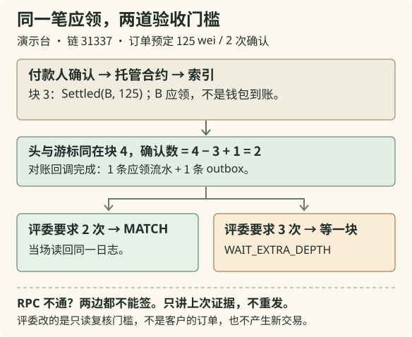

# 第 40 课 · 48 小时黑客松：让评委改一个数

评委接过 DESK-38：订单要求为收款人记 **125 wei 应领**，结算记录正好是 125，收在第 3 块。节点最新是第 4 块，对账台也已经核到同一个第 4 块。原订单要求 **2 次确认**，评委现在要求 **3 次**才肯签演示单。台面写着「已核销」，他现在该签吗？付款人需要再付一次吗？

按评委的新要求，**还不能签，也不需要重付**。结算所在的第 3 块算第一次，第 4 块算第二次。原订单已经达标，评委多要的是再等一块的证据，不是第二笔 125 wei。先等节点到第 5 块，再让对账台跟上，复查原交易仍在同一条历史里。这份结算记录只说明收款人可以领，不是钱包已经收到。

只改评委一栏：仍停在第 4 块，他把门槛从 3 调回 **2**。同一张记录现在够不够？够。可以签「这个块上，应领与要求相符」；交易编号、金额和原业务流水都不用改。若演示的是这个判断，两次复核应能点开同一张原回执，而不是各放一张成功截图。

**主线阅读到此结课。** 不做实验也可以停在这里；想另选主题，可从[选修入口：M07 跨层状态](../plan.html#m07)开始。以下是选做的 48 小时排期、三分钟彩排与毕业工单，读完不等于通过项目验收。实操沿用[第 38 课从订单找回应领凭据](payment-desk.html)和[第 39 课在查不到节点时暂停并恢复核验](operations.html)，不需要其他选修卷。时间和预期数字都是课堂约束；没有真实报名、资金、客户、比赛授权或获奖记录。

## 第一个去留决定，不是选前端框架

拿一届已经结束的活动做规则审读练习。[ETHGlobal New Delhi 的正式规则与提交说明](https://ethglobal.com/events/newdelhi/info/details)注明：2025 年 9 月 28 日 **09:00 IST** 截止；Classic 要求在开赛后开始项目，允许公共库或 starter kit，但不允许把赛前已有的项目专用代码、设计或素材当现场作品。Continuity 可以按该赛道条款延续项目，必须清楚区分既有工作与赛期新增功能；合作伙伴奖的资格还要另核。该届决赛评审是 **4 分钟演示 + 3 分钟问答**，推荐提交的录像为 2–4 分钟。不要把课程的 180 秒误抄到报名表里。

怎样选命题？把主办方的每个必选条件改写成一句可以被证伪的话。比如[该届 1inch 赛题](https://ethglobal.com/events/newdelhi/prizes/1inch)中的 “Utilize 1inch APIs” 要求至少一个 1inch API 真正为用户提供功能。我们的对账台只查本地 Anvil，**不选这一项**；放一个图标、一个 SDK 依赖或链接并不满足要求。就已有工程考虑 Continuity，也只能写「候选」，不能据此得出当届授权、版权许可或获奖资格。本练习只取该届评审关心的 *Practicality* 和 *Usability* 来练：收款员能否正确拒绝差额，接手人能否不找作者就复核。

在写第一行参赛代码以前，让队长把下面四笔记在[评委取证表](m10/demo/jury-sheet.tsv)及附件中：

| 要核的事实 | 可交给第二个人核对的材料 | 什么情况下不投 |
| --- | --- | --- |
| 谁参加哪一届、哪一赛道，允许做什么 | 当届官方链接、核对时间/时区、资格、团队与提交要求、命题对应的实物；有歧义时附主办方正式答复 | 只有旧活动页面、传闻或申请中状态，留作练习 |
| 开赛前已经有什么 | 准备一份带日期的基线提交、此后逐次的提交记录与文件差异；逐项列出 M04 托管、M05 索引、38 台面、39 演练和本课核验器，**全是读者拿到手时就有的** | 不得换仓重传，把这些文件或以前做好的录像计为赛期新增 |
| 谁允许复制、修改和公开 | 单列源码、依赖版本、图片/字体/音轨的作者、许可原文和分发义务；自制素材也记权利人。例：[web3j v4.12.3 LICENSE](https://github.com/LFDT-web3j/web3j/blob/v4.12.3/LICENSE) 的 Apache-2.0 第 4 条要求再分发附许可、保留适用声明，修改的文件标记修改 | 一个 `.sol` 上的 MIT 标识不覆盖整个仓库。找不到许可就不打包/不公开，换有权材料或向权利人取证 |
| 什么由团队当场完成 | 列赛期实际新增功能、作者、测试证据，以及复用和 AI 辅助的具体文件；该届对 AI 披露、使用规格驱动时附规划材料也有要求 | 拿不到披露材料、不能公开某段素材、合作方要求未达成，就缩小提交范围或不报，不编一封同意函 |

因此本课的提交动作是**交给同学验收**。真参赛时另查当届正式文件及[主办方活动入口](https://ethglobal.com/events)，有比赛准入与材料授权后才走正式提交流程。不用课程替任何人签字，也无需为练习押金、买币或连接外部钱包。

## 把 48 小时分给四个可以验收的结果

这里的核心切片只有一条：财务开单 → 付款人自行确认锁款、结算 → 索引追到正确部署 → 订单点回原回执。Java 工程师可以把它理解成一次跨数据库与外部事实源的验收：HTTP 200、回调参数和一行 `outbox` 都不能替代外部事实。少做一屏图表不会损失这条证据链；少做**受益人或单位核验**会。

| 演习时间 | 负责人、产物、交给谁检查 | 到点仍没做完，砍什么 |
| --- | --- | --- |
| 0–6 h，定题 | 队长与财务代表写一张单：谁签名、为何只核销 `Settled` 应领、怎样算失败；完成规则/许可表、定基线和验收人 | 不确定后台代签的边界，就砍代签；未获外部素材许可就不用。若命题不合格，此处停投 |
| 6–24 h，穿过一条真实路径 | 合约/Java 同伴在空链空库开单，另一人锁款并结算；交给财务同伴订单 ID、回执定位和一条可复算金额 | 砍多资产、多链和仪表盘。若只剩截图、读不回原件，到点标红，不能转为「已集成」 |
| 24–36 h，找会误报的地方 | 接手人改锁款末位，另跑拒签、查不到 RPC、重放；交正常与失败证据、停写/恢复步骤、流水数及 outbox 数 | 砍动画和推送；保留读失败的状态。到 36 h 仍不敢断 RPC，就不得声称可恢复 |
| 36–48 h，冻结并递交 | 冻结源码版本与依赖，另一台已预热的自有环境或干净目录重跑；计时排练，录制标出时间与限制的短片，留出上传/校验时间 | 不再合并非必要功能。课内由接手人签收文件；真实比赛按当届截止时间留缓冲，并留正式提交回执 |

## 彩排桌面：一笔真实结算，两种评委要求

从仓库根目录操作。提前按[38 课](payment-desk.html)预热 Docker/PostgreSQL 17.5、JDK 21、Maven 3.9.x 和依赖；按[工具准备](abi.html#m04-tools)预热 Forge/Cast/Anvil 1.7.1、solc 0.8.28。核验器只需 Python 3.11 标准库。两次彩排不要复用内存链、库或订单证据。**上台前**完成构建与空单部署，不把下载、重编译和启动 Java 的时间剪成付款响应时间。

终端 A 创建新目录和新链，保留前台进程；不要加 `--settle-wei`，也不要按回车结束它：

```bash
export PATH="${XDG_CACHE_HOME:-$HOME/.cache}/chain-course/m04/bin:$PATH"
export FOUNDRY_SOLC="${XDG_CACHE_HOME:-$HOME/.cache}/chain-course/m04/bin/solc"
unset ANVIL
WORK=$(mktemp -d); printf '本轮 WORK=%s\n' "$WORK"
python3 labs/m04/deployment.py --out "$WORK/release" --hold
```

终端 B 从仓库根目录启动对账台，复制 A 的 **WORK 路径**；此终端也留在前台。若沿用已结算的 38 课正常轮做读端彩排，**跳过 A、B**，不能重发付款。要演现场确认则必须有新空单。

```bash
printf '粘贴 WORK：'; IFS= read -r WORK
bash labs/m10/desk/run.sh init "$WORK" DESK-38 125 2
```

付款人与收款员各用一窗口：前者 `http://127.0.0.1:18039/` 只确认本机临时账户的交易；后者 `http://127.0.0.1:18038/` 查订单、补扫、核对。索引不接收签名密钥。终端 C 放好独立核验器和空取证表：

```bash
printf '粘贴 WORK：'; IFS= read -r WORK
ORDER=$(cat "$WORK/desk-order"); E=$(mktemp -d "$WORK/jury.XXXXXX")
cp labs/m10/demo/jury-sheet.tsv "$E/sheet.tsv"
# 参数：评委额外要求的确认数、本次记录的名字。每次使用新名字。
jury() { python3 labs/m10/demo/witness.py "$WORK/release/manifest.json" "$ORDER" \
  --depth "$1" > "$E/$2.json"; }
```

正常轮：在付款人窗口核查链号、地址、期限和金额，先预览再分别确认 **lock 125 wei、settle**；对账员补扫并请求核对。在块 3 已有结算，但只得到 `3 − 3 + 1 = 1` 次确认。使用本机实验管理员的空块操作推进一块，再由对账员补扫核对；本地头和游标同为块 4，`BOOKED_AT_HEAD` 才表明这一单的托管应领已入账。没有调用 `withdraw()`，也没有向外部商家投递通知。

<figure class="lesson-figure"><a href="../assets/figures/m10/hackathon.svg"></a><figcaption>上半张单是已经发生的业务事实，下半张是评委对同一份原件的核验要求。改下半张不应在上半张制造第二笔收入。</figcaption></figure>

在同一个稳定链头、同一订单上运行下面两条。`MATCH` 只是「所查头上的应领入账与该门槛相符」。第二条**预期退出 3 而非 0**，看文件里的 `outcome` 分清是额外门槛未到还是取证失败。命令不发回调、不挖块，也不改变订单条款。

```bash
jury 2 depth2
jury 3 depth3
python3 - "$E/depth2.json" "$E/depth3.json" <<'PY'
import json, sys
for path in sys.argv[1:]:
    with open(path) as f: p = json.load(f)
    print(p['outcome'], p.get('settledWei'), p.get('confirmations'), p['reviewDepth'],
          (p.get('receipt') or {}).get('transactionHash'), p.get('reason', ''))
PY
```

拿两份 JSON 并排，让评委先读相同的三栏：`receipt.transactionHash`、`settledWei`、`confirmations`。同一笔、同为 125 wei、同为两次确认，然后才读不同的两栏：`reviewDepth` 为 2 时 `outcome=MATCH`，为 3 时 `outcome=WAIT_EXTRA_DEPTH`。有效门槛取订单与评委要求中的较大者；评委不能调低原订单的放行条件。如果交易编号或头块已经换了，这就不是「只改一个条件」的对照。

[只读核验器 witness.py](m10/demo/witness.py) 的输入是可信部署清单、订单号和评委门槛。它先从本机 18020 的订单 GET 取 `observed`，用[第 16 课读端](m04/handoff.py)到 18556 核部署，再按交易哈希取原回执。在对应块、对应日志位置检查合约和受益人，按整数解 `Settled` 日志的 32 字节 `data`，这才是 125 的来源。最后复查链头，给 JSON 附上 UTC 时间、业务响应与原回执。若头变了，重新取整份，不拼两个时刻的数。它没有让观众指定任意节点，也没有独立验证共识；结论依赖受控的清单和本机节点。

| 在自己机器上应能区分的情况 | 预期结果，不是假装已跑的记录 |
| --- | --- |
| 应收、锁款均 125；块 4 查，输入 2 再输 3 | 两份 `settledWei="125"`、实际确认均 2、同一笔交易；先 `MATCH`（退出 0），再 `WAIT_EXTRA_DEPTH`（退出 3）。业务订单仍已核销 |
| 评委在**新部署**的付款人窗口改锁款为 124，应收仍 125 | `125 − 124 = 1 wei`；回执依然可能成功。补扫后 `HOLD_AMOUNT`，核验器 `HOLD_ORDER`，无应领流水、无 outbox；多挖块不会补钱 |
| 查阅过程断连、回执/部署锚点不符 | `UNVERIFIED`、退出 3，不能报金额为零。服务还开着但游标落后时也不能通过；`HOLD_ORDER` 内看业务原因，如 `HOLD_LAG` |

## 180 秒导演单：哪一句话可以当场被推翻？

开演前把空订单、付款人确认窗、核验终端摆好。主持人讲，付款人操作，对账员补扫，评委读数；一人排练时也要切换这三个职责，而非把签名塞进后台。请同伴按秒表，以下每个区间**含起点、不含终点**。

| 时间 | 台词、动作 | 屏幕要让评委读到什么 |
| --- | --- | --- |
| 00:00–00:15 | 「财务要交付的是应领，不是钱包余额。您可以改输入。」给他看开演前已建的单 | `DESK-38`、125 wei、两次确认；明确是本机 Anvil，未付款 |
| 00:15–00:35 | 指出谁签名、谁只读。让评委在付款前选 125 或 124；口述另一路的预期，不宣称两路都在本轮发生 | 可编辑的整数金额、目标合约；必须经本人确认 |
| 00:35–01:05 | 付款人确认锁款，再单独确认结算。对账员补扫，不把锁款/回调当收入 | 两笔不同交易；`Settled` 的受益人、金额和块 3，只含一次确认 |
| 01:05–01:30 | 推进一空块，补扫核对。若少 1 wei，就转人工，不换单、不补录 | 足额是块 4、两次确认、一次核销；不足是 `HOLD_AMOUNT` 与实际差额 |
| 01:30–01:55 | 从订单点入原回执。指出 `status=0x1` 只表执行成功；让评委对齐块哈希、日志索引和金额 | `logs[i].address` 是本清单的托管合约，事件是 `Settled` 而非 `Withdrawn`；在 `topics[1]` 读受益人，不拿交易的 `to` 当收款钱包 |
| 01:55–02:25 | 足额时让评委依次运行 `jury 2 stage2`、`jury 3 stage3`；少付时运行 `jury 2 short` 看原因，问「改确认数能补这 1 wei 吗？」 | 足额的结论翻转而哈希不变；差额轮换门槛仍挂起，流水为零 |
| 02:25–02:45 | 说明 RPC 如果此刻失联怎样值班。可展示已封存的 39 课断连/恢复记录，醒目标为「彩排历史，不是现在」 | 给出取证时刻和恢复条件。若现场真的失败，走下面的降级话术，不等待重启跑完 |
| 02:45–03:00 | 「这只说明本地这个头上的应领；我们没证明最终性，没发送外部通知。下一项值得验证的是接收端去重。」交出取证表和离线复核路径，停表 | 最后一屏是限制、文件路径和谁接手，不是奖金额或收益预测 |

**故障分支占用原来的时间，不给演示偷偷加时。** 一次有界请求失败即停止点确认，展示当前错误与时间：「本机现在不能读取节点，我不知道最新状态，不重发。」保留失败包和最后可信头；若有同一部署旧凭条，只能讲「这是某时某块的原件」，不能用它给刚改的输入签收。没旧凭条就只讲故障。恢复同一进程/链后，让接手人核对部署块哈希、头与游标，补扫重放，再查原交易。若换了新内存链，旧库不能直接接上；这轮在表中记为**未完成实时复核**。录像只补充展示，不覆盖失败。

**本课独立作业。** 不使用上面两份成功轮文件，另开一单 `J-40B`，应收 **703 wei**、门槛 **2**，让另一人现场选择锁 **702 或 704 wei**。在确认前写下其选择、预期差额符号和判据；结算后请他从订单点回日志，再用核验器保存实际 JSON 和一次不超过 180 秒的演示记录。解题判据：两种输入的 `expected − observed` 分别是 **+1 / −1 wei**，都进 `HOLD_AMOUNT`，不是仅少付才挂起；能指到本轮原回执，且无流水/通知。只要求实跑被选的一支，另一支标「预测」。

<a id="m10-checkout"></a>

## 卷末独立工单 C-1040：交给没看彩排的财务主管

**客户来单。** 山谷工坊要在自己的笔记本验收一场合成展销：一张订单、链 31337 的原生测试币、托管受益人应领。报价单位为人民币、业务单位为 wei，两者不换汇。财务签范围，付款人自己确认交易，另一位值班员验收恢复；不托管私钥、不做主网、不发货。请交两版报价、可启动的交付包、断连记录及三分钟演示，预算 **7,200 元**。做到一半又有人口头要「再写一个 CSV 导出，预计两小时」——回答这是不是原范围，不要默认白做。

**报价封面要能算回去。** 客户给的工时基准：梳理 2 h、只读对账 7 h、接手及验收 5 h；若包含非托管发起，再增付款操作 6 h 与拒签验收 2 h；费率 **320 元/h**。按[第 37 课](scope.html)分别写出 A/B 的里程碑、谁负责节点与环境、排除项、验收人和质保截止条件。判据：A 为 14 h、**4,480 元**；B 为 22 h、**7,040 元**。新增导出 640 元，B 加到 **7,680 元**，超预算 480 元；请财务另签变更、调预算或换范围。验收以下 B 版的本地非托管路径，不许把 A 报成包含签名。

**给接手人的新输入。** 订单号 `C-1040`，应收与锁款都是十进制字符串 **`9007199254741137` wei**，订单门槛 **3 次**，评委先要求 3 再改 4。这个数超过 JavaScript 安全整数；不能用浮点数解析再格式化。只有所选部署合约的一张活单，不准拿 `DESK-38` 的截图交卷。全套可在同一轮完成，下面是接手人的操作顺序，而不是已经发生的事故记录：

1. **独立开站。** 用已交付的版本、工具清单和 38/39 课命令，停止上一轮服务（B 停台，A 回车停旧链），保留原文件；新 WORK、新链、新库，A 仍是无预付的 `deployment.py --out "$WORK/release" --hold`，B 换成 `bash labs/m10/desk/run.sh init "$WORK" C-1040 9007199254741137 3`。记录版本、清单和 `python3 labs/m04/handoff.py "$WORK/release/manifest.json"` 的活读结果。初始应领为零；把订单号、链号、合约、受益人、部署交易与部署块哈希记在空取证表上。交接人的工作不是复制出题人的数据库。
2. **制造一个真的观察缺口。** 在付款台先拒绝一次预览，确认没有多出交易；重新预览才确认 lock、settle。对账员补扫至结算块（独占新链上为块 3）：只有一次确认，尚不能核销；保持 A、B 活着。终端 C 设好本轮 WORK、工具 PATH，不碰付款台或对账台的补扫按钮，只用本机节点管理员挖两个空块。只读 GET 应见头 5、游标 3，`HOLD_LAG`。注意是**节点读得到、索引没跟上**，不能把这个状态冒称 RPC 已失联。
3. **故障交班。** 由非作者值班员在这一缺口上跑[39 课的短暂停读与恢复](operations.html)，无并发扫描、付款或挖块；在表中记发现时间、告警、谁能暂停链下动作、何时须升级。真实暂停回环 RPC 后不能判断付款成败；应有一次失败回调、`mayNotifyAsOfHead=false`、不重复付。恢复同一部署，游标不会因通讯恢复而自动补齐。保存实跑产生的 `outage.json`，再 `Recover`；核销重试只产生 1 笔应领、1 行 outbox。

下面是第 2、3 步可复制的终端 C 命令。先像彩排一样用**新** WORK 定义 `ORDER`、`E`、`jury`，并在该终端导出 A 的 Foundry PATH；在收到结算块 3 的响应后运行。不要并行点击任何会挖块/扫描的控件：

```bash
export M05_MANIFEST="$WORK/release/manifest.json" M05_DB="$(cat "$WORK/desk-db")"
RPC=http://127.0.0.1:18556; API=http://127.0.0.1:18020
cast rpc --rpc-url "$RPC" evm_mine && cast rpc --rpc-url "$RPC" evm_mine
curl --noproxy '*' -fsS "$API/orders/C-1040" > "$E/lag.json"
python3 labs/m10/ops/outage.py "$M05_MANIFEST" C-1040 "$E/outage.json"
bash labs/m05/run.sh Recover
hint() { curl --noproxy '*' -fsS -X POST "$API/orders/C-1040/callbacks/jury-1040" \
  -H 'Content-Type: application/json' -d '{}'; }
hint > "$E/book.json"; hint > "$E/retry.json"
bash labs/m05/run.sh Scan 2
hint > "$E/replayed.json"
bash labs/m05/db.sh sql > "$E/counts.txt" <<'SQL'
SELECT (SELECT count(*) FROM order_booking WHERE order_id='C-1040') AS bookings,
       (SELECT count(*) FROM order_outbox WHERE order_id='C-1040') AS pending_records;
SQL
```

**财务主管亲自改输入并签收。** 在头 5、游标 5 上运行 `jury 3 checkout3`；打开 JSON，从 `receipt` 而非屏幕标签找成功状态、合约地址、`topics[1]` 末 20 字节和 `data` 的 32 字节整数，跟订单逐项核对。`5 − 3 + 1 = 3`，金额应为 **9,007,199,254,741,137 wei**。独立运行 `jury 4 checkout4`：仍是同一 `(chainId, blockHash, txHash, logIndex)`，同一金额和两张各 1 行的表，但预期 `WAIT_EXTRA_DEPTH`，**不是**新付款或撤销旧流水。若有必要证明允许恢复，只再挖 1 个空块并补扫，头到 6，确认数 4，不重发付款便能通过。录像中让评委读出一个完整交易号所在文件的路径，并说明为什么 3 次确认不是公网最终性。

**交包，而不是报喜。** 源码版本与基线差异、工具/依赖与许可、两版范围及签字栏、干净环境命令、可信部署清单、角色权限、原回执、正常/失败差异、停读与恢复记录、行数和实测时长，一起交给独立接手人；取证表最后一列由实际核验人填。只用合成工单；不交凭据、钱包文件或含秘密的全量环境。评判三个硬条件：能否不靠作者找回**同一**链原件，断连时是否停在「未知」并恢复原账，评委换输入后是否给出可解释的不同结果。任何一个只剩截屏、预期数或未经标注的重播，就保留未通过，不用接单额或奖项填空。

**复核原文。** [Ethereum Execution JSON-RPC：eth_getTransactionReceipt](https://ethereum.org/en/developers/docs/apis/json-rpc/#eth-gettransactionreceipt) 区分交易执行状态和回执日志；[本课合约](m04/src/MilestoneEscrow.sol)定义 `Settled` 与 `Withdrawn` 的不同业务含义。比赛资格与演示格式请回到上面的当届官方规则；协议文档不能回答版权或参赛许可问题。
