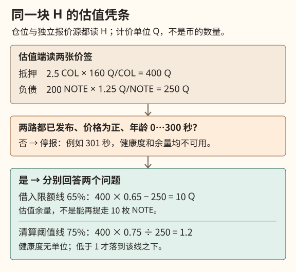

# 第 24 课 · 健康度 1.2，为什么还不能给借款报价？

工单 H-24：测试账户押了 **2.5 COL**，欠 **200 NOTE**。风控页显示健康度 **1.2**，产品想在旁边加个「再借 10」按钮。先问清：10 是枚数还是估值？是哪个块的哪两张价签？本单两币分别值 **160 Q/COL**、**1.25 Q/NOTE**；算出来的 **10 Q** 是按借入上限尚余的计价金额，不是贷款承诺。如果抵押币的价签已经 **301 秒**没更新，连这个估值也不能沿用。

先修：[13 · ABI 与只读调用](abi.html)、[17 · 回执与块锚点](rpc.html)、[22 · 资产精度和授权](allowance.html)、[23 · 报价不等于成交](swap.html)。本课独立开一条回环链，不复用上一课的池价或授权。COL、NOTE 是教学仓位中的记账单位；Q 是两路报价共用的**计价单位**，不是可转账的代币，更不代表真实美元。整个读端没有签名、借款或清算入口。

## 同一个仓位，为什么需要两个百分比？

假设仓位只有一种可抵押资产和一种已欠资产，利息在取数前已计入债务数量。先换成同一种钱：抵押估值 `C = 2.5 × 160 = 400 Q`，债务估值 `D = 200 × 1.25 = 250 Q`。不能算 `2.5 / 200` 来比较价值；也不能因为 NOTE 的名字像结算币就假定它恒值 1 Q。

| 问的问题 | 在本例怎么量 | 成立条件与答案 |
| --- | --- | --- |
| 当前抵押覆盖多少债务？ | 本课把「抵押率」明确写作 `C / D` | 债务非零时为 **160%**。反方向的**当前借款成数** `D / C` 在抵押估值非零时为 **62.5%**。写字段时标清分子分母 |
| 还能增加多少**估值上的**债务？ | 配置的最大借款成数 LTV 为 `6500 bps = 65%`。`1 bps = 0.01%` | 借入估值须满足 `D + 增量 ≤ C × 65%`。当前限额 260 Q，扣掉 250 Q，估算余量 **10 Q**；超过限额时余量只报 0，不报负借款 |
| 这个仓位在清算判断线的哪边？ | 清算阈值 LT 为 `7500 bps = 75%`。健康度 `HF = (C × LT) / D`，无单位 | 此刻阈值调整后抵押值为 **300 Q**，`HF = 300 / 250 = 1.2`。本模型只有 `D > C × LT` 才在线下，等价于 `HF < 1`。等于 1 在边界，不算已经越界 |

LTV 管新增借入，LT 衡量既有债务，两者不应共用一个配置项。例如仍有 400 Q 的抵押，若已欠 280 Q，则超过 260 Q，**再借余量为零，却没有跌破 300 Q 这条线**。「线下」也不等于「已清算」：后者需要有对应协议的状态变化和执行证据。在多抵押品系统，阈值贡献要按每种有效抵押的估值乘其阈值再加总，不能把各币阈值当百分数简单平均。

<figure class="lesson-figure"><a href="../assets/figures/m06/health.svg"></a><figcaption>有债务时的两道判断。图中金额是默认输入的手算值；读数所在的真实块哈希要由你本次节点给出。两条线都不会发交易。</figcaption></figure>

## 给每个整数贴上刻度，再决定怎么舍入

[RiskView.sol](m06/src/RiskView.sol) 是没有资金的合约。一份 `RiskView` 只记一笔教学仓位；构造时新建两个独立 `TeachingPrice` 合约，各保存一份不可变观测，不请求外部市场。这是为了能精确安排观测年龄、复算与拒绝路径，不是生产喂价设计。

| `position()`、两份 `quote()` 的默认输入 | 原始整数 | 自己的精度 | 含义 |
| --- | ---: | ---: | --- |
| 抵押数量 | `2500000000000000000` | 18 | 2.5 COL；不是 ETH/wei |
| 抵押价格 | `16000000000` | 8 | 每 1 COL 的报价 160 Q |
| 债务数量 | `200000000` | 6 | 200 NOTE |
| 债务价格 | `1250000` | 6 | 每 1 NOTE 的报价 1.25 Q |

把所有估值记成 `Q8`：**1 Q = 10⁸ 个 Q8 最小计价单位**。数量有 `a` 位，价签有 `p` 位，未舍入的估值是 `amountRaw × priceRaw × 10⁸ / 10^(a+p)` 个 Q8。份额和价格都还没有除过，不先把 2.5 截成 2。教学政策让抵押价值向下取整、债务价值向上取整，再对阈值调整和借入限额向下取整；不要照搬到别的协议。正债不能仅因取整就被归为无债。最后用 `floor(adjustedQ8 × 10¹⁸ / debtQ8)` 返回 `hfWad`，**10¹⁸ 对应健康度 1，不是 1 ETH**。本课判断 ABOVE、AT、BELOW 用原始的 `adjustedQ8` 与 `debtQ8` 比较，不用界面四舍五入后的 HF。

源码的读数范围是有意收窄的：数量 `uint96`、正价上界 `uint64`，本合约创建的两路价格精度分别固定为 8 和 6，只有一个仓位和两路报价。即使暂不除刻度，`数量 × 价格 × 10⁸` 也小于 `2^187`，再乘 `10¹⁸` 仍小于 `2^247`；本范围不会逼近 `uint256` 的乘法上限。不要把这条证明套在任意代币、任意精度和无限资产列表上。Java 读端应使用 `BigInteger`（每次写清取整方向），最后才以 `BigDecimal` 展示；不能拿 `double` 做边界比较。

## 用哪一个时钟判断过期？

读端只选一次头块 H。仓位、限额配置、两路价签、合约 `inspect()` **全部按 H 的哈希**做 `eth_call`，并要求 `requireCanonical: true`；输入时刻用 H 的 `timestamp`，不是浏览器打开页面的时间。假设 H 之后又出了块，当前屏幕仍然只是 H 上的观察；若节点不支持指定块或拒绝该锚点，应停止并重新选定一整份快照，而不是悄悄把某次读取改成 `latest`。

1. `debtRaw == 0` 是已知仓位事实，不需任何价格就能答「没有债务」。本接口返回 `NO_DEBT`，**健康度不适用**，也不据此给借款余量；不要用 0、无穷大或最大整数当成可比较的健康度。
2. 有债时先按发布标志检查抵押价，再查债务价。未发布返回 `MISSING` 并指出哪一路；已发布但数值为 0 返回 `BAD_ANSWER`。前者不是「确认价格为 0」。真实价格源可能给出有符号 `answer`、调用回退或暂不可读；先检查状态和正值，不应把负数直接转成无符号整数。本课的回环报价类型是 `uint64`，不声称复现真实价格源的全部故障。
3. 时间戳须非零、不晚于 H；否则 `BAD_TIME`。然后算 `H.timestamp − updatedAt`，两路均须在闭区间 **[0, 300] 秒**。本轮抵押价年龄默认 30 秒、债务价 0 秒；只有 `> 300` 才是 `STALE`。这是本工单的观察窗口，不是所有市场的统一心跳。年龄小说明够新，不证明价格真实、市场可成交或节点已最终化。
4. 任何必需价签不合格，保留仓位原数、来源、更新时刻和拒绝原因，估值列标「不可用」，不退回最近的好价、池的瞬时比价或硬编码的 1 Q。若产品保留上一次好价供人排障，应明确标「历史、截至旧块」，与当前决策隔离。等新观测出现，再读整张新快照。

## 在本机把同一块的两种实现对平

在**仓库根目录**用 Bash、Python 3.11 标准库和[第 13 课固定的工具](abi.html#m04-tools)（Foundry 1.7.1、solc 0.8.28，Cancun）。安装工具的准备阶段可能访问网络，缓存齐备后本实验可离线，不需 Maven、钱包或测试币。端口 **127.0.0.1:18624** 须空闲；每次运行都会新开、结束自己的 Anvil，链号 31337。不连接已有节点。

```bash
export PATH="${XDG_CACHE_HOME:-$HOME/.cache}/chain-course/m04/bin:$PATH"
export FOUNDRY_SOLC="$(command -v solc)"
unset ANVIL
WORK=$(mktemp -d)
python3 labs/m06/health.py > "$WORK/fresh.txt" && cat "$WORK/fresh.txt"
```

顺着[读端 health.py](m06/health.py)看输出：

- `SNAPSHOT` 给出实际链号、估值合约地址、块高、哈希和秒级 Unix 时间；`POSITION`、`POLICY` 是从该块读出的仓位和规则，不是重复打印命令行常量。`FEED` 两行分别带发布地址、刻度、原数和更新时间。把 `timestamp − updatedAt` 与 `ageSeconds` 对照。地址、哈希和绝对时间随部署变化，不抄别人的作为自己的证据。
- `words()` 对这四个已知、无动态类型的 getter 严格按数目拆 32 字节 ABI 字；`inspect()` 的静态结构展开共 7 个字：状态、出问题的一侧及 5 个度量。它以状态区分有效负载：**仅 `READY` 才解读后五个字**。例如缺价时 Solidity 返回区全零占位，读端丢弃，交付 `metrics=absent`，不做任何算术。
- `GETTER` 是合约返回值；`OFFLINE` 来自 `recompute()`，后者不再访问节点，只用刚才读到的原数、政策和 H 的时刻。Python 用 `divmod` 看到债务估值有余数就加 1，两端必须逐整数一致。默认手算期望如下，不包含本次地址或块哈希：

```text
GETTER state=READY side=none collateralQ8=40000000000 debtQ8=25000000000 adjustedQ8=30000000000 hfWad=1200000000000000000 headroomQ8=1000000000
OFFLINE state=READY side=none collateralQ8=40000000000 debtQ8=25000000000 adjustedQ8=30000000000 hfWad=1200000000000000000 headroomQ8=1000000000
RESULT ESTIMATE_ONLY collateralQ=400 debtQ=250 hf=1.2 boundary=ABOVE headroomQ=10 executableQuote=false
```

**`READY` 只指这次快照的数据适于估值，不是贷款审批。** 想把 10 Q 换算成 NOTE，按本价是 `10 / 1.25 = 8 NOTE`，仍只是折算。在真实协议还要查池可用流动性、借款开关、币种上限、账户/模式限制、利息累积与执行时的新状态。本合约根本不提供这些数据；此处不报价、不构造可执行交易，也不给交易或投资建议。

## 只改一项，看拒绝与越界是不是同一种事

仍在根目录，沿用上面的 `WORK`。以下是**分开运行**的对照，不是同一条链上的连续状态。前两条判断精度；不要用只显示两位的 `1.00` 替代 `boundary`。

```bash
python3 labs/m06/health.py --debt-raw 240000000
python3 labs/m06/health.py --debt-raw 240000001
python3 labs/m06/health.py --debt-raw 0 --missing debt
python3 labs/m06/health.py --coll-age 300
```

依次预期：240 NOTE × 1.25 正好 300 Q，`hf=1 boundary=AT headroomQ=0`；多欠 1 个 NOTE 最小单位，债务变成 **300.00000125 Q**，`boundary=BELOW`，不是已经执行清算。第三轮 `NO_DEBT`，即便债务价缺失，也不借它计算什么。第四轮仍可估，`ageSeconds=300`。以上均退出 0，表示得到了自洽的只读答案。

```bash
rc=0; python3 labs/m06/health.py --coll-age 301 > "$WORK/stale.txt" || rc=$?
cat "$WORK/stale.txt"; test "$rc" -eq 3 && grep 'RESULT HOLD_STALE side=collateral' "$WORK/stale.txt"
rc=0; python3 labs/m06/health.py --missing debt > "$WORK/missing.txt" || rc=$?
cat "$WORK/missing.txt"; test "$rc" -eq 3 && grep 'RESULT HOLD_MISSING side=debt' "$WORK/missing.txt"
```

这两轮有债，却不能回答健康度：`GETTER` 和 `OFFLINE` 都须 `metrics=absent`，结论为 `executableQuote=false`；前一轮有 `updatedAt` 但太旧，后一轮 `present=0 answerRaw=absent`，没有可代入的债务价。还可试 `--coll-price-raw 0`：这是**已发布**但不合格的报价，应退出 3、`HOLD_BAD_ANSWER` 而非 `HOLD_MISSING`。若看到的是端口冲突、RPC 异常或 ABI 长度错误，不算通过了任一业务拒绝分支。

## 独立作业：仓位数没动，为什么健康度会变？

新值班单 H-24B 有 **3 COL** 和 **220 NOTE** 的债务。原本每枚 COL 值 160 Q，复核时变为 **120 Q**；两张价签都有效。不要改偿债额「修正」比率。在根目录用下面两个调用，先预测两个块各自的估值、借入余量和健康度所在线的一侧，再与输出核对。

```bash
python3 labs/m06/health.py --coll-raw 3000000000000000000 --debt-raw 220000000 > "$WORK/h24b-before.txt"
python3 labs/m06/health.py --coll-raw 3000000000000000000 --debt-raw 220000000 \
  --coll-price-raw 12000000000 > "$WORK/h24b-after.txt"
```

**答案判据：** 两份独立部署的债务均为 **275 Q**。原先抵押值 480 Q、阈值调整后 360 Q、LTV 余量 **37 Q**，健康度为 `360/275 > 1`；换价后抵押值 360 Q、调整后 270 Q、LTV 余量 **0 Q**，`270/275 < 1`。各交出自己的 `SNAPSHOT / FEED / GETTER / OFFLINE / RESULT`，在相同块内对平，不把两次地址串成一次借款交易。再选一个反例让价签无效：只能给出有原因的停止，不能继续沿用 270 Q 作为当下答案。

<a id="m06-checkout"></a>

## 卷末验收 · D-624：四联证据能不能支持一键执行？

接手人拿到一张变更单：「测试用户想登录；采购设置 2.5 枚限额；报价台考虑用 40 枚 A 换 B；风险台看到 HF 高于 1。能不能合并成一个绿色的『已授权、可成交、还可再借』？」交付人要交**四份独立凭证和一项拒绝该合并的决定**。四个实验使用各自的回环环境，链号相同也不共享部署、用户、授权或块；工单号是交接索引，不把它们冒充一份原子交易。

**第一联：登录意图。** 按[21 · 登录与签名](siwe.html)备齐 JDK 21 和该课 Java 依赖。从根目录在两个终端分别启动 `bash labs/m06/login/run.sh login`、`bash labs/m06/login/run.sh signer`；用全新且专用的浏览器资料打开 `http://127.0.0.1:18121/`。先连接教学签名器并在独立窗口确认连接，再请求**登录**签名，这一次在签名器拒绝；回到登录页检查服务端会话。留一张文字记录：教学链号 **31337**、拒绝码 **4001**、会话仍为 **ANONYMOUS**。不要归档网络包、cookie、签名原件、私钥或浏览器资料目录。关闭两个进程。这一联不发 ERC-20 授权；后两联的授权只来自各自实验的测试账户。

**第二联：授权凭条。** 在根目录沿用前述工具环境，另建卷末目录，不复用作业输出。请求人在两份自建资产上均批准 2.5 枚，但要留 **1 个各自的最小单位**不动。由对方交接的地址、精度和交易凭证复算，不能只收「成功」截图。

```bash
WORK=$(mktemp -d)
python3 labs/m06/allowance.py --out "$WORK/A22" \
  --spend6 2.499999 --spend18 2.499999999999999999
python3 -m json.tool "$WORK/A22/evidence.json"
```

打开本地 `A22/voucher.html`，逐项登记 `chainId / owner / token / spender / capRaw / decimals`；和 `evidence.json` 各资产 `steps` 的回执逐笔对齐。6 位资产上限 `2500000`，合法使用 `2499999`；18 位资产上限 `2500000000000000000`，合法使用 `2499999999999999999`。两轮合法扣款都应获成功回执、额度余 1 raw；紧接着的 **2 raw** 请求必须是**有块哈希的失败回执**（`status=0x0`、无事件、消耗 gas），持有人余额、收款余额及授权余量都不动。这里的 1 raw 分别是 `0.000001` 和 `0.000000000000000001` 枚，不是又给了 1 枚额度。

**第三联：同池报价、受阻、实收。** 新池初始 1,000 A / 2,000 B，A 有 18 位、B 有 6 位，毛输入费率 30 bps。请两位接手人分别跑一次池实验、手算一次；手算不从报价输出复制数字。

```bash
python3 labs/m06/swap.py --trade-in 40 > "$WORK/swap.txt" && cat "$WORK/swap.txt"
python3 - <<'PY'
x, y = 1000 * 10**18, 2000 * 10**6
for whole in (40, 100):
    net = whole * 10**18 * 997
    out = y * net // (x * 1000 + net)
    print(whole, 'A =>', out, 'B raw')
    if whole == 40:
        print('reject minimum', out + 1, 'fill minimum', (out * 9950 + 9999) // 10000)
PY
```

在同一初始块，40 A 预期 **76,701,157 B raw**，100 A 预期 **181,322,178 B raw**，不是线性放大。40 A 的第一次最小输出要求 **76,701,158**，无成交事件、钱包与池的两币余额及授权不变，失败交易仍有原生 gas 费。第二次在失败后的块重新报价，按 50 bps 容差向上取整得最小输出 **76,317,652**；本地成交应实收 **76.701157 B**。保存拒绝和成功的**不同**回执及块锚点，从两笔转币日志与交换事件对上实收；池终值 1040 A / 1923.298843 B，钱包 60 A / 76.701157 B，授权归零。只拿报价、最小值或 `status=1` 的任一个都不能冒充真实实收；第 22 课的 spender 也不能替这一池背书。

**第四联：风险台的受阻决定。** 独立仓位 **3.25 COL**，报价 **128 Q/COL**，欠 **240 NOTE**。请先回答：「两张价签刚好有效时，看起来在线上，为什么余量却是零？唯一改成过期价，应不应该仍给客户报零？」在同一 Bash 中准备参数，分别记录可估与受阻两轮。

```bash
risk=(--coll-raw 3250000000000000000 --coll-price-raw 12800000000 --debt-raw 240000000)
python3 labs/m06/health.py "${risk[@]}" --coll-age 300 > "$WORK/risk-at-limit.txt" && cat "$WORK/risk-at-limit.txt"
rc=0; python3 labs/m06/health.py "${risk[@]}" --coll-age 301 > "$WORK/risk-expired.txt" || rc=$?
test "$rc" -eq 3 && grep 'RESULT HOLD_STALE side=collateral' "$WORK/risk-expired.txt"
```

300 秒这份的 `GETTER`、`OFFLINE` 应均对应 **416 Q** 抵押、**300 Q** 债务、**312 Q** 调整后抵押、`HF=1.04`。借入估值限额 **270.4 Q**，已经低于债务，所以可计算的 `headroomQ=0`。301 秒那份仓位原数相同，但因为抵押价过期，`metrics=absent`：此时连「余量是零」都没有证据，更没有可执行报价。两份记录需分别标记自己的 H、两路报价源、刻度、更新时间，不能把 300 秒的 HF 贴在 301 秒的工单上。

**签收判据：** 接手人不用原作者的地址、哈希或账号，按上述命令能得到相同的**字段关系与整数**；将四联的证据位置、可回答的问题、不能回答的问题各写一行，并写下拒绝合并的理由。至少区分「用户拒签而无会话」「链上超额交易已入块但回退」「交易成功且实收可对账」「估值可算，但没有新增空间」「输入过期，连余量也不可估」。留存工具版本与重跑命令，这些才是后续项目可复用的交接材料；不附测试或真实钱包的秘密，不把成功的本地实验当成主网借款、成交保证或生产安全审计。

## 查证原文

- [Chainlink Data Feeds API：`decimals()`、`latestRoundData()`、`updatedAt`](https://docs.chain.link/data-feeds/api-reference)。接口序列里 `answer` 是 `int256`，刻度要从对应 feed 读；本地 `TeachingPrice` 有明确的发布位，**不是**该接口的实现，也没有连接真实价格服务。
- [Aave：Health Factor & Liquidations](https://aave.com/help/borrowing/liquidations) 给出加权清算阈值与健康度低于 1 的含义；[Aave V3 Core：GenericLogic](https://github.com/aave/aave-v3-core/blob/master/contracts/protocol/libraries/logic/GenericLogic.sol) 可对照 `calculateUserAccountData` 与 `calculateAvailableBorrows` 为什么不是同一个数。本课的单仓位、精度、保守取整、300 秒和无债展示都是教学约定，不是复刻线上某个市场的实时配置。
- [EIP-1898：用 `blockHash` 和 `requireCanonical` 固定 `eth_call` 的读取对象](https://eips.ethereum.org/EIPS/eip-1898)。固定同一状态不等于证明这块永远不会被换掉。
