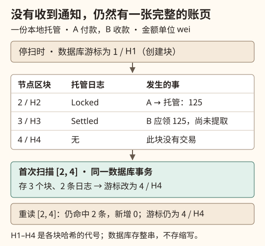

# 第 18 课 · 从日志建索引：没人在线的三块，怎样补进账页？

交接簿上写着「已查完块 1」。服务停着的时候，块 2 记了 A 锁款 125 wei，块 3 记了给 B 结算这 125 wei，块 4 是空块。值班员重开服务：要补查几个块，写几条记录？书签该夹在最后有业务的块 3，还是已经查完的块 4？

**查 3 个块，新增 2 条记录，书签夹在 4。** 书签标的是「查完哪里」，不是「最后一笔生意在哪里」。两条记录属于同一笔钱：先存进托管，再记为 B 可领。没有提款记录，不能对客服说 B 的钱包已收到 125 wei，更不能把两行相加算成 250 wei。

只改块 4 的内容：它不再是空块，而是记了一条「B 从 C 领走 125 wei」。仍从停在 1 的同一张书签补扫，答案变成什么？仍查 3 个块、书签仍夹在 4，但这次新增 **3 条**记录。第三条抵掉 B 的应领：从这份托管已领 125 wei，剩余可领 0。要看收到没有，关键是这条记录，不是块数。

只想读懂补账，可以[翻到第 19 课：查过的块被替换怎么办](reorg.html)。以下选做：用 PostgreSQL 和 [Java 扫描器](m05/src/main/java/course/m05/Scan.java) 重跑两遍。[第 14 课](escrow.html)区分应领与已领，[第 16 课](deployment.html)教你核准部署实例，[第 17 课](rpc.html)讲怎样核对回执所在块。配套原件：[托管源码](m04/src/MilestoneEscrow.sol)、[建表 SQL](m05/schema.sql)。

## 一行索引取自哪里？

Java 应用日志里的 `INFO payment successful` 是程序写的文字；以太坊的日志属于交易执行回执，编码成「**发出日志的合约地址**、若干个 32 字节主题 `topics`、一段 `data`」。先核对部署，再用它的 ABI 分栏解码。搜到名字相同的事件，并不能证明是我方托管；`log.address` 不是付款人、也不保证等于外层交易的 `to`。

| 这个实例的事件 | `topics[1]` 是谁 | `data` 的一个 `uint256` 表示什么 |
| --- | --- | --- |
| `Locked` | 付款方 A | 本次入托管的原生 wei |
| `Settled` | 收款方 B | 从托管记为 B 应领的 wei，不是已转给 B |
| `Refunded` | 付款方 A | 到期后记为 A 应领的 wei，尚须领取 |
| `Withdrawn` | 实际领取人 | 从托管成功提取的 wei |

以 `event Locked(address indexed payer, uint256 amount)` 为例。非匿名事件的 `topics[0]` 是 **完整 32 字节** `Keccak-256("Locked(address,uint256)")`；不写参数名、`indexed` 或空格，也不截成函数 selector 的 4 字节。`indexed` 使 `payer` 单独占 `topics[1]`：12 字节零加 20 字节地址。`amount` 未标 indexed，在 `data` 中按 32 字节无符号大端数读取。125 的最后一字节为 `7d`，前 31 字节为零。代码先查字长和高位补零，再去掉十六进制前缀，以 `BigInteger` 解出非负整数，交给 `new BigDecimal(amount)` 和数据库 `numeric(78,0)`；没有 `double`，也不把 `uint256` 缩成 `long`。这是四个**静态**事件的解码器，不能用「取低 20 字节」反解 indexed 的字符串或数组。

一个过滤器只跟本轮 `contractAddress`。`new EthFilter(at(from), at(to), release.address)` 选闭区间；`addOptionalTopics(TOPICS)` 把四个签名放进**同一个** topic 位置，即 `topics=[[Locked签名,Settled签名,Refunded签名,Withdrawn签名]]`。在这个位置是「或」；把四个签名平铺到四个位置则要求同时满足四个不同栏位，意义全变。节点返回后再核地址、块号、块哈希、`removed=false`、主题个数与数据形状，不处理 Forge 测试夹具的断言事件。

## 为什么记「块 4 的哈希」，而不是「最后一条消息在块 3」？

<figure class="lesson-figure"><a href="../assets/figures/m05/indexing.svg"></a><figcaption>游标是「已完整读过的最后一个块」，用高度和整串哈希共同定位。它可以落在没有日志的第 4 块。</figcaption></figure>

**定起点。** 一库只跟一条链上的一份部署。`verifyRelease` 要求清单与节点的 chain ID 都是 31337、按高度取回的部署块哈希一致。块内必须只有清单那笔创建交易；它的成功回执须给出同一交易、块位置和合约地址，且没有日志。这个限制很重要：只知道「构造函数没发事件」不足以跳过一个还有其他交易的部署块。这里才可以把部署块作为空库首锚。清单须来自第 16 课已核对的发布方；索引器不替你鉴定来历不明的合约。

**定一页。** 启动时读一次数值链头 `head`，当前运行不追一边增长一边移动的 `latest`。从游标的下一高度开始，本实验每页至多 **3 块**，便于看见提交边界。读每个块的哈希和 `parentHash`；第一个父哈希须接上库中前一块，其余逐对相接。若从历史高度重放，还要逐高度与库中规范块比较。真实业务会按节点允许的范围和日志量调页长；超时、限额或无权限都不能解释成成功的 `[]`。

**防止把两条分支拼在一页。** 假如刚把高度 3 对应的块记为 H，按高度查日志时，节点却已经把高度 3 换成 H′。有结果好认：日志自带块哈希，写的是 H′ 就不是刚才那块。难的是空答复 `[]`：它不带块哈希，你不知道是「H 没有匹配」，还是「查询落到了另一个没有匹配的块」。这和例子中的块 4 不同：块 4 的块体连交易都没有，本就不可能有本合约的交易日志。

遇到**有交易却没有匹配日志**的块，扫描器换个问法：拿原先记下的 `blockHash=H`、同一合约地址和主题再查一次，不再带高度区间 `fromBlock/toBlock`。可信节点成功答复为空，才可把 H 记作「已查、无匹配」；报错不算。提交前还要按高度重查本页首尾，哈希或父子关系不对就 `STOP branch mismatch`、回滚本页，转[第 19 课](reorg.html)。这依赖节点完整响应；最后一次查询与数据库提交不是同一个事务，下次启动仍要核验书签。

**把证据和书签一起提交。** `SELECT ... FOR UPDATE` 锁住已有游标行；同一个 JDBC 事务中先保存块，再插日志，再推进游标，最后 `commit()`。只保存日志而提前提交书签，宕机后会跳过缺行；先写业务增量再另存书签，重跑则可能重复加钱。这里不给余额做 `+=`，而是保存每个事实：主键为 `(chain_id, block_hash, tx_hash, log_index)`。一笔交易可以发多条日志，重新入块的同一笔交易也可以得到不同的块位置。重复插入同一把键时 `ON CONFLICT ... DO NOTHING`；要读当前规范链，查 `canonical_log`，而不是把所有分支的 `escrow_log` 相加。`if (to > cursor.height)` 才更新书签：重读旧页不能把书签倒拨。

## 终端 A：交一份尚未锁款的部署

从**仓库根目录**开两个终端。需要 JDK 21、Maven 3.9.x、Python 3.11、Docker（PostgreSQL 17.5 镜像）以及[第 13 课的工具](abi.html#m04-tools)：Foundry 1.7.1、solc 0.8.28、`lsof`。Maven 工程锁定 web3j 4.12.3，pgjdbc 依赖版本由 Spring Boot 3.5.8 管理。首次准备构件、镜像可能需联网；缓存齐后构建可加 `-o`。以下只用本机 18556 的 Anvil 和 18557 的教学库，不用真实钱包。

```bash
export PATH="${XDG_CACHE_HOME:-$HOME/.cache}/chain-course/m04/bin:$PATH"
export FOUNDRY_SOLC="${XDG_CACHE_HOME:-$HOME/.cache}/chain-course/m04/bin/solc"
unset ANVIL
WORK=$(mktemp -d)
python3 labs/m04/deployment.py --out "$WORK/release" --hold
```

等到 `HANDOFF ... deployBlock=1 readBlock=1 state=0`，记录 `ARCHIVE` 后面的绝对路径，不按回车。此处**不传 `--settle-wei`**：我们要先立游标，再让两笔交易在索引器不在线时发生。

## 终端 B：先立书签，再离线三块

若本课程的 Docker 集群尚未启动，先运行 `bash labs/m05/db.sh start`；已经在运行就复用集群，**为本轮新建空库**，不要覆盖其他课的库。建库名由下方固定格式和时间戳生成。如建库失败，不要继续。

```bash
export PATH="${XDG_CACHE_HOME:-$HOME/.cache}/chain-course/m04/bin:$PATH"
printf '粘贴终端 A 的 ARCHIVE 绝对路径：'; IFS= read -r R
export M05_MANIFEST="$R/manifest.json"
export M05_DB="m05_scan$(date +%s)"
printf 'CREATE DATABASE %s;\n' "$M05_DB" | M05_DB=m05 bash labs/m05/db.sh sql &&
bash labs/m05/db.sh sql < labs/m05/schema.sql &&
bash labs/m05/build.sh &&
bash labs/m05/run.sh Scan
```

无业务块可扫，预期 `CAUGHT_UP head=1 cursor=1`；进程随即退出，不存在常驻消费者。取公开的合约和付款方地址，随后只让本机节点使用它自己临时解锁的测试账户：

```bash
RPC=http://127.0.0.1:18556
field() { python3 -c 'import json,sys; print(json.load(open(sys.argv[1]))[sys.argv[2]])' "$M05_MANIFEST" "$1"; }
C=$(field contractAddress); A=$(field deployer)
```

整个演练可以**从不打开 WebSocket**。如果要演示「停止提示」，此刻可在终端 B 执行 `cast logs --rpc-url ws://127.0.0.1:18556 --address "$C" --subscribe`，随即按 **Ctrl-C**，在下面三块生成前确保已回到 shell。不停止终端 A 的节点。订阅只适合催促扫描器早点醒来：断开期间不会替你存历史，重连拿到的新 subscription ID 也不是数据库游标。

```bash
cast send --rpc-url "$RPC" --from "$A" --unlocked --json --value 125 "$C" 'lock()' > "$R/lock-18.json" &&
cast send --rpc-url "$RPC" --from "$A" --unlocked --json "$C" 'settle()' > "$R/settle-18.json" &&
cast rpc --rpc-url "$RPC" evm_mine &&
cast block-number --rpc-url "$RPC"
printf 'SELECT height AS before_scan FROM scan_cursor;\n' | bash labs/m05/db.sh sql
bash labs/m05/run.sh Scan
```

预期两个成功回执分别在 2、3；`evm_mine` 后链头为 4，SQL 中 `before_scan=1`。此时才重新启动 Java，预期 `PAGE 2..4 matched=2 inserted=2 cursor=4`。这是三块真的没有交给上一次进程，而不是故意丢掉一条已写入数据库的消息。若锁款/结算失败、回执状态不是成功或头高不是 4，先核对该轮清单与期限；别用新交易冒充补扫。

下面的快照函数按确定顺序打印完整事实键、角色、金额、块和游标。留一份首扫结果后**强制**再读 `[2,4]`，不能以「无参启动发现已经追平」偷换幂等测试。

```bash
snapshot() {
  bash labs/m05/db.sh sql <<'SQL'
SELECT height,hash,parent_hash,canonical FROM chain_block ORDER BY height,hash;
SELECT chain_id,block_hash,tx_hash,log_index,kind,address,actor,amount_wei
  FROM escrow_log ORDER BY block_hash,tx_hash,log_index;
SELECT id,chain_id,contract_address,deploy_height,deploy_hash,height,block_hash FROM scan_cursor;
SQL
}
snapshot > "$R/first-18.txt"
bash labs/m05/run.sh Scan 2 && snapshot > "$R/replay-18.txt" &&
cmp "$R/first-18.txt" "$R/replay-18.txt" && echo 'same rows, same cursor'
bash labs/m05/db.sh sql <<'SQL'
SELECT height,kind,log_index,amount_wei FROM canonical_log ORDER BY height,log_index;
SELECT c.height,c.block_hash=b.hash AS anchored FROM scan_cursor c
  JOIN chain_block b ON b.chain_id=c.chain_id AND b.height=c.height AND b.canonical;
SQL
```

看强制重读那一行 `PAGE 2..4 matched=2 inserted=0 cursor=4`：`matched` 是节点又交回的日志数，`inserted` 是数据库以前没收过的行数。拿首次保存的两份 JSON 回执逐条对 `blockHash`、`transactionHash`、`logs[0].logIndex`；只比 `logIndex=0` 会把不同块里的两条都当成同一条。预期快照 `cmp` 相等，游标查询为 `4 | t`，说明第二次确实读了同一页，但没有改行、也没有倒拨书签。

再回答客服的金额问题：明细先是 `2 | Locked | 0 | 125`，后是 `3 | Settled | 0 | 125`。快照里发日志的 `address` 两次都是 C，事件指向的 `actor` 则先是 A，后是 B。这是 A 的锁款和 B 的应领，不是 B 收到两次钱；若有人报已提现，请他指出属于 B 的 `Withdrawn` 在哪一行。

## 只改变块内容：空结果也要交账

接着在同一节点单独出两个空块；还没有再次调用合约。先正常补至 6，再从 2 开始重读两页，最后试图从未来高度跳扫。

```bash
cast rpc --rpc-url "$RPC" evm_mine && cast rpc --rpc-url "$RPC" evm_mine &&
bash labs/m05/run.sh Scan && bash labs/m05/run.sh Scan 2
if bash labs/m05/run.sh Scan 9 > "$R/gap-18.txt" 2>&1; then
  echo '异常：竟然允许跳过块 7、8'
else
  grep 'STOP fromHeight would skip history' "$R/gap-18.txt"
fi
bash labs/m05/db.sh sql <<'SQL'
SELECT (SELECT count(*) FROM chain_block WHERE canonical) AS blocks,
       (SELECT count(*) FROM canonical_log) AS logs, height AS cursor FROM scan_cursor;
SQL
```

预期新增区间打印 `PAGE 5..6 matched=0 inserted=0 cursor=6`；重放 `[2,4]` 时是 `matched=2 inserted=0 cursor=6`，再重放 `[5,6]` 时游标仍为 6。最后一步应**因跳过历史**拒绝并非零退出，SQL 为 `6 | 2 | 6`。无结果有两种：`PAGE ... matched=0` 表示在真实块上完成了一次带过滤器的查询；`CAUGHT_UP` 表示没有新区间，不能据此声称查询过不存在的第 7 块。

## 独立作业：能找回第三张单据，又不多记一次吗？

交换操作员。仍在上述第 6 块、B 尚未提取的实例上，让 B 调一次 `withdraw()`，再挖一个空块。可用 `B=$(python3 -c 'import json,sys; print(json.load(open(sys.argv[1]))["constructor"]["payee"])' "$M05_MANIFEST")` 从原件取公开地址；套用前面的 `cast send --unlocked` 形状，换发送者和调用签名，**不加 `--value`**。保留成功回执。不要启动订阅，自己选择正确的正常起点和重放起点，提交两次 `PAGE`、两份快照和一条查当前规范块数据的 SQL。

**判据：**第一遍只新增一条 `Withdrawn`，其高度 7、`actor=B`、`amount_wei=125`、`address=C` 四项齐全，游标落在没有交易的块 8；第二遍仍命中该条而新增为 0，快照不变。整份索引有 **8 个规范块、3 条业务日志**。三次事件不是三次进账：最初锁 125、结算时 B 应领 125、领取后 B 应领 0，托管向 B 实付 125（不等于扣除 B 自付 gas 后的钱包净差）。换一位同事只凭你提交的哈希和索引位置就能找回同一份回执才算通过。

结束后回终端 A 按回车关闭本轮 Anvil；`$R` 中的归档不等于在线节点。数据库是临时集群，需保留则先 `bash labs/m05/db.sh dump > "$R/scan-18.dump"`；`bash labs/m05/db.sh stop` 会清掉**整个教学集群**，仅在其他课也已留档并用完后执行。本课未模拟公网服务的日志截断、历史裁剪或最终性；遇到父哈希错误时不要手改游标，保留旧证据交给下一课。

## 查证原文

- [Solidity 0.8.28 ABI · Events](https://docs.soliditylang.org/en/v0.8.28/abi-spec.html#events)：非匿名事件的主题、indexed 参数与数据区。
- [Ethereum Execution APIs · filter](https://github.com/ethereum/execution-apis/blob/main/src/eth/filter.yaml)；[EIP-234](https://eips.ethereum.org/EIPS/eip-234)：按块哈希过滤，以及高度范围返回空集时缺少什么证据。
- [Geth · Real-time Events](https://geth.ethereum.org/docs/interacting-with-geth/rpc/pubsub)：订阅绑定连接，不补发历史，重组时还能重复提示。
- [PostgreSQL 17 · Transactions](https://www.postgresql.org/docs/17/tutorial-transactions.html)：一组操作何时全部可见，何时全部撤回。
