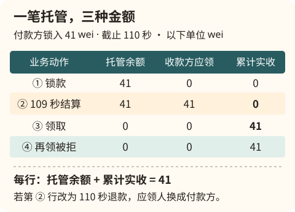

# 第 15 课 · 托管测试：这 41 wei 究竟领过几次？

客服要核一张只锁过 41 wei 的托管单。收款人第一次领取后，对账页写「累计实收 41 wei」；他又点了一次，记录写「领取被拒，累计实收 41 wei」。客服应该记一笔 41，还是两笔共 82？这里的 wei 是测试 ETH 的最小单位。

**只记 41。** 这两行是两次查看同一本账，不是两张付款凭条。第二次增加的是 `41 − 41 = 0 wei`；「被拒」还说明这不是一次成功的零额付款。这能解释这一单，不能据此保证任意订单、任意操作顺序都不会多付。

只把重试记录中的「领取被拒」遮住，累计实收仍看得见。现在还能回答什么？仍能算出没有多收钱，**却不能判断第二次请求是否被拒**：一个错误地返回成功却没付钱的程序，也会留下相同的金额。验收时要同时看调用结果和余额差。

只想学会看账，可以去[第 16 课：凭什么相信部署清单仍有效](deployment.html)。以下选做本地实验，沿用[第 14 课「结算只产生应领，领取才出金」的判断](escrow.html)；从调用数据读方法的做法见[第 13 课](abi.html)。本课不改[业务合约](m04/src/MilestoneEscrow.sol)，只运行[测试和记账器](m04/test/EscrowProperties.t.sol)。没有外部节点、钱包、私钥或测试币水龙头。下文第 109、110 秒是 Forge 本地 EVM 的区块时间戳，不是等待终端的时长。

## 从交接单推导断言，而不是照抄合约变量

把订单分成三栏：**托管余额**是钱现在放在哪里；**应领**是账上欠谁；**实收**是领取人的账户实际多了多少钱。记应付时，同一笔 41 同时出现在余额和应领两栏：前者是资产，后者是债务，不能相加说成 82。退款也不是自动打钱，而是让付款方取得应领权。用于对账的「累计领取」只在 `withdraw()` 成功、收款账户发生净增时计一次。

<figure class="lesson-figure"><a href="../assets/figures/m04/invariants.svg"></a><figcaption>手工推算的验收单。第 ② 行还没发生出金，第 ④ 行不是一次零金额成功付款。改为在截止秒退款时，用同一公式，把应领和实收的主人换成付款方。</figcaption></figure>

如果把合约自己报出的应领金额同时当作实发金额，两边相等可能只是因为抄了同一行。测试另立一册：锁入时记付款方余额的**实际减少**，领取时记领取人余额的**实际增加**，再与合约现金、双方 `credit` 和订单状态对照。就像 Java 订单服务对银行流水，不能拿两份由同一字段生成的 DTO 互证。

这里可以把余额差归因给单次调用：两个角色是互异的本地无代码地址，没有其他收支，`prank` 改的是内部测试调用的身份，不让该账户承担一笔已签名上链交易的 gas。若改用真实节点交易，付款方可能还付手续费，净差口径要回到[第 11 课的费用账](evm.html)。本实验只给付款方一次起始资金，不在每次提款前重置余额，也不向托管额外转款。不要把这些条件下的等式误写成任意链上地址的余额定律。

## 先跑固定例子：早一秒与恰好到点

环境：Foundry **Forge 1.7.1**、原生 **solc 0.8.28**，Cancun，优化器开启、200 runs；没有 `forge-std` 或其他 Solidity 库。首次取工具见[本卷安装说明](abi.html#m04-tools)，工具就绪后所有测试均可离线执行。从仓库根目录，在同一终端进入工程：

```bash
export PATH="${XDG_CACHE_HOME:-$HOME/.cache}/chain-course/m04/bin:$PATH"
export FOUNDRY_SOLC="$(command -v solc)"
cd labs/m04
forge --version
"$FOUNDRY_SOLC" --version
forge test --offline --match-contract EscrowPropertiesTest --match-test test_LastSecondSettles -vvvv
forge test --offline --match-contract EscrowPropertiesTest --match-test test_CutoffRefunds -vvvv
```

`setUp()` 从本地第 100 秒开始，在付款方身份下部署一份新托管，截止为 `100 + 10 = 110`。每个固定测试从同一初态开始。两者调用的是同一个 `_runOrder(40, atCutoff)`；`40` 是生成器输入，不是转款额：`1 + 40 % 1_000_000 = 41 wei`。唯一不同的开关是 `atCutoff`：`false` 在 109 秒由付款方 `settle()`，`true` 在 110 秒由付款方 `refund()`。推进时钟不等于触发退款，还要有这次明确的调用。

在 `-vvvv` 的调用树里找测试事件 `Page`，不是把最外层的 `PASS` 当余额。字段顺序是 `step, inWei, paidWei, heldWei, payerCreditWei, payeeCreditWei`。下面是**预期值**；每行后五列都是 wei。两条路径的第一行和最后两行数值相同，但领取调用者不同。

| 账页 | 累计入金 | 累计实收 | 托管余额 | 付款方应领 | 收款方应领 |
| --- | ---: | ---: | ---: | ---: | ---: |
| 两轮 `lock` | 41 | 0 | 41 | 0 | 0 |
| 109 秒 `resolve`，已结算 | 41 | 0 | 41 | 0 | 41 |
| 110 秒 `resolve`，已退款 | 41 | 0 | 41 | 41 | 0 |
| 各自由正确的人 `withdraw` | 41 | 41 | 0 | 0 | 0 |
| 同一人 `retry`，内层调用被拒 | 41 | 41 | 0 | 0 | 0 |

业务合约的 `Settled`、`Refunded` 和 `Withdrawn` 是不同的事件；`Page` 则是测试器另外打印的对账记录，不属于待部署的 ABI。沿调用树核对 `withdraw` 第一次成功、第二次回退。测试对第二次只接受 `ok == false` 且领取人余额不变，随后还检查现金、两份应领和终态。若错误地「成功但付零」，即便表面的余额一样，也过不了这一条。

## 用三种测试回答三个不同的问题

**单测：已签字的工单能否照做？** 固定测试就是上面那两张账。还有 `test_PayeeCannotSettle`：在钱已锁入、时间未到、其他条件均合法时，仅换收款方去点验收。预期业务调用被拒，订单仍为 `Locked`，余额 41、双方应领均为 0。只有这样隔离变量，才知道拒绝的是角色而不是「根本没锁款」。

**Fuzz：同一路径，换金额还成立吗？** `testFuzz_Posting(uint96 raw, bool atCutoff)` 让 Forge 生成一对输入，每个样本都从初态运行到连续两次领取。取模再加一将输入映射到 `[1, 1_000_000] wei`；即使抽到 `0` 也能真实锁入 1 wei，不会把大量样本花在预期的零额拒绝上。两个布尔值对应相邻的两个有效决策时刻。取模不是均匀抽样的承诺，64 轮也不会穷尽区间。零金额、错误角色等拒绝条件需要另列用例，不能从这个有效域外推。

**Invariant：让别人挑操作顺序，每一步还能平账吗？** `EscrowLedgerHandler`（下称记账器）不是第二套托管。Forge 通过测试合约的 `targetContracts()` 和 `targetSelectors()` 找到它，每次从 `lock(raw)`、`resolve(atCutoff)`、`collect()` 三个动作中选择一个。某次的入金、应领人、是否领过会留给**下一次**调用；不会每一步都重跑 `setUp()`。而 fuzz 的每个输入是固定的一整条流程，两者不要混淆。

| 动作 | 怎样执行 | 记账器凭什么记数 |
| --- | --- | --- |
| `lock(raw)` | 新单以付款方身份用正额锁款；已有未完成订单则不再锁 | `principal = beforePayer - PAYER.balance`，要求等于调用金额，再加进 `totalIn` |
| `resolve(atCutoff)` | 仅在已锁且尚未决定时执行；在截止前一秒结算或恰好到点退款 | 本册按所作的业务决定记应领人，不读合约的 `credit` 来填预期。不把结算算作出金 |
| `collect()` | 已决定时由登记的人领取；已领取则检查再领被拒 | 直接读领取人调用前后余额。首次要求净增恰等于本单本金，才把净增累加进 `totalPaid`；再次不许增加 |

在不具备某动作的前提时（如一开始就抽到领取），记账器不向合约发那次调用。已经成功领取且验证过再领被拒后，若又抽到锁款，先核旧单已清，再**部署另一份同源码的新单**；绝不重开旧单，也不清历史累计。`test_TwoOrdersOneJournal` 固定先结算 41，再退款 59，最后累计实际入金和实收都是 100，且旧单仍为 `Settled`。这让两条路径、两次成功领取和两次明确的拒绝都有确定的到达证据，而不依赖某次随机序列刚好走完。

随机动作之后怎么查错？以本单为例，在 109 秒结算、还没领时，记账器从两端余额记下的累计入金是 41、累计实收是 0。`assertLedger()` 先检查没多付（`totalPaid <= totalIn`），再要求托管余额等于 `41 − 0 = 41`（以前的订单均已结清）。这两项都对，还可能把钱欠错了人。所以第三步要按**记账器做过的决定**核 `state` 和双方 `credit`：这时应为已结算、付款方应领 0、收款方应领 41。若改在 110 秒退款，即使前两项数值完全一样，应领的也必须是付款方。

`invariant_cashAndClaimsAgree()` 每步都做这套检查。主调用意外回退会让本轮失败，只有预期被拒的重复领取才在记账器内捕获并断言。若吞掉所有失败，只查「实收没超过入金」，两者一直为零也能通过；所以还需要固定测试证明真正走过出金路径。

在同一 `labs/m04` 目录运行全套：

```bash
forge test --offline --match-contract EscrowPropertiesTest --fuzz-seed 0x15 -j 1 -vv
forge test --offline --match-test test_TwoOrdersOneJournal -vvvv
```

按[本工程配置](m04/foundry.toml)，预期四个固定测试通过，`testFuzz_Posting` 通过 64 轮，`invariant_cashAndClaimsAgree` 通过 32 轮、每轮深度 16（512 次记账器调用），意外回退为 0；`fail_on_revert = true`。**512 不是 512 次成功付款。** 包含因前提不符而返回的动作；要用固定路径的 `Page` 和收款余额差来证明实际付过。命令固定了种子和工作线程数，地址、Gas 数、selector 分布都不是答案。

## 留一份能重放的反例：改错的是验收公式，不是托管

某张旧报表写成「`decidedAt <= cutoff` 时仍给收款方记应领」。在 109 秒这没露馅，但 110 秒会把本应付给付款方的 41 错列到收款方。用**临时目录**重做这次账页纠错，只改测试中的报表公式一个比较符，不换实现、不向任何节点发交易。以下仍从 `labs/m04` 开始，保留同一个终端的变量。

```bash
PROJECT=$PWD
CASE=$(mktemp -d)
mkdir "$CASE/src" "$CASE/test"
cp foundry.toml "$CASE/"
cp src/MilestoneEscrow.sol "$CASE/src/"
T=test/EscrowProperties.t.sol
awk '{ sub(/bool vendorDue = decidedAt < cutoff;/, "bool vendorDue = decidedAt <= cutoff;"); print }' "$T" > "$CASE/$T"
cd "$CASE"
forge test --offline --match-test test_CutoffRefunds -vvvv > fixed-red.log 2>&1
```

最后一条**预期非零退出**；到这里先读 `fixed-red.log`。输入固定为 `raw=40, atCutoff=true`，`resolve` 行应为 `41,0,41,41,0`，失败原因应是 `posting at cutoff`，而不是编译错误。接着在同一目录收集由 Forge 自己找到的输入（普通交互终端中逐段运行，不要用 `set -e` 跳过预期失败后的取证）：

```bash
forge test --offline --match-test testFuzz_Posting --fuzz-seed 0x15 -j 1 -vvv > fuzz-red.log 2>&1
F=cache/fuzz/failures/EscrowPropertiesTest/testFuzz_Posting
cat "$F"
cp "$F" counterexample.json
forge test --offline --match-test testFuzz_Posting --fuzz-seed 0x15 -j 1 -vvv > replay-red.log 2>&1
```

两条 `forge test` 均预期因**同一条报表断言**失败。记录 `fuzz-red.log` 中的 `args` 和 calldata，`atCutoff` 应为 `true`；实际 `raw` 可能不是 40，用 `1 + raw % 1_000_000` 换算成 wei。Forge 1.7.1 将该模糊测试的反例写进上面的 JSON，再跑同名测试时会先尝试已存输入。若出错的是 invariant，反例则是**有序的调用序列**，默认在 `cache/invariant/failures/<测试合约>/<测试函数>`；不要只抄最后一次 `collect()`，没有前置状态就重放不了。`cache/test-failures` 用于筛选上次失败的测试名，不等于保留了这些参数。先归档再改，不要先 `forge clean` 把证据洗掉。

现在把原工程里正确的 `<` 公式带回**临时工程**，保留缓存和已经归档的 JSON，验证已发现输入与两个相邻时刻：

```bash
cp "$PROJECT/$T" "$T"
forge test --offline --match-test testFuzz_Posting --fuzz-seed 0x15 -j 1 -vvv > fuzz-green.log 2>&1
forge test --offline --match-test 'test_(CutoffRefunds|LastSecondSettles)' -vvvv > fixed-green.log 2>&1
cat fixed-green.log
printf '本次工单及日志：%s\n' "$CASE"
cd "$PROJECT"
```

预期两个固定用例均通过，fuzz 恢复通过。交接时归档版本、配置、错误比较符、完整反例和红绿两次输出；源码中长期保留 `test_CutoffRefunds` 这个具名回归，它即使在没有缓存的干净机器上，也会覆盖原先误判的一秒。若要钉住**随机发现的具体金额**，将日志中的那个 `raw` 与 `true` 原样作为 `_runOrder` 的两个常量另加具名用例，不要把换算后的 wei 填回 `raw` 参数。种子有助于重跑一轮，不能替代原参数、操作顺序和代码版本。

## 这些绿灯不包含什么

- **最小权限不是「对所有人隐藏函数」。** 函数 ABI 是公开的；由合约校验实际调用者。付款方才能锁款和作决定，领取入口按 `msg.sender` 取自己的应领，没有代领参数、管理员替人改账或紧急清空的后门。它仍信任付款方在截止前判断里程碑是否完成；代码不替双方仲裁。
- **先记账再交互，领取与结算分开。** `withdraw()` 检查非零应领，将其置零，最后对领取人执行带金额的调用；若发送失败，合约回退，前面的置零不会单独生效。这样结算本身不依赖领取人当场接款成功。第二次领取的断言检验可观察结果，不是外部接收方任何行为都正确的证明；本课没有测试任意收款合约、网络重组或钱包误操作。
- **版本也是边界。** 这里测试只导入本卷那一份源码，通过四个明确签名的本地 cheatcode 设置余额、身份、时间、读取时间；这些接口不是主网合约依赖。若今后引入第三方库，固定其发布版本或提交与校验值，复核实际引入的调用和权限，并用同一套账页重新验证。库名、审计标和高覆盖率都不能说明你的业务规则已被覆盖。
- **不是审计报告。** 本轮只对指定编译设置、两个角色、有限金额、两个相邻时刻及生成过的序列给出证据。对账式还假定没有无关入账；不能倒过来用合约账户的全部余额当成本单本金。覆盖率回答「哪些行执行过」，不回答「应领人是否应该是这个地址」，更不证明真实资金可以上线。

## 独立作业：退款后，谁能按领取键？

在你自己的临时工程测试合约 `EscrowPropertiesTest` 中增加 `test_RefundClaimBelongsToPayer`，不要改业务合约。新工单金额 **73 wei**：从测试输入推回适用的 `raw`，锁款并在 110 秒退款。这次不要立刻让付款方领取；先让**收款方**单独调用一次 `withdraw()`，检查被拒且状态不变。然后让付款方正常领取，再由付款方尝试领取第二次。可沿用 `test_PayeeCannotSettle` 捕获预期拒绝的写法；读取地址和合约引用后再 `prank`，因为它只作用于**下一次**外部调用。

```bash
cd "$CASE"
forge test --offline --match-test test_RefundClaimBelongsToPayer -vvvv > review-73.log 2>&1
cat review-73.log
```

交出新增测试源、实际命令和三张 `Page`，并在调用树标出每次 `withdraw` 的调用方。判据：收款方被拒后仍是 `Refunded`，五栏为 **73,0,73,73,0**；付款方成功后为 **73,73,0,0,0**；付款方再领被拒后五栏不变。另核付款方首次领取的余额净增为 73，收款方全程净增为 0。若用错身份时只查「调用失败」、既没查原债权仍在也没查正确的人能取回，就不能交班。

## 查证原文

- [Foundry：Solidity 测试、fuzz 与执行 trace](https://www.getfoundry.sh/forge/testing)；[Invariant testing：handler、目标选择与调用序列](https://www.getfoundry.sh/guides/invariant-testing)。本课的轮数取本地 `foundry.toml`，不取官网示例默认值。
- [Forge 1.7.1 的测试 runner](https://github.com/foundry-rs/foundry/blob/v1.7.1/crates/forge/src/runner.rs)：查 `run_fuzz_test`、`test_paths` 和 `persisted_call_sequence`，区别记录单次 calldata 与保存状态序列。
- [Solidity 0.8.28：Withdrawal from Contracts](https://docs.soliditylang.org/en/v0.8.28/common-patterns.html#withdrawal-from-contracts) 与[安全考虑](https://docs.soliditylang.org/en/v0.8.28/security-considerations.html)：核对拉取式付款的责任边界、先检查再改账再交互的顺序。
