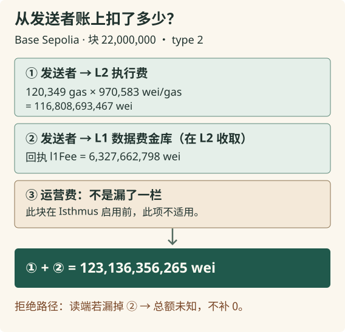

# 第 26 课 · 同一份合约搬到 L2，费用单为什么多了一行？

工单 F-26：迁移托管合约前，财务先递来一张 **Base Sepolia 第 22,000,000 块**的旧凭条。后台按 `gasUsed × effectiveGasPrice` 记了 **116,808,693,467 wei**，浏览器却列 **123,136,356,265 wei**。少的 **6,327,662,798 wei** 从哪里来？把这笔差额找对，再交付合约的本地部署凭证；若有人要求拿这张旧凭条给新部署报价，要能说明为什么不能签字。

先修：[11 · Gas 与收支平衡](evm.html)、[16 · 部署交接](deployment.html)、[23 · 报价与实收](swap.html)、[25 · Rollup 的三处证据](rollup.html)。这里有**两笔不同的交易**：旧凭条来自别人已经发过的一次普通合约调用；你要做的是在回环节点上真正创建第 16 课的 `MilestoneEscrow`。前者用来核对 L2 收费项目，绝不是后者的公测网部署或同一业务的成本对照实验。

## 先辨认哪一列是预算，哪一列是实付

在 EIP-1559 的普通交易中，发送者指定 `gas`（执行 gas 上限）、`maxFeePerGas` 和 `maxPriorityFeePerGas`。节点执行完才知道本笔用了多少 gas，回执的 `gasUsed` 是**本笔**用量，`effectiveGasPrice` 是本笔实际单价，已经包含适用的优先费。不能改用 `cumulativeGasUsed`（块内累计），也不能在乘积外再加一次小费。代码退回也可能有 `status=0x0` 的已入块回执，执行失败不等于没收费；若只收到 `null`，则还没有这张回执，不结账。

| 费用栏 | 在这张单上回答什么 | 不能拿什么代替 |
| --- | --- | --- |
| 执行费，wei | `gasUsed [gas] × effectiveGasPrice [wei/gas]` | `eth_estimateGas` 是在给定状态模拟，不是总价；`gasLimit × maxFeePerGas` 是本笔执行费的预算上界，不是实付 |
| L1 数据费，wei | L2 为向 L1 发布数据而向**这笔用户交易**收取的金额，读同一回执的 `l1Fee` | 不能把整笔 L1 批次交易的费用算在一个人头上；也不能拿该笔 L2 调用的 ABI 参数长度直接乘 L1 现价 |
| 其他协议收费，wei | 先用**这条链、这个块的时间、交易类型**定规则；若有运营费（operator fee），再取适用参数 | Anvil 的空字段、另一条链的默认值、今天的费率或浏览器只显示两栏，都不能证明当时运营费是 0 |

为什么明明按 EVM 跑同一份字节码，还是不能随手比价？执行成本与当时状态、有效单价、硬分叉有关。Rollup 还为数据可用性付费：例如 Fjord 的规则估计**序列化、有签名的整笔交易**压缩后的大小，把 L1 基础费、blob 基础费及各自的缩放系数纳入计算。它是协议向用户**已收**的一个分摊金额，不承诺等于批次发布者后来在 L1 的边际支出。`value` 是随交易转移的原生资产，不是 gas；桥页面的跨层总报价可能还列有另外一步交易的预估费用或服务费，不能把报价、源链实付、目标链实付记在同一栏。Arbitrum 等其他网络要另查规则，不能看到相同 ABI 就套本表。

<figure class="lesson-figure"><a href="../assets/figures/m07/l2-fees.svg"></a><figcaption>这是按一笔历史 type 2 调用的实际回执记的账。数据费在 L2 向发送者收取，不表示发送者又亲自签了一笔 L1 交易。</figcaption></figure>

## 用 2025 年 2 月的回执核销差额

[离线凭条](m07/fees/receipt-22000000.json)是四次只读 RPC 的**相关字段节选**：`eth_chainId`、`eth_getBlockByNumber`、`eth_getTransactionByHash`、`eth_getTransactionReceipt`；不是把全量日志、签名或整块交易复制进仓库。历史 RPC 来源为 `https://base-sepolia.drpc.org`；可与[该交易的区块浏览器记录](https://base-sepolia.blockscout.com/tx/0xb4b14cab5151ac7335eb4d6aeb5675fe415ede7ba912bbd55c8a1789cd925a15)和[该块的独立索引](https://base-sepolia.blockscout.com/api/v2/blocks/22000000)对照。这笔 `type=0x2`、`status=0x1` 的调用不是 L1 注入的存款交易（`0x7e`），也不是创建合约。

1. 对锚点：链 `0x14a34 = 84532`，块 `0x14fb180 = 22000000`，交易在块内索引 `0x2a = 42`；交易哈希与回执的 `transactionHash` 相同，交易和回执都指向这一个块哈希。
2. 执行栏：`gasUsed=0x1d61d = 120349`、`effectiveGasPrice=0xecf57 = 970583 wei/gas`。乘起来 **116,808,693,467 wei**。交易声明的 `gas=127440`、`maxFeePerGas=971758 wei/gas` 不进这个乘积。
3. 数据栏：直接取 `l1Fee=0x1792878ce = 6,327,662,798 wei`。反算陷阱：旧的 `l1GasUsed=1600` 直接乘 `l1GasPrice=3591997464` 会算出 **5,747,195,942,400 wei**，与实收不符；Fjord 的计算还涉及压缩估计和价格系数，不可退回该简式。
4. 第三栏：块时间 `1739768288`，即 **2025-02-17 04:58:08 UTC**。按[当时的 Base Sepolia 升级清单，固定版本 `720185c`](https://github.com/ethereum-optimism/superchain-registry/blob/720185c32b0599fa31b14f101cbc990ec39c0a36/superchain/configs/sepolia/base.toml)，它已经进入 Holocene，尚未到 Isthmus 的 `1744905600`（2025-04-17 16:00:00 UTC）。那个块的普通交易**没有运营费这个收费项目**；不是因为 JSON 恰好没有 `operatorFee` 字段才决定补零。
5. 所以这笔的费用总额是 **123,136,356,265 wei**，不是总 gas，用 `10¹⁸ wei = 1 ETH` 换算得 **0.000000123136356265 测试 ETH**。不据此推算真实法币成本、业务资产收入或 L1 最终化。Java 入账时用 `BigInteger` 做十六进制解码和乘加；字段缺失保留“未知”，格式化才用十进制刻度。

在**仓库根目录**用 Python 3.11 标准库即可离线复算：

```bash
python3 labs/m07/fees/fee_book.py history
```

期待 `ARCHIVE` 打印上述块与交易的**完整哈希**，`EXEC` 和 `DATA` 打印两个整数；`RULE ... operator=not-applicable reason=before-Isthmus` 后才有 `RESULT totalFeeWei=123136356265`。这重放的是留存字段，不是实时查询或独立验证区块头。需重新采集时，使用下文版本的 `cast`，在根目录执行以下**可选只读**步骤；根据原始回复的 `transactions[42]`、`blockHash` 和回执重新对齐。归档节点限流、已裁剪、返回 `null` 就标“未能在线复核”，不要换 `latest` 顶替。

```bash
READ_RPC=https://base-sepolia.drpc.org
TX=0xb4b14cab5151ac7335eb4d6aeb5675fe415ede7ba912bbd55c8a1789cd925a15
cast rpc --rpc-url "$READ_RPC" eth_chainId
cast rpc --rpc-url "$READ_RPC" eth_getBlockByNumber 0x14fb180 false
cast rpc --rpc-url "$READ_RPC" eth_getTransactionByHash "$TX"
cast rpc --rpc-url "$READ_RPC" eth_getTransactionReceipt "$TX"
```

**如果是在升级后呢？** 不能沿用第 4 步。在适用 [Isthmus 规则](https://docs.base.org/upgrades/isthmus/exec-engine#operator-fee)的普通用户交易，按 `constant + floor(gasUsed × scalar / 10⁶)` 算；[Jovian 版本](https://docs.base.org/upgrades/jovian/exec-engine#operator-fee)改用 `constant + gasUsed × scalar × 100`。纯手算示意：`gasUsed=50000, scalar=20, constant=7`，按前一条得 **8 wei**，按后一条得 **100,000,007 wei**。不是说 Base 曾采用这组参数。对新记录，应取得覆盖**该块**的协议版本、完整回执，在同一块查 `L1Block` 的 `operatorFeeScalar()`、`operatorFeeConstant()` 或按该版本读取 `GasPriceOracle.getOperatorFee(实际 gasUsed)`。Isthmus 的回执规则只在至少一个参数非零时添加这两个字段；不知 RPC 是否保留扩展字段时，不能把“都没返回”直接翻译成“都为零”。有块锚点与规则依据的零、分叉前的不适用、缺证据的未知，是三种不同状态。

## 在隔离节点真的部署一次，用两种读数算同一笔钱

本课不维护第二份托管源码。[本地网络清单](m07/fees/anvil.json)与[只读 Base Sepolia 网络清单](m07/fees/base-sepolia.json)共用的制品标识都是 [`src/MilestoneEscrow.sol:MilestoneEscrow`](m04/src/MilestoneEscrow.sol)。只有前者能启动一个新节点并发送交易：回环端口 `18626` 须空闲，普通 Anvil 1.7.1、Cancun、链号 31337，**不是 OP 节点**，不运行排序器、batcher 或 L1。后者的 84532、创世哈希和只读 RPC 都单列，**不预填部署地址**。单有网络配置没有部署证明。

依赖：Bash、Python 3.11、`lsof`、[第 13 课的 Foundry 1.7.1、solc 0.8.28 安装器](abi.html#m04-tools)。若尚未准备工具，在仓库根目录运行一次 `bash labs/m04/setup.sh`（下载工具需要联网）；随后数据采集只连本机，`forge build --offline`。以下在**同一 Bash、仓库根目录**运行：

```bash
export PATH="${XDG_CACHE_HOME:-$HOME/.cache}/chain-course/m04/bin:$PATH"
export FOUNDRY_SOLC="$(command -v solc)"
unset ANVIL
WORK=$(mktemp -d)
BOOK=labs/m07/fees/fee_book.py
python3 "$BOOK" local --out "$WORK/anvil" > "$WORK/deploy.txt" && cat "$WORK/deploy.txt"
python3 -m json.tool "$WORK/anvil/deployment.json"
```

顺着[读账程序](m07/fees/fee_book.py)核四处，不必相信一行 `success`：

- `local()` 先确认连接的是**自己新开**的节点、链号与所选清单一致。`build_contract()` 复用 [M04 的干净构建](m04/deployment.py)：相同 source unit、优化器 200 runs、Cancun、固定 solc。创建交易的 `input` 是创建字节码接两个 ABI 字：`payee` 和未来的 `deadline`；`to=null`、`value=0`。把同一份 `.sol` 复制到另一目录、改优化设置或部署参数，都可能改变交易字节和费用。
- `BUDGET` 来自入块前的 `eth_estimateGas` 和本次选择的上限。签名交易的 `gasLimit=3000000`、`maxFeePerGas=2000000000 wei/gas` 将执行费预算上界放在 **6,000,000,000,000,000 wei**，绝不表示已扣这个数。只用回环节点的临时解锁测试账户，无助记词或私钥进档。
- `check_release()` 按部署块高重取块，核对块哈希、交易成员关系、成功回执、创建地址和部署者；对读链上真实 `input` 与本地创建字节码加参数；按块哈希读 `eth_getCode`，比对实际 runtime 的 SHA-256。`DEPLOY ... rebuiltInputMatch=true runtimeMatch=true` 说明与**本次**清单吻合，不等于字节码经过安全审计，亦不证明 L1 最终化。`immutable` 包含部署者、收款人和期限，另一条链上即便源码完全相同，也不应照抄 runtime 摘要。
- `EXEC` 据**本次回执**算实收；普通 Anvil 上这笔 type 2 创建不产生 L2 数据发布费、运营费，所以这两项记“不适用”。`RESULT totalFeeWei=… payerDebitWei=… balanceMatch=true` 还用一个独立量核对：只有这笔零 `value` 创建进入第一个块，构造函数不给部署者转账，部署者不是费用接收者，因此创世状态余额减创建块状态余额应等于执行费。两次 `eth_getBalance` 都按各自块哈希读。公网同一块可能有其他资金进出；不能把块间余额差无条件当成一笔交易费用。

`deployment.json` 留存本链身份、交易/块哈希、地址、参数、源码/创建码/运行码摘要；`receipt.json` 是节点的回执；`balances.json` 是余额与块锚点及预算输入。三份证据加 `deploy.txt` 一起交接。每轮节点结束即销毁；地址、创建数据里的非零字节、实际 gas、绝对时间与哈希不固定，只核**同一轮内的整数等式**。清单和归档目录不能覆盖上次结果。

## 停止实验：一张清单用错链，一张回执少字段

猜测正确输出后，沿用上面的 `WORK` 和 `BOOK`。第一轮只把**预期清单**换成 Base Sepolia，发送端始终是自己的 Anvil，不会切向公网：

```bash
rc=0; python3 "$BOOK" local --expect base-sepolia --out "$WORK/wrong" > "$WORK/wrong.txt" 2>&1 || rc=$?
cat "$WORK/wrong.txt"; test "$rc" -eq 3 && test ! -e "$WORK/wrong"
```

要看到 `HOLD wrong_chain expected=84532 actual=31337 before_send=true`，无创建交易。若见的是端口占用或编译错误，不算通过了这道闸。第二轮模拟 SDK 把链专用字段丢了，只改**副本**，不更改原始节点记录：

```bash
python3 - "$WORK/incomplete.json" <<'PY'
import json, pathlib, sys
sample = json.loads(pathlib.Path('labs/m07/fees/receipt-22000000.json').read_text())
del sample['receipt']['l1Fee']
pathlib.Path(sys.argv[1]).write_text(json.dumps(sample))
PY
rc=0; python3 "$BOOK" history "$WORK/incomplete.json" > "$WORK/incomplete.txt" 2>&1 || rc=$?
cat "$WORK/incomplete.txt"; test "$rc" -eq 3
```

应保留已知执行分项 `116808693467`，并得到 `HOLD missing_or_invalid=l1Fee totalFeeWei=unavailable`；不得出现给出数字总额的 `RESULT`。这不是“收费为零”，也不是交易失败，而是**账单采集不完整**。回到支持扩展字段的节点按原哈希只读补证；不要重发原交易。

## 可选交接：对方说已经在 Base Sepolia 部署了同一份合约

此练习**不要求创建钱包、领取测试币或向公网发送**。没有对方已发布的独立清单，就记录“Base 部署未提供”，本地交付与历史费用练习仍可各自完成。不能挪用前面的 `claim()` 哈希或把本地 `chainId` 改成 84532。若有被授权用于教学的**既有**直接部署，按以下清单交接：

1. 提交人与接手人分别保留 `anvil/deployment.json`、`base-sepolia/deployment.json`。后者取与本地相同的字段名和 JSON 类型：`chainId`、`deploymentBlockNumber`、`deadline` 为十进制整数；`genesisHash`、`deployer`、`payee`、`contractAddress`、`deploymentTransactionHash`、`deploymentBlockHash` 为各自的 `0x…` 标识；三个 `…Sha256` 为无 `0x` 的小写十六进制（`sourceSha256`、`creationCodeSha256`、`runtimeSha256`）。从**该链**的发布记录取值；同时交编译器与设置、ABI、构造输入和原回执。没有直接创建时不要借一个工厂调用硬套这套校验。
2. 接手人从独立途径取得可信源码、网络配置与上述清单。将收到的文件保存在 `$WORK/base-sepolia/deployment.json`，沿用已准备的工具环境和 `BOOK`，运行 `python3 "$BOOK" verify-base "$WORK/base-sepolia/deployment.json"`。这一入口固定只读 RPC；先问链 ID、创世块，再做块、交易和重建字节对读。供应商若不支持历史状态、扩展字段或按块哈希读 `eth_getCode`，停在缺口；不降级成读 `latest` 或相信相同地址。故意输入本地凭证 `python3 "$BOOK" verify-base "$WORK/anvil/deployment.json"` 应在联网前退出 3，`wrong_chain_in_release`。
3. **分开签收“部署可核对”和“费用全额可核销”。** 本读端内置的 Base 自动合计只覆盖本课核过的历史窗口 `[Holocene, Isthmus)` 的普通 type 2 交易。其他窗口即使已经打印 `DEPLOY ... runtimeMatch=true`、`EXEC`、`DATA`，仍会给 `fee_rules_not_covered_for_block` 而不给总额。接手人要按新块核对 Base 自己的升级规范与交易类型，用该块的实耗 gas、`l1Fee`、经证明适用的其他收费重开费用单；不能拿一份旧的 OP Stack 参数表充数。

## 独立作业 F-26B：上限翻高，就该多付吗？

测试经理把另一单的 `gasLimit` 定为 **4,000,000**，单价上限仍为 **2 gwei/gas**。他还给了前面 Base 旧凭条里的两个上限，让你“把两张预算都当成本”。从干净部署和原始回执反驳他。在根目录接着运行：

```bash
python3 "$BOOK" local --gas-limit 4000000 --out "$WORK/job-b" > "$WORK/job-b.txt" && cat "$WORK/job-b.txt"
python3 - "$WORK/job-b" <<'PY'
import json, pathlib, sys
p = pathlib.Path(sys.argv[1]); r = json.loads((p/'receipt.json').read_text()); b = json.loads((p/'balances.json').read_text())
execution = int(r['gasUsed'], 16) * int(r['effectiveGasPrice'], 16)
print('executionWei', execution, 'payerDeltaWei', int(b['beforeWei']) - int(b['afterWei']))
assert r['blockHash'] == b['blockHash'] and execution == int(b['beforeWei']) - int(b['afterWei'])
PY
```

**签收标准：** 本地交新目录中三份 JSON 和日志，写出预算 **8,000,000,000,000,000 wei**、自己的实收及其两种取数路径；不要求两次独立部署的 `gasUsed` 一模一样。历史单交手算：`127440 × 971758 = 123,840,839,520 wei` 是当时执行费预算上界，不是 `116,808,693,467` 的实收，也不承诺覆盖全部 L2 收费；它碰巧高于该笔含数据费的总和并非定理。再挑一项必需字段（如 `effectiveGasPrice`）在另一份副本删去，保留退出 3 且没有数字总额的输出，说明要补取哪笔、哪块的数据。只交浏览器截图、以预算代替扣款、或把 31337 的部署写成 84532 已发布，都不能签收。

## 查证原文

- [Base 的网络与 RPC](https://docs.base.org/get-started/connect-to-base)、[Base 的回执字段](https://docs.base.org/base-chain/api-reference/ethereum-json-rpc-api/eth_getTransactionReceipt)和[网络费说明](https://docs.base.org/specifications/transactions/network-fees)：区分查询、估算与已入块的单价、`gasUsed` 和 `l1Fee`。
- [OP Stack Fjord 执行规范](https://specs.optimism.io/protocol/fjord/exec-engine.html)：FastLZ 的输入、估计尺寸下限、缩放因子、`l1GasUsed` 的局限；[Base Isthmus 启用时刻](https://docs.base.org/upgrades/isthmus/overview)、[Base 的升级历史](https://docs.base.org/upgrades/overview)：计算任何新单前重新核对网络、时代与适用规则。
- [EIP-1559](https://eips.ethereum.org/EIPS/eip-1559) 用于解释执行费上限与优先费；[EIP-1898](https://eips.ethereum.org/EIPS/eip-1898) 用于固定余额、代码及只读调用的状态锚点。这些共同接口并不保证不同链有相同的费用或最终性语义。
