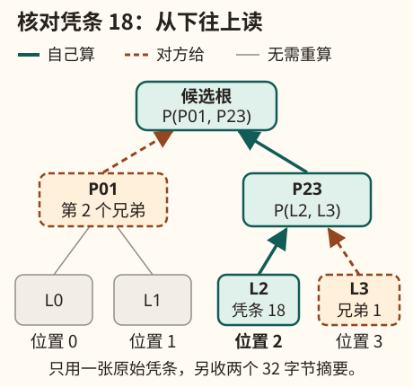
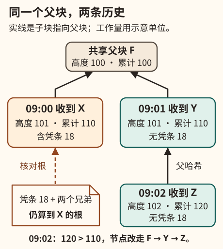

# 第 01 课 · 两本账如何对齐

「B 账户上正好有 2 张券。这张应收 2 张的订单，能发货了吗？」假设你接手商户 B 的对账程序。客服发来两样东西：一张页末余额截图，还有结算方指给他的凭条 18。先看凭条，上面写的是 **C 给 B 1 张**。如果订单只关联了这张凭条，即使它是真的，也还差 1 张。那截图上的 2 是哪儿来的？

咱们先算账，再拿 [MerkleLab.java](MerkleLab.java) 核对凭条有没有被改过。只需会跑 Java 和终端命令。券、账户和账页都是教学数据，不连链，也不用钱包。

## 给 B 单独算一遍：3 + 1 − 2

这一页有四笔，位置从 0 数，凭条号则从 16 起。A、B、C 的账号分别是 `01`、`02`、`03`。开账时 A 有 10 张，B、C 都没有。没有手续费，谁付券谁就扣，付不起就不能记这笔。跟着箭头看 B 是收还是付：

| 页内位置（从 0 起） | 凭条号（十进制） | 付款方 → 收款方 | 张数 | 执行后余额（A, B, C；张） |
| --- | --- | --- | ---: | --- |
| 页首 | — | — | — | (10, 0, 0) |
| 0 | 16 | A → B | 3 | (7, 3, 0) |
| 1 | 17 | A → C | 2 | (5, 3, 2) |
| 2 | 18 | C → B | 1 | (5, 4, 1) |
| 3 | 19 | B → A | 2 | (7, 2, 1) |

对 B 来说，凭条 16 是收入 3 张，17 跟它无关，18 又收入 1 张，到这里手里有 4 张。凭条 19 虽然写着 **2 张**，但箭头从 **B 指向 A**，是支出。算下来 `0 + 3 + 1 − 2 = 2`。**余额是把多笔账算完后的结果，不是一笔付款的金额。** 这就能给客服回话了：保留凭条 18，别拿余额补那缺的 1 张。

再看一个对账差异。你的程序先记 16 再记 17，另一台机器先记 17 再记 16。两笔都是 A 付；不论先付 3 还是先付 2，A 都付得起。两步之后双方都是 `(5, 3, 2)`，再记后两笔，页末还是 `(7, 2, 1)`。只比三户余额会报「一致」，可两台机器对「第一笔付给谁」的回答不同。余额这样的快照叫**状态**；要核对**历史**，得连顺序一起对。这套券账不是 Bitcoin 的账户模型。

## 想核对一笔，不想对方发来整页

把四张凭条按位置摆好。每张先算一个固定长度的摘要，叫一片「叶子」；相邻两片算出一个父节点，最后整页只剩一个摘要，叫「根」。这就是 **Merkle 树**。如果你手里已经留有这页可信的根，可以倒过来问：只给你凭条 18，还缺哪两样东西才能算到同一个根？

<figure class="lesson-figure"><a href="../assets/figures/m01/ledger-proof.svg"></a><figcaption>手指按住 L2 往上走。遇到岔口，只拿另一边线头上的那个摘要，不必拆开整条支路。</figcaption></figure>

位置 2 在第三格。往上一层，左边是你算的 `L2`，缺右边的 `L3`；再往上一层，你算出的 `P23` 在右边，缺左半页的 `P01`。这些跟当前节点配成一对的摘要叫**兄弟摘要**。对方只需发一张凭条和这两个摘要；你不必看凭条 16、17、19 的原文。这条路径帮你证明的是「凭条在指定页的这个位置」，所以叫**包含证明**。

## Java 究竟要喂哪几个字节？

先拆一张：`12 03 02 01`。每两位十六进制是一个字节。`12` 是十进制凭条号 18，`03` 是付款方 C，`02` 是收款方 B，`01` 是 1 张。实验把每个字段固定成一个无符号字节。传给程序的是去掉空格的 `12030201`；**不是**把字符 `'1'`、`'2'` 分别当作一个字节。

| 位置 i | 原始记录 rᵢ（hex） | 完整的叶哈希输入（hex，5 字节） |
| --- | --- | --- |
| 0 | `10010203` | `0010010203` |
| 1 | `11010302` | `0011010302` |
| 2 | `12030201` | `0012030201` |
| 3 | `13020102` | `0013020102` |

表里凭条是 4 字节，为什么最右一列有 5 字节？算叶子时先加一个 `00`，意思是「后面是一张原始凭条」。算父节点改用 `01`，意思是「后面是有先后的两个摘要」。记 `H` 为**一次** SHA-256（结果 32 字节），`||` 为字节拼接：

```text
叶：Lᵢ = H(0x00 || rᵢ)
父：P(左, 右) = H(0x01 || 32 字节左摘要 || 32 字节右摘要)
```

所以算 `P23` 时，输入必须是 `01`、32 字节 `L2`、32 字节 `L3`，共 **65 字节**；不能把左右排序。前面两台机器哪怕余额一样，交换凭条 16、17 也会改变左半页的摘要和最终的根。根不是压缩包，既不能解压出凭条，也不会替你保密。它的用处是先固定一个值，让人事后很难换一份内容还对得上它（依赖哈希函数的安全性）。这叫对内容作出**承诺**。

## 自己算一遍：四片叶、两个父节点、一个根

用 JDK 17 或更新版自带的 `java`、`jshell` 即可，不用 Maven。从仓库根目录开始；若只下载了 Java 文件，就在它所在目录打开终端，跳过 `cd labs`。后面的终端命令都在这个目录运行。

```bash
cd labs
java -version
jshell --execution local
```

把下面几行输入 `jshell>`。把 `h` 当小计算器：比如 `h("0012030201")` 会先把这 10 个 hex 字符解成 5 字节，再把这 5 字节交给 SHA-256。返回值重新写成 hex，所以后面可以用 `+` 拼出下一次输入的写法。

```java
var hex = java.util.HexFormat.of();
var sha = java.security.MessageDigest.getInstance("SHA-256");
String h(String s) { return hex.formatHex(sha.digest(hex.parseHex(s))); }
var l0 = h("0010010203");
var l1 = h("0011010302");
var l2 = h("0012030201");
var l3 = h("0013020102");
var p01 = h("01" + l0 + l1);
var p23 = h("01" + l2 + l3);
var root = h("01" + p01 + p23);
```

留着 `root` 的结果。输入 `/exit` 返回终端，换成整页程序再算：

```bash
java MerkleLab.java
```

预期输出如下。先看 `P23` 有没有和你在 JShell 算的一样，再核对最后两行根值。比较的是**全部 32 字节**，不是看到开头都叫 `c2d6` 就行。

```text
L0=2487f669d56855db396a8f09867bd77d74bc62b29fcbb4479aa8cb2916abc959
L1=cb41c03967ebff5f015aa9fbb9924e7a3926559859e4d2fb9a77f4def84b0cd4
L2=685830c71c7fbddc77512b04a68423618c098b52447c6f98a3b67563748a7dcf
L3=875805ed33594c064626a5a6981dde778756d8177bf60d472c5efbb6527ee321
P01=5fe1c147a2f03c709d5f1b79414603c14a3c64ea661ad57e387b82adbdb61741
P23=08c161f2b7790b64afe299e76c2f8e6e767f4e1d2f753ac19cc5a47c56b550e9
candidate.root=c2d6ba7ea2bb3bc0a5dec604403dc473df26c923b7e9cd81fefb8701f5ed290d
trusted.root=c2d6ba7ea2bb3bc0a5dec604403dc473df26c923b7e9cd81fefb8701f5ed290d
matches.trusted=true
```

这里有两个来源：`candidate.root` 是刚刚算出来的；`trusted.root` 是你在收材料**以前**就从题目拿到的检查点，Java 文件把它写成了常量。要是把后一行也换成对方刚寄来的值，那只是对方的材料彼此对得上，不是和你的账对得上。

结果对不上时，不要从根猜。先比四片叶：如果连 `L2` 都不同，检查原始四字节和前面的 `00`。如果叶都对、`P23` 不对，检查 `01` 和左右顺序。在 Java 文件里，`leaf` 的 `update` 先放标签，`digest(record)` 再放原始记录并完成计算；`parent` 放标签、左摘要，最后 `digest(right)`。`digest` 完成后会复位，下一次不会带着上次那张凭条一起算。

## 合上整页，只收凭条 18，再算一次

现在你站在 B 这边。你知道树有四片叶，也有自己的根。对方说凭条在位置 2，从下往上给了两个摘要：`S0` 是图里的 `L3`，`S1` 是 `P01`。先合成 `P(L2, S0)`，得到 `P23`；再合成 `P(S1, P23)`，得到候选根。注意第二次是**对方的摘要在前**，不是每次都把自己的放前面。

程序怎么知道左右？位置 `2` 写成二进制是 `10`。从最右边读：`0` 表示这一层自己在左，`1` 表示下一层自己在右。代码 `((index >>> level) & 1)` 取的就是这一位。到 POSIX shell（如 bash 或 zsh）里，先把最近的兄弟存为 `S0`，再把上一层的存为 `S1`：

```bash
S0=875805ed33594c064626a5a6981dde778756d8177bf60d472c5efbb6527ee321
S1=5fe1c147a2f03c709d5f1b79414603c14a3c64ea661ad57e387b82adbdb61741
java MerkleLab.java verify 2 12030201 "$S0" "$S1"
```

预期先看到 `step1.sibling=RIGHT`，`step1.parent` 是刚才的 `P23`，再看到 `step2.sibling=LEFT`，最后 `matches.trusted=true`，退出码为 0。`verify` 没有调用读整页的 `tree`。四张凭条只用读一张，另外传两个 32 字节摘要。对这样的满二叉树，叶数翻一倍，证明才多一层。

**要是客服收到了两封成功通知呢？** 两封邮件都指向同一页、位置 2、凭条 18。把命令执行两遍，核对的是同一张 `C → B 1 张`，不会因为第二次也得到 `true` 就再长出一笔。就算其他到账条件都满足，这张应收 2 张的订单最多也只能认 **1 张**。记下已入账的付款，再来的同笔通知只回「已处理」。这四字节里并没有订单号；付款归哪张订单，还得另查商户的订单记录。

**反过来，余额只有 2 张，能不能核销一张应收 3 张的订单？** 这次是 A 的订单，商户记录关联的是凭条 **16**，之前没入过账。原文 `10 01 02 03` 是 A 给 B **3 张**。它在位置 0：往上两层，自己都是左孩子，所以两次都把兄弟接在右边，分别用整页输出的 `L1`、`P23`：

```bash
java MerkleLab.java verify 0 10010203 \
  cb41c03967ebff5f015aa9fbb9924e7a3926559859e4d2fb9a77f4def84b0cd4 \
  08c161f2b7790b64afe299e76c2f8e6e767f4e1d2f753ac19cc5a47c56b550e9
```

预期依次是 `RIGHT`、`RIGHT`、`matches.trusted=true`。假设商户也已核实该页仍在当前链上、确认数已达自己的要求，这张 3 张券的订单就能核销。B 后来花掉 2 张，是另一笔账，不能因此通知 A「请再补 1 张」。

回到 C 那张只付了 1 张的凭条 18。**把最后一字节改成 `02`，能过关吗？** 先算算账：凭条 17 后 C 恰好有 2 张，改成付 2 张，它确实付得起。可你现在核对的是「当时那页写了什么」，不是「这笔钱理论上付不付得起」。下面第一次只改张数，第二次还原张数、只把位置从 2 改为 3。两次都用凭条 18 原来的兄弟和根：

```bash
java MerkleLab.java verify 2 12030202 "$S0" "$S1"
echo "exit=$?"
java MerkleLab.java verify 3 12030201 "$S0" "$S1"
echo "exit=$?"
```

第一次从叶就开始与原页不同；第二次叶没变，变的是第一步 `step1.sibling=LEFT`，连 `P23` 都对不上。两次预期都是 `matches.trusted=false`、`exit=1`。这只说明**这组材料对不上你保存的这页**，不能断言别的页也没有这笔付款。若是退出码 2，先看参数个数、位置范围、hex 和字节长度；程序拒绝了输入，还没走到比较根那一步。

对方又寄来一封：「数量就是 2，不信你用我附件里的新根来验。」想想刚才的改金额实验：只要用 `12030202` 和同样的兄弟重算，对方也能得到一个根。你算出的值当然会与它寄来的新值相等；可你先前留的根没有变。客服应退回这份材料，不能拿发件人临时换的尺子量它自己。

## 对上了根，如果节点换了一页呢？

到这里我们只对了一页。现在借 Bitcoin 的选链规则讲一个分叉，用上面的券作示意，不是在比特币网络上转券。假设你自己的节点先收到块 X，其中有凭条 18。过一分钟收到同一高度的块 Y，没有它。**只看高度，分不清 X 和 Y。** 两个块头各有一个父哈希，都指向前一个块 F 的头：

<figure class="lesson-figure"><a href="../assets/figures/m01/ledger-fork.svg"></a><figcaption>先沿实线从 Z 找回 F，再沿左边虚线看旧凭条到底核对的是哪一个块。</figcaption></figure>

看节点的时钟。**09:00**，X 有效，节点先走 `F → X`。**09:01**，Y 也有效，两支累计工作量都是 110；本例中节点保持原路。**09:02**，节点验证了 Y 的子块 Z。这支累计工作量到了 120，比 X 的 110 多，节点才改走 `F → Y → Z`。数字和时间是教学示意；Bitcoin 比的是**已知有效链的累计工作量**，不是看谁报的高度大，也不是数有几台机器举手。把原先采用的一段换成另一段，就叫**重组**。

这个变化不会修改 X。拿凭条 18 和原来的两个兄弟去算，**还是等于 X 的根**。可 Y、Z 都不含这笔记录，旧证明不能当作它已在新分支到账的证据。给客服的决定也该变：先暂停依赖旧块的交付；向已同步的可信节点按网络、块哈希重查，再按业务要求等确认。别把仍为 `true` 的旧结果盖成「当前已到账」。

再拆开看节点的工作。Bitcoin 的**块体**里装交易，**块头**长 80 字节，装版本、父块头哈希、本块交易的 Merkle 根、时间、难度目标的编码、nonce。若改了 X 里的交易再重算，根会变，块头哈希也会变，原来引用 X 的子块就指不到修改后的头了。哈希链接能让人发现改动，但不会替人判断交易是否有权花钱。

比如上一笔交易给某人留了一份钱，这份还没被花掉的钱叫「未花费输出」。如果一个块里有两笔交易要花同一份钱，照样能给它们算出一个根；可全节点会逐笔查账：第一笔已花掉，第二笔就没有了，因此整块不能接受。全节点先检查工作量证明、块体与根、交易授权及花费等协议规则，再在有效分支之间选路；这是**共识规则**管的事。哪张订单算付清，是商户的事。

最后别把两种树混用：本实验用 RFC 9162 的 `00` / `01` 标签和单次 SHA-256 教路径。Bitcoin 块头的交易树用按块内顺序排列的 TXID 作叶，父节点把两个原始摘要按顺序拼接，做**双 SHA-256**，并不加本课的标签。真实对账时应从自己的可信节点找出当前链上的块、读取块头里的根，按相应协议核验；本实验的固定常量不代替这一步。

## 独立作业：复核另一张凭条

客服又转来一句：「凭条 17 能证明 B 收到了 2 张。」这次别照抄位置 2。从整页输出找出凭条 17 的两个兄弟，写下先拼谁、后拼谁，自己组一条 `verify` 命令。再只改一个位置位，原文、兄弟和可信根都不动。最后回答：如果明天这页所在的块退出当前链，对原根的核对结果会变吗？客服要重查什么？

交一份纯文本核对单：JDK 版本、树大小、原始四字节、位置、两层兄弟摘要和方向、每层算出的摘要；附上两条命令、实际结果和退出码，最后用一句话告诉客服能否发货。不要附真实钱包或账单。

过关看三点：位置 `1` 用「兄弟在左，再在右」能算回原根；只改位置就匹配失败；能读出收款方是 **C，不是 B**。如果发生重组，旧证明对原根的结论不变，当前链和订单状态却要重查。能把这三件事说清楚，再在[卷末工单](networks.html#卷末验收接手一张异常付款工单)试一组没见过的数据。

## 规范对照

- [RFC 9162 §2.1：Merkle Trees](https://www.rfc-editor.org/rfc/rfc9162.html#section-2.1)：对照叶的 `0x00`、内部节点的 `0x01`，以及包含证明中兄弟摘要的顺序。它规范的是证书透明度日志，不是 Bitcoin。
- [Bitcoin Developer Reference：Block Headers 与 Merkle Trees](https://developer.bitcoin.org/reference/block_chain.html#block-headers)：逐项查看 80 字节块头的布局、父哈希的对象和交易树的实际拼接规则。
- [Bitcoin Developer Guide：Block Height and Forking](https://developer.bitcoin.org/devguide/block_chain.html#block-height-and-forking)：为什么同一高度可有多个块、节点如何在有效分支之间作出选择。
