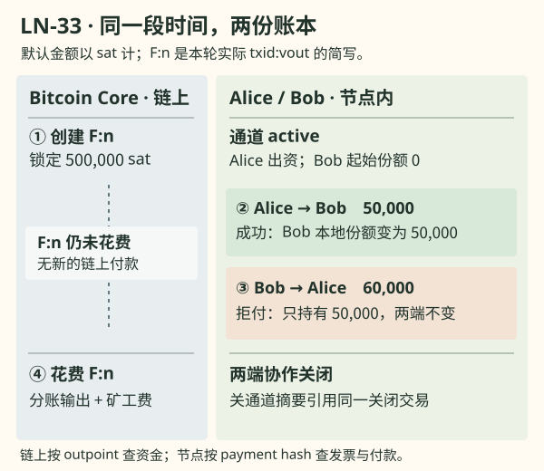

# 第 33 课 · 收到了 50,000 sat，为什么查不到付款交易？

Bob 给 LN-33 开了一张 **50,000 sat** 的发票（sat 是聪，比特币的最小单位）。他和 Alice 之间有一条 **500,000 sat** 的支付通道。Alice 的付款记录写「成功」；Bob 用本单的支付哈希查自己的节点，也读到同一张票「已结清，实收 50,000 sat」。客服却在比特币账本上找不到这次付款的交易编号。该让 Alice 再付吗？

不该。支付哈希是两端认这张票的编号，不是链上的交易编号。打开通道时，Alice 先把 500,000 sat 锁在链上；这次付票只改了两端约定的份额，Bob 的份额从 0 变成 50,000。能认这笔收款的是**本单的支付哈希、Bob 自己的已结清记录和实收额**，不是开通时的 500,000；也不能用一张已付票证明通道已经关闭。

**只换客服拿来的发票。** 还是 Bob 开的、还是显示已收 50,000 sat，但支付哈希与 LN-33 留的不一样。能用它核销 LN-33 吗？不能，它说的是另一张票。本单要按原哈希回查；不能因为对不上就断言本单没付，更不该催第二笔。

本课是独立选修。只阅读可到这里；若手上还有两份索引对不上的工单，可任选[第 34 课：在同一块比较两份报表](subgraph.html)，不需要先跑本课。以下选做：在自己的两端节点查发票，再看关闭交易实际花了哪笔钱。

先修：[M02 的确认与重组](confirmations.html)、[UTXO、找零与费用](bitcoin.html)、[输出脚本](scripts.html)、[交易签名交接](psbt.html)。本课不需要公网节点、交易所账户或真实 BTC；两个 Lightning 节点都由你在同一台机器临时创建。目标不是开一家常在线的路由商，而是为一个收款后端设计正确的对账依据。

## 先决定查哪本账

在普通 Bitcoin 付款里，你可以让后台按 `txid:vout` 检查特定输出。**Outpoint（输出位置）**由某笔交易的 ID 和从零起的输出序号组成；只写交易 ID 会把同笔交易的找零也混进来。Lightning 的入口仍是这样的输出：**注资交易（funding transaction）**从 Alice 的链上钱包选币，把 500,000 sat 锁入双方约定的脚本，余款另作找零，注资交易自己也付矿工费。本课明确协商 LND 的 `anchors` 通道类型，注资输出是 P2WSH，见证脚本要求双方签名。不要据此认定所有 P2WSH 都是通道、所有版本的通道都用这个脚本，或仅凭脚本哈希就认出了 Alice 与 Bob。

**双向通道**不是把同一 UTXO 重复发给不同的人。双方持有可执行的**承诺交易**：如果不再合作，当前有效的承诺可以把通道按约定带回链上。更新时，双方交换新承诺所需的签名，按协议确认并撤销旧承诺；本例所用通道通过延时和对已撤销状态的惩罚约束过期结算。正常工作时不广播这些承诺。链上始终只有一笔未花费的注资输出，节点内则有逐次更新的分配。这样的安全性依赖访问最新状态、按时观察链上争议等条件；并不意味着删掉节点数据库后，只凭一个支付哈希就能恢复资金。

<figure class="lesson-figure"><a href="../assets/figures/m09/lightning.svg"></a><figcaption>同一次运行的两条观察线。F:n 只是图中的占位名，不是写死的交易 ID。数字是默认输入下的预期，不代表公网余额；矿工费和关闭输出位置须读本次回执。</figcaption></figure>

| 要回答的问题 | 去哪里查 | 不能拿它证明什么 |
| --- | --- | --- |
| 有多少 BTC 锁着？ | Core 的 `gettxout(F,n)`：`value`、`scriptPubKey.type`、`bestblock`；LND 的 `channel_point` 指向它 | 链上值 500,000 sat 不是任何一方可用的支付额度 |
| LN-33 这张票付了吗？ | Alice 的 `Payment` 与 Bob 的 `Invoice`，以同一 `payment_hash` 对齐金额和终态 | 一张 `OPEN` 发票或一笔注资交易都不是收款回执 |
| 确实关了这条通道吗？ | LND 的 `closedchannels` 与 Core 已确认交易的 `vin` | 链上结算汇总了通道的最终分配，并不列示中间每笔发票 |

## 一张发票怎样变成一份收款证据

Bob 的 `addinvoice --amt=50000` 产生一张固定金额的 **BOLT 11 发票**。它是一个带签名的支付请求，含网络、金额、支付哈希和有时效的条件；**生成和解码都不是支付**。这里的 50,000 sat 是 50,000,000 msat（毫聪）；不要拿数据库的毫聪字段直接和 Java `long amountSat` 比。Alice 用 `decodepayreq` 检查收款节点、金额、哈希；业务还应校验网络、时效及订单绑定，不能只看转发来的备注。

具体机制是**有哈希锁和时间锁的条件支付**（HTLC）。Bob 保有随机原像 `r`，发票公开 `h = SHA256(r)`。Alice 经通道提出条件转移；Bob 用 `r` 满足条件，双方完成承诺更新。如果无法满足条件，则由协议失败回退或按超时规则处理，不会凭一张发票永久占有付款人的份额。这次只有直接相连的两个节点，无中间转发者；普通多跳支付还需要每一跳都有**那个方向**的可用容量，转发节点可以收费。本例的一跳路由费为零，不等于开关通道也免费。

从工程上说，`payinvoice` 成功返回后仍要将凭证关联到正确工单。本实验读的是这些字段，而不是解析终端一行「成功」：

1. `addinvoice.r_hash` 与 `decodepayreq.payment_hash` 必须相同，`decodepayreq.destination` 必须是本次 Bob 的身份公钥，`num_satoshis` 是订单金额。发票先在 Bob 的 `lookupinvoice(h)` 里处于 `OPEN`。
2. Alice 的 `Payment.status == SUCCEEDED`、`value_sat == 50000`、`fee_sat == 0`。读取 `htlcs` 中成功尝试的 `route.hops`：恰好一跳且其公钥是 Bob。脚本在内存中校验 `SHA256(payment_preimage) == h`，不把原像归档。哈希连接的是这张发票，不是通道的 `txid`。
3. Bob 的 `lookupinvoice(h).state == SETTLED` 且 `amt_paid_sat == 50000`。**商户应由自己的节点确认收款**，不能只信客人展示的付款成功截图。原像能验证与哈希的关系，但出具发票的收款人本来也持有原像；单凭原像不能向第三方证明是谁付款或买了什么。

把它接进 Java 服务时，将 `network + payment_hash` 和订单、定价单位、预期金额一起存。只让匹配金额的自有节点终态触发一次发货；处理订阅重放或响应丢失时，按哈希回查状态并做幂等更新。`IN_FLIGHT`、服务重启和单纯 RPC 超时都不是「客户已付」或「客户未付」的同义词。

## 准备两个真正的节点，而不是两份余额变量

在**仓库根目录**运行。需要 Bash、`curl`、`tar`、`install`、`sha256sum` 或 `shasum`、Python 3.11（标准库），以及可绑定回环端口的 macOS / Linux / WSL2。固定 Bitcoin Core **30.5** 和同一发行包中的 **LND / lncli v0.21.8-beta**。首次获取二进制需要网络；工具就绪后实验本身不联网下载、不使用 Docker、Go、ZMQ 或区块浏览器。

```bash
bash labs/m09/lightning/setup.sh
python3 labs/m09/lightning/run.py
```

[安装入口 setup.sh](m09/lightning/setup.sh) 支持 macOS 的 arm64/x86_64、Linux 的 aarch64/x86_64。已有[第 06 课环境](bitcoin.html#bitcoin-tools)时，在同一终端保留 `bitcoind`、`bitcoin-cli` 的 `PATH`；否则入口安装上述版本到 `${XDG_CACHE_HOME:-$HOME/.cache}/chain-course/m09/lightning/`。只缓存二进制，下载后对照固定 SHA-256 再解包；摘要校验不代替发布者签名验证。按文末官方发行说明可另验清单和签名。不要把缓存改成自己的钱包目录。

[运行器 run.py](m09/lightning/run.py) 复用 [regtest.py](regtest.py) 的聪/BTC 精确换算与断言。第 06 课的 [bitcoin.sh](bitcoin.sh) 是单节点付款练习，不需要提前运行，不会给本课持久提供 RPC。本课自行启动 Core，是因为两端 LND 都要知道同一 Core 的临时 RPC 端口和 cookie 路径。若从网页下载，保留 `labs/regtest.py`、`labs/m09/lightning/setup.sh` 和 `labs/m09/lightning/run.py` 的相对位置。

隔离是验收条件：Core 从 `height=0` 的新 regtest 启动，关闭 P2P 联网；两端 `lnd` 都检查 `network=regtest` 和 `synced_to_chain`，仅在 `127.0.0.1` 各自的端口监听 RPC 和节点连接，不用 DNS 引导；TLS 和 macaroon 鉴权仍开启。LND 对 Core 使用 RPC polling 接收区块和交易通知。**`--noseedbackup` 仅用于可丢弃的测试节点**，不要迁到真实节点。脚本遇见本机账号已有 `lncli` profile 就退出：请换干净的系统账号，不要挪开真实配置或把其 macaroon 传进来。每轮在权限受限的临时目录生成两套身份、链和钱包；正常退出与通常的中断会先停子进程再清目录，强杀进程或断电则不作保证。

## 沿着脚本走一圈：同一个 F:n 到底变没变？

以下方法名都是 [run.py](m09/lightning/run.py) 实际调用；`a.call` 和 `b.call` 分别给临时 Alice 和 Bob 的 `lncli` 附上独立 `--lnddir`、`--rpcserver`、`--network=regtest`。不要在另一个终端用没有这些隔离参数的 `lncli` 或 `bitcoin-cli` 手动补步骤。

**① 准备链上钱包，再锁定。** Core 先给矿工挖 101 块，使早期区块奖励越过 coinbase 成熟条件；矿工给 Alice 的临时链上地址转 2,000,000 sat，再挖一块。`walletbalance.confirmed_balance` 是 Alice 的**链上钱包余额**，此时还没有通道。Alice 连接 Bob 的回环节点地址，提出独资开一条私有、不广播到公共路由图的通道，没有初始推给 Bob 的份额：

```python
funding_id = a.call('openchannel', f'--node_key={b_key}', '--local_amt=500000',
                    '--private', '--channel_type=anchors', '--sat_per_vbyte=2')['funding_txid']
```

`funding_txid` 只是开端。脚本等它**实际出现于 mempool** 才挖 6 块，然后等两端 `listchannels` 均为 `active`，由 `channel_point` 取出 `F:n`。不能假定输出索引永远是 0，或把「开通命令返回」等同于「可以支付」。6 是本实验给确认与节点同步留的块数，不是所有通道一律要等六次。程序在第一个确认块的交易清单找 `F`，并读 `gettxout(F,n)`，确认脚本类型和 `0.00500000 BTC × 100,000,000 = 500,000 sat`。初始 `before_sat.bob.local_balance == 0`。

**② 不出块，付正向发票。** 读取 `payment` 与 `after_sat`。成功时 Bob 本地份额从 `0` 变为 `50,000`，Alice 视角的 `remote_balance` 也变为 `50,000`。从 Bob 看，这张表的 local / remote 恰与 Alice 相反。**实际可发送额不是 `capacity`，甚至不一定等于 `local_balance`**：要留通道保留额，还可能受承诺费、锚点输出、未决 HTLC、最小/最大 HTLC 和远端策略约束。尤其不要要求 `local_balance + remote_balance == capacity` 才通过，或把 `commit_fee` 当成本次路由费。它是节点为当前承诺交易计算的费用，不是本次协作关闭最终实付的矿工费。

**③ 换方向，并故意超过上界。** 现在改由 Alice 开一张 `50,000 + 10,000 = 60,000 sat` 的新发票，Bob 尝试支付。全网只有这一个对手、这一条通道；Bob 的本地份额才 50,000，**即使暂且忽略所有保留额，也短 10,000 sat**。脚本要求 Bob 的支付结果是 `FAILED`（命令非零退出且有结构化支付结果，不把通信错误当拒付），Alice 的票仍为 `OPEN`、实收 0，前后两端余额均不变。`reverse.failure_reason` 是本轮付款节点的诊断值；在真实网络，找不到路还可能因为节点离线、某一跳策略或时限等。不能由一次笼统的失败码推断「收款方缺钱」或把这笔失败当成任何网络的通则。

程序在这两次尝试前后分别读链尖、该 UTXO 及 mempool；要求链尖相同、池都为空、该 UTXO 仍为 500,000 sat。支付期间没挖块，但**只看高度不变不足以排除尚未打包的交易**，所以还检查 mempool。这里看到的是这个受控区间；协议上更根本的解释是：正常履约只更新双方的承诺，没有广播一笔逐票的 Bitcoin 交易。私有通道也不等于绝对匿名，链上开关、对手节点以及有权读节点数据的人各自仍有可见信息。

**④ 协作关通道，按输入而不是金额找结算。** Alice 的 `closechannel --chan_point=F:n --sat_per_vbyte=2 --max_fee_rate=20` 没有 `--force`。2 sat/vB 是协商起价，不是矿工保证收取的费率；20 sat/vB 是本实验允许的协商上限。省略上限时，这版 lncli 默认只接受起价的三倍。一次本地演练中，对方提议总费 1,202 sat，高于当时上限对应的 1,158 sat，协作关闭没有谈成；这不撤销之前已结清的发票。双方谈妥后才签署关闭交易。脚本等 `closing_txid` 出现于 mempool 并挖块，再检查：

```python
inputs = [f"{i['txid']}:{i['vout']}" for i in close_tx['vin']]
outputs = [sat(out['value']) for out in close_tx['vout']]
# 本实验要求 inputs == [point]，矿工费才可由这一个输入算出：
miner_fee_sat = CAPACITY - sum(outputs)
```

先看[默认交接凭单](m09/evidence/lightning/LN-33.json)的 `funding.channel_point`，它给出注资交易的 ID 和输出序号。把这串原样与 `close.spends[0]` 比：二者相同，才说明块 109 的关闭交易花的就是块 103 锁的那一笔。再算 `50,000 + 448,798 + 1,202 = 500,000 sat`：前两项是关闭输出，最后一项是矿工费，合起来才等于那个输入。**金额对平不能反推逐票历史**；单看某个输出恰是 50,000，也不能认领 Bob 的发票。复跑用本轮的实际数，不按数组序号猜收款人，也不要求矿工费永远相同。

如果只拿到 `gettxout(F,n) = null`，最多知道现在查不到这笔未花费输出，不能指出谁花了它。花费凭证要看已确认交易的 `vin`，再和**两端** `closedchannels --cooperative` 的 `channel_point`、`closing_tx_hash`、`close_type=COOPERATIVE_CLOSE`、`close_height` 对齐。本课只验双方在线的协作结算，不演练强制关闭、惩罚和链上等待。

**两层的“已关”不同时出现。** 在这版 LND 的本地观察中，关闭交易刚进块时，Core 已能指出是谁花了 `F:n`，两端 `pendingchannels` 的 `blocks_til_close_confirmed` 却仍是 2。脚本为关闭阶段共挖三块，从第一块读关闭交易，再等两端归入 `closedchannels`。单纯多等几秒不会给静止的 regtest 增加确认；不要为让界面变绿再发一笔关闭交易。

归档里 `payment.fee_sat` 是 **0 sat**，而 `close.miner_fee_sat` 是 **1,202 sat**，分别回答「路上付了多少转发费」和「最后花费链上输出付了多少矿工费」。后者不从 Bob 那张已结清的发票里再扣一次。

## 留一张别人能读懂的对账单

成功时程序只在标准输出写一份精选 JSON，错误去标准错误且退出非零。默认输入的**预期判据**如下，不是粘贴的实测回执：

| 摘要中的键 | 应看到什么 |
| --- | --- |
| `funding.channel_point`、`funding.capacity_sat` | 本轮随机的 `F:n`、`500000`；`before_sat.bob.local_balance = 0` |
| `payment` | `SUCCEEDED`，`50000 sat`，`hops=1`，`fee_sat=0`，原像校验为真，收款状态 `SETTLED` |
| `reverse` | `60000 sat`，`FAILED`，票 `OPEN` 且实收 `0`，`balances_unchanged=true` |
| `unchanged_chain_during_payments` | 同一 `bestblock`，`funding_unspent_sat=500000`、空 `mempool_txids` |
| `close` | `spends` 中是同一 `F:n`，矿工费为正；两端匹配协作关闭；`funding_unspent_after=false` |

排障按层次来：工具找不到先回 `setup.sh` 或第 06 课设置的 `PATH`；若出现「等候 Alice 链同步 / 两端 active 超时」，还没得到可用通道，不能报成拒付；若已到 `FAILED`，核对付款人、金额、`after_sat` 方向和实际 `failure_reason`。网络能力受限的环境不能绑定本地端口时换能运行本地节点的机器，不要改连主网或公网 RPC。每次重跑都是新环境，不能把 A 轮的关闭交易和 B 轮的付款哈希拼成一张单。

**独立作业：**给工单 LN-33B 自选一个不等于 50,000 的整数 `p`（20,000 至 200,000 sat）。开跑前写下 Bob 成功后的本地份额、反向请求金额及最低缺口。用新目录保存你的本轮结果，下例的 72,000 可替换：

```bash
umask 077
evidence_dir=$(mktemp -d)
python3 labs/m09/lightning/run.py --pay-sat 72000 > "$evidence_dir/ln-33b.json" && cat "$evidence_dir/ln-33b.json"
```

交付一份非空、成功退出生成的 JSON 和三句交接说明。**过关线**：能从两端区分 `p` 已结算与 `p+10,000` 未收，指出后者不是等待更多链上确认就会成功；能在同一回执逐字符对上 `funding.channel_point == close.spends[0]`，用真实输出重算矿工费；能回答客服「逐票查哪个哈希，关通道查哪个输入」，并解释为什么不能由关闭输出倒推出历史上恰好只有一笔付款。不要交节点目录、TLS 私钥、macaroon、钱包文件、RPC cookie、原像、完整发票或调试日志。摘要足以复核本次关联，不是公网可独立验证的第三方支付证明。

## 查原始规范

- [BOLT 2：Peer Protocol for Channel Management](https://github.com/lightning/bolts/blob/master/02-peer-protocol.md)、[BOLT 3：Bitcoin Transaction and Script Formats](https://github.com/lightning/bolts/blob/master/03-transactions.md)：对应注资、承诺状态更新、HTLC 以及协作关闭的消息与链上交易。
- [BOLT 11：Invoice Protocol](https://github.com/lightning/bolts/blob/master/11-payment-encoding.md)：核对支付请求的金额单位、支付哈希、签名和到期时间；区分能解码与已支付。
- [LND 的 LookupInvoice](https://lightning.engineering/api-docs/api/lnd/lightning/lookup-invoice/)、[本课版本的 RPC 类型](https://github.com/lightningnetwork/lnd/blob/v0.21.8-beta/lnrpc/lightning.proto)：比对 `Invoice`、`Payment`、`Channel` 与 `ChannelCloseSummary`，尤其是 `state`、`status`、`channel_point`、`closing_tx_hash`。
- [Bitcoin Core：gettxout](https://bitcoincore.org/en/doc/30.0.0/rpc/blockchain/gettxout/)、[Bitcoin Core 30.5 下载清单](https://bitcoincore.org/bin/bitcoin-core-30.5/SHA256SUMS)、[LND v0.21.8-beta 发行与验证说明](https://github.com/lightningnetwork/lnd/releases/tag/v0.21.8-beta)：核对默认 mempool 语义、程序版本与发行物。
