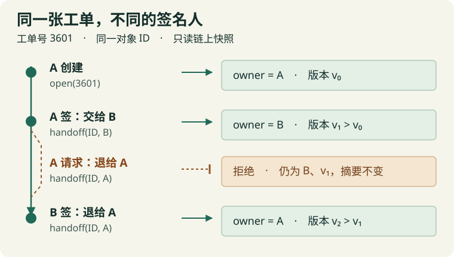

# 第 36 课 · 交出去的工单，原经办人还能退回吗？

白班 A 开的 **3601 号工单**已经交给夜班 B。交接记录有两栏：用来认这张单的对象 ID 没变，「当前持有人」从 A 变成了 B。客服现在要把这张单退给 A。A 知道对象 ID，也能读到最新一版；如果由 A 在退回申请上签名，系统该不该受理？

不该。要把工单从 B 手里交出去，得看**谁现在持有它**，不是看谁开的单。3601 是业务号，不一定唯一；即使拿着准确的对象 ID，也不能代替 B 的签名。拒绝这次请求后，工单应仍归 B；一条报错本身还不能证明拒绝原因，要与交接前后的记录对照。

只把**签名人换成 B**：还是同一个对象，还是要求「退给 A」。这次该不该受理？该。有效交接后对象 ID 不变，最新版本的持有人应是 A。这说明控制权回到了 A，不说明 A 已亲自签收，也不说明维修完成。

只读到这里就可以停；若有其他岗位问题，可[返回 M09 目录任选另一课](../plan.html#m09)。四个专项彼此独立，不是先后步骤。以下是选做的 Move 程序、本地交接实验和卷末工单；只需能[区分知道编号与持钥签名](crypto.html)、[确认客户端所连的网络](networks.html)。A、B 是独立临时测试钱包，工单不涉及收款；不接公共 Sui 网络，不用助记词、插件或水龙头。业务若不需要链上交接，一次带授权检查的数据库更新可能已经够用。

## 给工单找一个不会随交接而变的键

关系库中你可能有 `ticket(pk, number, assignee, rev)`。行锁能让写请求串行，`WHERE pk=? AND rev=?` 能发现旧版写入；两者都不能代替“这个用户现在是否有权交出这张单”的检查。在 Sui 中，普通 **地址拥有对象**把这三件事分开了：

| 要问的问题 | 去哪里读 | 不能据此推出什么 |
| --- | --- | --- |
| 哪张工单？ | `objectId` 是对象的标识，内容里的 `fields.id.id` 与它相同；`fields.number` 只是业务标签 | 显示号码 3601 不代表全网唯一。这个教学包允许同号开两张单；只看号码就会串单 |
| 在读哪个状态？ | 普通拥有对象在交易里的引用含 **ID、version、对象 digest**。读取结果的 `previousTransaction` 是把它写成这个状态的交易摘要 | 对象摘要和交易摘要不是一个东西；对象版本不是时钟、区块高度、用户第几次点击或工单流水号 |
| 谁能提交它？ | 外层 `owner.AddressOwner` 记录当前持有地址，执行输入检查会核对发送方 | 知道 ID 或保存旧回执没有授权作用；字段在链上可读，也谈不上工单内容保密 |

在[实验包](m09/move-ticket/ticket/sources/ticket.move)里没有冗余的 `assignee` 字段。手写第二份经办人再忘了同步，会造成“前端显示 A、协议只认 B”。本课把地址所有权定义为**下一次交接权**，不是客户已同意、收件人已签收或维修已完成。如果业务要 B 明确同意，应额外设计待接收状态和 B 的确认操作，不能把单向转移当双签。

<figure class="lesson-figure"><a href="../assets/figures/m09/move-ticket.svg"></a><figcaption>默认演练的判据。v₀、v₁、v₂ 是三张快照上实际版本的代号，并非数字 0、1、2。虚线是被拒的申请，不是一笔成功的交接。</figcaption></figure>

## 两个入口，一份能够移动、不能复制的值

```move
module workshop::ticket;

public struct Ticket has key {
    id: UID,
    number: u64,
}

public entry fun open(number: u64, ctx: &mut TxContext) {
    let ticket = Ticket { id: object::new(ctx), number };
    transfer::transfer(ticket, ctx.sender());
}

public entry fun handoff(ticket: Ticket, recipient: address) {
    transfer::transfer(ticket, recipient);
}
```

1. `key` 是 Move 类型的 **ability**：这个类型可以作为 Sui 对象，首字段为 `UID`。这不是钱包私钥，也不是授予某位操作员的许可证。`object::new(ctx)` 让运行时分配新 UID；`number` 相同不会拿到相同 UID。
2. 调用 `open` 时，运行时给出交易上下文，`ctx.sender()` 来自本次发送者，不是页面能任意填写的“当前用户”。模块把新对象交给这个地址。任何人都能开自己的单；没有对发行数量、企业身份或订单号去重作承诺。
3. `handoff` **按值接收** `ticket: Ticket`，不是把一串 ID 当作已授权工单。调用方必须提供能被运行时接受的当前输入。该类型没有 `copy` 或 `drop`；模块把值移给 `transfer::transfer` 后，不能再拿同一个局部变量转第二次。这里有两层不同的检查：Move 对值的使用规则，与账本对交易输入/签名的检查。
4. 我们故意没给 `Ticket` 声明 `store`。有 `key + store` 的对象可以走通用 `public_transfer`；这里只有定义模块能用受限的 `transfer` 交接本类型。因此演练通过 **`ticket::handoff`**，不通过通用 `sui client transfer`。入口对所有人可见，不表示所有人都能提供 B 拥有的输入。

**版本为什么未必加一？** 假设交接前工单版本是 7，付 gas 的 SUI 币对象版本是 12。本例这两项是交接时的可变输入，新写入的版本是 `1 + max(7, 12) = 13`。这不是工单丢了五条回执。反过来，若工单是 7、gas 币是 3，则结果是 8。本地脚本让同一次交易的输入引用、gas 引用、变更条目和后读的对象互相校验，不用假定起始版本。这里算的是对象版本，不是 gas 数量；**1 SUI = 1,000,000,000 MIST**。

## 从空创世发布，不借用你的 Sui 配置

在仓库根目录运行以下命令。需要 Bash、`tar`、`curl`、`install`、CPython 3.10+（仅标准库）以及能运行官方本机发行文件的 macOS 或 Ubuntu；不用 Docker、Rust、PostgreSQL、外部 RPC。先预留约 3 GB 空间给发行归档、框架源码、节点和临时账本。第一次安装会联网，后面的运行使用本地依赖。

```sh
LAB=labs/m09/move-ticket
bash "$LAB/setup.sh"
WORK=$(mktemp -d)
python3 "$LAB/run.py" --out "$WORK/default"
python3 "$LAB/review.py" "$WORK/default" --expect-number 3601 --expect-final A
```

[安装脚本](m09/move-ticket/setup.sh)固定 **MystenLabs `mainnet-v1.53.2`** 的 `sui`、`sui-node` 以及同标签框架。标签名是软件来源，**不是选择主网**。脚本按平台核验发行包，macOS arm64 归档 SHA-256 为 `4f2c65d55057110ff11033774d1b9778d6f49594d321ab776026194151386048`；源码归档 SHA-256 为 `b32bc517e9cda7257386beacb1e38b3886949d6a5e88f312c9905dda10b92939`。下载、二进制和 `framework/{sui-framework,move-stdlib}` 放在 `~/.cache/chain-course/m09/sui-1.53.2/`，不改全局 PATH。哈希不符请停下，不要放宽检查。固定旧版本是为了可复跑这个本地 JSON-RPC 实验，不是生产版本推荐。

[run.py](m09/move-ticket/run.py) 为每轮新建临时 HOME 和 `SUI_CONFIG_DIR`，从空目录 `sui genesis --committee-size 1` 产生一份创世，再按配置分别启动验证者和全节点。它把 RPC 和节点监听地址限制到回环；不启动 faucet 或索引服务。两个客户端配置都只知道这一轮的回环 RPC。A 取自临时创世钱包，B 在另一份全新的 keystore 中生成；不展示或存档恢复短语。脚本把一个测试 SUI 从 A 拨给 B 付 gas，这笔 `fund-B.json` 和“工单归谁”无关。发行版节点带 HTTP 遥测，脚本为子进程把非本地 HTTP(S) 代理限定到一个不接受连接的回环端口；这不是操作系统级网络沙箱。

[Move.toml](m09/move-ticket/ticket/Move.toml) 显式引用同版的本地 `Sui` 框架，不用拉取滚动分支。运行器在临时包目录编译，`publish --verify-deps` 对照本地链上的依赖，完成发布后从 `published` 变更取包 ID，再找刚创建的完整类型 `包ID::ticket::Ticket`。**包 ID、工单 ID、升级能力对象 ID、付费币 ID** 都可能同时出现在一次演练里；取“列表第一个 ID”不能定位工单。

下表对应真正执行的 CLI 调用。`$P`、`$T`、`$A`、`$B` 分别表示**本轮**的包、工单和两位钱包地址；自动脚本负责填值、给各命令指定临时 `--client.config`、预算和 `--json`。不要在自己的默认钱包照抄缩写命令。

| 默认演练 | 参数中的动作 | 应保留什么 |
| --- | --- | --- |
| A 建单 | `call --package $P --module ticket --function open --args 3601` | `open.json` 有 `created` 变更；`created.json` 对象归 A |
| A 交班 | `call --package $P --module ticket --function handoff --args $T $B` | `handoff.json` 的 sender 为 A；`handed.json` 同 ID、较新版本、归 B |
| A 要求退回 | `call --package $P --module ticket --function handoff --args $T $A` | `refusal.json` 非零退出，错误指向该对象、当前 owner B 与请求签名人 A；`after-refusal.json` 和 `handed.json` 对象完全一致 |
| B 要求退回 | **同一个** `handoff --args $T $A`，只换客户端为 B | `return.json` 的 sender 为 B；`returned.json` 同 ID、再次增版、归 A |

被拒时不能只看一个红色错误：丢了网络、gas 不足和把 `$P` 写成 `$T` 都足以令命令失败，却无法证实权限边界。这里明确给出 gas 预算，走正常客户端请求，由输入所有权检查拒绝；没有构造特殊签名或修改节点。**拒单文本不是成功回执，也不要编一笔 Move 抛错后已上链的交易号。** 对照组让有权的 B 真正完成相同的退回，排除“函数本来就不能用”。

## 接手人怎样读证据，而不是认截图

`--out` 要求新目录，防止混用创世。结束时脚本会关闭节点，清理临时钱包、编译目录和节点库；留下的是公开材料。先独立读快照，显示完整 ID、版本、持有地址和上一笔实际写入交易：

```sh
python3 - "$WORK/default" <<'PY'
import json, pathlib, sys
p = pathlib.Path(sys.argv[1])
for label in ('created', 'handed', 'after-refusal', 'returned'):
    o = json.loads((p / (label + '.json')).read_text())['data']
    print(label, o['objectId'], o['version'], o['owner']['AddressOwner'], o['previousTransaction'])
PY
```

先用上面打印的四行判断权限：拿 `handed` 与 `after-refusal` 对读，持有人都为 B，版本、ID 和上次写入交易都没有变；再去 `refusal.json` 看拒绝原因确实是**请求签名人 A 不拥有这个输入对象**。若只是断网，快照也可能不变，但不能得出权限检查生效的结论。

再验 B 的成功退回，不只看最后一行写了 A。取 `return.json` 的 `transaction.data.transaction.inputs` 中工单的 ID、版本和对象摘要，与 `handed.json` 的对象逐项对齐，证明交出的是 B 手里那一版。用 `gasData.payment` 的 gas 币版本和工单输入版本按前面的最大值公式算出新版本；用同一 ID 在 `objectChanges` 找新 owner 和对象摘要，与 `returned.json` 对照。最后，这张快照的 `previousTransaction` 要等于 `return.json` 的交易 `digest`：前者指向生成这张新记录的那一笔，不是对象自身的摘要。[复核器](m09/move-ticket/review.py)用 `run.json` 的角色映射做这些检查；默认判据是 `MATCH_LOCAL number=3601 final=A`，并报三次实际版本、`refused=UNCHANGED`。地址、摘要和版本以本轮为准。

只改业务的签收要求，不重发交易：

```sh
python3 "$LAB/review.py" "$WORK/default" --expect-number 3601 --expect-final B
```

预期 `HOLD: wrong final holder`，退出 3。交班那笔确实曾把对象交给 B，但对账要求的是**最后的持有人**，不能跳过第三笔实际写入。离线复核的前提是信任归档来源：本脚本没有独立认证检查点、重验验证者证书，也不能证明链外人员已经交班。

## 如果要改成“主管能调度工单”

不要把 **ability、capability、shared** 当作三个权限开关。`key`、`store` 是类型静态具备的 ability。**Capability** 是应用授予某项操作权限的一份值，常建模成独立对象，例如 `DispatchCap`。只允许模块在初始化时创建它，要求管理入口额外接收 `&DispatchCap`。谁能合法提供这份值，谁才能走这个入口；如果有多个项目，能力还要绑定相应工单簿 ID 并核对，不能接受别的簿同类型的能力。发布回执里的框架 `UpgradeCap` 只涉及包升级，不是替所有经办人签字的派工权。

如果单子仍是 B **地址拥有**的，主管仅有 `DispatchCap`，还是不能把 B 的 `Ticket` 直接当作自己的交易输入。反之，如果真正需求是多方轮流更新同一本队列，可以在创建时 `share_object` 一份 **shared 对象**：它不再依赖某个经办人地址才能作为交易输入，不同提交者可以请求访问。但修改动作仍受 Move 入口和权限检查约束。可以把“分配”建模成 `assign(board: &mut Board, cap: &DispatchCap, ...)`，把“认领”建模成另一条核对签名人的入口。共享不是“公开任意改”，也不是对已交出的普通对象补点一个按钮就改成共享。热门 `Board` 的写操作需要排定次序，吞吐和拥塞要用相同业务流量实测。这是改需求后的设计对照，实验没有部署共享队列或主管接口。

## 同一张需求单，三种状态放在哪里

| 平台与最小模型 | 交接时谁做授权检查 | 何时选它，付出什么 |
| --- | --- | --- |
| EVM：合约内 `mapping(uint256 => Ticket)`，行里放 `assignee`；改变后发事件 | 合约显式校验 `msg.sender == assignee`，再更新同一行；若要标准化可评估 ERC-721 并决定是否允许 operator | 团队已有 Solidity、EVM 钱包及日志索引，或要求按业务号唯一开单时，合约可集中检查。要自己定义角色、并发/重试语义和事件，事件不是当前持有人字段 |
| Solana：每工单一个由程序拥有的数据账户，可用“簿 + 工单号”推导 PDA；在账户数据存经办人公钥 | 程序核对账户归属、结构/PDA 和当前经办人的 signer，再写入新公钥。运行时外层 `owner` 是**程序**，不能拿它当“经办人地址” | 已有 Solana 客户和账户标准、想显式规划交易访问哪些账户时合适；不同工单可分账户。须处理账户大小、创建成本、账户清单、写锁和约束 |
| Sui：每张 `Ticket` 一个 UID，普通地址拥有，外层 `AddressOwner` 就是本题交接权 | 运行时检查拥有对象输入与发送者，模块决定准许的操作；接收方无需签字 | 一物一持有人的交接和按对象查证很直接。若要求主管随时追回、同号绝不重复或多方争抢，必须重新安排状态/能力和共享写入，不是原模型天然免费支持 |

选型要追问：只需知道“此刻谁能转出”，还是需要“经理可越过经办人代派、客服可回滚、接单方必须签收”？三者不等价。先画出谁能提交哪项状态，再谈语言和每秒交易数。

## 课后作业：不让工单号被 JavaScript 四舍五入

另起一轮，开 `9007199254740993`（比二进制浮点能逐整数精确表示的上界 `2^53` 多 1）号单。Java 可以用正的 `long` 表示这个数，网页若先转成 JS `Number` 则可能读到 `9007199254740992`；从命令行到回执都保留十进制字串或整数。

```sh
python3 "$LAB/run.py" --number 9007199254740993 --out "$WORK/precision"
python3 "$LAB/review.py" "$WORK/precision" --expect-number 9007199254740993 --expect-final A
python3 "$LAB/review.py" "$WORK/precision" --expect-number 9007199254740992 --expect-final A
```

交一张四行表：每行列出 ID、业务号、owner、version、previousTransaction，指出哪两行完全相同。过关线：第一次复核 `MATCH_LOCAL`，第二次只改合同号就 `HOLD`、退出 3；用 `handoff.json` 的工单与 gas 输入**手算交班后的实际版本**。只给 `3601` 例子的地址或用截图抹掉完整 ID，不通过。

<a id="m09-checkout"></a>

## 卷末工单 X-936：按岗位签自己能证明的一联

你接手一次技术选型演示。委托人没有要求四种技术集成：**从下面四联任选实际岗位需要的一联**，不用先学其他三课。每联都要交输入、运行环境、正常原件、只改一个条件的反例、据此能签收什么及不能签收什么。其他三联不因这一联通过而自动通过。

- **工单平台联（本课）**：936 号返修单，由夜班 **B** 开单交给 **A**，收到退回通知后只有当前持有人 A 可以将其交还 B。最终收件人必须是 B，不能拿中途归 A 的回执结案。
- **钱包联**：用[第 33 课](lightning.html)的独立作业输入，在两个回环 Lightning 节点核对发票、通道内支付和关通道证据；不能用一笔链上付款代替发票结算。
- **数据服务联**：用[第 34 课](subgraph.html)的独立作业输入，指定部署和同一目标块，比对派生视图与 Java 账本并交重建记录；不要把两个“最新”当同一高度。
- **证明应用联**：用[第 35 课](preimage.html)的独立作业输入，在同一验证密钥下检查 A 的证明配 A 的承诺、A 的证明配 B 的承诺、B 的证明配 B 的承诺；三次应依次为通过、拒绝、通过，不认证真实身份。

**工单平台联的接手命令**（从仓库根目录开始，可给未看过 3601 范例的同事）：

```sh
LAB=labs/m09/move-ticket
bash "$LAB/setup.sh"
BOX=$(mktemp -d)
python3 "$LAB/run.py" --out "$BOX/X-936" --number 936 --reverse
python3 "$LAB/review.py" "$BOX/X-936" --expect-number 936 --expect-final B
python3 "$LAB/review.py" "$BOX/X-936" --expect-number 936 --expect-final A
```

**独立过关线**：保留 `X-936/` 内公开 JSON。复核 B→A→B 的三个成功写入引用的是**本轮同一对象**；B 的旧权限申请具体因 owner/signer 不匹配而被拒，前后对象原件相同；A 才能完成最后一笔退回。按工单要求「最终持有人是 B」复核，结果为 `MATCH_LOCAL number=936 final=B`；最后一条只把要求改成「最终持有人是 A」，同一组链上写入仍成功，签收判断必须是 `HOLD`、退出 3。交一段对“如果主管必须能代派怎么办”的选型意见，写清需要改变哪类对象或权限。不要打包 `~/.sui`、keystore、节点库或助记词；本联与其他三联没有共用的交易或金额。

**离线先接手一份实物：** 仓库里有一轮[角色与对象清单](m09/evidence/X-936/run.json)、[错误签名人的拒单](m09/evidence/X-936/refusal.json)和[当前持有人的退回回执](m09/evidence/X-936/return.json)。从根目录运行 `python3 labs/m09/move-ticket/review.py labs/m09/evidence/X-936 --expect-number 936 --expect-final B`，只读公开原件，不用启动 Sui。然后再按上面的命令用新的创世交自己的单；两轮的对象 ID 不应混用。

## 可直接核对的资料

- Sui 文档：[地址拥有对象](https://docs.sui.io/develop/objects/object-ownership/address-owned)、[共享对象](https://docs.sui.io/develop/objects/object-ownership/shared)、[版本规则与 Lamport 算例](https://docs.sui.io/develop/objects/versioning)。核对“谁能提交”和“谁排写入顺序”是两个问题。
- The Move Book：[Capability 模式](https://move-book.com/programmability/capability/)。比较应用授予的对象能力与类型的 `key`、`store`。
- MystenLabs：[本课官方发行](https://github.com/MystenLabs/sui/releases/tag/mainnet-v1.53.2)、[该版 transfer 模块](https://github.com/MystenLabs/sui/blob/mainnet-v1.53.2/crates/sui-framework/packages/sui-framework/sources/transfer.move)、[该版输入检查](https://github.com/MystenLabs/sui/blob/mainnet-v1.53.2/crates/sui-transaction-checks/src/lib.rs)。看 `transfer` 的类型约束，以及对象拥有者与签名人不匹配的拒绝条件。
- 对照设计：[Solidity 的 mappings](https://docs.soliditylang.org/en/latest/types.html#mapping-types)、[Solana 账户模型](https://solana.com/docs/core/accounts)。本课没有把同一个包部署到这两种链上，也没有做跨链吞吐基准。
