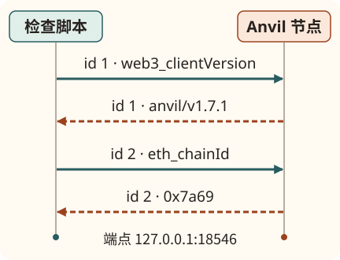
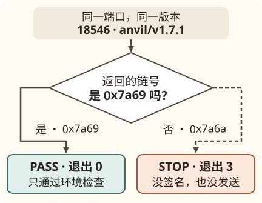

# 第 04 课 · 运行自己的第一条链：签名前先问连的是谁

联调单写着：「Bitcoin 用 `regtest`；EVM 用本地链 `31337`。」同事在 `127.0.0.1:18546` 拿到了 `anvil/v1.7.1`，问你：「服务已经连通，可以让收银员签名了吧？」先别弹签名框。这行字回答的是「你是什么软件」，工单问的是「你跑的是哪条链」。把同一个 Anvil 改成链 `31338` 再启动，它照样会报这个版本。

我们就在这台机器上复现一次。不装钱包，不领币，不发交易。能开终端、读 JSON 就够了；第 01 课讲的区块哈希，会在最后一次排障用到。[完整实验脚本：networks.sh](networks.sh)。

## 把一次调用拆开看

你写 Java 时可以调用 `client.getChainId()`。但答案不在 `client` 对象里：客户端要把方法名送给另一个进程，等它回话。这就是这里的 **RPC**（远程过程调用）；这次「远程」只有从本机一个进程到另一个进程那么远。

<figure class="lesson-figure"><a href="../assets/figures/m01/networks-rpc.svg"></a><figcaption>从左边的脚本出发，沿虚线回到左边；第二次回来的值才是工单要核对的数。</figcaption></figure>

拆开图里的第二个来回。下面是**正常时的报文示意**，实验脚本不会逐包打印它们。

```json
{"jsonrpc":"2.0","id":2,"method":"eth_chainId","params":[]}
```

```json
{"jsonrpc":"2.0","id":2,"result":"0x7a69"}
```

`id:2` 像叫号单，表示「这是给第 2 个请求的答复」，不是链号。脚本里的 `evm_read` 先检查 HTTP 状态和 JSON-RPC 应答：请求号要对得上，有 `error` 或没有 `result` 都不行。**就算 HTTP 是 200，也得打开信封看。** 第二封应答里的 `result` 才拿来比。

这条线上谁做了什么？Anvil 是**节点**，它按自己的配置维护账本、回答查询。脚本是调用方。Bitcoin 那边多一层：脚本启动 `bitcoin-cli`，由它向本机的节点进程 `bitcoind` 提问。把 `bitcoin-cli` 关掉，不等于关掉了节点。

那**钱包**和**区块浏览器**呢？如果收银员要授权一笔支出，钱包会准备交易，有签名能力的钱包可以自己签或找签名器；观察钱包只能看。浏览器则把后端查到的区块、交易做成可搜索的网页。比如浏览器里搜得到某个收款地址，这既没证明你的程序连接着那个后端，也没证明那张订单已付。本次实验连这两样都不用。

## 跑一次，看三行

从项目根目录执行 `cd labs`。只有网页的话，先把[脚本](networks.sh)下载到空目录，再进入那个目录。需要 Bitcoin Core **30.5** 的 `bitcoind`、`bitcoin-cli` 和 Anvil **1.7.1**；还需要 Bash 3.2+、Python 3.8+ 和 `lsof`。没装齐先看[本课安装命令](#network-tools)。都就位后运行：

```bash
bash ./networks.sh
```

脚本不复用你平时的节点。它创建临时目录，把 Core 的 RPC 绑在 `127.0.0.1:19443`，用 `-regtest -disablewallet -networkactive=0 -listen=0` 启动；Anvil 绑在 `127.0.0.1:18546`，用 `--accounts 0 --no-mining --no-cors --quiet` 启动。一个不加载钱包，一个不生成开发账户，也不从远端分叉。两边都从创世状态起步。节点会初始化自己的数据；这里的「只读」指客户端不写链，不是说 Anvil 所有接口天生只读。

读终端时先找行首，再读字段。下面是**正常时应有的读数**，`<PID>` 是操作系统当场分的进程号，交接时换成你实际看到的数字。

```text
BTC endpoint=127.0.0.1:19443 pid=<PID> version=300500 chain=regtest height=0 peers=0
EVM endpoint=127.0.0.1:18546 pid=<PID> client=anvil/v1.7.1 eth_chainId=0x7a69
PASS chain=regtest eth_chainId=0x7a69 read_only=true
```

**读 `BTC` 行。** `getblockchaininfo` 回答 `chain`（网络名）和 `blocks`（打印成 `height`）。`regtest` 是本地回归测试网络；只有创世块时高度是 `0`，不是 `1`。`getnetworkinfo` 回答的是**服务端**版本和连接情况：`300500` 表示 `30 × 10000 + 5 × 100 + 0`，`peers=0` 是这里刻意断开节点间连接的结果，不能据此诊断「RPC 坏了」。脚本还核对未打印的 `networkactive=false`。这些都对上，才轮到 Anvil。

**读 `EVM` 行。** `web3_clientVersion` 给出版本，`eth_chainId` 给出十六进制的链号。把 `0x7a69` 算成十进制：`7 × 4096 + 10 × 256 + 6 × 16 + 9 = 31337`，这才对上工单。`PASS` 和退出码 `0` 的意思到此为止：两个实验环境符合要求，没查余额，更没有付款回执。

这一步有什么用？同一个查询也能发往主网、公共测试网或本地链。主网处理真实资产，在那里签一笔小额付款也是真授权。Bitcoin 的 testnet4、Ethereum 的 Sepolia 是别人也在用的公共测试网，记录可公开查，不要放秘密；测试币到账不会增加主网余额。这里的 regtest、Anvil 都由你自己启动，可以从零重来；本地跑通并没有检验主网的共识、负载或最终性。

## 故障一：刚才还 PASS，怎么连不上了？

同事跑完脚本，过了一分钟，另一个程序访问 `127.0.0.1:18546` 报 `Connection refused`。该改链号吗？先在本机查有谁还在接电话：

```bash
lsof -nP -iTCP:18546 -sTCP:LISTEN || printf 'lsof exit=%s\n' "$?"
```

假设工具没报错、没有监听记录，而且刚才那次实验已正常退出。解释很简单：脚本退出前已经关掉了自己启动的节点，删除了这次的数据目录。**连接都没建起来，就没有 RPC 应答，更没有一个「错误链号」可读。** 要复查环境，重新运行整个脚本；不要拿别人的节点补这个空位。

反过来，如果这个命令查到另一个进程正占着 `18546` 呢？[脚本](networks.sh)的 `owned_node` 要求 `lsof` 同时匹配**本次子进程 PID、指定回环地址和端口**。旧服务占着端口，新 Anvil 若因此启动退出，你可能会看到 `BTC` 行，接着是 `ERROR anvil 启动退出…`，不会有带 `actual` 的错链判定。查明监听者是谁，协调释放端口后再跑，不要 `killall`。Core 的 `19443` 也可以用同一条命令换端口排查；缺工具则先看 `command -v bitcoind bitcoin-cli anvil lsof`。

Core 的 CLI 只用这次目录里的认证 cookie；EVM 客户端直连回环，不走系统代理。脚本正常、报错或按 Ctrl+C 时只清理自己启动的进程。回环只是「留在本机」，不是链身份证、更不是访问权限；不要改为 `0.0.0.0` 或转发到公网。

## 故障二：请求成功，服务器也没说谎，为什么停？

保持交付单 `31337` 不动，把**服务端**改成 `31338`。参数只传给新 Anvil 的 `--chain-id`，不是改客户端的答案。脚本只接受 `31337` 到 `31399`。端口不变，版本不变；如果只看图里的第一次应答，你会猜两次都通过。

```bash
if bash ./networks.sh 31338; then rc=0; else rc=$?; fi
printf 'exit=%s\n' "$rc"
```

在 `BTC` 行之后读 `EVM` 行。`31338` 比 `31337` 多一，十六进制末位 `9` 再加一是 `a`。所以预期仍有 `client=anvil/v1.7.1`，却变成 `eth_chainId=0x7a6a`。这是**成功读到了不该使用的链**，不是网络超时。

<figure class="lesson-figure"><a href="../assets/figures/m01/networks-gate.svg"></a><figcaption>沿右边的虚线走：节点已经回答，是检查脚本把这次联调拦下来了。</figcaption></figure>

谁踩的刹车？找脚本结尾的 `actual = inspect(...)`，它拿到刚读回的值；接下来 `if actual != EXPECTED_EVM` 把它同预先写好的 `0x7a69` 比较。这里不相等，预期收尾是：

```text
STOP expected=0x7a69 actual=0x7a6a before_sign=true before_send=true
exit=3
```

`STOP` 是客户端的决定，不是节点拒绝了一笔交易。整份脚本只有前面四个查询方法，两条分支都没有签名或发送交易。验收错链要看到**实读链号、`STOP`、退出码 `3`，且没有 `PASS`**；少装一个程序也会非零，不能当作测到了错链。换成 Java 服务，道理一样：允许的链号从部署单拿，别用 RPC 刚返回的值去填期望值。应修正部署或端点，不要靠「先签一笔试试」查错。

## 故障三：链号没变，昨晚的订单怎么不见了？

换一个**查账示例，不是脚本输出**。昨晚交班时，结算方独立留了高度 `12` 的区块哈希，末四位是 `b17a`。今早服务迁机，仍报 `anvil/v1.7.1`、`0x7a69`。你只读查询相同高度（`eth_getBlockByNumber` 的高度参数是 `0xc`），今天区块哈希的末四位却是 `9c20`。

末四位不同，全串就一定不同：至少在高度 12，今天看到的**不是昨晚那一块**。反过来，末四位相同不能认作相同，交接时应比完整的 32 字节。现在该暂停拿这份账核销订单，找部署方核对端点和可信区块检查点；不要靠重试付款「补」一条流水。仅凭这两次读数，还分不清是接错私链还是那段历史发生了变化，更不能说客户没付过。

`eth_chainId` 是可配置的整数。对带链号防重放的交易，签名会绑定链号；它并不绑定昨晚那份数据目录。两台私链可以都填 `31337`，两个 regtest 也都叫 `regtest`。本课脚本每次重新起链，根本没承诺保留上一次的数据。真实结算还要认证 RPC 端点（它也可能谎报），对上可信历史，再核对那笔交易是否成功、收款方和金额单位是否属于这张订单。**端口、链号、区块哈希回答的是三个不同的问题。**

## 独立作业：交班时留下两次读数

交付单还是 `31337`，另一组却把 Anvil 设成了 **31360**。先别运行：从 `0x7a69` 往上算，把十六进制进位和你会做的决定记下来。然后在 `labs/` 跑两次，实测能否对上预测：

```bash
for chain in 31337 31360; do
  if bash ./networks.sh "$chain"; then rc=0; else rc=$?; fi
  printf 'launch=%s exit=%s\n' "$chain" "$rc"
done
```

交一份短日志：日期、平台、实际命令、两次 `BTC` / `EVM` 行、最后的 `PASS` 或 `STOP` 及退出码。末尾回答同事一句：「明天如果链号又恢复正常，就能用这个结果给昨晚那笔订单销账吗？」不贴完整终端历史，不交节点目录、钱包文件、密钥、助记词、认证 cookie 或带凭据的 URL。

**判据：** 两次 Bitcoin 都是 `regtest`；正常链退出 `0`，异常链的实读值解码后是 31360，退出 `3`、没有 `PASS`。应能指出：即使链号匹配，还要确认哪个端点在回答、可信检查点是否吻合，以及那段历史里究竟有没有与订单匹配的付款。

<a id="network-tools"></a>

## 安装：只取这次用的三个程序

用 macOS 或常见的 glibc Linux／WSL2，普通用户即可。Bash 之外只用 Python 标准库和 `lsof` 跑实验；下载另外需要 `curl`、`tar`、`awk`、`openssl` 和 `sha256sum` 或 `shasum`。Debian／Ubuntu 若缺系统工具，可用 `sudo apt-get update && sudo apt-get install -y bash python3 lsof curl tar gawk openssl coreutils ca-certificates` 补齐。**不要用 sudo 跑节点。** 不需要 JDK、Node.js、Foundry 全套工具或 Docker 来运行本课脚本。

进入 `networks.sh` 所在目录，**先单独输入 `bash` 并回车**，再把下段粘贴到子 shell。它只提取 `bitcoind`、`bitcoin-cli` 和 `anvil`。首次下载要联网，装好后三个排障例子都不用公网。

```bash
set -eu
set -o pipefail
umask 077
test -r ./networks.sh
case "$(uname -s)/$(uname -m)" in
  Darwin/arm64)  core=arm64-apple-darwin;  anvil=darwin-arm64 ;;
  Darwin/x86_64) core=x86_64-apple-darwin; anvil=darwin-amd64 ;;
  Linux/aarch64|Linux/arm64) core=aarch64-linux-gnu; anvil=linux-arm64 ;;
  Linux/x86_64)  core=x86_64-linux-gnu; anvil=linux-amd64 ;;
  *) echo '本段不适用于该架构' >&2; exit 1 ;;
esac
KIT=$(mktemp -d "${TMPDIR:-/tmp}/network-tools.XXXXXXXX")
trap 'rm -rf -- "$KIT"' EXIT
(
  cd "$KIT"
  base=https://bitcoincore.org/bin/bitcoin-core-30.5
  archive="bitcoin-30.5-$core.tar.gz"
  curl -fLsS "$base/$archive" -o "$archive"
  curl -fLsS "$base/SHA256SUMS" -o SHA256SUMS
  awk -v name="$archive" '$2 == name { print }' SHA256SUMS > selected.sum
  test -s selected.sum
  if command -v sha256sum >/dev/null; then sha256sum -c selected.sum; else shasum -a 256 -c selected.sum; fi
  tar -xzf "$archive" bitcoin-30.5/bin/bitcoind bitcoin-30.5/bin/bitcoin-cli

  pkg="anvil-$anvil"
  registry="https://registry.npmjs.org/@foundry-rs/$pkg"
  curl -fLsS "$registry/1.7.1" -o release.json
  curl -fLsS "$registry/-/$pkg-1.7.1.tgz" -o anvil.tgz
  expected=$(python3 -c 'import json; print(json.load(open("release.json"))["dist"]["integrity"])')
  actual=$(openssl dgst -sha512 -binary anvil.tgz | openssl base64 -A)
  test "sha512-$actual" = "$expected" || { echo 'Anvil 归档摘要不符' >&2; exit 1; }
  tar -xzf anvil.tgz package/bin/anvil
)
export PATH="$KIT/bitcoin-30.5/bin:$KIT/package/bin:$PATH"
```

Core 来自 [30.5 官方发布目录](https://bitcoincore.org/bin/bitcoin-core-30.5/)；Anvil 来自 [Foundry v1.7.1](https://github.com/foundry-rs/foundry/releases/tag/v1.7.1) 对应的 `@foundry-rs` 平台包。摘要能检查归档和发行清单是否一致，不能替代对发布者的独立认证；更严格的做法见 [Core 官方签名验证说明](https://bitcoincore.org/en/download/#verify-your-download)。**留在同一个 shell**，运行上面的 `bash ./networks.sh`。作业做完再输入 `exit`，临时工具目录会随之清理。

## 查证原文

- Bitcoin Core 30.x RPC：[getblockchaininfo](https://bitcoincore.org/en/doc/30.0.0/rpc/blockchain/getblockchaininfo/) 定义 `chain` 与 `blocks`；[getnetworkinfo](https://bitcoincore.org/en/doc/30.0.0/rpc/network/getnetworkinfo/) 定义节点版本、连接数和 `networkactive`，区别于 CLI 自身版本。
- Foundry：[Anvil 命令参考](https://www.getfoundry.sh/reference/anvil/anvil)，核对 `--host`、`--chain-id`、`--accounts` 与 `--no-mining`；以本课固定发行版的 `anvil --help` 为准。
- Ethereum：[JSON-RPC](https://ethereum.org/en/developers/docs/apis/json-rpc/#web3-clientversion) 说明 `web3_clientVersion` 与十六进制数量；[EIP-695](https://eips.ethereum.org/EIPS/eip-695) 规定 `eth_chainId`，不应拿 `net_version` 替代；[EIP-155](https://eips.ethereum.org/EIPS/eip-155) 给出传统交易签名绑定链号的具体例子。

## 卷末验收：接手一张异常付款工单

**工单 R-36（演练）。** 销售发来一句话：「商户 B 应收 1 张券；有人批过了，账页也有凭条 36，能把状态从待核对改成已付吗？」你值班，只查账，不补发、不改附件。交班时要给一个能执行的答复：改状态、拒绝这次核销，还是等谁补哪项证据？

**先打开账页，不看销售的结论。** 这是独立于第 01 课范例的四条新记录。每条依次是凭条号、付款方、收款方、券张数，各占一个字节；A、B、C 编号是 `01`、`02`、`03`。从左到右抄录如下：

```text
21010202   22010303   23030202   24020101
```

审计方事先保管的根是 `c3322a5de98353549cc1d77445b20caf80b355a63224466f6d3eead3b5f1dc08`，不要把现场算出的值冒充它。用第 01 课的 JShell 做法，从四条记录拼出凭条 36（`0x24`）的证明：记下叶子位置、两个兄弟摘要、每次谁放左边，以及是否对上审计根。**第二次只交换凭条 36 的付款方和收款方**，其余输入不动，用原来的证明和审计根再验。两次都写出「谁付谁几张」，别只交两个布尔值。

其余附件按这三步拆，不必把不同系统的凭据硬凑成一笔交易：

1. **审批单。** 在 `labs/` 把 `IntentLab.java` 复制到临时目录，不动课程源码。把 `intent` 改成 `R-36:B:1券`，把篡改分支改成 `intent.replace("B", "C")`，输出标签也从 `changed_amount` 改成 `changed_recipient`。在副本目录执行 `java IntentLab.java`；用同一把本次实验公钥、同一份原签名比较两次验签结果，保留密文篡改试验的结果。写清「批给谁」和「有没有执行」哪一个能由签名回答。
2. **迁机清单。** 它把 BIP84 的第二张收款单误记成了索引 `0`。拿第 03 课公开的**账户扩展公钥**，用那一课观察钱包的代码分别派生 `/0/0`、`/0/1`，与规范的**第二个收款地址**整串比较。交两条相对路径和各自的匹配结果，不加载签名材料，不交扩展密钥。这里比较的是 BTC 地址，不是券账上的流水。
3. **部署记录。** 附件只有「RPC 能连上」。请另一位复核人从 `31338`–`31399` 中任选一个值，不用刚练过的 `31338` 或 `31360`。你先写十六进制预测，再照本课错链命令把值传给脚本。交 `EVM` 行、最后判定和退出码，指出究竟是没连到节点，还是连到了不符合工单的链。

**交班判据。** 复核人按你记下的版本、命令和输入能重做：凭条位置是 `3`（从 `0` 数），两个兄弟都放在当前摘要左边；原凭条能对上根，换方向后不能。原文审批验签通过，改收款方后不通过，密文改动被拒绝。只有 `/0/1` 匹配第二张收款单；错链是在读出链号后、签名和发送前退出 `3`。

最后看最容易漏的一步：凭条 `24 02 01 01` 写的是 **B 付 A 一张券**，不是 **B 收一张券**。所以拒绝用这张凭条核销，订单继续待核对；这不等于断言没有别的付款。请结算方补一条指向 R-36 的实际结算流水，标明是哪份账、哪条记录，能核对收款方 B、方向和单位「1 张券」。不索取钱包秘密，也不要让客户再付一次。
