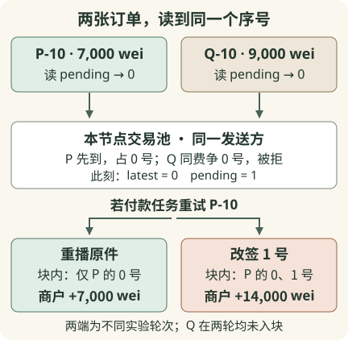

# 第 10 课 · 签名与序号：退款超时，要换一个号再发吗？

周一，退款服务要从同一账户给商户付两张单：**P-10 是 7,000 wei，Q-10 是 9,000 wei**。两个 worker 都查到「下一个序号是 0」。P 先提交，但客服没拿到回执；值班同事看到下一个号已经变成 1，打算用 1 号再付一次 P。要不要放行？**先拦住，拿 P 广播前保存的交易哈希去查。** 换号不是替原件查进度，而是给同一张退款单再签一笔可能独立执行的付款。

先修：[第 02 课的消息签名](crypto.html)、[第 04 课的链身份](networks.html)、[第 09 课的账户状态](accounts.html)。本课只处理普通外部账户在本地 Cancun 链上直接转测试 ETH；`wei` 是最小金额单位，`1 ETH = 10^18 wei`。交付物是能把**订单、账户序号、交易哈希**三者对上的两份运行记录。

## 先问：哪个号是谁分的？

`P-10` 是退款系统的业务键。即使客户点两次「重试」，它仍指同一笔退款。**nonce** 是发送账户在链上的序号，不是随机数，也不按收款地址或订单分别计数。本实验中的付款账户从 0 起；若当前链状态要求 0，必须先处理 nonce 0，才能处理同账户的 1。仅收款不会增加这个外部账户的 nonce。一笔交易即使入块后执行回滚，也已经用掉自己的 nonce；在池外被拒的草案则没有用掉它。

`eth_getTransactionCount(付款地址, "latest")` 读本节点当前链头的账户状态；`"pending"` 读本节点考虑待执行交易后的状态。在这个单节点、无缺号的例子里，P 的 0 号已经进池、还没入块，所以 **latest = 0，pending = 1**。这是两个状态视图，不是领号服务。两人赶在 P 广播前各读一次 pending，都能得到 0；读 API 没有锁住它。别的节点可以没见到 P，池也可能清掉 P，都不违反协议。未来序号的交易有可能被排队等待前面的缺号，不能把 pending 当作「本节点见过的最大数字 + 1」。

<figure class="lesson-figure"><a href="../assets/figures/m03/nonce-race.svg"></a><figcaption>沿箭头从同一对读数走下去。争 0 号的是两张不同订单；分叉处决定的却是同一张 P 单怎样重试。两类问题不能共用一条“再试一次”规则。</figcaption></figure>

## 签字批准的是有顺序的一串字节

本单采用 **Type 2**（EIP-1559），开头的类型字节是 `0x02`。下表按实际签名顺序排列，P 的示例值用十进制写，金额和费率分开。金额虽小，费用可以比款额大；数字是为了看清重复付款，不是主网报价。

| 顺序与字段 | P-10 的签名内容 | 批准的具体条件 |
| --- | --- | --- |
| 1 · `chainId` | 31337 | 只针对这个链号；节点检查与自身链号相符。私链可以重用同号，不能只凭 31337 认出某个节点或某次实验 |
| 2 · `nonce` | 0 | 用这个发送账户的第 0 号，不是第 0 块也不是订单号 |
| 3 · `maxPriorityFeePerGas` | 1,000,000,000 wei/gas | 愿付的每单位 gas 小费上限 |
| 4 · `maxFeePerGas` | 4,000,000,000 wei/gas | 每单位 gas 的总价上限，**包含**小费，不是再加一次小费 |
| 5 · `gasLimit`（RPC 写 `gas`） | 21,000 gas | 最多给执行多少 gas；此例为无代码收款账户、无数据、无访问清单的普通转账 |
| 6 · `destination`（`to`） | 本轮商户的 20 字节地址 | 钱给谁；空目的地表示创建合约，与 20 字节零地址不同 |
| 7 · `amount`（`value`） | 7,000 wei | 发送的原生币金额，不含手续费 |
| 8 · `data` | `0x`，零字节 | 没附带调用数据；非空调用数据同样受签名约束 |
| 9 · `accessList` | `[]`，空列表 | 可预先声明要访问的地址和存储键；不是付款白名单。此处与空字节串的编码也不同 |

记上面九项为列表 `F`。RLP 按顺序把字节串和列表编码成可拆分的字节；数值用无前导零的大端表示。这里的 `||` 是拼接**字节**，不是拼 JSON 字符串。三步各有一个不同的问题：

```text
签什么？  D   = Keccak-256(0x02 || RLP(F))
发什么？  raw = 0x02 || RLP([九项 F 的元素依次展开, yParity, r, s])
查什么？  H   = Keccak-256(raw)
```

发送方以私钥对 **D** 作 secp256k1 ECDSA 签名；`r` 和 `s` 是签名的两个整数，`yParity` 是 0 或 1 的恢复信息。给定 D 和这三个数，可恢复签名公钥；对未压缩公钥的 `x || y`（不含 `04` 前缀）取 Keccak-256 的末 20 字节，得到发送地址。**`from` 并不在九个字段里。** 向本地签名服务提供的 `from` 只是选哪把测试钥匙；验收时要把从签名恢复的地址与独立登记的付款账户比，而不是信任客户端自报的 `from`。

交易哈希 **H** 则把签名也算进去了。它在广播前就能算出来；有 H 不等于节点收到了，有节点收到也不等于执行成功。改 `value`、`chainId` 或 `nonce` 都会改变待签摘要；拿旧签名配新内容，就不能证明仍由原付款方批准。Type 2 的链号是显式字段，不要用旧式交易的 `v` 公式从 `yParity` 猜链号。`hashlib.sha3_256` 也不能代替以太坊的 Keccak-256，二者填充不同。

## 运行：让两个 worker 都先读，再让一个先写

从**仓库根目录**运行 [nonce.py](nonce.py)。需要 CPython **3.11**（只用标准库，包括 `sqlite3`）、Foundry **Anvil 1.7.1** 和系统 `lsof`；安装参考[第 04 课](networks.html#network-tools)。可执行文件 `anvil` 在 `PATH`，或用环境变量 `ANVIL` 指向它。请保留同目录的[节点启动器](anvil_lab.py)。不用准备地址、私钥或助记词。

```bash
python3 labs/nonce.py
```

程序新建 `127.0.0.1:18550` 上的链 31337；两个随机解锁测试账户在创世块各有 10 测试 ETH。脚本关闭自动出块，等两份草案和重试都处理完才手动挖一个块。用一个进程固定重现「P 读、Q 读、P 写、Q 写」的并发交错，无须赌线程调度；它不是并发吞吐量测试。`--amount-wei` 指定 P 的金额，Q 总是比它多 2,000 wei。两轮之间账户、签名和哈希会变，不要相互拼接。

以下是默认输入的**预期关键字段**；尖括号是应换成本轮实值的位置。`D` 是签名摘要，`H` 是 P 的交易哈希，`J` 是 Q 的另一个哈希：

```text
READ chain=31337 payer=<付款地址> to=<商户地址> P-10.nonce=0 Q-10.nonce=0
SAVED order=P-10 nonce=0 amount_wei=7000 hash=<H>
LOOKUP original=<H> receipt=null latest=0 pending=1
SIGN signing_digest=<D> tx_hash=<H> parity=<0或1> recovered=<付款地址>
CONFLICT order=Q-10 nonce=0 amount_wei=9000 hash=<J> admitted=false
RETRY order=P-10 mode=same_bytes nonce=0 hash=<H> reply=<节点答复类别>
MINED height=1 block=<块哈希> hash=<H> status=1
RESULT order=P-10 receipts=1 merchant_delta_wei=7000 latest=1 pending=1 verdict=PAID_ONCE
```

**第一步：在发送前准备查件号。** `sign()` 把费用上限、链号和序号都明确交给 `eth_signTransaction`。本版 Anvil 返回带类型前缀的已签原文，不广播。程序用本机的 `web3_sha3(raw)` 算 H，再把 P 的订单键、H 和原文一起提交到临时 SQLite 库，关闭连接后才调用 `eth_sendRawTransaction`。若把 H 只记在发送成功的回调里，恰恰在最需要查的那次超时时会没有查件号。此处签名和算哈希都在自己启动的回环节点做，不应把已签未发原文交给远端哈希服务。

**第二步：不靠提交答复也能找回 P。** 这次 RPC 真提交交易，实验刻意不用它的返回值；没有伪造网络超时。程序重开数据库取出原件与 H，用 H 读 `eth_getTransactionByHash`、`eth_getTransactionReceipt`。前者有交易且尚无块号，后者为 `null`，所以只能说「本节点见过，尚无回执」。`verify_author()` 用独立订单字段和查询到的签名参数重建原件，逐字节和库存原件比较。它又重算 D，通过只读 `eth_call` 调用地址 `0x0000000000000000000000000000000000000001` 的 `ECRECOVER` 预编译：四个 32 字节字依次是 `D`、`27 + yParity`、`r`、`s`。返回的地址和交易查询里的 `from` 必须都等于本轮付款地址。这次只读调用既不占序号，也不付款。

**第三步：分别看 Q 和 P 的重试。** Q 用的还是 0 号，金额却是 9,000 wei，原件和哈希都不同。相同发送方和 nonce 的两份不同原件可能争夺同一位置。这个版本的 Anvil 对已就绪的等费用上限竞争者不放行：脚本观察 Q 的提交被拒、查不到 J；最后还核验第 1 块包含 H 而没有 J。不根据错误字符串判断结果。其他节点有各自的替换政策，可接受调价后的候选；即使两个节点各自接纳了不同候选，**同一条规范链**的同一账户也不能靠这个 0 号付两笔。

默认重试 P 时，发的则是从库里读出的**完全相同的 `raw`**。没有重新签名，H 不变。节点可能返回同一哈希，也可能返回 JSON-RPC 错误（脚本分别记为 `same_hash`、`rpc_error`），这条回复不是结论。手动 `evm_mine` 后检查块 1 的交易列表、该块内成功回执，以及商户在块 0 和块 1 的余额差。只出现 H，商户增加 7,000 wei，付款账户的下一个序号变成 1。这是一次本地成功执行，不是公开网络的最终化证明。

## 改一个输入：超时后盲签新号会怎样？

```bash
python3 labs/nonce.py --new-nonce
```

这轮仍拒绝 Q，P 的原件也还在池里。唯一的策略变化是重试 P 时**不用库存原件，拿当前 pending = 1 再签**；收款人和金额完全相同。预期 `RETRY ... mode=new_nonce nonce=1 hash=<K>`，其中 K 不等于 H，第 1 块内依序有 H、K 两笔成功回执。最后 `receipts=2 merchant_delta_wei=14000 latest=2 pending=2 verdict=DOUBLE_PAID`。两条命令正常跑完均退出 0；第二条是**成功复现业务错付**，不是说付款政策过关。普通 ETH 转账没有业务订单号字段，节点不知道这两笔在客服那里都叫 P-10。商户本轮没有别的入账、没有付手续费，所以余额差可以独立核对 `7000 + 7000`；公共商户账户不可仅靠一个余额差认领某笔订单。

## 真遇到 RPC 超时，值班人员怎样交接？

先记下本次端点与链身份、业务键、原发送地址、nonce、原 H 和最后一次**有证据的**状态。查询恢复后，在已核实的网络上查原 H，而不是再向钱包要一个 nonce。

| 查到什么 | 能告诉客服什么 | 下一步 |
| --- | --- | --- |
| RPC 仍不可达，或两项查询都为 `null` | 提交结果未知；不是失败证明 | 保留原件与号位；换用经核验的可信节点交叉查。若获准继续广播，只重播库存原件，不能重做一笔新付款 |
| H 可查、无块号，回执 `null` | 该节点已见，尚无入块证据 | 等原 H，不释放原号位；即使后来某个节点查不到，也不能直接把单标为未付 |
| 有回执并能匹配当前规范块 | `status=1` 表示该次执行成功；`0` 表示回滚 | 核对交易发送者、收款人、金额、块哈希与本单确认政策。回滚也消耗 nonce 和费用，不能按「原号没用」处理 |
| 原 H 暂无回执，但 `latest` 已越过原 nonce | 当前链的这个序号已被消耗，不能由此断定是 P 花的 | 沿该发送账户和 nonce 查本地尝试记录、相关区块交易及替换 H，确定赢家和收款意图；不清楚就挂人工对账 |

回执、重组和最终化的判据在[第 12 课](receipts.html)详查。这里不拿当前链头的一个 nonce 给原交易下成功或失败结论。

## 给 Java 支付服务设计一张持久号簿

实验的 SQLite 文件只保留这一轮 P 的原件，用来演示「先落库、后广播」，退出后连同测试状态清理。生产问题还包括多个 JVM、后台任务重启、延迟消息以及替换尝试。可以把三道约束分别放到数据库，不靠 `synchronized` 保护不同实例：

| 记录 | 键与职责 |
| --- | --- |
| 退款意图 | 业务范围内唯一，例如 `(商户, 退款单号)`。同键同内容返回原记录；同键却改了收款地址、链、资产或金额，报冲突，不能悄悄修改待付款单 |
| 发送账户与号位 | 对已核实的网络和付款地址维护一行游标；号位表唯一约束 `(网络, 发送地址, nonce)`，指向唯一意图。本地并行开发链可能重用 chainId，应隔离网络配置、核对创世块，而不是跨网络共享游标 |
| 广播尝试 | `tx_hash` 唯一；指向号位，保存受访问控制的已签原件、签名参数、提交状态、回执和匹配的块哈希。如果需要替换，多个 H 可以指向**同一号位**，不是一个新订单 |

1. **先认单再领号。** 付款账户只允许本服务写；新启用或故障恢复时，以可信节点的 `latest`、本节点 `pending` 和本地连续号位交叉核对。发现未知的外部支出、跳号或本地已分配却查不到的未决号位，先停止新分配，逐号复核，不是取三个数的最大值就算恢复。收到新订单，在同一数据库事务内锁账户行（例如 `SELECT … FOR UPDATE`）、按业务键查重、写意图与预留号位、推进游标后提交。所有实例走这一条路径；唯一约束冲突应重新读已有记录。两个独立订单才会分别得到 0、1；同一订单的两个入口只拿回原记录。
2. **先存授权、后做网络副作用。** 签名 worker 只领取已预留号位，不另申请新号。把签好的精确原文、H、号位关联和「待发」状态在同一事务提交，再由发送 worker 广播。若进程死在预留之后、签名之前，重启接手同一意图同一号位；死在广播之后、记录应答之前，重启从已有 H 查，不存在「肯定没发」的推断。数据库事务不包住网络请求。原件可被代广播，须限制访问，不写普通日志。
3. **缺号与替换都要有人负责。** 卡在 0 号时，不因为 1 号已经签好就宣称 1 能入块。经审批需要调整费用，才以相同账户、相同 nonce 和核对过的同一付款意图签替换件；持久记录新旧 H，跟踪谁在规范块中胜出。替换政策是节点政策，不保证所有节点接纳，也不能从某节点池里删除已传播的旧件。回执回滚、订单真正需要再次执行时，用明确的业务决策建立新尝试，而不是让 HTTP 重试器自行领新号。
4. **支付一次与记账一次各管一层。** 链在一条历史里至多执行一次同账户同 nonce，并不知道订单是否重复。财务入账、发货或退款通知还需要业务键约束、可重放的状态转换和针对重组的复核；不能靠交易哈希唯一就承诺端到端“恰好一次”。

## 独立作业：接手金额不同的退款单

商户的 P 单改为 **12,345 wei**，Q 仍按规则比它多 2,000 wei。先写下两种重试策略下应有的余额增量与付款账户末尾 nonce，再从根目录各开一轮：

```bash
python3 labs/nonce.py --amount-wei 12345
python3 labs/nonce.py --amount-wei 12345 --new-nonce
```

交两张分别标注轮次的凭条：链号、付款和收款测试地址、两次 `READ` 的号位、P 的签名摘要与恢复地址、广播前保存的 H、冲突的 J、重试 H 或 K、块高与块哈希、块内每份成功回执、收款差额（wei）、结束时的 `latest/pending`。**答案判据：**两轮 Q 都是 14,345 wei，同抢 0 号但不在块内；正确轮仅有一个 H，商户 +12,345 wei、末尾 `1/1`。错付轮同一块有两个不同交易哈希，商户 +24,690 wei、末尾 `2/2`。同轮 `SIGN.recovered` 等于该轮付款地址。不要交私钥、助记词、已签原文或数据库。

最后补一条值班决策：若真实服务只剩一条「P 已提交，RPC 超时」日志，既没保存 H，也不能从余额认单，能否放行新付款？**不能。** 应冻结该单，尽量从受控签名记录找回原件并重算 H，按账户、nonce、订单内容核查链上与本地的候选；若仍无法确定就保留未知，不得用新 nonce 试错。说明你的系统靠哪一个唯一键挡住业务重复，又靠哪一个唯一键挡住并发争号，才算完成这一课。

## 协议与工具原文

- [EIP-1559 · Type 2 签名字段与签名摘要](https://eips.ethereum.org/EIPS/eip-1559#specification)，对照 [EIP-2718 · 类型信封](https://eips.ethereum.org/EIPS/eip-2718#transactions) 和 [RLP 编码规则](https://ethereum.org/en/developers/docs/data-structures-and-encoding/rlp/)。
- [以太坊执行规范 · Cancun 的 ECRECOVER 输入与输出](https://github.com/ethereum/execution-specs/blob/master/src/ethereum/forks/cancun/vm/precompiled_contracts/ecrecover.py)、[账户与地址](https://ethereum.org/en/developers/docs/accounts/)。
- [JSON-RPC：区块参数](https://ethereum.org/en/developers/docs/apis/json-rpc/#block-parameter)、[按哈希找交易](https://ethereum.org/en/developers/docs/apis/json-rpc/#eth-gettransactionbyhash)、[查询回执](https://ethereum.org/en/developers/docs/apis/json-rpc/#eth-gettransactionreceipt)。默认 Anvil 端点不要开放给网络；本课用到的解锁账户签名不是公共 RPC 应提供的服务。
- Anvil **v1.7.1** 的[签名与发送 RPC 实现](https://github.com/foundry-rs/foundry/blob/v1.7.1/crates/anvil/src/eth/api.rs)与[同号候选替换检查](https://github.com/foundry-rs/foundry/blob/v1.7.1/crates/anvil/src/eth/pool/transactions.rs)，查 `replaced_transactions`。本实验的等费判据来自实现，不是以太坊所有客户端的一条共识规则。
