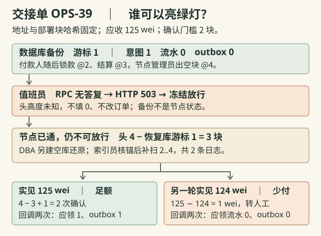

# 第 39 课 · 移交与事故演练：节点又通了，为什么还不能销账？

晚班接手 `OPS-39`：订单要求给指定受益人记 125 wei 应领，结算回执指向块 3，要等两次确认才准记账。刚才读不到节点，现在已核实连回原部署。节点最新记录是块 4，恢复出来的查账库却只读完块 1。接手人能因为「又连上了」就恢复这张单的通知吗？

**继续暂停。** 节点能应答，只说明现在能查；库里的扫描位置说明块 2、3、4 都没核进来。哪怕付款人出示的回执写着成功，也不能把这段空白当成订单已核销，更不能叫付款人重付。要补读原部署的记录，不是重新制造三笔交易。

只改扫描进度：现在库已把**同一条链**核到块 4。能做什么？可以核销这张单：在原部署的块 3 对到同一受益人、同一资产、足额 125 wei 的结算日志，`4 − 3 + 1 = 2` 次确认也已够，才可登记一条应领和一条待发通知。扫描追平本身不是收款证据，「待发」也不是「对方已收到通知」。

只想读懂交接判断，可以去[第 40 课：让评委改一个条件重判](hackathon.html)。以下是选做事故演练。接手人不碰原作者的工作目录、不拿任何人的私钥；要用到[第 38 课区分结算回执、业务流水和待发通知的判断](payment-desk.html)。

## 先签收什么：交付包、部署、业务账是三件事

做过 Java 服务移交的人容易漏掉一项：同一个 URL、同一个链号并不能标识同一本账。`127.0.0.1:18556` 今天和明天都能回答 `31337`；重起 Anvil 却会得到全新的随机角色和部署。接收方要能分别回答三问：**哪份源码？哪次部署？这个订单依哪条日志核销？**

| 要签收的物件 | 必须独立核对 | 不能由它推出 |
| --- | --- | --- |
| 源码包、SHA-256、工具和授权清单 | 接手人解到空目录，从本机缓存/受信上游重新编译；实际使用的源码和配置的字节摘要 | 有源码 ≠ 有权公开分发；摘要 ≠ 签发人身份 |
| 地址簿 `$WORK/release/manifest.json` | 链号、合约地址、部署块高/哈希、创建交易、runtime 摘要、构造的收款方和截止时间；用 `handoff.py` 从节点重验 | ABI 文件、浏览器截图或一个地址不证明代码仍在规范链上 |
| 单库 dump、意图与事故附件 | 快照时间、库名、游标高/哈希、应收资产和金额、确认阈值；还原到**另一个新库**再读 | 没有订单意图就不知道替谁核销；数据库备份不是节点备份，也不是外部发货流水 |

<figure class="lesson-figure"><a href="../assets/figures/m10/operations.svg"></a><figcaption>不同人解除不同的闸：节点管理员只恢复读取；索引员证明三块无缺；财务只接受规范支上的 Settled 应领。两条底部分支是不同演练，不是事后修改同一张订单。</figcaption></figure>

本课从无预付的新部署和空库开始，只启动 M05 订单 API，不开自动处理界面，便于逐步冻结和观察。第 38 课的对账台和独立付款端也在交付包里：另一次新部署按包内 `labs/payment-desk.md` 操作；第 40 课按 `labs/hackathon.md` 调评委工具。三者共用同一套 M04 合约与 M05 索引、订单和 outbox。只做本课不必启动 18038 或 18039。完整课程站的[部署](deployment.html)、[索引恢复](reorg.html)、[订单事务](reconciliation.html)解释原理，不是包内运行依赖。

## 交班的第一道门：所有权不等于把秘密交给乙方

| 角色 | 本实验能做什么 | 明确不能当成什么权限 |
| --- | --- | --- |
| 付款人 A | 自己确认合约、受益人、金额和截止时间；仅 A 调 `lock()`、截止前 `settle()`；锁定且到期才有退款分支 | 付款私钥不进交付包，不发给运维；核销员不能代签或改一笔已执行的结算 |
| 受益人 B | 持有自己的签名权；`Settled` 使 B 获得 `credit`；只有相应的应领人才能成功 `withdraw()` 领自己的款 | 125 wei 在合约中可领 ≠ B 钱包已收 125 wei。本课不调用领取 |
| 索引/订单服务 | `eth_chainId`、读块/回执/日志；索引在本地数据库写游标、事实；订单 POST 在同一事务写提示、业务流水和 outbox | **链上只读不等于数据库只读。** 不调用 `eth_send*`、不挖块，不从回调自报金额造收据。只看结果者用 HTTP GET，不给数据库账号或 Docker 权限 |
| 发布/节点管理员；DBA | 前者保管部署标识、演练时暂停/唤醒自有节点、出测试空块；后者备份、校验、另建恢复库、切唯一服务 | 停节点和建库不是对账员日常权限。不得靠重置链、覆盖旧库、手调游标或删 outbox 解除告警 |
| 财务复核/履约人 | 按单重查本次头和日志；恢复点前后的外部动作另与接收端流水勾兑，必要时批准补偿 | `ENTITLEMENT_RECORDED` 是一次「应领已记」的通知意图，不是已发送、可发货或已退款 |

本地教学链的随机账户由 Anvil 临时解锁；**能访问解锁节点的其他进程也可能发交易**。`--unlocked` 只出现在付款人的回环教学命令中。M05 用公开的实验数据库角色 `course`，没有生产级鉴权或最小授权隔离；不要把这个实验端口、Docker socket 或台面转发给别人。生产交接须由权利人自己用其签名设备/多签接管角色并验证权限，使旧授权失效；只交公开地址和授权记录，索引另配只能读的 RPC 身份、业务表按岗位分权。此合约的 payer/payee 是 immutable，**改清单不能换受益人**。若要换人，应另行授权新部署与新意图，保留旧合约合法领取或退款路径；不能假装旧款已迁移。

## 第一步：原作者制包，接手人在空目录解包

从仓库根目录执行。给[制包器](m10/ops/bundle.py)一个**尚不存在**的输出文件。不取 `HEAD`、不递归打包、不装入 `.git`、`target/`、`__pycache__`、日志、dump、`.env`、钱包或 `$HOME`；白名单只含人工审过的课文、图、配置和源码。白名单不能防止误把秘密写进一个允许的文件，发出前仍需审查内容。

```bash
SHIP=$(mktemp -d)
python3 labs/m10/ops/bundle.py "$SHIP/m10-source.tar" > "$SHIP/m10-source.sha256"
cat "$SHIP/m10-source.sha256"
```

接收方只拿获准交付的 tar，并通过**另一个可信渠道**确认上述摘要。下方 `SHIP` 是接收方收到 tar 和已核准摘要的目录，不是原仓库。若两者同由未知人提供，验出来相等也不要执行。以下实验用 Bash；每个新终端都 `cd` 到打印的 `KIT` 绝对路径。包里的 `START-HERE.txt` 是入口，不需要 Git 或生成的 HTML。

```bash
(cd "$SHIP" && shasum -a 256 -c m10-source.sha256) || exit 1
KIT=$(mktemp -d); tar -xf "$SHIP/m10-source.tar" -C "$KIT" || exit 1
cd "$KIT" && shasum -a 256 -c SHA256SUMS || exit 1
printf 'KIT=%s\n' "$KIT"; cat START-HERE.txt
```

在这里按[工具与许可清单](m10/ops/DEPENDENCIES.md)准备 Python 3.11、JDK 21、Maven 3.9、Docker/PostgreSQL 17.5、Forge/Cast/Anvil 1.7.1 与 solc 0.8.28。首次可从受信上游取构件；真正隔网前须预热**接收方平台**的工具、镜像和 Maven 仓库。用 `bash labs/m05/build.sh`（预热后可加 `-o`）在新目录编译。旧 `classpath.txt`、Docker 凭证和真实数据库密码均不是依赖交付方案。

## 第二步：在付款之前取能恢复的备份

**A／节点管理员**在 `KIT` 根目录执行。把打印出的 `WORK` 绝对路径交给 B、C；`HANDOFF ... state=0` 后保持前台，直到签收结束才按回车。全程不用 `--reset` 或 `--settle-wei`。

```bash
export PATH="${XDG_CACHE_HOME:-$HOME/.cache}/chain-course/m04/bin:$PATH"
export FOUNDRY_SOLC="${XDG_CACHE_HOME:-$HOME/.cache}/chain-course/m04/bin/solc"
unset ANVIL
umask 077; WORK=$(mktemp -d); printf 'WORK=%s\n' "$WORK"
python3 labs/m04/deployment.py --out "$WORK/release" --hold
```

**B／DBA** 在自己的终端 `cd` 到同一 `KIT`。若本机没有本课程专用容器，运行 `bash labs/m05/db.sh start`；若已运行且已核验标签 `chain.course.lab=m05`，复用容器、不清其他人的库。口令是脚本中的公开本地夹具，不可带到实际项目。以下命令最后将 `OrderApp` 留在前台，看到它监听 `127.0.0.1:18020` 再继续。

```bash
printf '粘贴 A 的 WORK 绝对路径：'; IFS= read -r WORK
python3 labs/m10/ops/incident.py prepare "$WORK"
```

[交接驱动](m10/ops/incident.py)先让原 `Scan` 锚定部署，再用 `OrderIntent create OPS-39 native:31337 125 2` 建意图，随后 `db.sh dump` 调 `pg_dump -Fc`。`$WORK/ops/backup.json` 写下两个随机库名（源库、将要新建的恢复库）、dump 摘要、部署与游标哈希。`before-payment.dump` 的恢复点应为 `height=1, orders=1, logs=0, bookings=0, outbox=0`。单库一致快照含意图、表、索引和约束，不含集群角色、Anvil、源码、节点故障后的订单或外部履约流水。

## 第三步：让真实付款留下三个待扫的块，再制造断连

**C／临时付款人**在包根目录用 Bash 执行。没有启动扫描循环。先看 API 返回 `WAIT_SETTLED`；把清单的公开角色与运行时读数对上，再自行确认下列两笔不同交易：第一笔从 A 向合约锁 `PAID`，第二笔由 A 结算，**不再附款**。`cast send` 的超时不是允许重发；先用原交易哈希/发送方 nonce 查清，不知道结果就停止演练。只有本地节点管理员执行最后的空块命令。

```bash
set -euo pipefail
printf '粘贴 A 的 WORK 绝对路径：'; IFS= read -r WORK
export PATH="${XDG_CACHE_HOME:-$HOME/.cache}/chain-course/m04/bin:$PATH"
M="$WORK/release/manifest.json"; O="$WORK/ops"; RPC=http://127.0.0.1:18556
API=http://127.0.0.1:18020/orders/OPS-39
curl --noproxy '*' -fsS "$API" > "$O/unpaid.json"
python3 labs/m04/handoff.py "$M" > "$O/before-pay.json"
PAYER=$(python3 -c 'import json,sys;print(json.load(open(sys.argv[1]))["payer"])' "$O/before-pay.json")
ESCROW=$(python3 -c 'import json,sys;print(json.load(open(sys.argv[1]))["contractAddress"])' "$O/before-pay.json")
PAID=125
printf '本人确认本地 A=%s 托管=%s 锁入 %s wei\n' "$PAYER" "$ESCROW" "$PAID"
cast send --rpc-url "$RPC" --unlocked --from "$PAYER" "$ESCROW" 'lock()' --value "$PAID" --json > "$O/lock.json"
cast send --rpc-url "$RPC" --unlocked --from "$PAYER" "$ESCROW" 'settle()' --json > "$O/settle.json"
cast rpc --rpc-url "$RPC" evm_mine
curl --noproxy '*' -fsS "$API" > "$O/lag.json"; cat "$O/lag.json"
```

付款后和下一步暂停期间都不要再送交易/挖块/扫描。预期 `lag.json` 给出 `headHeight=4, cursorHeight=1, lagBlocks=3, decision=HOLD_LAG`。缺口不是三笔钱：块 2 记 `Locked`，块 3 记 `Settled`，块 4 无合约日志。两条日志是同一笔价值的不同阶段。

**C 现在切回演练主持人角色（不是付款功能）**，或让节点管理员在同一主机的同一系统用户执行[断连工具](m10/ops/outage.py)。该工具核对真实部署、该单的部署锚、监听者的 UID/可执行名及父进程 `deployment.py --hold`，只给本轮 Anvil 发 `SIGSTOP`。内核可继续接受 TCP 连接，但 `eth_chainId` 在 1 秒内**读不到任何 HTTP 应答**；M05 在自己的 RPC 调用超时后返回业务 503。这是应用层确实不可用，不是关掉 Java、改 SQL、返回假 JSON 或重建链。不要在共享、容器外、远程或非自有节点执行。

```bash
python3 labs/m10/ops/outage.py "$M" OPS-39 "$O/outage.json"
```

脚本在故障中 POST `outage-39` 要求真实回查；应见 `ALERT HTTP 503 HOLD_UNAVAILABLE mayNotify=False`。告警的**动作**是停止核销/外发，不把超时当 0 wei，不改订单，也不再请用户付款。即便提示记录先尝试 INSERT，事务没提交就不能留下半张单。脚本在 `finally` 对同一 PID 发 `SIGCONT`，重验清单及**同一头哈希**并再次 GET，签发 `RPC_RESTORED_SAME_HEAD`。应仍是 `HOLD_LAG`，不是绿灯。工具若遭强杀，管理员先按打印的 PID 重新以 `lsof`/`ps` 核实仍为本节点，再 `kill -CONT` 该 PID；不按进程名批量发信号。未完整记录的报告 `INCOMPLETE` 不得验收。

## 第四步：切空库，补历史，证明重放不是第二笔收入

**B** 用 Ctrl-C 只停旧 `OrderApp`。不要停 A，也不要让两个实例分别对源库和恢复库接单。然后仍在 B 执行：

```bash
python3 labs/m10/ops/incident.py restore "$WORK"
```

驱动要求事故与当前部署/当前头相符、原库仍在备份点（包括 `hints=0`：故障中那次回调未落库），再比对可信清单中的 dump 摘要。`db.sh restore` 在不存在的库名上 `createdb`，以 `pg_restore -1 -e` 恢复；同名存在或内容不匹配就停，**不覆盖旧账**。`restored.json` 是实读新库的结果；新服务连的必须是这里的 `database`。源库保留，只作取证。若第一份恢复未成功，先隔离该新库、检查错误与备份来源，不能把未完成的库切上线。

**C／索引与财务复核**：等 B 的新服务就绪，拿同一份 `WORK` 目录执行下面的核验。先比较输出中的 `headHeight` 和 `cursorHeight`，再读扫描区间和日志数。若看到 `2..4 matched=2`，意思是三个块里有两条相关记录，不是两次付款：`Locked@2` 说明进了托管，只有 `Settled@3` 指明谁应领。从后者核对受益人和整数金额，再按块 4 的链头数确认，才轮到订单服务写账。重放后则看**新增了几条**，不要数输出了几次同一句成功消息。

```bash
python3 labs/m10/ops/incident.py audit "$WORK"
```

| 检查点 | 预期可观察结果（不是本轮实测值） | 谁能据此解什么锁 |
| --- | --- | --- |
| 还原后初查 | 同一 `deployHash`；头 4 / 游标 1，`HOLD_LAG` | DBA 只确认库可读，没有核销依据 |
| `Recover` 核验分支并调用 `Scan` | `UNCHANGED height=1` 指旧游标所在分支没变；随后 `PAGE 2..4 matched=2 inserted=2 cursor=4` | 索引员确认追平。核销只读 `Settled@3`；`4−3+1=2` 次本地确认达标，不是公网最终性 |
| 先 GET、再 POST `retry-39` | 足额时 `READY_TO_BOOK` → `BOOKED_AT_HEAD`；`newHint=true`。短付时始终 `HOLD_AMOUNT` | 同一事务写流水与 `ENTITLEMENT_RECORDED`；少 1 wei 也不写，不靠多等一块抹平 |
| 强制 `Scan 2` 重扫并再 POST 同键 | `matched=2 inserted=0`；`newHint=false`，`bookingEvidence` 不变 | 以数据库快照数记录，不把两次 HTTP 200 数成两份收入 |
| 独立复核原件 | 评委读端按交易哈希从活节点回查，核对规范块、`logIndex`、事件、B 与 wei；`audit.json` 里保留报告 | 足额时 `bookings=1, outbox=1, hints=1`，应领 125 wei；证明的不是外部通知送达或 B 提现成功 |

关键有两把钥匙：扫描器按 `(chainId, blockHash, txHash, logIndex)` 存日志，原样再读不会再插一条。业务端又有按订单/证据的唯一约束，用事务把应领流水与 outbox 一起提交。**只给回调键去重不够**：换一个提示键还是同一张单；回调不能决定金额。数据库内幂等也不等于邮件/货运系统 exactly-once，真实消费者还需自己的业务幂等键、发送前重新核对与接收方对账。

## 事故卡：损失窗口、升级与保留

RPO 是业务可接受的数据损失窗口，不是备份任务的运行间隔。假设约定 RPO 为 15 分钟，09:56 隔离事故时，最近一次**已验证可恢复**的快照在 09:45，那么有 **11 分钟**的链下写入未必在 dump 里；这次恢复点符合目标，但不等于已经丢了 11 分钟的订单，更不能据此计算丢款金额。若 09:45 的快照已坏，要从上一个可恢复点重算。规范链历史可从受信的同一节点补，期间新录的报价、订单归属、人工已发货记录却无法靠 `eth_getLogs` 恢复：要另有可重放的订单日志或数据库基础备份与连续 WAL，以及外部接收方的履约记录。本实验在付款前已备份意图，不向任何外部系统发送。

| 信号/时限（下列为本工单的演练规则） | 值班动作与解除条件 |
| --- | --- |
| 活订单任一次 RPC 超时、503 或部署锚不符 | 立即关业务放行；记录最后可信头、游标、订单、UTC 与响应。503 也可能来自数据库，须用独立读探针定位；部署锚不符交发布人隔离，不自动换 RPC 或换链 |
| RPC 已通但 `head − cursor > 0` 或相同高度哈希不同 | 保持挂起；前者补扫、后者按原 `Recover` 寻共同祖先。缺部署锚、节点无足够历史或旧凭据不再规范，人工调查，不能重写历史流水 |
| 值班目标：从**首次告警**到新库查账恢复 ≤30 分钟 | 用 `outage.json.alertAt` 与 `audit.json.reviewedAt` 计算实际恢复时长，与目标比较；超时叫 DBA/业务负责人，不降低确认门槛。`pauseSeconds` 只是进程暂停时长，不是 RTO |
| 下班交接 | 记录原/新库名、dump 摘要、头/游标/证据四元组、差额、流水/outbox 数与复核人。与链外系统对不平就交红单，不宣告「全系统已恢复」 |

**保留策略（本地合成练习，不是客户默认法律期限）。** 将 `release/manifest.json`、包摘要、工具版本、`ops/backup.json`、`outage.json`、`restored.json`、`audit.json`、两笔公开测试回执列为复核附件；受限工单保存 30 天，到期由资料负责人销毁并记下清理日期。dump 另存于仅 DBA 可读的受控位置，加密备份、7 天轮换，演练完成后清理临时还原库；应用故障日志只保留 7 天，记录错误类型/时间和合成订单号，不记请求体、真实地址画像或鉴权数据。合同另有期限、审计冻结或删除请求时先走审批。`umask 077` 不等于备份加密。未核对脱敏与授权不把整个 `$WORK` 放进参赛附件，更不把数据库、工具缓存、私钥、助记词、RPC 凭据或客户数据装进源码包。

可以撤回的是**链下**切流、暂停通知、从可信快照恢复到另库、重新索引；已经对外发出的消息或货物需补偿流程。不能用 SQL 回滚已执行的链上 `lock`/`settle`/`withdraw`，也不能把关掉临时节点叫做退款。签收后 B 停服务，先留批准的附件，A 最后按回车销毁临时节点。仅当已确认整台教学容器无人使用且所需库都已另存，才 `bash labs/m05/db.sh stop`；其数据在 tmpfs，停止即消失。

## 独立作业：把「系统恢复」与「可以核销」拆开签字

让另一位工程师仅拿 tar、可信摘要和工具前提，从新的空目录、新 WORK、空库和新部署完整走一轮。**不改订单** 125 wei / 2 次确认，只将付款步骤的 `PAID=125` 换成 `PAID=124`。先在纸上回答：RPC 停顿时可否断言欠 125？恢复且追平后欠多少？亲自复核 `outage.json`、`audit.json` 与原始结算回执后，提交两行签字：值班人签服务恢复，财务签是否核销。

判据：断连期间 503、金额**未知**；回到同一部署/头后仍需补三块；`Settled(B,124)` 与意图同资产同收款方，`125−124=1 wei`，两次本地确认仍 `HOLD_AMOUNT`，`mayNotifyAsOfHead=false`。重放新增 0，最终 `bookings=0, outbox=0, hints=1`。不要把 B 的 **124 wei 应领权**写成零，也不要把没有业务流水写成「链上没发生付款」。两位签字人结论不同才正确。

## 核验原文

- PostgreSQL 17：[pg_dump](https://www.postgresql.org/docs/17/app-pgdump.html) 定义单库一致快照及全局对象边界；[pg_restore](https://www.postgresql.org/docs/17/app-pgrestore.html) 说明自定义归档、单事务及不可信备份风险。
- Ethereum Execution APIs：[按块读取](https://github.com/ethereum/execution-apis/blob/main/src/eth/block.yaml)、[交易与回执](https://github.com/ethereum/execution-apis/blob/main/src/eth/transaction.yaml)；[M04 实际合约](m04/src/MilestoneEscrow.sol)区分结算应领与提款事件。
- [M05 订单表的唯一键与外键](m05/orders.sql)、[同一事务内的核销实现](m05/src/main/java/course/m05/OrderApp.java)；[依赖与上游许可出处](m10/ops/DEPENDENCIES.md)。
