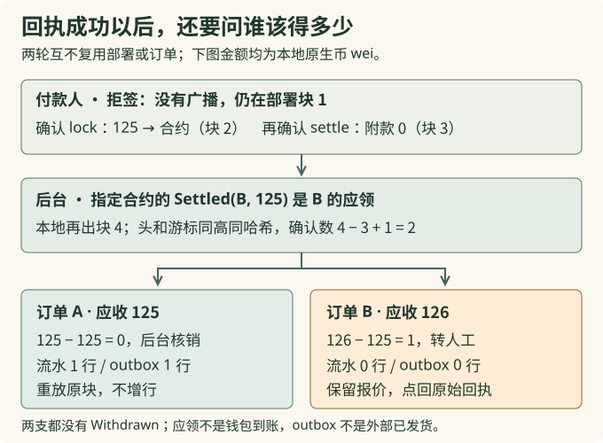

# 第 38 课 · 毕业项目：收款对账台

轮到你接手 `DESK-SHORT`。开单时写的是「托管给 B 记足 **126 wei 应领**」，不是「收到成功回执就结单」。你查到本次部署的结算确实成功，受益人是 B，金额 **125 wei**；要求的两次本地确认也够了。要在订单下记一条流水、交给通知程序，还是留给人工？

**留给人工。** 应收减去应领是 `126 − 125 = 1 wei`。两次确认回答「这条记录已经埋了几层」，不会补上少的 1 wei。流水 0 条、通知意图 0 条；不要重新替付款人签字。回执证明的是 B 可以从托管领多少钱，不足以说 B 的钱包已经收到钱。

只改一个开单条件再判：假如订单**从一开始就约定 125 wei**，其余证据仍匹配，两次确认已够，该写什么？应领恰好足额，写 1 条流水和 1 条待通知记录；这仍不是已经通知发货。下面用两个独立的新部署对照这两种约定，不能在出差错后把老订单的 126 改成 125 来凑数。

只读交付流程，可以[翻到第 39 课：把服务和故障现场交给下一班](operations.html)。以下选做完整实操：先建正常单，再还原这张差错单。先修是 M01–M06，尤其是[核验部署](deployment.html)、[从书签补扫](indexing.html)、[识别旧分支](reorg.html)、[对平订单才入账](reconciliation.html)和[用户单独确认](siwe.html)，不要求选修卷。只用自己机器上的合成订单、临时账户和本地原生币，不接真实钱包，不转发端口。

## 谁能动钱，谁只能解释账

先把合同里的「收款」写成一句可检验的话：**本链本次部署的唯一一张有效订单，约定给 B 的原生币托管应领已足额，并达到约定的本地确认数**。这不是 B 钱包的余额增加。[合约](m04/src/MilestoneEscrow.sol)先让 `lock()` 锁款，再由同一付款人调用 `settle()` 把锁款计入 `credit[B]`。后者交易的 `value` 是 0，`Settled(B,125)` 的金额来自前一笔锁款。必须另有成功的 `withdraw()` 才能证明合约向 B 转出了钱，本项目没有这个按钮。

| 入口与操作者 | 执行的动作 | 不接受的输入或权限 |
| --- | --- | --- |
| `127.0.0.1:18039`，付款人 | 独立进程先显示链、账户、合约、方法、附款、nonce 和费用上界，再接受本次确认或拒签 | 不让商户网页跨源确认；不导入助记词，不提供任意 calldata、地址或 RPC 转发 |
| `127.0.0.1:18038`，值班员 | GET 当前订单、队列与链上回执；点击补扫后只提交「请重查」的提示 | 不设置付款额，不调用发交易接口，不把浏览器自报的哈希当凭据 |
| `127.0.0.1:18020`，M05 Java 服务与索引器 | 清单锚定、扫规范日志、与 PostgreSQL 意图比对、在同一事务插流水和 outbox | 这条路径不签名，不通知物流；只读 GET 不入账 |

第 21 课确认的是登录消息，绝不等于批量批准转账。这里保留的是**每个动作另行核对、可拒绝**的思想。付款人进程只在点击确认后才请本机 Anvil 用临时解锁账户签交易。两个入口不同源、不同进程，没有网站能通过商户端「代点同意」。它也不是硬件钱包或生产级非托管隔离：同机能直接访问解锁 RPC 的其他程序仍属信任边界；不要在共享主机上运行。

<figure class="lesson-figure"><a href="../assets/figures/m10/payment-desk.svg"></a><figcaption>图中的两张单是两次独立交接，不是把同一条结算借给另一张订单。任一回执里的 125 都不能同时算作锁款、收入和钱包到账三份钱。</figcaption></figure>

## 从空链和空库起台，不预装付款

从**仓库根目录**运行。准备 Python 3.11、`curl`、`lsof`、JDK 21、Maven 3.9.x，以及可运行 `postgres:17.5-bookworm` 的 Docker。第一次准备镜像、Maven 依赖和[第 13 课工具](abi.html#m04-tools)可能需要联网；课堂操作的三个 HTTP 服务、PostgreSQL 和 Anvil 都在回环地址。M04 固定 Forge/Cast/Anvil 1.7.1 与 solc 0.8.28，M05 的 [pom.xml](m05/pom.xml) 锁定 web3j 4.12.3，由 Spring Boot 3.5.8 管理 JDBC 依赖。没有 Node 包和浏览器扩展。

**终端 A：部署，不付款。** 不传 `--settle-wei`；看到 `HANDOFF ... readBlock=1 state=0 payeeCreditWei=0` 后不要按回车。打印的 `WORK` 是该次交接目录，里面的 `release/manifest.json` 标识哪一次部署，不能从另一轮复制。

```bash
export PATH="${XDG_CACHE_HOME:-$HOME/.cache}/chain-course/m04/bin:$PATH"
export FOUNDRY_SOLC="${XDG_CACHE_HOME:-$HOME/.cache}/chain-course/m04/bin/solc"
unset ANVIL
WORK=$(mktemp -d); printf '本轮 WORK=%s\n' "$WORK"
python3 labs/m04/deployment.py --out "$WORK/release" --hold
```

**终端 B：先开单。** 粘贴 A 的 WORK，不是其中的 `release` 子目录。在准备过 Maven 缓存的离线环境，可先运行 `bash labs/m05/build.sh -o`；尚无构件时启动器会运行 `build.sh`。以下命令保持前台运行：

```bash
printf '粘贴本轮 WORK：'; IFS= read -r WORK
bash labs/m10/desk/run.sh init "$WORK" DESK-38 125 2
```

[启动器](m10/desk/run.sh)先用 M04 接收方校验部署回执、代码与实时状态，要求新单从尚未锁款的部署块开始。随后根据部署块哈希取专库名；复用 M05 的临时 PostgreSQL 容器但**只许新建数据库**。原样加载 `schema.sql`、`orders.sql`，运行 `Scan` 锚定块 1，再运行 `OrderIntent create DESK-38 native:31337 125 2`，最后起服务。数据库中订单已存在，程序不是等日志来了再猜谁该付多少。`desk-db`、`desk-order` 是两行分别存放的交接索引，不是私钥。端口占用、重复建库、清单不符都不要忽略；起新链不是恢复旧单。

## 正常单：先拒签一次，再逐笔授权

浏览器手动打开 `http://127.0.0.1:18038/`（用地址里的 IP，不换成 `localhost`）。这是本地应用，不是课程静态网页。看到订单 `DESK-38`、应收 125、头/游标 `1 / 1`、`WAIT_SETTLED`，两表各 0。此时 `0` 是**行数**，实见金额应当是「尚未核出」，不能写为零。

1. 点「前往独立付款人确认台」。确认地址栏端口变成 **18039**。在「实际锁入金额」填 `125`，点「预览锁款」。核对 `from` 是本轮付款人，`to` 是托管合约而不是 B，调用 `lock()`、附款 125 wei。页面显示 `gas 上限 × gas 单价` 的费用**上界**，费用不计入应领。点「拒签，不发送」：没有广播、没有交易哈希，页上仍是块 1、待锁款。返回对账台只刷新也不产生流水。
2. 再预览锁款，这次点「确认发送锁款」。等到本轮真实哈希和成功回执块高 2。钱进合约，不等于 B 已有应领。继续点「预览结算」，核对 `settle()` 的附款为 **0 wei**、托管余额为 **125 wei**；点「确认发送结算」。回执块高 3；付款人页读到 B 的应领为 125 wei。超时或连接断开不代表没广播，不自动重发；先查看已知哈希和实时状态。
3. 返回对账台，只刷新：头是 3，游标仍在 1，`HOLD_LAG`。点「补扫并核对」：`Recover` 调同一个 M05 扫描器补回 `Locked@2`、`Settled@3`。头/游标 `3 / 3`，金额对平，但 `3−3+1=1`，还不到 2，结果是 `HOLD_DEPTH`，流水 / outbox 仍 `0 / 0`。
4. 在付款人台点一次「推进一个本地空块」。这只是给自建节点出块，不是替客户付款，也不是在商户服务里改确认数。回到 18038 点「补扫并核对」；头和游标同为 4、哈希一致，`4−3+1=2`。同键回调重算后可见 `BOOKED_AT_HEAD`、差额 `0`、流水 / outbox `1 / 1`。「打开人工核对队列」显示此刻 **0 张差错单**。

为什么按钮能决定写不写，却不能决定写多少钱？[desk.py](m10/desk/desk.py)把补扫和回调分为两步：补扫成功后才 POST `/orders/DESK-38/callbacks/desk-38`，请求体是空对象。真正判据在 [OrderApp.evaluate](m05/src/main/java/course/m05/OrderApp.java)：校验意图与部署清单、游标与节点当前规范头、唯一 `Settled` 的发出地址与受益人、相同资产、整数 wei 全额匹配和最小深度。任一步不成立就不新建流水。最后用订单行锁串行化并发，`order_booking` 与 `order_outbox` 在**一个事务**内写，表的唯一键约束订单号和日志四元组。回调只是门铃，重复按不会多出一份应领。

[payer.py](m10/desk/payer.py)的另一条路径故意不出现 `OrderApp` 的回调：`preview` 用清单和链上状态组装交易，交易字段留在付款人进程；页面得到一次性确认号。`reject` 作废它；`confirm` 消耗它并重新核对部署、链头和 nonce，再用 `eth_sendTransaction` 发送那一笔。重新开页不等于授权。Anvil 已默认解锁只属于本次练习的账号，不要把这种节点当公网钱包服务。

## 证据链：凭什么相信这张回执

点「打开这笔结算的原始回执 JSON」。这不是一个固定区块浏览器链接：[对账台](m10/desk/desk.py)从 `observed` 或既有 `bookingEvidence` 取块哈希、交易哈希与日志索引，向本次回环节点调用 `eth_getTransactionReceipt`，核对返回的块、交易和发出日志的地址后才显示原件；找不到匹配项会失败，不用旧截图顶替。浏览器后退可回到订单。「当前订单 JSON」同时给出链号、部署锚、订单意图、`cursorHash` 和 `headHash`，可以逐项对读。

在终端 C 留证（A、B 不停）：

```bash
printf '粘贴当前 WORK：'; IFS= read -r WORK
DESK=http://127.0.0.1:18038
curl --noproxy '*' -fsS "$DESK/order.json" > "$WORK/decision.json"
curl --noproxy '*' -fsS "$DESK/counts.json" > "$WORK/counts-before.json"
python3 - "$WORK" <<'PY'
import json, pathlib, sys
p = pathlib.Path(sys.argv[1]); r = json.loads((p/'decision.json').read_text())
e = r['observed']; raw = json.loads((p/'payer-settle.json').read_text())
assert e['blockHash'] == raw['blockHash'] and e['txHash'] == raw['transactionHash']
log = next(x for x in raw['logs'] if int(x['logIndex'],16) == e['logIndex'])
assert int(raw['status'], 16) == 1 and log['address'].lower() == e['address']
assert '0x' + log['topics'][1][-40:].lower() == e['actor']
assert int(log['data'],16) == int(e['amountWei'])
print(r['decision'], e['chainId'], e['height'], e['logIndex'], e['amountWei'], e['txHash'])
PY
```

预期输出形如 `BOOKED_AT_HEAD 31337 3 0 125 <本次结算交易哈希>`。另外对照第 18 课主题校验：`cast keccak 'Settled(address,uint256)'` 应等于这条日志的 `topics[0]`；`logIndex` 是日志在区块中的位置，不是 order ID。订单金额从数据库到 JSON 一直是十进制字符串，别用 JavaScript `Number` 绕过这里的精度。当前本地的两次确认不是主网最终性；链改变时，历史原件和此刻能否放行要分开。

## 后台重启，再强制重放旧块

在 B **Ctrl-C** 停本轮三个界面/服务进程，保留 A 的 Anvil 和 PostgreSQL 容器；不要运行 `db.sh stop`。在同一 B 终端执行：

```bash
bash labs/m10/desk/run.sh resume "$WORK"
```

`resume` 不开新库、不开新单，重新从这份订单读取报价，链上状态也不会回到待付款。在浏览器重新打开 18038，点「重放本轮并核对」。这与「补扫发现没新块」不同：从本轮部署高度运行 `Scan 1`，**强制重读包含锁款和结算的旧块**，再拿同一个提示键重查。看「本次后端执行」中的 `matched` 与 `inserted`：事件仍匹配，`inserted=0`；提示键已存在。刷新、再按或重启后仍是同一条流水和一条通知意图，不承诺任何外部通知已经送达。

```bash
# 终端 C；接上节的 WORK、DESK
curl --noproxy '*' -fsS "$DESK/counts.json" > "$WORK/counts-after.json"
cmp "$WORK/counts-before.json" "$WORK/counts-after.json" && cat "$WORK/counts-after.json"
M05_DB=$(cat "$WORK/desk-db") bash labs/m05/db.sh sql <<'SQL'
SELECT b.order_id,b.chain_id,b.block_hash,b.tx_hash,b.log_index,n.kind
FROM order_booking b JOIN order_outbox n USING(order_id);
SQL
```

预期 `bookings=1,outbox=1,hints=1`，SQL 唯一一行的 `tx_hash` 等于刚才打开的结算回执，`kind=ENTITLEMENT_RECORDED`。如果只看到界面仍是「已入账」而没有重放及行数证据，这条验收不算通过。

## 差 1 wei：交易成功，但订单被拒

保留第一轮 WORK 和库。先在 B 停服务，再在 A 按回车结束**那条**内存链。重新执行上面终端 A 的整段命令，取得新的 WORK、清单和两个临时地址。B 改用新的目录并先约定 **126 wei**：

```bash
printf '粘贴第二轮的新 WORK：'; IFS= read -r WORK
bash labs/m10/desk/run.sh init "$WORK" DESK-SHORT 126 2
```

在 18039 把默认锁款额从 `126` 改成 `125`，先核对预览。这里只为演练，才在本地确认这次锁款和随后的结算，再推进一个空块。在 18038 点「补扫并核对」→「打开人工核对队列」，找 `DESK-SHORT`，从这张单打开原始回执。

拿三处数据给接手人对读：① **订单**写应收 126 wei，这是付款前约定的量；② **回执**的 `status=0x1` 表示结算成功，托管 `Settled` 日志中受益人是 B，`data` 末字节 `7d`、其余为零，解成十进制是 125 wei；③ **工作台**头与游标同在本轮块 4，块 3 的结算已有两次确认，仍显示 `HOLD_AMOUNT`、差额 `+1 wei`。所以问题既不在回执真假，也不在扫描延迟。再查流水和通知意图各为 0，把两份金额原件交给人工，不等空块来补钱。

| 对平项（预期，不是本次实测哈希） | `DESK-38` | `DESK-SHORT` |
| --- | --- | --- |
| 订单约定 / 受益人实见，应领 wei | 125 / 125 | 126 / 125 |
| 本地确认，实有 / 要求 | 2 / 2 | 2 / 2 |
| 业务判断 | `BOOKED_AT_HEAD` | `HOLD_AMOUNT` |
| 原始结算回执 | 本轮 A 成功回执 | 本轮 B 成功回执，与 A 不同 |
| 专库流水 / outbox / 待人工 | 1 / 1 / 0 | 0 / 0 / 1 |

人工队列是**从本轮真实意图与当前核对结果导出的待办视图**，不是一份只存在浏览器内存的假列表，也没有把它冒充持久化的结案历史。刷新或重启后仍可打开未经解决的差错。等待结算、积压和深度不足单独显示在订单，不伪装成金额差错；RPC 或数据库不可用时显示暂停，不能把「队列不可读」显示为「队列为空」。把订单 JSON、同轮回执与计数交给复核人，说明该合约只能锁一次；不改报价、不让重新结算补 1 wei，不写 SQL 手工转绿。客户若要求补差、退款或通知仓库，要另签流程，不能冒充本实验已有的能力。

## 独立作业：给第三张单出具差异报告

合作方给新单 `DESK-OVER` 的条件是 **9,007,199,254,741,027 wei，3 次确认**，付款人却想锁 **9,007,199,254,741,028 wei**。先写下决定，再起第三套干净部署与专库；把应收作为 `init` 第四个参数（紧跟订单号），最后一个参数换成 `3`。只在付款人页编辑「实际锁入金额」，其余一律走公开按钮。分别在结算后和再推进两个空块后拍订单，不借第二轮的数据。

交一页差异报告，加上本轮 `manifest.json`、两份成功回执、订单/计数 JSON、队列到结算回执的定位键，以及一次后台重启重放的输出。**判据**：确认数从 `1` 到 `3`，应收减实见始终为 `−1 wei`，队列仍为 1，重放后流水和 outbox 都为 0。说明为什么不是等深度达标就自动核销，为什么不能把超付直接赠送或擅自退回，以及把商户和付款人页合成「商户代签」会丢掉哪道授权。若任一步只给了预期值，没有本次原件，要标「未验证」。

**收台与交接。** A 关闭后原回执不能再从这条内存链实时取得，先留存原件。需要保留数据库时在 C 执行 `M05_DB=$(cat "$WORK/desk-db") bash labs/m05/db.sh dump > "$WORK/orders.dump"`；这备份的是数据库而非节点。B 停服务、A 停节点；确认该临时集群内所有需保留的库都已各自备份、无人再使用后，才执行 `bash labs/m05/db.sh stop`（会删除整个临时容器及其库）。下一课用接手人的眼睛检验这些材料，不以原作者会点按钮代替交付。

## 查证原文

- [EIP-1193：Provider Errors 与安全边界](https://eips.ethereum.org/EIPS/eip-1193#provider-errors)：`4001` 指用户拒绝；本文借鉴确认语义，不宣称实现了标准钱包 Provider。
- [EIP-1474：eth_getTransactionReceipt](https://eips.ethereum.org/EIPS/eip-1474#eth_gettransactionreceipt)：对读交易哈希、状态、块标识与日志；业务订单号、应收和是否可交付不在回执里。
- [PostgreSQL 17：唯一约束和外键](https://www.postgresql.org/docs/17/ddl-constraints.html#DDL-CONSTRAINTS-UNIQUE-CONSTRAINTS)与[本项目实际 DDL](m05/orders.sql)：区分提示去重键、业务主键与可追溯的日志外键。
