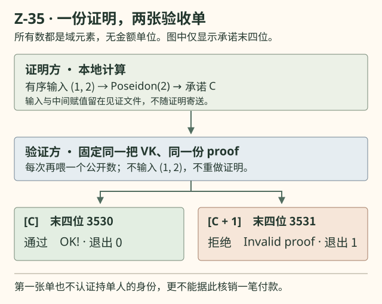

# 第 35 课 · 不交原像，怎样验一张凭条？

活动登记台保存着一串数，末四位是 3530。登记规则是把两个数按顺序算成这一个结果，原来的两个数不交给客服。现在有人递来一份证明，客服用登记台自己的验证密钥、自己保存的完整数值去验，结果是「通过」。交接时该写「证明与这条登记相符」，还是「眼前这个人就是登记人，可以发券」？

**只能写前一句。** 两个原数叫「原像」，公开登记的结果叫「承诺」。在电路和验证密钥可信的前提下，通过表示这是一份与该承诺相符的原像知识证明。验证时没查姓名，也没查领券记录；别人拿来同一份证明，结果不会因换了提交人而改变。这里只摘末四位方便阅读，不是只核四位。

保留同一把验证密钥和同一份证明，只把待验的完整数值加 1，末尾变成 3531。还能给新登记打勾吗？不能，验证结果应是「拒绝」：原证明不能替改过的数作证。这并不是说没人能找到产生新数的原像。

这是独立选修，到这里就可以收起工单；想换个问题再看，可选读[第 36 课：工单交接后谁还能改它](move-ticket.html)，两课互不为先修。以下选做离线实验。要区分「数值对得上」与「谁签了名」，可回看[第 02 课](crypto.html)；要理解为何另记「是否已领」，可回看[第 14 课的状态转移](escrow.html)。实验用现成的 Circom 电路和 snarkjs，不部署合约、不连接节点、不用钱包。输入来自公开测试向量，不是真实秘密。

## 验证方究竟要验哪句话？

先把需求写成一个能判真假的关系：**对于指定的 `C`，存在两个有序域元素 `x, y`，使得 `Poseidon(x, y) = C`，而证明的生成者知道这样一组输入。** 这里的 `Poseidon` 特指 circomlib 2.0.5 的 `Poseidon(2)`，即初始状态为零、输入两项、输出一项的那套参数。`(1, 2)` 是两个域元素，不是 UTF-8 文本 `"12"`，也不是把两个 Java `long` 的字节拼起来再做 SHA-256。这里把登记的哈希值简称为「承诺」；这个称呼本身不保证隐藏性。

可把验证接口想成 `verify(固定的验证密钥, 登记台要验的公有信号, 交来的证明)`。密钥决定验哪套电路与设置；公有信号决定验哪个实例；证明交由密码库检验。**不能让证明方替登记台选题。** 如果对方随便挑一对数，算出自己的 `C`，再把这个 `C` 连同证明一起交来，数学验证也可以通过。业务端还必须用自己事先保存的完整承诺来验，或先查明提交的公有信号与该记录完全一致。本课的独立对照物是库作者发布的已知答案，不是证明脚本自己算出的另一个「预期值」。

<figure class="lesson-figure"><a href="../assets/figures/m09/preimage.svg"></a><figcaption>A 单的受控对照。图中只写末四位以便阅读；真正验证的是完整域元素，不是四位后缀。两次调用都没有把见证发给验证方。</figcaption></figure>

## 从一道约束读懂「见证」

库中自带的[入口电路](https://github.com/iden3/circomlib/blob/cff5ab6288b55ef23602221694a6a38a0239dcc0/test/circuits/poseidon3_test.circom)只有三句有效代码；实验复制并编译这一原件和它引用的两个源文件，不另写哈希函数：

```text
pragma circom 2.0.0;
include "../../circuits/poseidon.circom";
component main = Poseidon(2);
```

第一句声明 Circom 语法版本；第二句引入库；第三句把**两个输入**的模板设为主组件。文件名里的 `3` 是内部状态宽度（三个域元素），不是让你再交一个输入。主组件的 `inputs[0]`、`inputs[1]` 没被声明为公开输入，因此是私有输入；主组件的输出 `out` 按 Circom 规则总是公开。于是编译统计会显示 **2 个 private inputs、0 个 public inputs、1 个 output**，而交给 snarkjs 验证器的 `public.json` 却有 **1 项**。不矛盾：从电路看是输出，从验证器接口看它是公有信号，也就是调用方的输入。

验证的不是「某段 JS 顺利返回」；验证的是一组算术等式能同时成立。看库中 `Sigma` 的三行即可，不必手推整个哈希：`in2 <== in * in`、`in4 <== in2 * in2`、`out <== in4 * in`。例如**单看这个部件**，若线上的值是 2，就须分别填 4、16、32；最后填 33 即使是合法数字，也不能满足最后一条等式。`<==` 既计算赋值，又把等式加入约束。编译器把关系表示为 R1CS（秩一约束系统）；一份完整的**见证**是使约束成立的赋值，包含私有输入、公开值以及编译后需要的中间值。`.wtns` 因此不是一张可公开的证明。`.wasm` 负责算赋值；`groth16 prove` 读见证与证明密钥才产生可交接的 `proof.json`。

这些等式做的是**模素数 `p`** 的算术。本实验默认 BN254 标量域的模数是 `21888242871839275222246405745257275088548364400416034343698204186575808495617`。域中 `(p−1)+1 = 0`；`x` 和整数 `x+p` 不是两个不同的域元素。电路没有验证 `x` 是合法的手机号、正金额或不超过 `Long.MAX_VALUE`。应用如需这些条件，要有相应的编码、范围约束和数据来源，不能从哈希等式倒推。交接文件以规范十进制**字符串**写 `[0,p)` 的值；Java 可用 `BigInteger` 读取并检查上下界，不用 `double`，脚本给 `C` 加一也用 `BigInt`。

## 先搭一次本地验证台，再开两张单

工具基线：Bash、Node.js 24 LTS（可用 24.22.0）、npm 11（可用 11.19.1）。[依赖表](m09/preimage/package.json)和[锁文件](m09/preimage/package-lock.json)固定 circomlib 2.0.5、snarkjs 0.7.6、circom2 0.2.23 及传递依赖。最后一个包是第三方封装的 Circom 2.2.3 WASM 编译器，不是官方原生二进制；实验不要求 Rust、Docker 或全球安装的 `circom`。首次安装须能从 npm registry 获取锁定的软件包。所有命令在**仓库根目录、同一个 Bash 会话**执行：

```bash
export ZK35_TOOLS="${XDG_CACHE_HOME:-$HOME/.cache}/web3-study/m09-preimage"
bash labs/m09/preimage/prepare.sh
# 安装目录如上，下载包缓存见 npm config get cache；缓存齐全才可用 prepare.sh --offline。
WORK=$(mktemp -d)
printf '本轮工作目录：%s\n' "$WORK"
bash labs/m09/preimage/setup.sh "$WORK/keys"
bash labs/m09/preimage/prove.sh "$WORK/keys" A "$WORK/A"
```

[prepare.sh](m09/preimage/prepare.sh) 把两份 npm 清单放进专用缓存，执行 `npm ci --ignore-scripts`，不写全局工具。[setup.sh](m09/preimage/setup.sh) 只接收一个**尚不存在**的目录。它按下述顺序运行；备妥依赖后，设置、证明和验证都无需联网：

| 工序 | 读入 → 写出 | 你要核对什么 |
| --- | --- | --- |
| 编译 | 库内 `poseidon3_test.circom` → `.r1cs` 与见证计算器 `.wasm` | `keys/circuit-info.log` 的私有输入、公有输入与输出数量；不是合约字节码 |
| 第一阶段 | `powersoftau new bn128 10`、本机一次 `contribute`、`prepare phase2` → `prepared.ptau` | `10` 是容量指数（2 的 10 次方），不是业务字段；`ptau-check.log` 来自工具对文件的验证 |
| 第二阶段 | 该电路的 R1CS 和 `prepared.ptau` → 初始 zkey；本机再贡献 → `proving.zkey` | `key-check.log` 记录 `zkey verify`；不能拿零次贡献的初始文件当成正式参数 |
| 导出 | 从本轮 `proving.zkey` 导出 `verification_key.json`（VK） | 验证方应从自己信任的发布渠道固定 VK；不是证明方发来哪把就用哪把 |

**为什么在一台电脑上跑两阶段，还叫「不可信设置」？** Groth16 的可靠性依赖生成参数时的秘密没有被保留、相应的贡献和电路绑定可核验。第一阶段与容量及曲线有关，第二阶段绑定具体电路；改电路不能沿用旧的一套密钥。实际仪式把贡献分给独立参与方，各相关阶段需要有诚实贡献者安全销毁自己的秘密。文件校验能检查代数关系，不能证明操作者销毁过秘密，也不能排除恶意工具或编译错了电路。本例同一人、同一机完成全部步骤，`-e=teaching-only` 是公开的教学参数，不为仪式提供独立信任。**可以演练流程，不能把这套本地密钥用来发放有价值的权益。** `proving.zkey` 是证明材料，不是用户私钥或见证；无需让验证方持有它。

## A 单：别把「拒绝」测成 JSON 语法错误

[prove.sh](m09/preimage/prove.sh) 的 A 单把 `{"inputs":["1","2"]}` 写进临时目录。`wtns calculate` 生成见证；`wtns check` 对同一电路本地核对；`groth16 prove` 一次生成 `A/proof.json` 与 `A/public.json`。脚本要求公开数组只有一项，且等于[上游测试向量](https://github.com/iden3/circomlib/blob/cff5ab6288b55ef23602221694a6a38a0239dcc0/test/poseidoncircuit.js)的 A 答案：

```text
C   = 7853200120776062878684798364095072458815029376092732009249414926327459813530
C+1 = 7853200120776062878684798364095072458815029376092732009249414926327459813531
```

第二个数没越过 `p`，仍是一个合法域元素。脚本把它放入**另一份**合法的单项数组 `A/changed.json`；没有改曲线、VK、证明文件、数组长度或序列化类型。你可以扮演接手方，在另一进程中只读公开文件再验，不接触证明端的输入和见证：

```bash
S="$ZK35_TOOLS/node_modules/.bin/snarkjs"
VK="$WORK/keys/verification_key.json"
P="$WORK/A/proof.json"
"$S" groth16 verify "$VK" "$WORK/A/public.json" "$P"
rc=0
"$S" groth16 verify "$VK" "$WORK/A/changed.json" "$P" || rc=$?
printf '改承诺后的退出状态 = %s\n' "$rc"
cat "$WORK/A/receipt.txt"
```

读这两次命令时，对齐三个文件位置：验证密钥 `"$VK"` 和证明 `"$P"` 始终没换，只把中间的 `public.json` 换成 `changed.json`。先看诊断再看退出码：第一行应为 `OK!`（0）；第二次应为 `Invalid proof`（1）。两个公开数都合法，说明第二次不是「文件读不出来」，而是验证等式用上了新的公有信号，同一证明不再满足。它拒绝的是这份证明与这个数的**组合**，不判断新数是否有别的证明。

若是找不到文件、JSON 解析错误或进程中断，同样可能非零退出，不能算这道负例做对。脚本只在拒绝原因和退出码都对时签收；此时脚本自身退出 0，说的是「对照做成了」，不是「第二张单通过」。

**交件白名单：** `A/public.json`、`A/changed.json`、`A/proof.json`、`A/accept.log`、`A/reject.log`、`A/receipt.txt`。另由设置方提供本轮 VK。`receipt.txt` 记录同一 VK、同一 proof 文件的 SHA-256 以及两次判断；这两个文件摘要是交接用的字节指纹，不是 Poseidon 承诺，也不是发布者签名。接手人可以移走整份 `keys/`，只留下从可信处取得的 VK 副本仍能验。不要打包工作目录、`.wtns` 或私有输入。脚本退出时删除临时见证，不承诺介质上的安全擦除。重新设置会产生另一套材料；重新证明也使用随机性。请比较**结论与公开承诺**，不要把某次的证明字节当作黄金快照。

**只接手验证，不做设置：** 仓库已收录一轮的[验证密钥](m09/evidence/preimage/verification_key.json)、[A 的证明](m09/evidence/preimage/A/proof.json)、[原承诺](m09/evidence/preimage/A/public.json)和[加一后的承诺](m09/evidence/preimage/A/changed.json)。备好上面的 npm 工具，在仓库根目录执行：

```bash
D=labs/m09/evidence/preimage
S="$ZK35_TOOLS/node_modules/.bin/snarkjs"
"$S" groth16 verify "$D/verification_key.json" "$D/A/public.json" "$D/A/proof.json"
rc=0; "$S" groth16 verify "$D/verification_key.json" "$D/A/changed.json" "$D/A/proof.json" || rc=$?
test "$rc" = 1
```

这套公开材料不含见证。不要拿自己新跑 `setup.sh` 得到的 VK 来验这份旧证明。

## 公开了什么，能拿来批准什么？

- **仍然公开：**验证的关系、验证密钥、承诺 `C` 和证明本身。若同一承诺出现在两次请求，观察者可以把它们关联；若通过 API 或链提交，还有时间、网络或交易发送方等电路外的线索。本实验没有模拟这些外部身份，也没有链上记录。
- **没有直接交付不等于不可推断。** 零知识针对的是证明相对于公有陈述不额外披露见证，不会增强公有陈述自身的保密性。若两项都来自 `0..9`，有序候选总共 `10 × 10 = 100` 对，确定性哈希可以逐一比对，不需要破解证明。这里上游甚至直接刊出了两对测试输入。真实业务若需要不可猜测性，应评估高熵秘密与承诺方案，不能把手机号、短信码或小额金额直接当作安全秘密。
- **不是身份，也不是一次性授权。** 拿到证明副本的人可以原样提交；`verify` 仍回答「这份证明与这条陈述相符」，不回答「当前请求者就是原证明者」。电路没有验证发行人签名、名单成员资格、时效或支付状态，也没有记录「已用」。若产品要求某人一次领取，要另行定义身份或持有条件、场景绑定与防重复核销的状态转移，再评估满足那些要求的协议；本例不能充当登录或支付接口。

## 独立作业：两张正确单能否互换附件？

登记员保留 A 单，再建 B 单：B 对应库作者的另一组 `(3,4)`。不要再跑 `setup.sh`；在同一把 VK 下生成 B 的证据。把 B 的证明交给另一位接手人，不给任何 `.wtns`。在一张交接表上填 **三行**：B 承诺＋B 证明、B 承诺＋A 证明、A 承诺＋B 证明。记录各次的 VK 和 proof 字节摘要、公有信号的完整值、退出状态及 CLI 的原话。两次交叉验证只换指定附件，不临时生成新证明。

```bash
bash labs/m09/preimage/prove.sh "$WORK/keys" B "$WORK/B"
# S、VK 的定义见上；先验证 B 原件，再自行替换下列其中一条输入路径。
"$S" groth16 verify "$VK" "$WORK/B/public.json" "$WORK/B/proof.json"
```

**过关线：** B 的公开数应为 `14763215145315200506921711489642608356394854266165572616578112107564877678998`；B 原件通过，两次交叉提交都报 `Invalid proof`，不能用 B 的证明签收 A 工单。另用同一个 B 证明和 B 承诺重放一次，说明为何密码验证仍通过，却不能据此重复发券。把白名单证据与交接表放在一起；若不小心换了 VK、只比较末四位，或把数字相等写成「已验证真实身份」，不能签收。

## 对照原件

- [Circom：信号与可见性](https://github.com/iden3/circom/blob/master/mkdocs/docs/circom-language/signals.md)、[域元素与算术](https://github.com/iden3/circom/blob/master/mkdocs/docs/circom-language/basic-operators.md)：分别核对主组件输出、公私输入与模数。
- [circomlib：本课实际调用的 Poseidon 电路](https://github.com/iden3/circomlib/blob/cff5ab6288b55ef23602221694a6a38a0239dcc0/circuits/poseidon.circom)、[WASM 编译器封装的版本说明](https://unpkg.com/circom2@0.2.23/README.md)：辨认模板和编译器来源。
- [snarkjs 0.7.6：两阶段设置与证明命令](https://github.com/iden3/snarkjs/blob/9a8f1c0083d18b9b5e18f526cfd729e7259423be/README.md)、[Groth16 验证器源码](https://github.com/iden3/snarkjs/blob/9a8f1c0083d18b9b5e18f526cfd729e7259423be/src/groth16_verify.js)、[Groth 的原论文](https://eprint.iacr.org/2016/260)：核对公有信号进入验证的方式、返回条件和安全假设。
