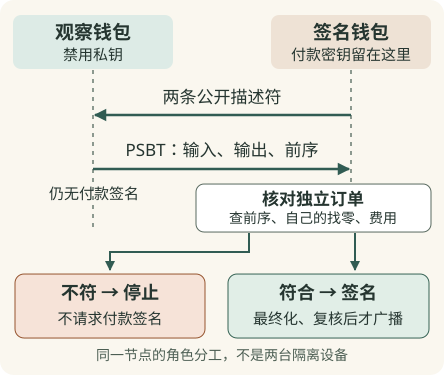
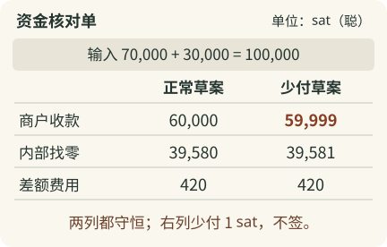

# 第 08 课 · PSBT：这张付款单能交给签名钱包吗？

商户应收 **60,000 sat**。收银系统交来的草案却写着：商户 59,999 sat，找零 39,581 sat，手续费 420 sat。两笔输入合计正好 100,000 sat，一聪没丢。审批人该不该签？**不该。** 账对平了，钱却没按订单分。我们把这张单交给一个没有私钥的观察钱包来准备，再让持钥端按另一份来源可靠的订单决定签不签。

这次接在[第 06 课的前序输出对账](bitcoin.html)和[第 07 课的锁定脚本与见证](scripts.html)之后。要交付的是一张能从订单追到区块的比对单，不是一串“看起来像已签名”的文本。[完整程序：psbt.py](psbt.py)；[本地节点启动器：regtest.py](regtest.py)。

## 带着哪些材料去签名？

PSBT（Partially Signed Bitcoin Transaction）是一种交接格式。本课用 BIP-174 的 v0 格式：全局部分放未签交易，此外按输入、输出分别附信息。例如输入写着“花费 `P:1`”，交易本身并不写 `P:1` 值多少；补全器可附上该笔前序交易，或者对于见证输入附上那个输出的金额和锁定脚本。签名器需要知道自己在授权花什么。键的派生信息可以帮钱包找对公钥，但**能找到公钥不等于有权签名**。编码成 Base64 是为了传递，不是加密，更不是可广播的最终交易。

<figure class="lesson-figure"><a href="../assets/figures/m02/08-roles.svg"></a><figcaption>先从右向左交给收银机“怎样认出我们的脚本”，再从左向右交回一笔具体付款。“知道怎么收”和“同意这次支出”走的是相反方向。</figcaption></figure>

**观察端 `watch`** 是收银台：用 `createwallet` 把 `disable_private_keys` 和 `blank` 都设为 `true`；前者禁止私钥，后者从空钱包开始。**签名端 `signer`** 是付款审批方：用 `listdescriptors false` 只取公开描述符，从中选自己活跃的两条 `wpkh(...)`（P2WPKH）。`internal=false` 的分支生成收款脚本，`internal=true` 的分支生成找零脚本；两条都检查 `hasprivatekeys=false` 再导入 `watch`。这相当于给观察端一份能派生整段地址的规则，不是只抄一个旧地址。公有描述符仍会暴露地址之间的联系，作业不要附它。

这里还有两个独立钱包：`miner` 出块并提供初始测试币，`merchant` 为订单开收款地址，它们都不持有这两笔付款输入的私钥。**四个钱包在同一个临时 Core 进程中**。`wallet='watch'` 选中了哪个钱包回答 RPC，不是操作系统的访问控制；运行脚本的人也能调用 `signer`。实验验证角色能力不同，不声称实现了硬件隔离、隔空传输或生产托管。

## 一笔交易，三份不能混为一谈的依据

| 要决定什么 | 采用的依据 | 不接受的替代品 |
| --- | --- | --- |
| 要付给谁、多少 | 先核实节点是 regtest。商户用自己的临时钱包出收款地址；审批方把地址、对应的 `scriptPubKey`、应付 sat 和费用上限记入独立的 `Invoice`，再构造草案 | 从待签输出抄出一个“预期地址”，用它跟自己比；取两个输出中较大的一个作收款 |
| 能动用哪些钱 | 本单指定的两笔入金 `txid:vout`；签名前逐个向本地节点读未花费输出，核对金额、脚本及签名钱包的收款分支 | 相信 PSBT 上自报的前序金额，或只查第一笔输入 |
| 剩下的钱是谁的 | 签名钱包用自己的描述符检查剩余脚本。地址属于本钱包，且父描述符等于自己的内部找零分支 | 相信观察端贴的“找零”标签；看到地址同样以 `bcrt1q` 开头就放行 |

下面两列都是按实验固定输入推算的**账页示意**。签名前必须同时通过金额守恒与支付意图检查；上面三份依据中若有一份来自错误的钱包，再精确的求和也救不了审批。

<figure class="lesson-figure"><a href="../assets/figures/m02/08-review.svg"></a><figcaption>沿每一列算：输入合计减去商户收款和内部找零，就是费用。右列拒签的原因不是费用变了，而是商户少收了一聪。</figcaption></figure>

## 从项目根目录跑一遍

环境：Python **3.11** 标准库（无 pip 依赖），Bitcoin Core **30.5** 的 `bitcoind` 与 `bitcoin-cli` 均在 `PATH` 中；缺工具先看[本卷安装步骤](bitcoin.html#bitcoin-tools)。用仓库根目录作启动目录，同时保留 `labs/psbt.py` 和 `labs/regtest.py`：

```bash
python3 labs/psbt.py
```

启动器先核对本次新建的 regtest，回环 RPC、断开 P2P；不要传入自己的地址、钱包、数据目录或节点。程序在全新链上先给矿工出 101 块，再由矿工一次给 `watch` 的两个外部地址分别付 70,000、30,000 sat，出一块确认。这个准备动作与商户订单是不同的交易。矿工的找零不是付款钱包此次可以动用的第三个输入。矿工和商户也用不同钱包，避免再出一块时把区块奖励混进商户收入。

交接时只存终端的摘要。下面是**正常完成时的部分预期字段**；`<…>` 代表必须保留自己这一轮实值的字段，不是可用于查链的常量。哪笔入金排在前面、地址、脚本、txid、区块哈希及最终签名长度都不要从本页抄。

```text
ROLES watch_private_keys=false signer_private_keys=true public_branches=external,internal
ORDER chain=regtest address=<本轮地址> script=<商户脚本> sat=60000 max_fee_sat=800 max_sat_vb=3
INPUT prev=<入金txid>:<前序vout> sat=<70000或30000> script=<前序脚本> confirmations=1
INPUT prev=<同一入金txid>:<另一个前序vout> sat=<另一笔> script=<另一前序脚本> confirmations=1
OUTPUT merchant_vout=0 merchant_sat=60000 script=<商户脚本>
CHANGE vout=1 sat=39580 script=<内部脚本> signer_internal=true
PREVIEW fee_sat=420 estimated_vsize=<估算vB> estimated_sat_vb=<估算费率>
WATCH sign_requested=true complete=false can_extract=false
FINAL matched=true signed_inputs=2 fee_sat=420 vsize=<实际vB> actual_sat_vb=<实际费率>
MEMPOOL txid=<付款txid> confirmations=0
BLOCK height=103 hash=<块哈希> includes=<付款txid> payer_conf=1 merchant_conf=1
PASS receipt=<付款txid>:0 received_sat=60000 fee_sat=420
```

### 读懂签名前的五道检查

`createpsbt(inputs, outputs)` 只是**构造**交易骨架，不会扣款，也不发网络消息给对端。`walletprocesspsbt(draft, false, "ALL", true, false)` 由 `watch` 执行：不签、补公钥派生信息、不最终化。程序将返回的 PSBT 交给 `review`，只有它通过才会调用持钥端签名。

1. **网络与付款来源。** 启动器已核对网络。`decodepsbt` 暴露实际输入；其前序引用集合必须恰好等于本单批准的两笔，不可重复。对每个 `txid:vout` 调 `gettxout(..., true)`，包含内存池视图，要求仍未花费且至少确认一次。返回空不能当作 0 sat。如果 PSBT 附整笔前序，就核 txid 及第 `vout` 项；若附 `witness_utxo`，就核其金额和脚本；两者都有就各核一次。本地查到的前序还须在 `signer` 自己的收款分支内。这里信任自己已同步的节点，并非让商户为自己的输入作证。
2. **收款。** 遍历实际输出，本单只准两个；`scriptPubKey.hex` 与 `Invoice.script` 必须恰好匹配一次，金额要等于 `Invoice.amount`，不是“至少付到了某个地址”。链上承诺的是脚本字节；显示给人的地址只是该类脚本的一种编码。这里的商户账单是另一数据源；一份在登记前就被改错的订单，不会被这段比较自动发现。
3. **找零。** 对另一个输出，在 `signer` 而非 `watch` 上调 `getaddressinfo`。程序检查 `ismine`、`ischange`、返回的脚本及 `parent_desc` 与钱包内部描述符的相等关系。不单信 `ischange` 这一个钱包标签，也不靠 vout 顺序。在本单中用的是 P2WPKH，没法解析为所支持的地址或没匹配内部规则就停；不要把未知输出当找零。
4. **费用。** 从每个输入的真实金额求和，再减去**所有**输出：`100000 − 60000 − 39580 = 420 sat`。不从 PSBT 的 `fee` 字段倒推。再用 `analyzepsbt` 取估算的最终 `estimated_vsize`，并核实其费用读数与自己的相同。绝对上限 `800 sat` 和费率上限 `3 sat/vB` 必须同时满足。代码用整数比较 `fee_sat <= 3 * vsize`；Core 返回的 BTC 金额先由 `sat()` 精确转成聪，显示四位小数不是判定依据。若直接读 `analyzepsbt.estimated_feerate`，它的单位却是 **BTC/kvB**，不能拿该字段直接和 3 比。
5. **签什么。** 这堂课仅处理由本程序构造的原生 P2WPKH，使用 `SIGHASH_ALL`：签名承诺这笔付款的全部输出。不要把审批同样用于别的签名范围。签前把版本、锁定时间、每个输入的引用和 `sequence`、每个输出的脚本与金额按顺序留作快照，不能只留下两个总额。

### 从签名到同块回执

先让 `watch` **真的尝试** `sign=true`。这不是故意跳过调用：它能读到两个 UTXO，却交不出签名；此时 `finalizepsbt` 的 `complete=false`，没有可提取的完整交易。换成 `signer` 对**刚才审核的同一份** `updated` 执行 `walletprocesspsbt`，显式 `finalize=false`。在返回 PSBT 每个输入的 `partial_signatures` 中都应找到签名。即使一个单签输入的签名已经够用，此刻也还没把它组装成最终输入见证。

**合并不是最终化。** 假如两名签名者分别拿到同一份未签交易，各自带回一份有不同签名的 PSBT，`combinepsbt([A, B])` 可以把同一底稿的互补信息合并；它不替缺席的人签字，也不是把两个不同付款草案拼成一笔。**最终化**是为每个输入把已有材料组装为锁定脚本所要求的 `scriptSig` 或见证；**提取**才是序列化成能发给节点的交易。本例是一个签名者串行签全部输入，没有第二份独立结果要合并。`finalizepsbt(signed)` 默认在全部输入最终化后直接提取，返回 `complete=true` 和 `hex`，还没有广播。

广播之前再 `decoderawtransaction(hex)` 一次：按位置比较签前快照的**每一项**，同时确认两个输入现在都有见证。用这笔最终交易的 `vsize` 重算实付费率，而不沿用估值。例如 **若** 估值是 209 vB、实测是 208 vB，费率分别约 `420/209 = 2.0096` 和 `420/208 = 2.0192 sat/vB`；这是演算，不是固定日志。若实际费率超限，停止广播；一份已经签好但尚未广播的交易**仍是有效授权**，不能当普通调试日志分享。

`sendrawtransaction` 成功且付款 txid 在本地内存池，只能报“待打包”。程序再出一块，用 `getblock` 查看区块确实列出付款 txid，同时向付款端与商户端各取 `gettransaction`：两者要指向同一块哈希、同一高度、均为 1 确认。商户 `details` 里还须有同一个收款 vout、地址、金额和 `category=receive`。提交给客服的是 **`txid:vout` + 区块证据 + 与订单的比对**；不是仅凭签名或 txid 就把所有订单入账。

## 让一张对得平的单据被拒绝

仍从仓库根目录运行。先预测：若少付 1 sat 并把这 1 sat 加回找零，哪道检查会先停？

```bash
python3 labs/psbt.py --short-pay
```

程序用节点真的生成、补全并解码这份改过输出的 PSBT，独立订单仍是 60,000 sat。预期末行为 `STOP 收款金额不符 expected_sat=60000 proposed_sat=59999 payment_sign_requested=false broadcast=false mempool=0`，退出码 **3**。停在签名前，因此没有 `FINAL` 或商户的 `BLOCK`。这里的“不签、不广播”特指**这张付款单**；准备测试输入的矿工交易早已入块。

再试费用：`python3 labs/psbt.py --fee-sat 700`。本次 Core 30.5 给这笔两入两出交易估算了 208 vB。虽然 `700 < 800 sat`，但 `700 > 3 × 208 = 624 sat`，因此停在**估算费率**检查。改为 `python3 labs/psbt.py --fee-sat 801` 则先触发**绝对费用**上限。二者都是本订单的审批政策，不是 Bitcoin 对所有钱包规定的上限。缺节点或 RPC 报错也不可记作成功的策略拒签。

## 本课作业：不要让位置替你判断归属

先预测：保持 60,000 sat 的订单不变但把找零排在最前面，这次给商户的凭证最后是 `:0` 还是 `:1`？运行 `python3 labs/psbt.py --change-first`。各保留一行 `ORDER`、`OUTPUT`、`CHANGE`、`FINAL`、`PASS`，并自行写下金额等式。**过关判据：**工单脚本只命中 `vout=1`，`vout=0` 由付款方内部描述符认领，费用仍为 420 sat。不同轮次使用新地址和新币，不要求新旧 txid、脚本相同；应要求同一轮中被比较的脚本精确相同。再交一份少付分支的真实 `STOP`，解释为什么不能把它写成“收款方拒绝接收”。

<a id="m02-checkout"></a>

## 卷末验收：接手结算工单 C-208

**客户交代：**在全新 regtest 给设备商付 **31,250 sat**；仅可花本轮到账的 70,000 和 30,000 sat 两笔。报价费用 **550 sat**，审批双上限仍为 800 sat、3 sat/vB。财务要求找零排在第一项，商户须在同一笔交易入块且两端确认数至少为 1 后才能记账。出纳误把草案写成 31,249 sat，多出的一聪又退回付款方。请查明错在订单登记、资金守恒还是草案分配，然后重开正确草案。不要用前面 60,000 sat 工单的回执顶替。

从项目根目录分别执行；每轮一条新链，各自填写证据，**不能跨轮拼接哈希**。交接时让同事再指定另一个 1,000–98,000 sat 内的应收金额，你先写出新找零，再让对方独立复跑对照。

```bash
python3 labs/psbt.py --order-sat 31250 --fee-sat 550 --change-first --short-pay
python3 labs/psbt.py --order-sat 31250 --fee-sat 550 --change-first
```

不要只交一张 `PASS` 截图。用这份清单写你自己的凭证：

| 凭证项 | 同事复核的方法与答案判据 |
| --- | --- |
| 错单处置 | 对照**该轮**的独立订单及真实草案：31,249 ≠ 31,250。输入输出仍守恒，是草案分配错；`STOP`、退出 3、没向持钥端请求付款签名，不是“已付款但少到一聪” |
| 钱从哪里来 | 对正确轮的每个输入分别写 `前序 txid:vout → 金额、脚本、确认数`。两行 txid 相同也不能合并省掉 vout；检查它们是同笔入金的不同输出，合计 100,000 sat |
| 给谁多少 | 将商户订单脚本与**正确轮**的 `vout=1` 配对，31,250 sat。用自己的内部描述符证据认领 `vout=0` 的 **68,200 sat**，不是按位置推断；核 `100000 − 31250 − 68200 = 550 sat` |
| 为什么敢广播 | 写下观察端证据、持钥端复核的字段、估算与实际 vsize，各自计算 `550/vsize`。两次均不超过 3 sat/vB，绝对费用不超过 800 sat。金额一样而脚本不同也不得放行 |
| 能否记账 | 同一轮 `MEMPOOL` 仅是待打包。将 `PASS` 的付款 `txid:1` 与 `BLOCK.includes` 的 txid、块哈希、高度、付款端及商户端的确认数一起交接；入块且两边均 1 才满足本单。如果客户临时要求 2 确认，此时只能记“已入块，等待阈值” |

**现场口试：**遮掉工单与钱包信息，只看区块中金额较大的一项，能断定它是找零吗？本工单里较大的是找零，默认 60,000 sat 例子里较大的是商户收款；规则在两单中必错一次。外人看到的是锁定脚本，不是“属于某人”的标签。能补强结论的是商户的独立账单和付款钱包已验证的内部描述符匹配；若没有这些材料，就标注“归属未知”，不要猜。只交合成地址、脚本与上述摘要；不交助记词、私钥、钱包目录、RPC cookie、扩展公钥、完整 PSBT 或已签原文。

## 协议与核验入口

- [BIP-174：PSBT v0 的数据与角色](https://github.com/bitcoin/bips/blob/master/bip-0174.mediawiki#roles)；[Bitcoin Core 30.5 的 PSBT 工作流](https://github.com/bitcoin/bitcoin/blob/v30.5/doc/psbt.md)，对照 Creator、Updater、Signer、Combiner、Finalizer、Extractor。
- Core 30 系列 RPC：[listdescriptors](https://bitcoincore.org/en/doc/30.0.0/rpc/wallet/listdescriptors/)、[importdescriptors](https://bitcoincore.org/en/doc/30.0.0/rpc/wallet/importdescriptors/)、[getaddressinfo](https://bitcoincore.org/en/doc/30.0.0/rpc/wallet/getaddressinfo/)。对比 `private`、`internal`、`parent_desc` 三个不同问题。
- [gettxout](https://bitcoincore.org/en/doc/30.0.0/rpc/blockchain/gettxout/)、[walletprocesspsbt](https://bitcoincore.org/en/doc/30.0.0/rpc/wallet/walletprocesspsbt/)、[analyzepsbt](https://bitcoincore.org/en/doc/30.0.0/rpc/rawtransactions/analyzepsbt/)、[finalizepsbt](https://bitcoincore.org/en/doc/30.0.0/rpc/rawtransactions/finalizepsbt/)。参数及默认值以本地 Core 30.5 的 RPC help 为准。