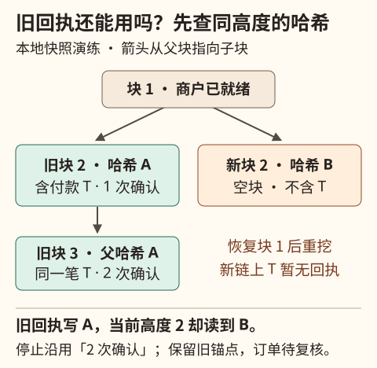

# 第 12 课 · 从提交到最终化：现在能给订单盖章吗？

商户应收 **0.003 测试 ETH**。付款页拿到了交易哈希，收银台查回执却收到 `null`。客服问：「要不要让买家再付一遍？」**先不要。** 接下来我们把同一笔交易留在本地节点的待打包池，再让它入块：第一次查询没有回执，第二次却能找到款。反过来，有回执也未必收到钱。你要交给客服的是能解释这两种情况的一张工单，而不是一个绿色对钩。

先修：[同块账户快照](accounts.html)、[发送者与 nonce](nonce.html)、[Java 费用对账](evm.html)。本课只查原生 ETH；商户程序在成功时保留全部来款，不转给第三人。[完整实验：receipts.py](receipts.py) · [本地节点启动器：anvil_lab.py](anvil_lab.py)。

## 别把四个问题塞进一个布尔值

交易哈希标识一份签名交易；算出它不需要等人出块。请求 `eth_sendTransaction` 得到哈希，说明本次提交得到了节点的答复，不是全网的收货签名。**回执**是交易入块执行后的结果，带交易哈希、区块号、区块哈希、执行状态和用掉的 gas。回执里没有本订单应付金额，连原交易的 `value` 也要另查。像在 Java 服务里存异步任务的 ID：能查这个 ID，跟任务成功提交了哪一笔业务结果，是两个问题。

| 查问 | 看到的证据 | 可以怎样告诉客户 |
| --- | --- | --- |
| 能正常查询吗？ | 连接被拒、超时，没收到有效 RPC 响应 | 「查询服务暂不可用；保留上次记录，请勿重复付款。」这不是 `result: null`，更不是 `status=0` |
| 这笔是否待打包？ | RPC 正常；回执为 `null`，按哈希却能查到交易，尚无块哈希或块号 | 「本节点已见到，等入块。」如果连交易也查不到，只能说「本节点暂未查到」；输入哈希、链、节点视图都要核，可能未传播，也可能已被替换 |
| 是否执行成功？ | 非空回执的 `blockHash` 仍是该高度当前链上的块；`status` 为 `0x0` 或 `0x1` | `0x0`：「已入块，执行失败，款未到账，本次消耗了手续费。」`0x1`：「顶层执行成功，正在核对收款与确认条件。」不能用有无日志来猜 |
| 能否核销这张单？ | 核对链、交易双方、实际到账额、块锚点与订单门槛；如要求最终化，还要查最终化头 | 本地演练可以说「金额相符，达到两块门槛」；要求最终化的真实订单，则须等本交易所在块进入已最终化历史 |

还有一种情况：节点回了有效的 JSON-RPC `error`（例如参数无效、历史数据不可用）。查询没成功，但节点也不是失联；应保留错误类型，不可伪装成 `null`。订单「未找到」不是交易「确认失败」；一次新的查询失败也不抹掉上次得到的证据。区块浏览器能帮你定位哈希和高度，但索引器会延迟，可能选错链，也看不到你的独立应收单。点开浏览器是核验的起点，不是裁判的印章。

## 把时间停在提交和打包之间

环境：Python **3.11** 标准库、Foundry **Anvil 1.7.1**、系统 `lsof`；macOS 或有这些工具的 Linux/WSL2。工具安装见[第 04 课](networks.html#network-tools)。从仓库**根目录**运行；`anvil` 在 `PATH` 中，或将环境变量 `ANVIL` 指向其可执行文件。脚本自行启停 `127.0.0.1:18552` 上的新内存链，链 ID 31337、Cancun 规则、两个临时账户各 10 测试 ETH，不连接公网。不要另启同端口的节点，也不要输入钱包密钥。

```bash
python3 labs/receipts.py
```

1. **先把商户身份与订单分开登记。** 脚本先用 `evm_setAutomine(false)` 关闭自动出块。第二个临时账户发起部署，再用 `evm_mine` 手动出第 1 块。新商户地址的程序只做一件事：输入数据为空则停止并保留款，非空则执行 `REVERT`，撤销本次价值转移。`eth_getCode` 在块 1 确认商户地址有预期程序。第一个账户才是付款方，它没有付部署费。`BEFORE` 固定在块 1，记录付款方余额、商户余额与付款方 nonce。订单独立写明应收 `3000000000000000 wei`。
2. **保留真空档，不用轮询撞运气。** 保持手动出块。先查从未提交的全零哈希作为对照：回执和交易都为 `null`。再发一笔 `nonce=0` 的付款。此时 `eth_getTransactionByHash(T)` 已返回含该 nonce 的交易，仍没有块位置，`eth_getTransactionReceipt(T)` 为 `null`。这是两次不同查询；单看两个空回执分不出「节点已见」与「暂未查到」。
3. **手动出一块，给回执找座位。** `evm_mine` 后，取回执的 `blockNumber=h`，按**高度**调用 `eth_getBlockByNumber(h, false)`。块的 `hash` 必须等于回执 `blockHash`，本实验的交易列表必须恰好是 `[T]`。再按 T 查原交易：`from/to/nonce/value/input` 必须是这次提交的尝试。只用 `eth_getBlockByHash(旧哈希)` 不够：有些节点还保留离开当前链的旧块。
4. **查余额并数确认。** 此处块 2 的父块是块 1，块 2 只有这一笔交易。分别读取两端块后状态，`付款方减少额 = 商户增加额 + gasUsed × effectiveGasPrice`，发送 nonce 增 1。再挖一个空块，核对块 3 的 `parentHash` 是刚才的块 2。按本工单约定，把收录块本身算作第一次：`确认数 = 当前头高度 − 收录高度 + 1`，所以从 `2−2+1=1` 到 `3−2+1=2`。**先确认在同一条链上，再做减法。**
5. **让读取真的失败。** 退出 `with anvil(...)` 后，子进程已停止。程序用同一客户端、同一哈希再读回执，这次捕获的是传输异常，没有拿到 JSON 回执。只输出 `lastKnown` 与 `freshObservation=no`，不发送第二笔付款。实验还故意销毁了内存账本；重启是新链，不是把这笔订单找回来的办法。

下面是正常轮的**预期字段节选**，省略了真实运行才知道的地址、哈希与单价。`T` 是同一笔订单交易，`A` 是收录它的同一个块哈希；不要把字母当作可查询值。`READY_LOCAL` 是本地演练的两块门槛，不是最终化。

```text
UNSEEN   control=<全零哈希> receipt=null transaction=null
PENDING  tx=T nonce=0 receipt=null block=none
RECEIPT  tx=T … valueWei=3000000000000000 input=0x status=1 height=2 block=A …
DEPTH    height=2 canonicalHash=A head=2 … confirmations=1 orderState=HOLD_DEPTH
DEPTH    height=2 canonicalHash=A head=3 … confirmations=2 orderState=READY_LOCAL
RPC_UNAVAILABLE tx=T … lastKnown=READY_LOCAL freshObservation=no resend=no
```

例如只作算术示意：若回执给 `gasUsed=21019 gas`、`effectiveGasPrice=1500000000 wei/gas`，实付便是 `31528500000000 wei`，对这张成功单，付款方应少 `3031528500000000 wei`。用**你自己的**回执单价、用量和 `BEFORE/AFTER` 实值验证，不用上述单价填空。并发收支时，账户跨块净差不能独自归因于某笔交易；本实验专门隔离了付款块，而且商户不再向外转款。

## 只改一个字节：失败的交易为什么也有确认数？

```bash
python3 labs/receipts.py --reject
```

这次只改订单交易的输入：`0x` 变成 `0x01`，`value` 与应付金额不变。商户程序看的是输入数据**长度**，不是检查 ETH 够不够。在程序里，`INIT` 把 12 字节运行时代码装入测试地址；其中的条件跳转把空数据引向 `STOP`，另一条路执行 `REVERT(0, 0)`。故意给足 `gas=50000` 并发送真实交易，不用估算失败来冒充失败回执。

预期仍有 `PENDING`，仍在块 2 找到 T，仍有 1 次、2 次确认，差别是 `status=0`、`AFTER.shopWei − BEFORE.shopWei = 0`，付款方少掉的**只有实付费**，nonce 仍从 0 到 1。两次 `DEPTH` 都应是 `HOLD_REVERTED`。协议撤销的是本次顶层执行的价值转移与合约状态，不是让已入块的交易、已用 gas 或已消耗的发送序号消失。`status=0` 本身不提供故障原因；我们能说本例是主动 `REVERT`，是因为知道测试代码和输入。真实系统还须区分如耗尽 gas 等原因，不要看到 0 就编造一条报错文案。

## 昨天的块 2，不一定是今天的块 2

<figure class="lesson-figure"><a href="../assets/figures/m03/receipts-anchor.svg"></a><figcaption>看右列时，别从左列继承确认数。判断条件是「这个具体块仍在当前链上」，不是「链上还有这个高度」。两列哈希 A、B 是示意，日志中有完整值。</figcaption></figure>

链重组指节点改认另一支历史。交易可能掉回待打包、从本节点消失，或已经进入新支的另一块；第三种情况下，即便哈希 T 不变，块位置、执行前状态和确认数也要重新取。实际处置是保留旧的 `(chain, T, h, blockHash)` 记录，暂停依赖旧证据的核销，按**原哈希**重查新回执与订单；无回执时再查交易。撤销旧的暂记状态用同一订单键做补偿，若已发货就转异常工单，不能假装撤下链上明细就能收回货物。

**从确认到最终化，还差什么？** 以太坊 PoS 中，执行客户端验证交易和状态变化，共识客户端依据验证者投票选择当前头，并传递安全头和最终化头。`latest` 可以换支；`safe` 是共识层给出的较安全头，不等于 `finalized`。检查点得到足够权益（至少三分之二）投票并满足最终化规则后，其历史前缀才获得协议最终性。不是「过两块」或「过了某个固定分钟数」就变成最终化；投票不足时最终化可以停滞而链头继续增长。

如果交付策略要求 `finalized`，在同一受信、同步且网络身份正确的节点上查 `eth_getBlockByNumber("finalized", false)`。最终化头低于 h 就等；达到或超过 h，还要确认收录哈希是该头的祖先（同高度则哈希应相同；必要时沿 `parentHash` 核到 h），再核业务结果。断线、节点未同步、标签不支持时标「最终性未知」，不要回落为 `latest` 就放行。这里的 Anvil 没有真实验证者投票；即便开发节点能返回同名标签，也不作为实测 PoS 最终性的证据。浏览器若写「Finalized」，仍要核对它说的是哪条链、哪一块。

## 本课作业：交回一张被撤销的暂记凭证

先在纸上判断：若在满两次确认后把本地节点恢复到部署块并挖一个空块，旧收据的 `status=1` 字样还在你的日志里。客户现在能凭它提货吗？从根目录运行：

```bash
python3 labs/receipts.py --order-id R-12B --replace-block
```

这里用的是 Anvil 管理方法 `evm_snapshot` / `evm_revert`，**人为**构造旧块被另一块代替，不是让公网验证者发生重组。保留本轮 `RECEIPT`、两行 `DEPTH`、`RESTORED`、`ROLLBACK`、`RPC_UNAVAILABLE`。**答案判据：**旧块 2 的哈希曾与回执相符；恢复后块 2 的新哈希与旧哈希不同，交易列表为空，旧 T 的回执变成 `null`；`RESTORED` 的付款方余额、商户余额与 nonce 均等于部署块的 `BEFORE`。因此从 `READY_LOCAL` 退到 `HOLD_RECHECK`；随后 RPC 断开只是不能更新，不是又一场回滚。请用一句客户听得懂的话分别解释「合约执行回滚」和「收录块不在当前链」：前者交易仍在账上、花了费；后者是这张旧回执已无有效锚点，两者不能共用一个“支付失败”。

<a id="m03-checkout"></a>

## 卷末工单 E-312：两次确认之后，谁来核这 1 wei？

商户订单要求**精确收取 9,007,199,254,740,993 wei**，本地策略要求两次确认。报表用浮点数显示「金额相同」；客服递来一笔成功交易，要求放货。先取**少付现场**，再以同一采购要求做独立足额对照。两轮是在不同的临时链，不能从第二轮的付款给第一轮补差，也不能从第一轮的 nonce 推断第二轮的哈希。学员交付的是两张核验单和交接意见，不是真的发货。

从仓库根目录在 Bash 中执行。`tee` 保存的只是本地实验的公开摘要；两次相同的 `id` 用于对照输入，不代表在线上允许一个订单重复付款。

```bash
set -o pipefail
python3 labs/receipts.py --order-id E-312 --order-wei 9007199254740993 --short-pay | tee e312-short.log
python3 labs/receipts.py --order-id E-312 --order-wei 9007199254740993 | tee e312-full.log
```

用 [第 11 课](evm.html)的 Java 整数思路独立复算，**不拿程序打印的 `feeWei` 当输入**。准备 JDK 17 或 21 的 `jshell`，仍在这两个日志所在的目录运行：

```bash
jshell -s - <<'JAVA'
import java.math.BigInteger;
import java.nio.file.*;
import java.util.*;
BigInteger field(List<String> rows, String tag, String key) { String line = rows.stream().filter(s -> s.startsWith(tag + " ")).findFirst().orElseThrow(); String p = key + "="; return Arrays.stream(line.split(" ")).filter(s -> s.startsWith(p)).map(s -> new BigInteger(s.substring(p.length()))).findFirst().orElseThrow(); }
for (String file : List.of("e312-short.log", "e312-full.log")) {
    var r = Files.readAllLines(Path.of(file));
    var fee = field(r,"RECEIPT","gasUsed").multiply(field(r,"RECEIPT","priceWeiPerGas"));
    var debit = field(r,"BEFORE","payerWei").subtract(field(r,"AFTER","payerWei"));
    var credit = field(r,"AFTER","shopWei").subtract(field(r,"BEFORE","shopWei"));
    var shortage = field(r,"ORDER","orderWei").subtract(credit);
    System.out.println(file + " feeWei=" + fee + " balanced=" + debit.equals(credit.add(fee)) + " shortageWei=" + shortage);
}
/exit
JAVA
```

| 交接栏 | 本单的验收判据 |
| --- | --- |
| 身份与账户 | 每轮独立记 `ORDER.id/chain/payer/shop/orderWei`；从 `BEFORE`、`AFTER` 抄高度、块哈希、两端余额与发送 nonce。商户有本轮已核过的程序代码，不能用任意一个测试账户的余额替代。留证用完整哈希，不只留末四位 |
| 交易与序号 | 把 `PENDING.tx/nonce` 接到同轮的 `RECEIPT.tx/from/to/nonce/valueWei/input`。两张证据都应是原付款方的 nonce 0，入块后该方 nonce 1。RPC 不可用时只重查；记清订单键和待复查的原哈希，不分配 nonce 1 再发一遍 |
| 钱与费用 | 两个 `balanced` 都为 `true`，表示钱守恒；少付轮 `credit=9007199254740992`、`shortageWei=1`，足额轮 `credit=9007199254740993`、`shortageWei=0`。两者 `status=1` 但只有后者付清。`2⁵³+1` 不能由二进制 `double` 精确表示，不能用浮点近似或显示精度裁单 |
| 所在链与门槛 | 同轮 `RECEIPT.block` 必须等于两行 `DEPTH.canonicalHash`；高度从 2 数到头 3 得两次确认。少付轮两次都 `HOLD_AMOUNT`，足额轮依次 `HOLD_DEPTH`、`READY_LOCAL`。这两次运行都**没有**主网最终化证明 |
| 下一班做什么 | 交给客服两句可直接使用的意见：「第一笔执行成功，确认两次，仍少 1 wei，暂不核销并按订单差额流程处理」；「足额对照在本地达门槛。查询服务断开后保持上次记录，无新证据，不要求二次付款」。若客户改要协议最终化，两张凭证都不放行 |

**独立复核：**请接班人选一个不同的整数金额（2 wei 到 1 测试 ETH 之间），先不看节点，预判少付 1 wei 后的收款、发送 nonce 和处置。替换两条命令中的 `--order-wei`，给新工单单独保留日志，再用同一方法比对；能解释为什么 `balanced=true` 不足以核销才算过关。交接只留临时地址、交易及块哈希、金额和状态，不交密钥、助记词、签名原文或客户信息。

## 查证原文

- [Ethereum Execution APIs：按哈希查交易、查回执](https://github.com/ethereum/execution-apis/blob/main/src/eth/transaction.yaml) 与[区块查询和 block tag](https://ethereum.org/en/developers/docs/apis/json-rpc/#block-parameter)：区分未找到、查询错误与已有回执。
- [EIP-658：回执中的顶层执行状态](https://eips.ethereum.org/EIPS/eip-658)；[EIP-1898：用块哈希取得一致的状态视图](https://eips.ethereum.org/EIPS/eip-1898)。本实验停住出块后按高度读；对会移动的节点不能假设连续两次 `latest` 就是同一状态。
- [以太坊 PoS：Gasper 的分叉选择与检查点最终化](https://ethereum.org/en/developers/docs/consensus-mechanisms/pos/gasper/)；[Anvil 1.7.1 的本地 RPC 实现](https://github.com/foundry-rs/foundry/blob/v1.7.1/crates/anvil/src/eth/api.rs)。快照与手动出块是控制实验时间的工具，不是以太坊共识接口。
