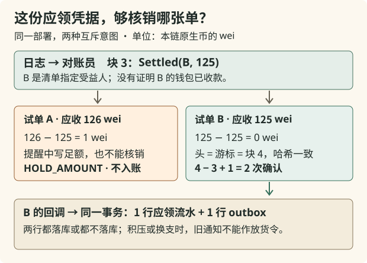

# 第 20 课 · 订单对账：回调说付足了，为什么还差 1 wei？

客服要给财务填一张单：「合约已经为 B 记足可领取的款了吗？」订单要求 **126 wei**，约定收录后有 1 次确认就能核对。第 3 块是当前块，扫描器也已核到同一块；约定合约的结算记录写的是 **B，125 wei**。付款系统两次提醒「付了 126」。财务该填「足额」还是「待处理」？看哪一行？

填「待处理，少 1 wei」。订单告诉你**应该有多少**，合约的结算记录告诉你**为 B 记了多少**。两次提醒只是两次请你查账，不是两笔来款；再等一个块也不会把 125 补成 126。这里核对的是 B 可以从托管合约领取的金额，连「B 已经领走 125」都不能写。

只在纸上改一个数：若当时结算记录写的是 **B，126 wei**，其余证据不变，还需要等吗？不需要。差额归零，第 3 块自身已算这张单要求的 1 次确认，可以记一笔足额**应领**。不要改原订单来凑数，也不要把这笔应领当作给钱包付款的回执。

只想读懂差异单，可以[翻到第 21 课：签登录消息是在同意付款吗？](siwe.html)。以下是选做的本地对账、恢复与卷末工单。动手前需要能[认出本次部署](deployment.html)、[查原回执](rpc.html)、[用游标找出没有扫过的块](indexing.html)、[区分旧分支与当前分支](reorg.html)。实验复用 [MilestoneEscrow](m04/src/MilestoneEscrow.sol)，只连接自有回环 Anvil 和临时 PostgreSQL；不开钱包，也不向仓库发货或投递消息。

## 先写下核销对象，再看到账提示

支付意图是业务系统**预先承诺接受什么**，不是让回调解释「刚才发生了什么」。运营端 [OrderIntent.java](m05/src/main/java/course/m05/OrderIntent.java) 把订单号、链号、部署块哈希与高度、合约、受益人、资产、整数应收与最小确认数一次写入。清单要来自自己的发布交接；`INSERT … SELECT … FROM scan_cursor` 还要求受信清单与这一个数据库的部署锚点一致。回调不能创建意图、修改报价或分配地址。

业务约定是「合约替 B 登记了一笔可领取的原生币」。锁款只让状态变成 `Locked`，此时付款方仍可能在期限后退款；`Settled` 才让 B 获得应领，`Withdrawn` 才表明合约完成转出。三者是同一笔钱的不同阶段，不能相加。若合同要求「到 B 钱包才交付」，本服务的 `BOOKED_AT_HEAD` **不是**那个交付条件，必须另验领取。这里没把交易的 `value` 当收入：调用 `settle()` 的那笔交易本身不需要再附 125 wei。

| 证据 | 谁给的 | 哪些字段说了算 |
| --- | --- | --- |
| 意图 | 本地订单系统 | 链 31337、清单这次部署、B、`native:31337`、126 wei、确认门槛 |
| 观察 | 第 18 课逐块扫描，第 19 课标规范支 | 指定链与地址的唯一 `Settled`、indexed 受益人、整数字段、块高/哈希、交易哈希及 `logIndex` |
| 业务流水 | 对账事务 | 订单号只记一次，外键指回不可随重组删除的原始日志；**不是**钱包余额 |
| 通知意图（outbox） | 同一事务 | `订单号 + ENTITLEMENT_RECORDED` 表示有一项应领入账可供复核；**不是**已经发出通知，更不是放货指令 |

<figure class="lesson-figure"><a href="../assets/figures/m05/reconciliation.svg"></a><figcaption>右支不是把左边的订单改成「已付」。两个试单条款各自保留，不能同时占用部署；已经入账的那条凭据不能让给第二单。</figcaption></figure>

## 判定顺序：先问「是哪一页账」，再问「差多少」

[OrderApp.java](m05/src/main/java/course/m05/OrderApp.java) 的 `evaluate` 在数据库事务里做以下几步。把金额判断提前是个常见错误：旧分支的 125 和新分支的 125 数字相同，不代表是同一份收据。

1. 锁定订单，再以 `FOR SHARE` 读第 18、19 课共用的第 1 行游标；扫描器修改这一行时持排他锁。核对服务加载的清单、意图和游标。它们指向同一部署后，另从节点读 `eth_chainId` 和 `latest` 块；头高、头哈希来自**同一个块对象**。若头落后于游标、或游标高度的当前规范哈希已不同，返回 `HOLD_REORG`；若该哈希仍对、但头比游标高，返回 `HOLD_LAG`。RPC/数据库不可用时接口报错，不能拿昨天最后一次成功当今天的绿灯。
2. 仅当头与游标同高同哈希才看 `canonical_log`。**没有** `Settled` 是 `WAIT_SETTLED`，不是已付零；查出两条则拒绝猜测。已有流水还要比较先前入账的那一条完整证据；当前事件消失或换了，即 `HOLD_ORPHAN`，不把新支上金额相等的另一条偷偷改成原单凭证。返回的 `bookingEvidence` 是历史证据，`observed` 才是已核对这一页的事件。
3. 这一个部署已知只收原生币，白名单只认可 `native:31337`，并按日志的 `actor` 匹配受益人。面值同为 `125` 的美元分和 wei **不能相减**。只在资产正确时用 `BigInteger(expectedUnits) − BigInteger(amountWei)`；`differenceWei=1` 表示少 1，负数表示超付，示例中两者都转人工。Java 用整数，PostgreSQL 用 `numeric(78,0)`，JSON 把最小单位作为十进制**字符串**，大于 `2⁵³` 也不经浏览器浮点数。
4. `confirmations = headHeight − eventHeight + 1` **含事件本块**。结算在 3，头也是 3，只有 1 次；要求 2 次时返回 `HOLD_DEPTH`。块 4 已出但游标仍为 3 时，不能隔空加这一次；追到 4 且哈希相同时才是 2。本地确认门槛是业务策略，不是 PoS 最终化，也不是对下一秒链头的保证。

`GET /orders/{id}` 是只读判断，足额且尚未入账为 `READY_TO_BOOK`。`POST /orders/{id}/callbacks/{key}` 只是「请重查」：接收 `Content-Type: application/json` 但**不绑定请求体**。`(order_id, hint_key)` 重试只留一条到达记录；重复键也重新检查链头，不缓存上次的绿灯或挂起决定。独立的新提醒键可以不同，入账业务键仍是同一个订单号。`book()` 先插 `order_booking`，再插 `order_outbox`，最后由外层事务 `commit()`；任一步失败，关闭未提交连接时一起回滚。两个并发回调先争订单行锁，不会各看到一次「未入账」。[表定义](m05/orders.sql) 还分别约束订单号、日志四元组和 outbox 订单号的唯一性；不是靠在 Java 里先 `count(*)` 再碰运气。

接口的 `mayNotifyAsOfHead` 只在**本次读到的头**仍支持既有流水时为 `true`。不存在跨节点和 PostgreSQL 的原子快照，提交后链仍可变。示例**没有发送器**。不要用 `SELECT * FROM order_outbox` 批量放货。真实消费者至少要按订单/通知种类去重，发送前用最新头再次核对，断连、换支或未追平时挂起；已经发出的消息/货物不能靠 SQL 回滚，必须另走告警、复核与补偿。若需求是不可逆交付，还要约定最终性策略、人工放行与外部系统幂等协议。

## 本地开单：同一张日志做三次互斥实验

工具沿用前课：JDK 21、Maven 3.9.x、web3j 4.12.3、Spring Boot 3.5.8、pgjdbc、PostgreSQL 17.5、Python 3.11 和 M04 的 Forge/Cast/Anvil 1.7.1。以下从**仓库根目录**执行。本课第一个案例用 `--settle-wei 125` 预装真实日志，再分别回放商户的三种意图，这是教学试算；真实订单应先定条款，不能付款以后为凑数换单。后面的工单按真实顺序先建意图再锁款。

终端 A：先按[第 13 课工具准备](abi.html#m04-tools)安装工具，再运行：

```bash
export PATH="${XDG_CACHE_HOME:-$HOME/.cache}/chain-course/m04/bin:$PATH"
export FOUNDRY_SOLC="${XDG_CACHE_HOME:-$HOME/.cache}/chain-course/m04/bin/solc"
unset ANVIL
WORK=$(mktemp -d); printf '本轮目录 %s\n' "$WORK"
python3 labs/m04/deployment.py --out "$WORK/release" --settle-wei 125 --hold
```

终端 B：复制 A 的目录而非另一轮的清单。第一次起本卷的专用 Docker 容器时运行 `bash labs/m05/db.sh start`；已运行就复用，本步骤不要清空旧库。每个新部署使用一个全新数据库；示例库名 `m05_orders` 若已存在，请换尚不存在的 `m05_` 加小写字母数字的名字。执行 `build.sh` 前需要 Maven 依赖已缓存或能下载。启动成功后让服务留在前台：

```bash
printf '粘贴本轮 WORK：'; IFS= read -r WORK
export M05_MANIFEST="$WORK/release/manifest.json" M05_DB=m05_orders
printf 'CREATE DATABASE %s;\n' "$M05_DB" | M05_DB=m05 bash labs/m05/db.sh sql
bash labs/m05/db.sh sql < labs/m05/schema.sql
bash labs/m05/db.sh sql < labs/m05/orders.sql
bash labs/m05/build.sh && bash labs/m05/run.sh Scan && bash labs/m05/run.sh OrderApp
```

终端 C：设好相同环境。每次演练从未用过这些订单号的库开始；不要并行挖块。完整的[演练驱动](m05/order_drill.py)只经 CLI 创建/退役意图，经 HTTP 提醒和查询，**不往索引表塞事件**。需要 `cast` 挖一个本地空块：

```bash
printf '粘贴本轮 WORK：'; IFS= read -r WORK
export M05_MANIFEST="$WORK/release/manifest.json" M05_DB=m05_orders
export PATH="${XDG_CACHE_HOME:-$HOME/.cache}/chain-course/m04/bin:$PATH"
set -o pipefail
python3 labs/m05/order_drill.py 125 | tee "$WORK/orders.jsonl"
```

驱动的次序是：`OrderIntent create short-20 native:31337 126 1` → 回调 → `OrderIntent retire short-20`；再开 `asset-20 invoice:USD 125 1`，回调后也退役；最后开 `match-20 native:31337 125 2`。`invoice:USD` 明指「美元分计价的应收」，真实观察仍是 M04 原生币结算，**没有模拟 ERC-20 转账**。部分唯一索引使同一部署只能有一个 active 意图；CLI 只准退役未入账的试单、保留旧 ID 和条款，已入账则禁止退役或再分配。不要在生产中复用已展示给顾客的收款入口。

以下是**预期差异表**（新链从块 3 开始；哈希必须从自己的 JSONL 抄完整值）。`—` 不是数值零。

| 步骤 | 应收 / 实见 | 差额 wei | 头 / 游标 | 判断；业务结果 |
| --- | --- | ---: | --- | --- |
| short-20，回调自报 126 | 126 wei / 125 wei | 1 | 3 / 3 | `HOLD_AMOUNT`；0 流水 |
| asset-20 | 125 美分 / 125 wei | — | 3 / 3 | `HOLD_ASSET`；不比较数字，0 流水 |
| match-20，先只读 | 125 wei / 125 wei | 0 | 3 / 3 | `HOLD_DEPTH`，1 < 2 |
| 挖出块 4，扫描器未跑 | 125 wei / 尚未复核 | — | 4 / 3 | `HOLD_LAG`，`lagBlocks=1`；不放行 |
| `Scan` 补扫无日志的块 4 | 125 wei / 125 wei | 0 | 4 / 4 | `READY_TO_BOOK`，2 次确认；GET 仍不入账 |
| `hint-a` 两次，`hint-b` 一次 | 同一笔 125 wei 应领 | 0 | 4 / 4 | `BOOKED_AT_HEAD`；`newHint=true,false,true`，合计 1 流水、1 outbox |

自己加一次显然错误的金额。前两次 `hint-a` 的 body 已经不同，再发一次也不改变事实：

```bash
API=http://127.0.0.1:18020
curl --noproxy '*' -fsS -X POST "$API/orders/match-20/callbacks/hint-a" \
  -H 'Content-Type: application/json' -d '{"amountWei":"999999","asset":"invoice:USD"}'
curl --noproxy '*' -fsS "$API/orders/match-20" | python3 -m json.tool
bash labs/m05/db.sh sql <<'SQL'
SELECT i.id,i.active,i.asset,i.expected_units,b.block_hash,b.tx_hash,b.log_index,n.kind
FROM payment_intent i LEFT JOIN order_booking b ON b.order_id=i.id
LEFT JOIN order_outbox n ON n.order_id=i.id ORDER BY i.id;
SQL
```

在 `bookingEvidence` 取完整 `txHash`，用 `cast receipt --rpc-url http://127.0.0.1:18556 <该哈希> --json` 查原回执：`status` 应成功，块哈希与流水一致，再按 `logIndex`、合约地址定位日志，而不是只比交易号。`topics[0]` 应是 `cast keccak 'Settled(address,uint256)'`，`topics[1]` 低 20 字节是 B，`data` 是 32 字节整数。上面的归档另有 `release/receipts.json` 的 `settle` 可用于离线交叉比对；换支后归档文件只证明当时保存过什么，不能替代当前规范块。

**本课独立作业。** 不改报价、不再调用任何托管函数：在已经 `BOOKED_AT_HEAD` 的 `match-20` 上用 `cast rpc --rpc-url http://127.0.0.1:18556 evm_mine` 再添一空块。立即重发上面的同键回调，把 JSON 交给仓库；用 `bash labs/m05/run.sh Scan` 补扫后再交第二份。判据：第一份有历史 `bookingEvidence`、`newHint=false`，但 `HOLD_LAG` 和 `mayNotifyAsOfHead=false`；第二份块高加一、证据四元组未改，才恢复 `BOOKED_AT_HEAD`。两份之间没有第二次入账。写出如果仓库只缓存第一次绿灯，会怎样误报。

<a id="m05-checkout"></a>

## 卷末接手工单 E-520：备份还在块 1，结算却在块 3

需求改为 **9,007,199,254,741,019 wei**，约定 **3 次**确认；订单号 `E-520`。索引器停机期间客户完成锁款、结算。请从**付款前**的数据库备份接手，用真实节点补回两块；最后还要演示：发生开发链换支时，为什么一行仍在的 outbox 不代表应继续通知。换同事复跑时，另选一个 `1..10¹⁸` 的整数字符串和一个新的订单号，先写下自己的差异表与预计确认高度，再动手。

**1 · 开新交接，不挪旧单。** B 用 Ctrl-C 停上个服务，A 回车结束上条链；保留原实验目录与数据库。终端 A 在新的 `WORK=$(mktemp -d)` 中用 `python3 labs/m04/deployment.py --out "$WORK/release" --hold` 启动**不带 `--settle-wei`** 的新部署，记下 WORK 并保持运行。终端 B 如前 `read -r WORK`，再执行（`m05_ticket`、后面的 `m05_restored` 都要求没用过）：

```bash
export M05_DB=m05_ticket M05_MANIFEST="$WORK/release/manifest.json"
printf 'CREATE DATABASE %s;\n' "$M05_DB" | M05_DB=m05 bash labs/m05/db.sh sql
bash labs/m05/db.sh sql < labs/m05/schema.sql && bash labs/m05/db.sh sql < labs/m05/orders.sql
bash labs/m05/run.sh Scan
bash labs/m05/run.sh OrderIntent create E-520 native:31337 9007199254741019 3
bash labs/m05/db.sh dump > "$WORK/before-payment.dump" && test -s "$WORK/before-payment.dump"
bash labs/m05/run.sh OrderApp
```

此时只有部署块，`before-payment.dump` 是 `pg_dump -Fc` 的单库一致快照，含意图、索引、游标、约束和当时的业务表。它**不是** Anvil 状态，不包含应用 JAR、链外请求、清单文件或集群角色。另保管同轮 `release/` 与工程版本；只恢复可信备份。停写索引直到下一步结束。

**2 · 制造真正的漏块，不改游标。** 终端 C 设好新的 WORK、工具路径，地址**取自本次可信清单**。先向订单 API 查询应为 `WAIT_SETTLED`。保存快照号，在本机持有的节点上用解锁的临时付款方发两笔不同交易，绝不提供私钥：

```bash
printf '粘贴工单 WORK：'; IFS= read -r WORK
export M05_DB=m05_ticket M05_MANIFEST="$WORK/release/manifest.json"
export PATH="${XDG_CACHE_HOME:-$HOME/.cache}/chain-course/m04/bin:$PATH"
RPC=http://127.0.0.1:18556; API=http://127.0.0.1:18020
PAYER=$(python3 -c 'import json,os;print(json.load(open(os.environ["M05_MANIFEST"]))["deployer"])')
ESCROW=$(python3 -c 'import json,os;print(json.load(open(os.environ["M05_MANIFEST"]))["contractAddress"])')
curl --noproxy '*' -fsS "$API/orders/E-520" > "$WORK/initial.json"
SNAP=$(cast rpc --rpc-url "$RPC" evm_snapshot | tr -d '"')
cast send --rpc-url "$RPC" --unlocked --from "$PAYER" "$ESCROW" 'lock()' \
  --value 9007199254741019 --json > "$WORK/lock.json" && \
cast send --rpc-url "$RPC" --unlocked --from "$PAYER" "$ESCROW" 'settle()' --json > "$WORK/settle.json"
curl --noproxy '*' -fsS "$API/orders/E-520" | tee "$WORK/before-recovery.json"
```

两笔都要有成功回执；若超时先查已有哈希，不重发。`before-recovery.json` 预期 `headHeight=3,cursorHeight=1,lagBlocks=2,decision=HOLD_LAG`。这里漏掉的是有真实 `Locked`、`Settled` 的两块，不是手工删除 SQL 行。B 用 Ctrl-C 停服务，A 不动。确保旧读写进程/发送器未在运行，切库时不要让新旧两个实例同时受理。

**3 · 恢复到空库、先查缺口、再追平。** 终端 B 执行以下内容后留在服务前台：

```bash
export M05_DB=m05_restored
bash labs/m05/db.sh restore < "$WORK/before-payment.dump" || exit 1
bash labs/m05/db.sh sql <<'SQL' || exit 1
SELECT height,block_hash FROM scan_cursor;
SELECT id,expected_units,min_depth FROM payment_intent;
SELECT count(*) AS bookings_at_backup FROM order_booking;
SQL
bash labs/m05/run.sh OrderApp
```

`restore` 先 `createdb`，再 `pg_restore` 到**新空库**；若同名存在会失败，不要忽略错误继续启动。恢复点应是 `1 / E-520 / 9007199254741019 / 3 / 0 条流水`，RPC 仍是原链而不是另一次部署。C 切到恢复库，定义一次提示函数，每次都传错误的自报数字：

```bash
export M05_DB=m05_restored
hint() { curl --noproxy '*' -fsS -X POST "$API/orders/E-520/callbacks/recheck-520" \
  -H 'Content-Type: application/json' -d '{"amountWei":"1"}'; }
hint | tee "$WORK/restored-lag.json"
bash labs/m05/run.sh Recover
hint | tee "$WORK/one-confirmation.json"
cast rpc --rpc-url "$RPC" evm_mine && cast rpc --rpc-url "$RPC" evm_mine
bash labs/m05/run.sh Scan
hint | tee "$WORK/booked.json"; hint | tee "$WORK/retried.json"
bash labs/m05/db.sh sql <<'SQL'
SELECT height,kind,actor,amount_wei,tx_hash,log_index FROM canonical_log ORDER BY height,log_index;
SELECT b.order_id,b.block_hash,b.tx_hash,b.log_index,n.kind
FROM order_booking b JOIN order_outbox n USING(order_id);
SQL
```

读这几份输出时，认准两个不同的编号。`recheck-520` 区分「这是哪一次提醒」，订单号 `E-520` 才回答「哪张单只许记一次」。把**同一个**提醒键和自报金额 `1` 交给服务：恢复旧库后，头 3、游标 1，先得 `HOLD_LAG`。`Recover` 核对游标分支，再从块 1 往后扫出 `Locked@2` 和 `Settled@3`；第一条是锁进去的钱，第二条才是受益人的应领，不能把两条相加。再看 `one-confirmation.json`：现在能核金额，但 `3−3+1=1`，所以是 `HOLD_DEPTH`。

挖两空块、补扫后，查看 `booked.json` 与 `retried.json`：同一条结算已有 `5−3+1=3` 次确认，两个回答都是 `BOOKED_AT_HEAD`。用 SQL 输出的块哈希、交易哈希和日志索引找回 `settle.json` 的原记录，核对受益人与金额。**证据没换、订单没换，重试后仍只有一条流水和一条待通知记录**，这才是可交接的结果。数据库备份以后新开的链外订单、发出的通知，不会因补扫链上区块自动回来；本例把订单建在备份前，也没有外部发送，真实交接还须另存订单与通知记录，并与接收方去重。

**4 · 证明旧 outbox 不能直接发。** 只在这条自建 Anvil 上回到第 2 步付款前的快照。先看 `evm_revert` 返回 `true`；换支后不再锁款，也不造一条反向 `Refunded`。C 连续核对：

```bash
cast rpc --rpc-url "$RPC" evm_revert "$SNAP"
hint | tee "$WORK/rewound.json"
cast rpc --rpc-url "$RPC" evm_mine
bash labs/m05/run.sh Recover
hint | tee "$WORK/orphaned.json"
bash labs/m05/db.sh sql <<'SQL'
SELECT b.order_id,c.height,c.canonical,n.kind FROM order_booking b
JOIN chain_block c ON (c.chain_id,c.hash)=(b.chain_id,b.block_hash)
JOIN order_outbox n ON n.order_id=b.order_id;
SQL
```

判据：刚回到块 1 而游标还在 5，`HOLD_REORG`；**只有较短的相同前缀还不能证明旧支错误**。在付款前状态挖一个空块 2，与旧支含 `Locked` 的块 2 哈希必不相同，第 19 课才有换支的正面证据。`Recover` 退回共同祖先 1、补扫新块 2 后，规范支没有结算，历史流水指向 `canonical=false` 的旧块 3，`HOLD_ORPHAN`、`mayNotifyAsOfHead=false`。唯一的 outbox 仍指向那条**旧应领记录**，供审计而不是发送；不删除流水、不伪造退款、不因同一订单再次被提示就重新入账。

**交付物**：带版本的运行环境记录；本轮清单及两笔成功回执；付款前 dump（注明库名、游标高/哈希与恢复后的新库名）；真实 JSONL/JSON 和一张标明「意图资产、应收单位、实见、差额或不可比、头/游标及哈希、判断、流水/通知数」的差异表。最终回答三个可核问题：哪一笔结算曾支持应领、现在为什么不再支持、哪一个持久化键能让接班人重新查到它。最后 B 停服务、A 停链；需要保留的临时库先分别 dump，`bash labs/m05/db.sh stop` 会移除本卷临时容器及库。不要把真实订单、客户身份或密钥放进归档。

## 查证原文

- [Solidity 0.8.28：Events](https://docs.soliditylang.org/en/v0.8.28/contracts.html#events) 与[本课合约实际的事件和状态更新](m04/src/MilestoneEscrow.sol)：事件描述哪次调用，业务含义由源码和意图共同确定。
- [PostgreSQL 17：显式行锁](https://www.postgresql.org/docs/17/explicit-locking.html#LOCKING-ROWS)、[唯一约束](https://www.postgresql.org/docs/17/ddl-constraints.html#DDL-CONSTRAINTS-UNIQUE-CONSTRAINTS)、[pg_dump](https://www.postgresql.org/docs/17/app-pgdump.html)、[pg_restore](https://www.postgresql.org/docs/17/app-pgrestore.html)：区分并发互斥、持久化业务键和备份恢复点。
- [Spring MVC：按方法、路径和媒体类型映射请求](https://docs.spring.io/spring-framework/reference/web/webmvc/mvc-controller/ann-requestmapping.html)；[Ethereum Execution APIs：块与规范链查询](https://github.com/ethereum/execution-apis/blob/main/src/eth/block.yaml)。
