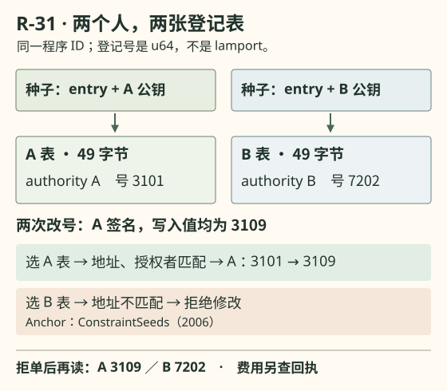

# 第 31 课 · A 签了字，为什么不能改 B 的登记号？

客服替 A 办设备改号。登记簿上，A 的表写着 3101，B 的表写着 7202。申请写「改为 3109」，签字人是 A，所选记录也是 A 的表。交班单该把谁的号改成什么？能因为这两张表归同一个登记程序管理，就把两张都改了吗？

**只改 A 表。** 签字人和表内有权改号的人是同一个 A；程序还按 A 的公钥算出了所选表的地址。处理成功后，读回两张表，应是 **3109 / 7202**。登记号不是金额；交易签名只是查这次申请的线索，不是改号成功的证明。

现在 A 再签同样的 3109，只把所选记录换成 B 表。B 会变成 3109 吗？不会。A 的签名仍有效，但 B 表不是按 A 的公钥算出的那张，程序拒绝；两表仍是 **3109 / 7202**。拒绝改号与收取处理这笔交易的费用并不冲突。

只想学会审表，可以转到[第 32 课：交接代币收条时怎样认对账户](spl-delivery.html)。以下选做本地实验，用两个随机测试用户和全新回环节点。读回登记号用[第 29 课的字节布局](rust-order.html)，分开看签字人与付费人用[第 30 课的交易账户表](solana-payment.html)。数据并不像[第 14 课的托管状态](escrow.html)那样都在一份合约里。

## 不在程序里找表：给每个人的状态一个地址

把登记服务想成一个 Java 方法 `revise(currentUser, rowId, newTicket)`。验证登录只能回答「是谁」，解析 `rowId` 只能回答「要改哪行」。两问都答对，还得确认它们指向**同一个人**。在 Solana 上，调用者把程序 ID、指令字节和一列账户一起放进交易；程序不能相信前端永远选对账户。可执行程序是一份共享代码，A、B 的数据分别存在两个不可执行的账户中。

这里选 **PDA（Program Derived Address，程序派生地址）**作主键：`Pubkey.find_program_address([b"entry", 用户公钥的32个原始字节], 程序ID)` 返回 `(地址, bump)`。`entry` 是本应用给登记表选的固定前缀，不是用户输入；公钥不是它的 Base58 显示文本。派生算法从 255 向下试一字节的 bump，取第一个使结果落在 Ed25519 曲线外的值。本程序只接受这样初始化的地址。程序 ID 和种子固定，客户端与程序就能独立定位同一张表；换用户公钥，得到另一个地址。**能算出地址，不等于账户已创建，更不等于能签字**。PDA 没有对应私钥，bump 也是公开的。

<figure class="lesson-figure"><a href="../assets/figures/m08/registry.svg"></a><figcaption>默认输入的预期对照。两次改号的业务参数与签字人相同；改变的是指令传入的目标表。图中的 A、B 是角色，实际公钥和 bump 看本轮清单。</figcaption></figure>

**不要把三种身份合并成一个 `owner`。** RPC 的 `account.owner` 是有权修改账户数据的**程序 ID**；本例两张表的 owner 相同。表内的 `entry.authority` 是该程序解释的业务字段，两张表的值不同。交易还有一个独立的 fee payer，本例由本地创世预充值账户代付交易费；它可以提供资金，不能因此替 A 批准改号。

## 写约束，再写那一行赋值

完整链上源码：[src/lib.rs](m08/registry/src/lib.rs)。`#[program]` 给它生成链上指令入口；`Context<Revise>` 不是用户传来的「可信对象」，而是 Anchor 按下面的声明从传入账户中验证、构造的上下文。请先读 `Revise`，再读方法体：

```rust
#[derive(Accounts)]
pub struct Revise<'info> {
    pub authority: Signer<'info>,
    #[account(mut, seeds = [b"entry", authority.key().as_ref()], bump = entry.bump,
              has_one = authority)]
    pub entry: Account<'info, Entry>,
}

pub fn revise(ctx: Context<Revise>, ticket: u64) -> Result<()> {
    ctx.accounts.entry.ticket = ticket;
    Ok(())
}
```

- `Signer<'info>` 要求这里的 `authority` 具有 signer 权限。本实验是钱包直接发起的顶层调用，运行时由交易签名建立该权限。填一个可显示的公钥字符串不能代替签名。
- `Account<'info, Entry>` 先校验账户归 `Entry::owner()` 所属；`#[account]` 为 `Entry` 绑定本程序 ID，再检查类型判别字节并反序列化。读到合法 `Entry` 只排除了「别的程序、别的类型」，还没排除**同程序的 B 表**。
- `seeds` 和已保存在表里的 `bump` 复算地址，并与实际传入的 `entry.key()` 比较。`has_one = authority` 另查表内 `entry.authority == authority.key()`。前一条把位置绑定到调用者；后一条把记录内容绑定到签字人。`bump` 由初始化代码写入，没有 API 能单改它或 `authority`。
- `mut` 既要求传入可写账户，也使 Anchor 在成功退出时把结果序列化回去。**writable 不是授权。** 这些条件都通过才会执行 `entry.ticket = ticket`；本指令没有转 SOL，也不新建表。

初次登记不走 `revise`。`Register` 声明 `init, payer = authority, space = Entry::DISCRIMINATOR.len() + Entry::INIT_SPACE, seeds = […], bump`，并要求 `system_program: Program<'info, System>` 确认被调用的是系统程序。此处不从用户收 bump：Anchor 在初始化时求出规范值，`register` 用 `ctx.bumps.entry`、真实的 `authority.key()` 和传入的 `ticket` 填好新记录。`init` 是创建，不是「有则覆盖」。

**哪一步是 CPI（跨程序调用）？** 算出 A 表地址，并不会在账本里变出一张表。首次登记还要做三件事：A 的系统钱包为新表提供免租所需的 lamports，分出 49 字节空间，把能写这段数据的程序设为登记程序。负责创建账户的是 System Program，所以 `init` 让登记程序在同一笔交易内再调用它。

到 `register-A` 回执的调用日志里找 `invoke [1]` 和 `invoke [2]`：前者是登记程序，后者是它请来建表的系统程序，方括号表示深度，不是两笔交易的编号。A 已在外层签字；新表地址却没有私钥。登记程序在内层通过 `invoke_signed` 给出那组 seeds 和 bump，运行时用当前程序 ID 复算一致，才认这个 PDA 在该次调用的签字权限。它不因此拿到 A 的私钥，也不能把只读账户变成可写。以后 `revise` 只需修改已有表，不必再请系统程序创建账户。

## 没有 IDL，客户端如何知道该传什么？

本课固定 [Cargo.toml](m08/registry/Cargo.toml) 与 [Cargo.lock](m08/registry/Cargo.lock)，不用 Anchor CLI 生成 IDL（接口描述）或 TypeScript 绑定，而在 [run.py](m08/registry/run.py) 里写出两条小指令的实际协议。如果日后更改字段类型、顺序、名称或判别值，必须同步升级读写端；不能把这一页的布局当成所有 Anchor 程序通用的 ABI。

| 指令 | 指令数据，均为 16 字节 | 指令账户顺序（与交易全局公钥表顺序不同） |
| --- | --- | --- |
| `register(ticket)` | `SHA256("global:register")` 的前 8 字节 + `u64` 小端 | `authority` 签字、可写；`entry` 不签、可写；System Program 不签、只读 |
| `revise(ticket)` | `SHA256("global:revise")` 的前 8 字节 + `u64` 小端 | `authority` 签字、只读；`entry` 不签、可写 |

这里 `SHA256` 的输入是引号内的 ASCII 字节，不含引号和换行。举例：3109 是 `0x0c25`；完整 `revise(3109)` 是 `d0a61da7e846b199` 接 `250c000000000000`。两次改号的这 **16 个字节完全一样**；真正的差异在账户列表。测试 fee payer 在交易层签字并可写，不是 `Revise` 的第三个账户。读 JSON 回执时，经 `message.instructions[0].accounts` 中的下标回查 `message.accountKeys`，不要把下标当公钥。

| `Entry` 账户数据，左闭右开 | 字节数 | 本课解码 |
| --- | ---: | --- |
| `[0,8)` | 8 | 默认类型判别值：`SHA256("account:Entry")[:8]`，即 `3f129871d7f6ddfa` |
| `[8,40)` | 32 | 有权改号的钱包公钥原始字节 |
| `[40,48)` | 8 | 登记号 `u64`，低位在前；不是 Java `ByteBuffer` 的默认字节序 |
| `[48,49)` | 1 | 初始化时的规范 bump，范围 `u8` |

共 **49 字节**。这是 Anchor 默认判别值加 Borsh 数据布局，不是 `size_of::<Entry>()` 的机器内存布局；RPC 另报的 owner、可执行标志和 lamport 余额不在这 49 字节里。客户端先按 owner、类型、长度判定能否读，再检查授权者、编号、bump；只取偏移 40 的一个整数不足以给客户签收。

## 在新链完成登记、改号和拒单

从**仓库根目录**用 Bash 操作。准备 Rust（含 rustup / Cargo）、CPython 3.11；公共安装脚本提供 Agave **2.3.13** 和 `solders==0.26.0`。SBF 是供 Solana 运行时执行的程序格式；主机上的普通 `cargo build` 不是链上目标编译。以下固定 `cargo-build-sbf` 的 platform-tools **v1.48**（内含 Rust **1.84.1**），Anchor Rust crate **0.31.3**。首次安装工具、拉取 crate 和 SBF 工具包需要网络；工具及依赖缓存好后，实验不访问任何外网 RPC。

```bash
bash labs/m08/setup.sh
source labs/m08/env.sh
R=labs/m08/registry
WORK=$(mktemp -d)
(
  cd "$R" &&
  printf '%s  Cargo.lock\n' '1e35ac48a1b588dc4ee6764aa99d5e0057bf448774f43072908871fd4069cd15' | shasum -a 256 -c - &&
  bash build.sh
)
```

看到 `Cargo.lock: OK` 且编译成功才继续。[build.sh](m08/registry/build.sh) 把宿主 Rust 链接到课程缓存里的独立 `RUSTUP_HOME`，再调 `cargo-build-sbf --tools-version v1.48 -- --locked`：Agave 会维护名为 `solana` 的工具链链接，不让它替换日常开发用的同名链接。首次编译仍会下载目标编译器、crate 和 SDK 的辅助工具。**完整跑过一次后**，可从仓库根目录用 `CARGO_NET_OFFLINE=true bash labs/m08/registry/build.sh --offline` 复编。不要把 `target/deploy/` 内工具生成的 keypair 当作钱包或打包；交接源码、锁文件和制品摘要即可。

```bash
shasum -a 256 "$R/target/deploy/course_registry.so"
python "$R/run.py" --out "$WORK/default"
```

`run.py` 把刚编出的 `.so` 用固定程序 ID `841hPEnHjRQ7bn4tm6Lk6whxMtt5dCfbJL2Hf5QA6XKv` **在创世预载**，然后才注册 A 和 B。三个地方须指向同一 ID：Rust 的 `declare_id!`、客户端寻址和指令的 ID、节点预载时分配的地址。创世配置用 upgradeable loader 但不留升级权限；**预载不是提交 `program deploy` 交易**，所以没有可交付的「部署签名」。常规可升级部署另外涉及 ProgramData、上传与部署交易、升级权限的保管与核验。这里只记录本机使用的制品摘要、程序 ID、创世哈希与随后真实执行的业务交易；本机制品的 SHA-256 也不是一次独立的链上代码审计。

客户端按以下顺序运行，可用 [run.py](m08/registry/run.py) 对照：

1. `fund` 先向两个新钱包各转入「0 字节系统钱包的免租下限 + 49 字节登记表的免租下限」，数值用本节点 RPC 查，不按公网页面的费率估算。这样钱包花掉建表款后仍可留存。`register-A` 和 `register-B` 分别由对应的钱包签字，另有 fee payer 付交易费；两张登记表的账户余额不是「交易费」。
2. 在 `registered.json` 里，`getMultipleAccounts` 一次按 `[A表,B表]` 读同一节点视图。`read_pair` 核对拥有程序、49 字节布局与字段，预期得到 **3101 / 7202**。随后 A 正常改自己的记录；在 `before-refusal.json` 应为 **3109 / 7202**。
3. 最后用相同的 `authority`、相同 `ticket` 组 `revise`，只把指令目标换成另一张**有效的登记表**。为了拿到教学用的确认失败回执，这一次用 `skip_preflight=True` 跳过 RPC 发送前模拟；它不跳过链上验签、权限检查或程序执行。Anchor 0.31.3 在本组合先报种子约束 `ConstraintSeeds`（2006），不表示每条约束都各报了一次。一般产品应保留预检，明确区分「预检拦下、无已确认交易」与「已确认执行失败」。
4. 脚本保存 `refused.json` 的完整 `getTransaction` 结果，再用 `confirmed` 与 `minContextSlot=拒单所在slot` 读取两张表（这是**读数的 slot 下限**，不是锁定到某个历史 slot），写成 `after-refusal.json`。比对前后 `value` 数组，要求两张表的原始账户记录均未改变。拒单的 `meta.fee` 为正，且等于代付者在该回执的余额减少；所以不能说「整条链什么都没变」。

默认运行的**预期判据**如下，签名、slot、bump、摘要与本轮费用从文件读，不拿另一轮的值填空：

```text
registered       A=3101 B=7202
before-refusal   A=3109 B=7202
refused          err={'InstructionError': [0, {'Custom': 2006}]}
after-refusal    A=3109 B=7202
REFUSED          unchanged=2
```

`--out` 指定一个尚不存在的子目录；成功结束时节点关闭，目录内留下 `manifest.json`、5 份交易结果和 3 次两表快照，没有用户私钥。**签名仅在这条链上可查**；不要把它发到主网浏览器，也不要用新建节点「复核」旧签名。接手人可以在断网时用下面的命令复核原件，不靠终端最后一行作判断：

```bash
python - "$WORK/default" <<'PY'
import base64, json, sys
from pathlib import Path
p = Path(sys.argv[1]); load = lambda stem: json.loads((p / (stem + '.json')).read_text())
m = load('manifest'); t = load('refused'); msg = t['transaction']['message']
ix = msg['instructions'][0]; keys = msg['accountKeys']
print('genesis', m['genesisHash'], 'registry', keys[ix['programIdIndex']])
print('authority and entry', [keys[i] for i in ix['accounts']])
print('signature', t['transaction']['signatures'][0], 'slot', t['slot'], 'fee', t['meta']['fee'])
print('error', t['meta']['err'], *t['meta']['logMessages'], sep='\n')
a, b = load('before-refusal'), load('after-refusal')
print('same accounts', a['value'] == b['value'], 'slots', a['context']['slot'], b['context']['slot'])
for label, account in zip(m['snapshotOrder'], b['value']):
    raw = base64.b64decode(account['data'][0]); field = raw[40:48]
    print(label, account['owner'], len(raw), field.hex(), int.from_bytes(field, 'little'))
PY
```

在默认轮，打印的两个指令账户应对应 `manifest.json` 中 **A 的 authority、B 的 entry**，不是 A 自己的 entry；程序 ID 应与清单一致。`meta.err` 非空和相应日志说明这次已确认调用确实被拒，`same accounts True` 配合两张表的解码值才能回答「哪两条记录没变」。这是独占本地链且两次读数之间没有其他业务写入的受控实验；实际服务中两个任意时刻的账户快照不能单独证明某一笔历史交易的效果。

只练读账时，可用随课的[创世与地址清单](m08/evidence/registry/manifest.json)、[失败回执](m08/evidence/registry/refused.json)和[拒单后的双表快照](m08/evidence/registry/after-refusal.json)。把上面离线命令的首行改为 `python - labs/m08/evidence/registry <<'PY'`，即可对照同一轮原件；要练写入则必须重建自己的本地链。

## 独立作业：让 B 登记一个 JavaScript 会舍入的号

接手工单 R-31B：不是 A，是 **B** 要把自己的登记号换为 **9007199254740993**（`2^53+1`）。拒单工单要求证明不会串写 A 的表。先写下两次改号应该传的两个公钥角色，再开一条不同的本地链：

```bash
python "$R/run.py" --actor B --ticket 9007199254740993 --out "$WORK/actor-b"
```

只交可公开的证据：这一轮 `manifest.json` 中的程序 ID、制品摘要、创世哈希、B 的授权公钥和两张 PDA；`revise.json` 与 `refused.json` 各自的第一签名、slot、指令账户下标展开和 `meta.err`；拒单前后两份账户快照。把上面的离线读数命令首行换为 `python - "$WORK/actor-b"`，不用启动第二个节点或把原签名重发。

**答案判据：**正常调用是 B 签、选 B 表，`meta.err=null`；拒单是 B 签、选 A 表，返回 2006。A 前后都是 3101；B 改号后和拒单后的 `[40,48)` 均为 `0100000000002000`，小端无符号解得 **9007199254740993**，不是 9007199254740992。不要让 JS `Number` 或 Java `double` 做编号中转；按字节或十进制文本传递。A、B 的 RPC owner 应相同、authority 应不同；只能找到收费扣款或一条成功签名，没有两个地址和原始账户对照，不算过关。

## 官方资料

- [Solana：PDA 派生与规范 bump](https://solana.com/docs/core/pda/pda-derivation)、[跨程序调用与权限传递](https://solana.com/docs/core/cpi)：分开理解位置、外层签名和内层 PDA signer。
- [Anchor 账户约束](https://www.anchor-lang.com/docs/references/account-constraints)、[账户空间](https://www.anchor-lang.com/docs/references/space)、[0.31.3 的约束展开源码](https://github.com/otter-sec/anchor/blob/v0.31.3/lang/syn/src/codegen/accounts/constraints.rs)：本例为何在赋值前报种子错误、为何需要 49 字节。
- [Solana：getMultipleAccounts](https://solana.com/docs/rpc/http/getmultipleaccounts)、[程序部署与升级权限](https://solana.com/docs/programs/deploying)、[platform-tools v1.48](https://github.com/anza-xyz/platform-tools/releases/tag/v1.48)：核对快照语义、部署边界和目标工具链。
