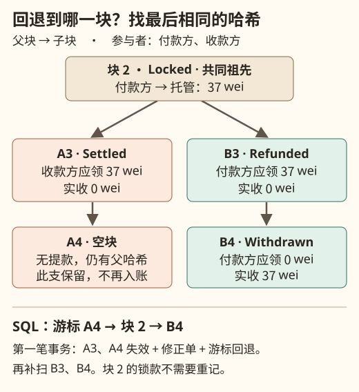

# 第 19 课 · 重组与事务：昨天应领的 37 wei，今天该算给谁？

客服要回答：昨晚显示的 37 wei，收款人今天还能领吗？昨晚的第 3 块写着「结算给收款人」。今天节点给出的第 3 块编号相同，指纹（块哈希）却不同，写的是「退款给付款人」；紧接的第 4 块还记着「付款人已提走 37 wei」。两套记录都接在同一次锁款之后。客服该按哪套作答，旧回执还留不留？

**收款人现在可领 0；付款人已从托管领走 37 wei。** 同一页码放不下两页不同的账，今天从链头沿父块指纹往回找到的是退款那一页，不是旧结算页。这种已采用的区块被另一支替换的现象叫重组。留下旧回执说明昨晚为何那样答，但不让它参与今天的合计。37 是合约付出的金额，不能断言付款人的钱包净增了 37：他还可能付过交易费。

只改一件事：新支仍已退款，但付款人**没有调用提款**。如果翻遍这段新账只看到退款，没有提款，现在谁收到钱？付款人应领 37、实收 0，收款人仍应领 0。退款在这份合约里是改应领人，不是把钱送到钱包。

只想读懂客服怎么答，可以转到[第 20 课：怎样用当前账本核对订单](reconciliation.html)。以下选做本地换支实验：用[第 12 课的块哈希](receipts.html)认回执，按[第 14 课的托管规则](escrow.html)读金额，再把[第 16 课的部署清单](deployment.html)和[第 18 课保存的扫描位置](indexing.html)对起来。[Recover.java](m05/src/main/java/course/m05/Recover.java)修的是 PostgreSQL 对[单笔托管](m04/src/MilestoneEscrow.sol)的解释，不是节点的历史。

## 一张共同的锁款凭条，两种互斥的后续

付款方在块 2 锁入 37 wei，合约收钱，此时双方的 `credit` 都是零。给这一刻留一份本地开发链快照。走 A 支：截止前由付款方调用 `settle()`，合约把 37 写入收款方的 `credit`；再挖一个没有交易的块。收款方还没调用 `withdraw()`，所以没收到转账。让索引器扫完并退出，数据库游标停在 A4。

**只把 Anvil 还原到块 2，不还原数据库。** 让下一块的时间戳等于合约的 `deadline`，付款方调用 `refund()`。第 14 课的条件是 `timestamp < deadline` 才能结算，`timestamp >= deadline` 即可退款，故 B3 把 37 写入**付款方**的 `credit`。如果付款方再调用 `withdraw()`，B4 中合约清零这笔应领、向调用者转 37，转账成功才发出 `Withdrawn`。这里的「实收」专指**该托管向受益人转出的毛额**，不含交易费，不是 EOA 原生币余额的净增幅。

<figure class="lesson-figure"><a href="../assets/figures/m05/reorg.svg"></a><figcaption>A3 与 B3 是两个块哈希的简写，不是同一块里先结算再退款。这份单笔状态机不允许那个顺序。箭头从父块指向子块，金额单位都是 wei。</figcaption></figure>

这是开发节点的快照演练，不是模拟公网节点如何投票选链。我们只复现索引器必须处理的**可观察结果**：按高度读出的规范块变了，旧的 SQL 事实还在。没有模拟真实网络传播、最终性违规或链下打款。

## 重启时，为什么不能只查游标的下一块？

把区块高度当 Kafka offset，会写出这样的恢复逻辑：`next = storedHeight + 1`。本例旧头、新头都是 4，`next=5`，程序甚至不发取块请求就报告「已追平」。但第 4 块的哈希变了，旧收款方会一直被显示为有款可提。多等几个块只能改变接受风险的策略，不替代哈希核对；只盯着通知中的 `removed` 标记也救不了断线期间漏掉的变化。

[第 18 课的扫描器](m05/src/main/java/course/m05/Scan.java) 在续扫前核对游标哈希，扫新区间时要求**新块的 `parentHash` 等于上一块的 `hash`**。不相等，宁停不跳。本课为这个停点加一条恢复路径：

1. **锁游标，认部署。** `SELECT … FROM scan_cursor WHERE id=1 FOR UPDATE` 放在关闭自动提交之后。把受信清单中的链号、合约地址、部署高度和完整块哈希同游标比对；再按**高度**从节点核对部署哈希，核对库中规范部署块。只凭 31337 或同一个地址不能恢复。如果当前节点根本不是那次部署，停止，不把旧账改成「零」。空库没有行可锁，交给 `Scan` 建立经核对的起点；实验只有一个索引写进程，不用空行锁充当多主选举。
2. **沿两个父链向后对齐。** 起点高度取 `min(旧游标高度, 节点头高度)`。旧侧从游标哈希反查本地规范头，向下每一步要求 `旧孩子.parentHash == 当前库中父块.hash`；新侧按高度逐块取规范头，也要求父子哈希连得上。A4 对 B4：不等；A3 对 B3：不等；两边的块 2 哈希相等。哈希承诺了父块，故这是两条已核对路径上**最高的共同祖先**，而不是猜测「通常回两块就够」。没有日志的 A4 仍是路径的一环，所以不能只存有事件的高度。
3. **辨别短头和错支。** 若 B 只到 3，节点没有第 4 块本身并不能证明 A4 失效；B3 与 A3 哈希不同才是冲突证据。若较短节点只有与旧链一致的前缀，程序拒绝倒带：先等节点追平或核查节点同步。若祖先走查遇到 RPC 错误、父哈希断裂、部署锚断裂，同样停下。数据库行锁不能冻结以太坊节点，所以写库前还要按高度复读本轮新侧比较起点的哈希；此后链若再变，下次扫描仍须重新核对。

本例按分歧深度线性访问块头，不从创世重扫。行锁会一直持有到事务结束；这适用于本机单写、短分叉教学，不是高延迟多节点索引器的吞吐设计。生产中应有重组深度与耗时告警、超界暂停并人工核验，而不是遇到不认识的部署就自动重置数据库。

## 一次提交管哪三项？

看 `Recover.repair` 中相邻的三条 SQL。先把 `chain_block` 中祖先之后、原先 `canonical=true` 的块置为 `false`；受影响行数必须等于 `旧高度−祖先高度`。再写 `reorg_audit`，记录本次链与合约、旧游标、节点观察到的比较点、共同祖先（均含高度与哈希）、失效块数及时间。最后让同一行 `scan_cursor` 回到祖先。**这三项在同一个 JDBC 事务中提交；任一失败，都回滚。** 修正单是索引器观察到换支的证据，不是一笔链上退款；真正的 `Refunded` 只能来自规范链上的合约日志。

旧块的 `escrow_log` 一行不删，保留 `(chain_id, block_hash, tx_hash, log_index)` 原位置。`canonical_log` 是与规范块的连接视图，不是第二份需要手工冲销的余额表。查询在修正提交之前仍看到 A4；提交之后、补扫之前，看到的是**只确认到块 2 的投影**，不能向客服宣传「已到最新」。`Recover` 释放锁后才调用 `Scan`，由后者按页把 B 支的区块、日志和前移的游标同批提交。两阶段故意留有可重启的存档点。

| 中断位置 | 下一进程应该看见什么 | 不该发生什么 |
| --- | --- | --- |
| 三项修正均已执行，但 SQL 尚未提交 | 重新读仍是 A4，两条 A 支规范事件，修正单 0 张 | 部分 A 块失效，游标却留在 A4 |
| 修正已提交，B3 尚未补扫 | 游标在块 2，只有 `Locked` 计入，修正单 1 张 | 用 B 的最新高度给这份旧投影盖「已追平」章 |
| B 支已经补齐，重复投喂 3 至头 | B 支事实、金额、修正单均不变 | 为同一退款发两条入账或再造一张修正单 |

如果根据 A 支的未最终结果已经发了邮件，收件箱不会随 SQL 事务回滚；更不能声称把真实链下打款撤回了。保留当时的证据，按业务确认策略处理纠正通知或人工核对。后续看[第 20 课：订单对账与运维](reconciliation.html)。

## 只在本机做一次真实换支

从**仓库根目录**运行。需要 Python 3.11、JDK 21、Maven 3.9、web3j 4.12.3（[Maven 工程](m05/pom.xml)）、Docker/PostgreSQL 17.5、`lsof` 及[第 13 课的 Foundry 1.7.1 / solc 0.8.28](abi.html#m04-tools)。依赖与镜像提前准备好即可离线做实验。端口 `127.0.0.1:18556` 必须空闲；先退出你自己前一课的 `--hold`，不要复用或终止别人的节点。

```bash
export PATH="${XDG_CACHE_HOME:-$HOME/.cache}/chain-course/m04/bin:$PATH"
export FOUNDRY_SOLC="${XDG_CACHE_HOME:-$HOME/.cache}/chain-course/m04/bin/solc"
unset ANVIL
bash labs/m05/build.sh
# 仅当本卷专用临时 PostgreSQL 尚未启动时执行（已经在运行就跳过这一行）
bash labs/m05/db.sh start
WORK=$(mktemp -d)
python3 labs/m05/reorg_lab.py --out "$WORK/paid"
```

[实验驱动](m05/reorg_lab.py) 自己启动第 16 课的 `deployment.py --out … --hold`，只在该子进程成功交接之后发送上述三类业务调用及快照命令。两个账户是本轮的临时开发账户，不输入密钥。它新建一个随机命名的 `m05_fork…` 空库，运行[共享建表 SQL](m05/schema.sql)，为每个子进程明确设置 `M05_DB`、`M05_MANIFEST`；不清表、不覆盖你正在学的订单库。`--out` 必须是尚不存在的目录。留下的数据库名在 `database.txt`，进程退出时只关闭自己的 Anvil。

驱动在**不同 JVM** 中执行 `Recover`（空库认锚后扫 A）→ 换支 → `Recover --interrupt-before-commit`（写完三项后故意抛错）→ `Recover --rewind-only`（提交修正就退出）→ `Recover`（从祖先续扫 B）→ `Scan 3`、`Recover`（实际重放已有区间，再重启）。正常服务用的命令是 `bash labs/m05/run.sh Recover`；另外两个开关只用于演练。故意中断必须在 `interrupt.log` 中留下 `LAB_INTERRUPT_BEFORE_COMMIT` 并以非零码退出，端口或依赖错误不能冒充回滚成功。

下面是**默认输入的预期对照**，不是固定回执。`live` 是参与核算的事件数；`raw` 是所有分支的原始事件数。每个角色后的两个数依次是「尚可领 / 从这份合约累计实收」，单位都是 wei。

```text
A height=4 live=2 raw=2 payee=37/0 payer=0/0 audit=0
rolled-back height=4 live=2 raw=2 payee=37/0 payer=0/0 audit=0
REWIND old=4 ancestor=2 observed=4 orphanBlocks=2
ancestor height=2 live=1 raw=2 payee=0/0 payer=0/0 audit=1
B height=4 live=3 raw=4 payee=0/0 payer=0/37 audit=1
replayed height=4 live=3 raw=4 payee=0/0 payer=0/37 audit=1
```

不要只看退出码。用这些命令取回本轮**完整哈希**和修正单，数据库读取使用单条 SQL 的一致性快照：

```bash
cat "$WORK/paid/interrupt.log"
export M05_DB="$(cat "$WORK/paid/database.txt")"
bash labs/m05/db.sh sql < labs/m05/reorg-evidence.sql
python3 - "$WORK/paid" <<'PY'
import json, pathlib, sys
p = pathlib.Path(sys.argv[1]); get = lambda f: json.loads((p/f).read_text())
a, b, r = map(get, ('A.json', 'B.json', 'receipts.json')); j, = b['audit']
assert (j['old_hash'], j['ancestor_hash'], j['observed_hash']) == (a['hash'], r['lock']['blockHash'], b['hash'])
print(' A3', r['A-settle']['blockHash'], '\n B3', r['B-refund']['blockHash'])
print('修正单', j, '\n当前按角色的账', b['balances'])
assert a == get('rolled-back.json') and b == get('replayed.json')
PY
```

[核账查询](m05/reorg-evidence.sql)里的关键不是 `sum(amount_wei)`，而是**只对本链、本合约的 `canonical_log`，按受益地址和事件含义求和**：

```sql
sum(CASE WHEN l.kind IN ('Settled','Refunded') THEN l.amount_wei
         WHEN l.kind='Withdrawn' THEN -l.amount_wei ELSE 0 END) AS credit_wei,
sum(CASE WHEN l.kind='Withdrawn' THEN l.amount_wei ELSE 0 END) AS received_wei
```

拿 B 支三条日志走一遍：`Locked(37)` 只说谁出资，未产生应领；`Refunded(37)` 给付款人的应领加 37；同一受益人的 `Withdrawn(37)` 再从应领扣 37，给实收加 37。因此 B 行的 `payer=0/37` 不是「没有退款」。若把 A 支那条 `Settled(37)` 也送进求和，就会凭空多出收款人的 37。原始表用来列全地址，金额只取规范事件；左连接才让原收款人的两列明确显示为 0，而不是整个人从报表消失。

SQL 用精确整数 `numeric` 求和，跨 JSON 边界把金额转为十进制字符串。驱动还对 A、B 各自的块哈希用 `eth_call` 校验合约 `credit(address)`，防止 SQL 算对了事件条数却算错受益人。

## 独立作业：让新支比旧支短一块，再判一次实收

同事说「退款已经成功，付款方钱包就一定收到了」。另开同一套实验，改为 **9,007,199,254,740,993 wei**，B 支在 `refund()` 后停下，**不提现**。先不看输出，写下你认定的共同祖先、退款后的两个金额以及应该留下几张修正单，再执行：

```bash
python3 labs/m05/reorg_lab.py --wei 9007199254740993 --leave-credit --out "$WORK/unclaimed"
cat "$WORK/unclaimed/ancestor.json" "$WORK/unclaimed/B.json"
```

**交回判据：** A 游标是 4，新头只有 3；提供 A3 与 B3 两个不同的完整哈希和相同的块 2 父哈希（查两行 `blocks.parent_hash`），而不是用「少了一块」代替证据。修正单应写 `old_height=4, observed_height=3, ancestor_height=2, orphan_blocks=2`；B 的规范事件只有 `Locked`、`Refunded`，原始表另留旧 `Settled`，没有 `Withdrawn`。故付款方仍应领 **9007199254740993**、实收 **0**，收款方两项皆 **0**；二次重放后修正单仍只有一张。若末位变成 2，检查金额有没有走 `double`；若实收非零，检查把哪种事件误当成了出款。`B.json`、`replayed.json`、`receipts.json` 和本轮部署清单是可交接证据。

实验结束后由专用库的使用者决定何时归档、停止。`bash labs/m05/db.sh stop` 会清除**整个临时集群**，不是只清本课的随机库；其他课仍在用时不要调用。保存了 JSON 可以离线复算，不表示能重启原来的内存链。

## 查证原文

- [Anvil 1.7.1 的 RPC 定义与参数用例](https://github.com/foundry-rs/foundry/blob/v1.7.1/crates/anvil/core/src/eth/mod.rs)：`evm_snapshot`、`evm_revert`、`evm_setNextBlockTimestamp` 是开发节点控制历史和时间的接口，不是公网共识操作。
- [EIP-1898：按块哈希读取状态](https://eips.ethereum.org/EIPS/eip-1898)：支撑 `eth_call` 的 `blockHash`、`requireCanonical` 选择；不赋予 SQL 或未来区块最终性。
- [PostgreSQL 17：事务的原子可见性](https://www.postgresql.org/docs/17/tutorial-transactions.html)与[行级锁](https://www.postgresql.org/docs/17/explicit-locking.html#LOCKING-ROWS)：`FOR UPDATE` 约束同一数据库行的写者，不是分布式节点锁。
