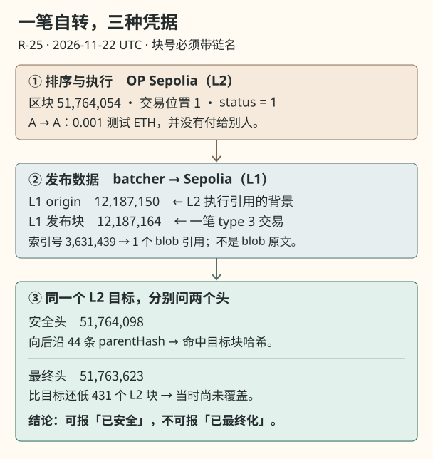

# 第 25 课 · 回执已经成功，哪一层还没确认？

值班员要给 R-25 填两格：「第二层已执行」「这次记账已最终确定」。在练习网 OP Sepolia，**0.001 测试 ETH** 的成功回执写着第 **51,764,054** 块；查第一层的发布记录，还能从索引找到装有这一段交易数据的批次 **3,631,439**。但当时节点报告已最终确定的第二层账本只到 **51,763,623**。两格都能勾吗？

只勾第一格。把回执对回执行块，就知道确实执行过；批次是大家可以据以重建这段账本的**数据出处**，不是最终确认书。第二格的界线比执行块还早 **431 块**，没到这笔。即使这条记录以后最终确定，也不能替商户核销：原交易的发、收地址是同一个，这是自转。

**只抽走最终位置那一页。** 回执和批次还在，现在该填「当时尚未最终确定」还是「不知道当时是否最终确定」？填后者。原件里有个明确落后 431 块的位置；缺了它，不能再用执行成功或批次号替代这项判断。

只阅读可[去第 26 课看一次第二层操作该怎样核费](l2-fees.html)。以下是选做取证：先离线对读两层账本的归档，再决定是否用公开测试网更新观察。

先修：[12 · 回执与最终性](receipts.html)、[17 · RPC 与块锚点](rpc.html)、[19 · 规范分支与重组](reorg.html)。默认实验是公开测试网**既有记录**的离线重放：不用钱包、节点余额或 API key，不生成签名，不发交易。只讨论配置为使用以太坊数据可用性的 OP Sepolia（L2 链号 **11155420**），其父链是 Ethereum Sepolia（L1 链号 **11155111**）。不要在两个 RPC 上用同一个块高指代同一件事。

## 先沿一笔交易找三张凭条

第一张是**执行回执**。排序器从用户交易中选取并决定先后，执行节点按这个顺序运行 EVM，得到区块、状态和回执。交易哈希只标识交易本身；回执的 `blockHash` 才标识这次执行所处的块。分支改变时，同一笔交易可以消失、被重收，甚至因为前置状态变了而得到不同结果。拿到一个成功回执，比拿到「提交成功」强，但不是 L1 的收据。

第二张是**数据发布记录**。在本例，batcher 将有序交易的编码压缩为 channel，用一个或多个 frame 传给 L1 的 batch inbox。一般一个 channel 可以跨多笔 L1 交易；一个用户哈希不对应一张专属 L1 收条。以太坊承载的是其他人重建 L2 所需的数据，不是在 L1 上替用户再转 0.001 ETH。OP 可用 calldata，也可按网络升级规则用 blob；样本的 L1 交易确实是 **type 3**，拿它的 `input` 当作完整批次字节会读错地方。

第三张是**派生节点报告的头**。rollup 节点按规范遍历 L1，读取该链当时认可的 batcher 数据、存款和链配置，组合被接受的批次，把有序的执行输入交给 L2 执行引擎。这样第三方不用相信排序器自报的状态根，也能从共同前态重建结果。数据可用性（DA）回答的是「验证者能否取得重建所需的数据」，不是「链浏览器今天还能永久下载所有历史 blob」，更不是「这次业务执行成功」。一个 blob 的版本化哈希是对承诺的引用，不能把哈希解压成原始字节。

| 运营台的问题 | 该看的证据 | 证据的边界 |
| --- | --- | --- |
| 交易执行了吗？ | L2 回执状态，执行块高与哈希，以及该块对应交易位置 | `status=1` 不证明安全头覆盖，更不自动匹配商户与金额 |
| 能离开排序器的承诺来判断顺序吗？ | 核对一条 L1 发布记录与目标块的关联；L2 节点报告的 `safe` 头在同一分支上覆盖目标 | `safe` 表示这条链可由节点已认定的规范 L1 输入派生；L1 尚可能重组。转给 inbox 的任意交易都不是自动有效批次 |
| 排序与执行结果在什么假设下最终化？ | `finalized` L2 分支覆盖目标，建立它所需的 L1 输入已经最终化 | 依赖父链共识、正确实现与读取渠道；这不是桥合约已接受输出声明、目标地址收到提现的证据 |

`latest` 通常给出节点当前的 unsafe 头，即它接受的最新完整 L2 块；不代表它以下的块全是 unsafe。`safe`、`finalized` 也是**头**，一个头覆盖自身和同分支祖先。仅比较高度可以**排除**覆盖（头比目标矮），不能**证明**覆盖（同高度可以有两条分支）。读数不一致时先核对链号和两个哈希，再沿 `parentHash` 回找，不要把 `latest − 目标 + 1` 当成 L1 最终性。

<figure class="lesson-figure"><a href="../assets/figures/m07/rollup.svg"></a><figcaption>R-25 的实际只读记录。向下读是在连接证据，不表示这是一笔从 L2 桥到 L1 的转账。图中结论只属于采样时段。</figcaption></figure>

## 两个 L1 块：一个给执行提供背景，一个装发布交易

打开[冻结的节点与索引字段](m07/rollup/observation.json)。数据来自 [OP Sepolia 交易](https://testnet-explorer.optimism.io/tx/0x73a8f37077852565f64ce046b2c18d936b7c42ba81761f2a265b784c7e394a94)、[该索引器的批次记录](https://testnet-explorer.optimism.io/api/v2/optimism/batches/3631439)和 [Sepolia 发布交易](https://sepolia.etherscan.io/tx/0x80f565aa84d031928fa21d23ef5ed266d08c73fa40b69c3176e44911f952531d)，并用两端执行 RPC 取块和回执。JSON 的 `sources` 与 `observedUtc` 标出来源及读取时段：L2 三个头是 **2026-11-22 07:01:21 UTC** 的观测，其余取数并非跨提供者的原子快照。它是从答复中保留的字段（含完整的 L2 回执），不是签名的 RPC 录音。

1. **定位 L2 执行。** `0x73a8f370…94` 的回执指向 `0xd449a099…9910`。按高度 `51,764,054` 另查规范块，哈希相同，该块交易数组下标 `1`（从零数起）正好是完整目标哈希。回执 `status=0x1`；原交易 `value=0x38d7ea4c68000`，换成十进制是 `1,000,000,000,000,000 wei = 0.001` 测试 ETH，`from == to`。这是一次自转，不是第三方收款；也不是证明净余额增加了这个数。
2. **找 L1 origin。** 每个 L2 块属于某个以 L1 块为来源的 epoch。对固定 L2 块哈希上的 `L1Block` 预部署读 `number()` 与 `hash()`，再查 L1 同高度的规范块，得到 **12,187,150**、`0x82ec9031…d8ea`。这是排序/执行所引用的 L1 背景，并不是「装有这个 L2 块的批次已经在这里发布」。L2 回执中的 `l1Fee` 也不是 L1 发布交易哈希。
3. **从索引线索走回 L1。** 对目标 L2 块，浏览器记录的块哈希相符，映射到索引号 **3,631,439**（浏览器编号，不是共识字段）。覆盖区间 `[51,763,984, 51,764,098]`，含两端，共 **115 个 L2 块**。索引列出一笔 L1 发布交易 `0x80f565aa…531d`。在 L1 取它的交易、回执和按号查的规范块，核对同一个块哈希、数组位置 `131`、`status=1`，才定位到发布块 **12,187,164**。它比 origin 高 **14 个 L1 块**；这个差不是固定延迟。
4. **核对发布身份和载体。** 此链的 inbox 是 `0xff00000000000000000000000000000011155420`；用该笔 L1 交易所在块哈希读 `SystemConfig.batcherHash()`，这个历史版本的 32 字节值左补零、右 20 字节等于实际 `from`。不要拿创世 batcher 地址或今天的配置代替当时的。此交易的 `blobVersionedHashes` 有一项 `0x01898f66…8e6d`，与索引记录同值。这里核实的是**索引关联 + 真实发布交易和引用 + 节点头**，不是自己拿 blob 重跑了 OP 派生。单看发布交易成功，也不能判断任意用户交易在其内容中。
5. **沿安全头倒数，不沿时钟猜。** 从 `51,764,098` 认出它的父哈希，再找那个块的父哈希；连续 **44 条**，恰好回到目标的完整块哈希。此时 `latest=51,764,170`，高出 `116`，含目标块计数已是 `117`；但 `finalized=51,763,623`，仍落后 `431`。另一个 RPC 给出的 L1 最终头是 **12,187,095**，也比发布块低 **69 个 L1 块**。这两次「不覆盖」都不能翻译成「再过 431 或 69 个块一定最终化」。

## 离线运行，分别扣掉一张凭据

工作目录为**仓库根目录**；用 CPython **3.11.8**（标准库）和 Bash，无安装依赖。断网可做本节和作业。程序只读归档，`--omit` 是故意让读端少看一类材料的教学对照，**不是**公网发生了重组、丢了 blob 或回退了终局。

```bash
R=labs/m07/rollup
WORK=$(mktemp -d)
python3 "$R/replay.py" > "$WORK/r25.txt" && cat "$WORK/r25.txt"
```

把回执的 `blockHash` 当成你要找的那一页。[replay.py](m07/rollup/replay.py) 先用 `check_inclusion` 核对交易在该块数组里的位置。再拿安全头来问「它认的是不是同一页」：`check_path` 的输入是从目标块到安全头的路径；每前进一步，既要高度加一，又要新块的 `parentHash` 等于刚核过的块哈希。**44 次逐项相等**，且最后的哈希就是节点报告的安全头，才有资格输出 `nodeReportsSafeCoverage=true`。只算两端高度相差 44，不足以排除另一条同高度的分支。`check_publication` 另核索引所指的 L1 发布交易；只适配本案的一笔发布交易、一个 blob，不是通用批次浏览器。默认输出节选：

```text
HEADS utc=2026-11-22T07:01:21+00:00 latest=51764170 safe=51764098
SAFE_PATH edges=44 nodeReportsSafeCoverage=true
FINALIZED_HEADS L2=51763623 L1=12187095
RESULT SAFE_NOT_FINAL_AT_SAMPLE
```

保留完整输出中的 L2 和 L1 两个块哈希以及 `LINK` 行。`independentBlobReplay=false` 很重要：即使两家服务的引用相同，脚本没有取 blob 原文、验证 KZG 包含关系、解 frame、解压 channel、在前态重执行或验证以太坊共识签名。它核对了已返回的数据，不把 RPC 变成轻客户端。若业务要求独立验证，使用按该网配置同步的 rollup 节点和可信的父链执行/共识数据源获取并验证 blob，再以完整派生与本地执行结果核对；远端标签应清楚标为谁的观测。

```bash
(
  for missing in publication parent finalized; do
    rc=0; python3 "$R/replay.py" --omit "$missing" > "$WORK/no-$missing.txt" || rc=$?
    cat "$WORK/no-$missing.txt"; test "$rc" -eq 3 || exit 1
  done
)
```

三份证据都保留原始执行回执。`HOLD PUBLICATION_MISSING` 时仍有节点的安全头和 44 条链接，**不能给出本台已核实的 L1 发布出处**；不是否认节点报告 safe。`HOLD SAFE_PATH_MISSING` 时即使高度看起来处于区间内，也不能把标签贴到这张回执上。`HOLD SAFE_FINALITY_UNKNOWN` 时已核对安全范围，但最终头材料被扣掉，最终性是**未知**，不能把「未知」改写成「已知尚未达到」。默认样本的「当时未达」与这次的「未知」不是同一种返回。错误链号、块中位置不符或父链链接断裂也应停报，不是执行失败。

还有一种更隐蔽的坏输入：**高度和条数一个也没少**，但有人把第一个子块的父哈希抄成了目标块的父哈希。只在临时副本做抄录错误演练，不制造另一条「真实历史」：

```bash
python3 - "$R/observation.json" "$WORK/wrong-parent.json" <<'PY'
import json, sys
with open(sys.argv[1]) as f: case = json.load(f)
case['pathToSafe'][0]['parentHash'] = case['numberedBlock']['parentHash']
with open(sys.argv[2], 'x') as f: json.dump(case, f)
PY
rc=0; python3 "$R/replay.py" --input "$WORK/wrong-parent.json" > "$WORK/fork-check.txt" || rc=$?
test "$rc" -eq 3 && grep 'HOLD SAFE_PATH_GAP_OR_FORK' "$WORK/fork-check.txt"
```

这份副本与原件的 `safe − 目标` 仍然都是 **44**。正确结论不是「已证明链重组」，而是「所交的链接不能证明该目标属于这个安全头」。这也是在 Java 的对账表里同时存 `blockNumber`、`blockHash` 和观察头哈希的理由。

## 可选：向公开测试网重新取证，不重发当事人的交易

有网络时，在同一 Bash 里运行以下**只读**命令；[lookup.py](m07/rollup/lookup.py) 从留档取两笔原交易的哈希，直接向各自的执行 RPC 取回执、核对入块位置、查询固定块状态。它不读本机钱包。标准输出逐行保留 URL、UTC、方法、参数和回复。两端 RPC 可以各自证实交易入块，**两笔之间的批次关联**仍来自索引记录，不是 RPC 返回了一个跨层外键。若还要重新向区块浏览器核对这一关联，另加 `--index`；索引器不接受请求时不会妨碍已经取回的两个原始回执。

```bash
PYTHONDONTWRITEBYTECODE=1 python3 "$R/lookup.py" > "$WORK/r25-now.jsonl"
python3 - "$WORK/r25-now.jsonl" <<'PY'
import json, sys
for line in open(sys.argv[1]):
    row = json.loads(line)
    if row['method'] == 'eth_getBlockByNumber':
        block = row['reply'].get('result')
        if block:
            print(row['utc'], row['url'], row['params'][0], int(block['number'],16), block['hash'])
PY
```

历史块可按固定哈希对读；今天请求 `finalized` 拿到的是**今天这个提供者的头**，不是替你重现归档时刻的最终头。公开节点可能限流、禁止固定块读取或裁剪历史。若脚本非零退出，保留已收到的行，结论写「查询未完成」；别用 0、`latest` 或任意同高度哈希填空。对新案，在每次观测留存三种 L2 头和父链最终头，用 `eth_getBlockByHash(当前.parentHash, false)` 从相关头回走，直到目标高度并逐跳验哈希；另取批次所需 L1 发布块到 L1 最终头的祖先关系。间隔很大时用自己的历史库/节点，不用公用 RPC 做无界扫链。`lookup.py` 不做这种长距离扫链，不会仅凭一个新的头号自动升级工单。

## L1 结算在裁定什么？哪些假设换链后要重写？

把「顺序和数据已锚定」与「L1 合约能否信这个状态声明」分开。OP 的普通 L2 节点可以从同一份数据执行同一套规则。L1 桥合约却不逐笔重跑所有 L2 EVM 交易；处理例如提现时，需要判断引用的 L2 输出是否可信。**Optimistic** 路径允许先提出状态声明；在协议限定的时间和规则内可以挑战错误声明，用故障证明裁决争议。安全性不仅依赖正确实现，还需要足够的数据、至少一个能发现问题并及时参与争议的诚实参与者、可用的 L1 和有效的挑战机制。谁能升级、暂停或替换合约，也是要按部署查的信任边界。挑战错误的输出不等于抹去已从最终 L1 数据派生的那笔 L2 交易。

**Validity rollup** 改的是接受状态转移的条件：L1 验证器检查密码学有效性证明，接受给定旧状态与公开输入确实按电路/程序转到了新状态，而非靠无人挑战来接受声明。安全假设转到证明系统的可靠性、正确的电路与验证器、可能的可信设置、数据发布与升级权限；证明生成/提交延迟会影响可用速度。「有有效性证明」不等于「用户立刻拿到了 L1 资产」，也不保证交易隐私。若数据只交给链下委员会，所依赖的 DA 假设已不同于这里的以太坊 DA rollup。

迁移到 Base 要重新核对链号、父链、数据载体、升级和安全模型；迁移到 **Arbitrum Nitro**，可沿用「排序器先给软确认 → 父链收录批次 → 子链状态声明的结算」这组问题，但要查该链的 SequencerInbox、batch poster、断言与挑战规则。不要照搬 OP 的 inbox 地址、blob 格式、`safe` 标签能力、块时间、费用公式或提现等待期。工具若只提供一个 `confirmed=true`，先问是哪层的确认、基于谁的证据，再接业务逻辑。

## 独立作业：拿到 blob 的承诺，够不够补上最终性？

值班同事没拿到 `finalized` 标签，却找到[另一个档案服务对同一 blob 的记录](m07/rollup/commitment.json)，其中 `commitment` 是 **48 字节 KZG 承诺**。请不依赖 `replay.py` 的判断，按 EIP-4844 的规则 `0x01 || SHA256(commitment)[1:]` 算出版本化哈希，然后把档案里的 L1 块哈希、交易哈希、交易位置和两端材料对上。最后给同事写一句能发给商户的答复。以下是可独立复核的计算，不需要 KZG 库：

```bash
python3 - "$R" <<'PY'
import hashlib, json, pathlib, sys
p = pathlib.Path(sys.argv[1]); blob = json.loads((p/'commitment.json').read_text())['result']
pub = json.loads((p/'observation.json').read_text())['publication']
c = bytes.fromhex(blob['commitment'][2:]); assert len(c) == 48
v = '0x01' + hashlib.sha256(c).digest()[1:].hex()
r = pub['receipt']; other = blob['transactions'][0]
print('versionedHash', v, 'archiveBytes', blob['size'])
assert v == blob['versionedHash'] == pub['transaction']['blobVersionedHashes'][0]
assert (other['txHash'], other['blockHash'], other['txIndex']) == (
    r['transactionHash'], r['blockHash'], int(r['transactionIndex'],16))
print('L1-reference matches; blob body and finality not verified by this calculation')
PY
```

**提交与判据：** 交这两行输出、`no-finalized.txt` 和一句话。版本化哈希须完整等于 **`0x01898f661747fa1b38a62576f3d447613fe76822c54b6917c0ee61d99fde8e6d`**，发布交易位置须为 **131**，档案的 `size=131072` 是 blob 字节数，不是这笔用户交易的大小。把承诺本身的 SHA-256 全串当作结果，首字节便不符合规则；把承诺和引用比对成功也不等于已经取得 131,072 字节原文并验证其 KZG 证明。足够的答复是：「可定位该自转的成功执行、节点的安全范围和发布引用；当前给我的材料没有最终头，不能断言已最终化，更不能据此给第三方商户入账。」

## 查证原文

- [OP Sepolia 网络信息](https://docs.optimism.io/op-mainnet/network-information/connecting-to-op)与[Superchain Registry 的 OP Sepolia 配置](https://github.com/ethereum-optimism/superchain-registry/blob/main/superchain/configs/sepolia/op.toml)：确认链号、inbox 与 SystemConfig 地址；历史授权 sender 要在指定块读取。
- [OP Stack 派生规范](https://specs.optimism.io/protocol/derivation.html)、[Ecotone 的 blob 检索规则](https://specs.optimism.io/protocol/ecotone/derivation.html)、[SystemConfig 与 batcher hash](https://specs.optimism.io/protocol/system-config.html)：什么输入有效，为什么 origin、发布交易、可派生状态不是同一项。
- [OP Stack 关于交易最终性的说明](https://docs.optimism.io/op-stack/transactions/transaction-finality)、[故障证明规范](https://specs.optimism.io/fault-proof/index.html)、[Arbitrum Nitro 的 finality](https://docs.arbitrum.io/how-arbitrum-works/deep-dives/finality)：分别核对数据与排序最终性和结算/提现，不套用预估分钟数。
- [EIP-4844：blob、KZG 承诺与版本化哈希](https://eips.ethereum.org/EIPS/eip-4844)、[Ethereum.org：validity rollup](https://ethereum.org/en/developers/docs/scaling/zk-rollups/)；作业原始出处是[独立 Blobscan 记录](https://api.sepolia.blobscan.com/blobs/0x01898f661747fa1b38a62576f3d447613fe76822c54b6917c0ee61d99fde8e6d)，不是协议证明本身。
