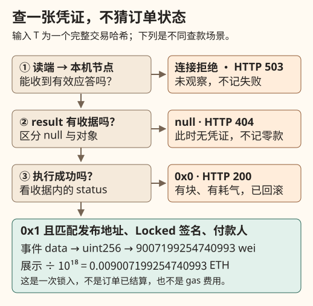

# 第 17 课 · 查一张回执：多出来的 1 wei 到哪儿去了？

客服单 R-17 写着：付款方锁了 **9,007,199,254,740,993 wei**，报表却少了 **1 wei**。同事递来交易哈希，说「接口返回 200，款肯定齐了」。你要交付的是一个只读接口：它能指出**哪一块的哪条凭证**给出了金额，也能明确回答「我现在没有凭证」。本机的这笔锁款应显示为 **0.009007199254740993 ETH**；交易执行成功、托管已锁款、收款人已提现，是三件不同的事。

先修：[12 · 回执与块锚点](receipts.html)、[13 · ABI 字节](abi.html)、[14 · 托管状态机](escrow.html)、[16 · 部署清单](deployment.html)。用[同一份合约](m04/src/MilestoneEscrow.sol)，不新造事件。本课不用数据库、浏览器钱包或任何密钥；写入只发生在你自己启动的临时 Anvil 上，Java 服务只读。

## 给客服的接口，不能是一层透明代理

约定 `GET /receipts/{hash}`。哈希是 `0x` 加 64 个十六进制字符（32 字节），不是订单号。请求者既不能传节点 URL，也不能自选 RPC 方法或合约地址。受信的第 16 课清单给出链号、部署块指纹、合约和付款人；小服务每次先核对链号和部署块哈希，再读指定交易。**返回的是此刻节点上的执行事实，不是放货决定。** 并行链查询没有数据库事务的快照保证；因此连成功答复也带块哈希，不缓存为永远有效的支付结果。

| 服务答复 | 读到了什么 | 可以怎样行动 |
| --- | --- | --- |
| `200 EXECUTED` | 回执 `status=0x1`。只有本部署的 `Locked` 日志匹配，才附 `lockedWei` | 可核对锁款金额；没有该字段表示这不是锁款凭证，不能补成 `0` |
| `200 REVERTED` | 找到了块、交易和 `status=0x0` 回执，执行未正常完成 | 保存失败凭证；交易仍花 gas。不要因为 HTTP 200 就登记付款，也不要根据状态位猜具体异常 |
| `404 NO_RECEIPT` | 节点正常回答了 **`result: null`** | 仅表示现在没有收据；可能未打包，也可能此节点根本不知道这笔交易。别承诺一定还在排队 |
| `502 RPC_ERROR` / `503 RPC_UNAVAILABLE` / `504 RPC_TIMEOUT` | 节点返回 JSON-RPC `error`，或连不上，或等不及 | 无法判断交易；记录方法、请求 ID 或故障时间，别把异常转换成 `Optional.empty()` |
| `429 RATE_LIMITED` | 本服务的读取配额用完，请求还没发给节点 | 依 `Retry-After` 放慢；它不证明节点拥堵。节点自身返回 HTTP 429 则是 `503 RPC_THROTTLED` |

<figure class="lesson-figure"><a href="../assets/figures/m05/rpc.svg"></a><figcaption>都是询问一笔交易。右边三种答复分别是「无法观察」「暂时无收据」「有失败收据」；三者都不提供锁款金额。</figcaption></figure>

## 从真实部署拿输入，不把示例哈希当凭证

从**仓库根目录**使用 Bash。环境：JDK 21、`PATH` 中的 Maven 3.9.x、Python 3.11、curl、lsof，以及[第 13 课安装的 Foundry 1.7.1 和 solc 0.8.28](abi.html#m04-tools)。共享 Maven 工程固定 web3j **4.12.3**；首次编译需联网下载依赖，缓存齐备后可 `bash labs/m05/build.sh -o`。编译时联网与查链时联网不同：两个实验端口都只绑定回环。确保 **18556** 和 **18117** 空闲，有冲突就停，不要改指别人的服务。

终端 A 新开一条内存链。`--settle-wei` 会在本次部署后实发 `lock` 和 `settle`，不提现。保留本轮打印的 **`ARCHIVE` 绝对路径**；看到 `HANDOFF ... state=2` 和等待提示后，暂时别按回车。

```bash
export PATH="${XDG_CACHE_HOME:-$HOME/.cache}/chain-course/m04/bin:$PATH"
export FOUNDRY_SOLC="${XDG_CACHE_HOME:-$HOME/.cache}/chain-course/m04/bin/solc"
unset ANVIL
WORK=$(mktemp -d)
python3 labs/m04/deployment.py --out "$WORK/release" --hold --settle-wei 9007199254740993
```

终端 B 也在根目录。清单是受信发布方交来的原件；归档里的 `receipts.json` 用来定位交易，**接下来读的是活节点，不是用归档冒充在线回答**。

```bash
printf '粘贴终端 A 打印的 ARCHIVE 绝对路径：'; IFS= read -r R
WORK=$(dirname "$R")
export M05_MANIFEST="$R/manifest.json"
bash labs/m05/build.sh
LOCK=$(python3 -c 'import json,sys; print(json.load(open(sys.argv[1]))["lock"]["transactionHash"])' "$R/receipts.json")
SETTLE=$(python3 -c 'import json,sys; print(json.load(open(sys.argv[1]))["settle"]["transactionHash"])' "$R/receipts.json")
bash labs/m05/run.sh ReceiptApi raw "$LOCK" > "$WORK/lock-wire.json"
python3 -m json.tool "$WORK/lock-wire.json"
```

### 第一次读：保留 JSON-RPC 的信封

打开[完整 Java 源码](m05/src/main/java/course/m05/ReceiptApi.java)，先读 `rpc()`，暂时不看 HTTP 路由。JDK `HttpClient` 向 `http://127.0.0.1:18556` 发 **HTTP POST**，请求体是 `{"jsonrpc":"2.0","id":1,"method":"eth_getTransactionReceipt","params":[T]}`，其中 `T` 表示带引号的实际哈希。这个 POST 是 RPC 传输方式，里面的**方法**是读；外层客服接口才是 GET。`raw` 模式打印节点应答的完整 JSON 字段，不把 web3j 类型转回 JSON 来充当原件。

对照三处：`id` 应与本次请求相同，它不等于交易哈希；`result.transactionHash` 应等于 `$LOCK`；`result.status` 应为 `0x1`，`blockNumber` 为 `0x2`。JSON-RPC 层 `error` 与 `result` 互斥，**HTTP 200 并不替它检查**。再看 `logs`：本例一个元素，`address` 是清单中托管地址，`topics[0]` 是 `Locked(address,uint256)` 的签名哈希，`topics[1]` 是左侧补零的付款地址。`data` 是完整的 32 字节字，去掉左侧填充后的金额是 `0x20000000000001`。注意 `gasUsed` 的单位是 **gas**，不是 wei；交易的 `value` 也不是回执字段，不能去回执顶层找它。

### 第二次读：把同一个回执变成有单位的 Java 值

在终端 B 启动服务。`run.sh` 最终 `exec java`，所以 `$!` 是稍后要停的那个进程。看到 `GET http://127.0.0.1:18117/receipts/{hash}` 再执行下一段；若报地址占用，不要向该端口发请求。

```bash
bash labs/m05/run.sh ReceiptApi &
API_PID=$!
BASE=http://127.0.0.1:18117/receipts
```

```bash
curl --noproxy '*' -fsS "$BASE/$LOCK" > "$WORK/lock-view.json"
python3 -m json.tool "$WORK/lock-view.json"
python3 - "$WORK/lock-wire.json" "$WORK/lock-view.json" <<'PY'
import json, sys
wire, view = (json.load(open(p)) for p in sys.argv[1:])
r = wire['result']; log, = r['logs']
assert r['transactionHash'] == view['transactionHash'] and r['blockHash'] == view['blockHash']
assert r['status'] == view['status'] == '0x1' and int(r['blockNumber'], 16) == int(view['blockNumber']) == 2
assert int(log['data'], 16) == int(view['lockedWei']) == 9007199254740993
assert view['lockedEth'] == '0.009007199254740993'
print('same receipt:', view['blockHash'], 'lockedWei:', view['lockedWei'])
PY
curl --noproxy '*' -sS "$BASE/$SETTLE"; printf '\n'
```

最后一行应同样是 `EXECUTED`，但属于**块 3**，**没有 `lockedWei`**。结算只是把已经锁入的款项登记为可领，不是又一次锁入。对同一个哈希重复 GET 也不应累加款项：这个接口根本不写业务表。

`lookup()` 的顺序值得照着数据读一遍：

1. 先检查 JSON-RPC 是否成功，再让 `result.isNull()` 单独走 `NO_RECEIPT`；只把真实对象交给 web3j 的 `TransactionReceipt`。`getBlockNumber()`、`getGasUsed()` 已从十六进制 quantity 变成 `BigInteger`，`getStatus()` 则保留字符串。对本卷 Cancun 链明确只接受 `0x0` 和 `0x1`，不把缺字段当成功。
2. `new TypeReference<Address>(true) {}` 标出 indexed 参数在 topic 里；`Uint256` 未 indexed，在 data 里。`EventEncoder.encode(LOCKED)` 算出 topic 0；这里只对指定发布地址、签名及付款人相符的一条锁款事件执行 `FunctionReturnDecoder.decode(...)`，不全链搜同名事件。合约直接部署、单笔锁定，因而不会返回两条可相加的 `Locked`。换 ABI 或换部署要重新核发布凭据，不能凭字段碰巧长成 32 字节沿用这个解释。
3. 解出的 `Uint256.getValue()` 是 `BigInteger wei`。**先用最小单位算，再展示**：`new BigDecimal(wei, 18).toPlainString()` 只是给整数加 18 位小数刻度，不做浮点除法。`2⁵³+1` 落在相邻两个可表示的 binary64 整数之间，转 `double` 会变成 `2⁵³`。因此 JSON 输出 `"lockedWei":"9007199254740993"`，而非要求浏览器用 `Number` 接住不安全的大整数。记录资金事实时保存 wei，不保存这个展示用 ETH 字符串。

数据库边界也要对称：Solidity `uint256` 的最大值是 `2²⁵⁶−1`（78 位十进制），不适合 `BIGINT` 的有符号 64 位上限。下一课表列用 PostgreSQL `NUMERIC(78,0)`；落库之前已是合法无符号整数，用 JDBC `setBigDecimal(i, new BigDecimal(wei))`，取回 `getBigDecimal("amount_wei").toBigIntegerExact()`。这个列型能容纳所有 `uint256`，但它本身**不**等于 `uint256` 范围校验，也不替你拒绝入参小数。来自文本的 wei 要先按约定的整数字串解析、校验范围；别依赖列的 scale 自动舍入。本课接口不连库也不拿数据库补回执。

## 给读端三种相似的报障，让它给出不同证据

先保持节点和服务都运行。下面的全零哈希只是查找对照，不代表提交过交易。紧接着从[单次提交脚本](m05/reverted_receipt.py)取得**另一笔**真实哈希：脚本复用第 16 课验清单、状态和付款人，只在自己的 `Settled` 实例上再调一次 `settle()`（携带 **0 wei**）。显式给 gas 上限，临时关自动挖块、先入池再挖一块，最后恢复自动挖块；否则预估 gas 就可能拒绝，根本没有失败回执。这段写端是演练夹具，**不是 Java API 的路由**。使用单独实验链，期间别运行其他课程写端。

```bash
ABSENT=$(printf '0x%064d' 0)
curl --noproxy '*' -sS -D "$WORK/absent.headers" -o "$WORK/absent.json" "$BASE/$ABSENT"
cat "$WORK/absent.headers" "$WORK/absent.json"; printf '\n'
BAD=$(python3 labs/m05/reverted_receipt.py) && printf 'failed tx=%s\n' "$BAD"
curl --noproxy '*' -sS -D "$WORK/revert.headers" -o "$WORK/revert.json" "$BASE/$BAD"
cat "$WORK/revert.headers" "$WORK/revert.json"; printf '\n'
```

预期：第一张是 **404 / `NO_RECEIPT`**；第二张是 **200 / `REVERTED`**，带 `$BAD`、真实块哈希、`status=0x0` 和非零 `gasUsed`，没有锁款金额。这份源码先检查 `state != Locked`，所以在本次已结算实例上第二次结算会失败；不能只凭 `status` 位给任意陌生交易还原原因。若看到的是 `400 BAD_REQUEST`，检查是否把空字符串或短哈希当成 `$BAD`；格式错误没有查询过链，不是实验通过。

再观察一种**有应答的下游错误**。直接询问自己的 **18556**，故意把回执方法的参数列表留空。它仍是只读方法，不用提交交易：

```bash
curl --noproxy '*' -sS -D "$WORK/rpc-error.headers" -o "$WORK/rpc-error.json" \
  -H 'Content-Type: application/json' \
  --data '{"jsonrpc":"2.0","id":17,"method":"eth_getTransactionReceipt","params":[]}' \
  http://127.0.0.1:18556
cat "$WORK/rpc-error.headers" "$WORK/rpc-error.json"; printf '\n'
```

找 `id: 17` 和 `error.code`，而不是 `result:null`。这是绕开适配层、直接了解节点协议的对照；对外 GET 会先挡住坏参数，不能把它说成服务端收到了同一张错误回执。`rpc()` 遇这样的信封会记录 RPC 错误码，向业务侧返回 `502 RPC_ERROR`，不解析收据。

最后回终端 A **按回车**关闭节点，**不要关闭 Java 服务**。回到终端 B，再用原先确定成功的 `$LOCK`：

```bash
sleep 1
curl --noproxy '*' -sS -D "$WORK/down.headers" -o "$WORK/down.json" "$BASE/$LOCK"
cat "$WORK/down.headers" "$WORK/down.json"; printf '\n'
kill "$API_PID"; wait "$API_PID" || :
```

此时应收到 **503 / `RPC_UNAVAILABLE`**，不是 404，更不是 `REVERTED`；这是 Java 服务对下游断线的回答。如果 curl 自己报连不上 **18117**，说明被停的是读端，没有测到该分支。归档和 `$WORK` 中的凭证仍可复核，不能据此声称临时链还在线。

## 读请求可以重试，读数不保证永远一样

`rpc()` 复用一个直连回环的 `HttpClient`，建连最多 1 秒；从发出单个 `sendAsync` 到收到完整响应体最多等 2 秒，超时取消这次等待。正常的一次 GET 顺序读链号、部署块、回执三次，下游等待预算相加约 6 秒，**不是整个 GET 只有 2 秒**。这一层不自动重试，避免 HTTP 客户端、网关、业务层各试三次，放大对同一节点的压力。本机服务每个一秒窗口最多放行 8 个合法 GET，超出回 `429` 并带 `Retry-After: 1`；这是单实例入口配额，不是全局精确 QPS。

如果由上层排任务，可以给同一哈希**最多两次额外只读尝试**，遇临时断连/超时则按 1 秒、2 秒加少量随机抖动退避，并设总截止时间；遇 429 尊重 `Retry-After`。`result:null` 若属于刚提交的已知交易，安排稍后重新观察原哈希；格式错、错链或不兼容 ABI 要修配置，失败回执要保存，不进入这种重试。`GET` 的幂等指不改链上/业务状态，不保证下一次查到相同块或相同结果。**不把只读策略套在发送交易上**：提交响应丢失不能证明交易没进池。

查单笔只需要一个哈希；若需求改成「从块 10 到块 210 找全部锁款」，别给每笔或每块触发一轮 HTTP 扇出。按地址与 topic 分段调用 `eth_getLogs`：如闭区间 `[10,109]`、`[110,209]`、`[210,210]`。超出节点范围/结果限制就缩小**同一段**，只有这段完整取回并持久化才推进；失败不能当成空段跳过。如何把分段与块游标绑在一起，是[第 18 课](indexing.html)的职责。

## 独立作业：能否凭一张结算凭证补写锁款？

另开一个全新 `WORK`，让终端 A 改用 `--settle-wei 9007199254740995`；终端 B 从新 `ARCHIVE` 取清单与哈希，重新启动读端，别让原先的断线服务复用旧清单。**先写预测，再查这次的 lock、settle 和本次部署交易三笔**。用本轮的 `lock-wire.json` 与 `lock-view.json` 独立复算（把前面断言中的金额和 ETH 展示值一并换为你的预测值）；用原始回执和读端答复组成三行表，列：`transactionHash / blockHash / status / 有无 lockedWei / 可回答的业务问题`。保留一次对错误短哈希的 `curl -i "$BASE/0x12"` 结果，结束后同样关闭两个进程。

**过关判据：** 部署在块 1，没有 `lockedWei`；块 2 锁入 **9007199254740995 wei = 0.009007199254740995 ETH**；块 3 结算成功却不能再记一笔锁款。三笔都能给出本轮不同的交易哈希和独立的块位置。短哈希返回 **400**，不是「没付」。能用 R-17 的线索解释少掉 1 wei 是哪种类型转换可能造成的，并用你自己的整数复算结果排除「少付」；不能仅凭这三次 HTTP 200 推断已提现、已最终化或可以交货。

## 查证原文

- [Ethereum Execution APIs：eth_getTransactionReceipt 的输入、收据、notFound 与 error](https://github.com/ethereum/execution-apis/blob/main/src/eth/transaction.yaml)；[EIP-658：回执状态码记录顶层调用成功或失败](https://eips.ethereum.org/EIPS/eip-658)。
- [Solidity 0.8.28 ABI 规范：Events](https://docs.soliditylang.org/en/v0.8.28/abi-spec.html#events)；[web3j 4.12.3 的 TransactionReceipt 字段与类型](https://github.com/LFDT-web3j/web3j/blob/v4.12.3/core/src/main/java/org/web3j/protocol/core/methods/response/TransactionReceipt.java)。
- [JSON-RPC 2.0：Response object](https://www.jsonrpc.org/specification#response_object)；[PostgreSQL：精确与不精确数值类型](https://www.postgresql.org/docs/current/datatype-numeric.html)。
