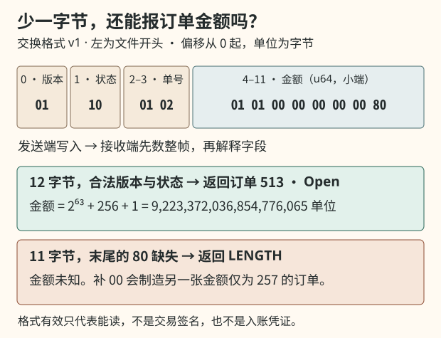

# 第 29 课 · 少一个字节，Rust 还能给订单报金额吗？

接单员收到了 **513 号订单**的文件。交接表明写整单 **12 字节**，实际收到 **11 字节**；前面的单号能读，报价末尾却少了一格。同事建议「补个零，就按 **257 个最小单位**报价」。光凭这份残件，能答应客户吗？

不能，先请对方重交完整原件。这里报价占八格，约定把分量最小的一格放在最前。现存的报价开头两格都是 1，分别值 1 和 256；其余收到的格是零。**257 只是擅自假定最后一格也为零的结果**，不是收到的报价。

**只补回原件确有的末字节 `80`（十六进制）。** 现在够 12 格，版本和状态也符合约定，还报 257 吗？最后这格是十进制 128，权重为 256 的七次方，它补回的是 2⁶³。完整报价为 **9,223,372,036,854,776,065** 个最小单位。能读出报价，不说明有人已付款或在链上提交过这张单。

只阅读可[去第 30 课看一张真正的付款凭据要查什么](solana-payment.html)。以下选做：让 Rust 对完整件报数，对同一份订单的残件只报错、不输出金额。

先修：[M01 · 签名绑定哪些字节](crypto.html)；做过 [M04 · ABI 与整数边界](abi.html)会更容易比较两种格式，但不是开工条件。本课只处理合成订单的本地文件，不需要钱包、密钥或 validator。这里的「单位」是两端为一种教学商品约定的计数单位，不是 SOL、lamport 或某种代币。

## 两个进程之间，传的不是一个 Rust 对象

用 Java 写服务时，方法的两个形参可以指向同一个订单实例。换到文件或网络边界，接收方没有那块内存，也不知道哪个字段在前；直接转储 Rust 结构体的内存还可能带上编译器选择的布局、填充和机器字节序。**序列化**是按约定把值写成一串字节；**反序列化**是先确认字节符合约定，再恢复有类型的值。这里约定一份文件恰好是一张记录，不是多条记录的拼接。

| 字节偏移（首尾均含） | 字段与类型 | v1 写入规则 | 513 号单，十六进制字节 |
| --- | --- | --- | --- |
| 0 | 版本，`u8` | 只接收 `0x01` | `01` |
| 1 | 状态，1 字节标签 | `0x10` 表示 Open（仍可受理），`0x20` 表示 Cancelled（已撤销） | `10` |
| 2–3 | 单号，`u16` | 无符号、小端 | `01 02` |
| 4–11 | 报价，`u64` | 无符号、小端，单位固定 | `01 01 00 00 00 00 00 80` |

小端指**权重最低的字节先放**，不是把一个字节里的比特左右倒过来。`01 02` 表示 `1 + 2 × 256 = 513`。报价的第 0、1、7 个字节非零，合计 `1 + 1 × 256 + 128 × 256⁷ = 2⁶³ + 257`。少掉最后的 `80`，就把权重最大的那个字节弄丢了；它原来是 `00`、`80` 还是别的值，无法从前 11 字节推出。已撤销的单仍可保留原报价；状态不是付款事实，也不把金额清零。

<figure class="lesson-figure"><a href="../assets/figures/m08/rust-order.svg"></a><figcaption>按本课 v1 格式计算的预期结果。文件结尾的 80 是金额的一部分，不是分隔符；先对总长度，才有资格读单号和报价。</figcaption></figure>

## 先写一张固定的表，再跑一次往返

工作目录为**仓库根目录**，以下命令在同一个 Bash 中执行。工具基线是宿主机 `rustc 1.98.1`、Rust edition 2021 和系统链接器；无 Cargo 包、无需下载依赖。尚无编译器时先按 [Rust 官方安装说明](https://rust-lang.org/tools/install/)准备工具链及对应平台的链接器；若用 rustup 切到指定版本，可运行 `rustup toolchain install 1.98.1 --profile minimal` 再 `export RUSTUP_TOOLCHAIN=1.98.1`。首次安装工具需要联网，之后下列编译和运行均可离线。

```bash
SRC=labs/m08/order
WORK=$(mktemp -d)
B="$WORK/order"
rustc --version > "$WORK/rustc.txt" && cat "$WORK/rustc.txt"
rustc --edition=2021 -O "$SRC/main.rs" -o "$B"
"$B" encode 513 open 9223372036854776065 > "$WORK/order.bin"
wc -c < "$WORK/order.bin"
od -An -v -tx1 "$WORK/order.bin" | tee "$WORK/order.hex"
"$B" decode < "$WORK/order.bin" > "$WORK/order.txt" && cat "$WORK/order.txt"
```

`encode` 的标准输出是**原始二进制**，并没有把十六进制字母或十进制数字写进文件；`od` 才是它的十六进制查看器。预期编译和两次调用均退出 0，忽略排版空格应见：

```text
12
01 10 01 02 01 01 00 00 00 00 00 80
id=513 status=Open units=9223372036854776065
```

`wc` 报 12 只能说格数够。接着看 `od` 的输出，跳过版本 `01` 与状态 `10`，第 3、4 个字节必须是 `01 02`，按约定算出 `1 + 2 × 256 = 513`。报价段的末字节还必须是 `80`，所以要读出开头算过的那个大整数，而非 257。最后把这两个人工算的数与解码行的 `id`、`units` 比。为什么不只看「写出后能读回」？如果两端把顺序一起写反，仍可能读回 513，接手人按交接表却会读出另一张单。

## 哪个值交出去了，哪个只是借给函数看一下？

打开 [order.rs](m08/order/order.rs)。`struct Order` 要求每张单同时有 `id`、`status`、`units`；`enum Status` 表示状态只能取列出的一个分支，业务对象不会暂时拿一个任意整数充当合法状态。标签只在读写边界映射。`encode(&self)` 接受订单的**共享借用**，读这些字段，返回新的 `[u8; 12]` 定长数组；`to_le_bytes()` 固定字节序，两次 `copy_from_slice` 各把正好 2、8 个字节写入自己的区域，不按原生内存布局输出。

下面三行可放在构造好 `order` 的 Rust 代码处理解所有权；不是三次订单提交：

```rust
let preview = order.encode();    // 相当于 Order::encode(&order)，订单还在
let next = order;                // 把 Order 移到新绑定，不是复制一份订单
assert_eq!(preview, next.encode());
```

Java 的 `Order next = order` 复制引用，两者通常仍能访问同一个对象。这里的 `Order` **没有实现 `Copy`**；移动后只有 `next` 还能用于整单操作，再写 `order.encode()` 会在编译时遇到 *use of moved value*，不是运行时空指针。`u16`、`u64` 自身可以按值复制，这不让整个 `Order` 自动实现 `Copy`。如果只是要先审单再交接，用 `&Order`；接手函数确实要持有整单才用 `Order` 按值传入。需要就地修改才借 `&mut Order`，在该独占借用仍要使用期间，不能再从原绑定同时读写。不要靠克隆整单绕过这个选择。

反向接口 `Order::decode(raw: &[u8])` 借用的是只读**切片**：指向一段字节并带长度，长度还没有被证明是 12。成功返回的 `Order` 只含自己的整数和枚举，不借用 `raw`；所以 [main.rs](m08/order/main.rs) 的 `read_order` 可以退出，让局部缓冲区销毁，而调用者仍能打印订单。这与 Rust 的内存所有权有关，不是下一课 Solana 账户的 `owner` 权限。

## 读不了，返回哪个错误？

编解码器先检查长度，再检查版本和标签，最后才创建业务对象。对照 `decode` 中这几步：

```rust
let frame: &[u8; WIRE_LEN] = raw.try_into().map_err(|_| DecodeError::Length(raw.len()))?;
let &[version, tag, lo, hi, units @ ..] = frame;
if version != VERSION {
    return Err(DecodeError::Version(version));
}
let status = Status::from_tag(tag)?;
```

1. `try_into()` 从切片取得**同一块内存**的定长数组引用，长度不是 12 就失败。`map_err` 把转换错误翻成带观察长度的 `Length`。这里的 `?` 相当于匹配 `Result`：`Ok` 取出值继续，`Err` 从当前函数提前返回错误（需要时转换错误类型）。它不像 Java 的 `throw` 那样抛异常展开调用栈。
2. 数组模式把前四个字节分开，`units @ ..` 把剩下恰好八个字节绑定给 `units`，供 `u64::from_le_bytes(units)` 使用。长度检查已经完成，不会因为输入太短就索引越界。只要版本不受支持，即使它看起来也有 12 字节，仍然拒绝按 v1 解释。
3. `from_tag` 匹配 `0x10`、`0x20`，其他字节返回 `Err(DecodeError::Status(tag))`。这行的 `?` 把未知状态原样交给调用者，不会默认为 Open。`Result<Order, DecodeError>` 表达的是「一张完整订单，**或者**一个错误」，不会同时返回半张订单。外层 CLI 才决定往标准错误写 `REJECT ...` 并退出 2；库里不打印、不退出、不用 `unwrap()` 处理外部输入。

现在只动**长度**。`dd` 取原件的前 11 字节，连版本和状态都不改。以下命令同时保留输出、诊断与退出码；不要用 `程序 | tee ...; echo $?` 推断被管道前一端的退出状态。

```bash
dd if="$WORK/order.bin" of="$WORK/short.bin" bs=1 count=11 2>/dev/null
rc=0; "$B" decode < "$WORK/short.bin" > "$WORK/short.out" 2> "$WORK/short.err" || rc=$?
printf '%s\n' "$rc" > "$WORK/short.rc"
test "$rc" -eq 2 && test ! -s "$WORK/short.out" &&
  grep -Fx 'REJECT LENGTH expected=12 bytes_seen=11' "$WORK/short.err"
```

再做一个**长度正确**的对照。仅覆盖偏移 1，Bash 的 `\177` 是八进制写法，即十六进制 `7f`；`conv=notrunc` 保留后面的金额。预期错误不同，不能只断言「都不是 0」。

```bash
cp "$WORK/order.bin" "$WORK/unknown.bin"
printf '\177' | dd of="$WORK/unknown.bin" bs=1 seek=1 conv=notrunc 2>/dev/null
rc=0; "$B" decode < "$WORK/unknown.bin" > "$WORK/unknown.out" 2> "$WORK/unknown.err" || rc=$?
printf '%s\n' "$rc" > "$WORK/unknown.rc"
test "$rc" -eq 2 && test ! -s "$WORK/unknown.out" &&
  grep -Fx 'REJECT STATUS tag=0x7f' "$WORK/unknown.err"
```

`read_order` 会循环读，因为成功的一次 `read` 也可能只读到部分字节；读到 EOF 才知道给的是整份短文件。最多容纳 13 字节：多出一个就足够判错，不需把大文件全缓存在内存。对更长的文件，CLI 报 `bytes_seen=13`，表示「至少看到 13」，不是声称测出了整个文件大小。这个 CLI 接受会结束的单记录输入，不是面向长连接的消息分帧器。

## 到 Solana 时，能直接贴这 12 字节吗？

不能靠语言相同来决定。我们写的是**本课自定义的字节格式**：版本和标签都是双方自己规定的。Borsh 也是确定性的二进制序列化规范：整数按小端写、结构体按声明的字段次序写、通常的枚举按 `u8` 变体序号再跟变体内容写。直接给这里的 `Order { id, status, units }` 按 Borsh 的普通规则派生序列化，第一项会是 `id`，没有本课另加的版本字节，普通的第一个状态也不会自然变成 `0x10`。即使两个例子都用了 `u64` 小端，也不能互换。

Anchor 则是构建 Solana 程序的框架，不是一种整数编码。常规 Anchor 指令有区分指令的 discriminator（默认 8 字节）及序列化参数；常规 Anchor 数据账户另有标识账户类型的 discriminator 和字段布局。针对某个部署，读它的程序、IDL 与版本，而不是把本课偏移 0 的 `01` 当作指令号或账户 discriminator。即便本课文件完全合法，它也没有指定链、程序、账户、签名者，更没有交易回执；不能据此声称付款或撤销已在链上执行。

## 独立作业：在 Java 的有符号上界之外交接一张撤销单

交给同事新的 **1025 号**撤销单，报价取 `u64` 最大值。先在纸上按字段写出 12 字节；再让编码端写文件，解码端和另一位只认字段表的同事各读一次。最后分别回答：「在文件后面**多一个** `00` 是允许的填充吗？」「在报价文本上**加一单位**会写出零吗？」每次只改变一个条件。

```bash
"$B" encode 1025 cancelled 18446744073709551615 > "$WORK/max.bin"
od -An -v -tx1 "$WORK/max.bin" > "$WORK/max.hex"
"$B" decode < "$WORK/max.bin" > "$WORK/max.txt"
(cat "$WORK/max.bin"; printf '\000') > "$WORK/trailing.bin"
rc=0; "$B" decode < "$WORK/trailing.bin" > "$WORK/trailing.out" 2> "$WORK/trailing.err" || rc=$?
printf '%s\n' "$rc" > "$WORK/trailing.rc"
rc=0; "$B" encode 1025 cancelled 18446744073709551616 > "$WORK/overflow.bin" 2> "$WORK/overflow.err" || rc=$?
printf '%s\n' "$rc" > "$WORK/overflow.rc"
```

如果接手方有 JDK 21，可独立从同一份 `max.bin` 读出原始位，再用 Java 的无符号十进制显示值；这段只复核该**已知布局的样本**，不是完整 v1 解码器。`ByteBuffer` 默认大端，所以要显式选择小端。

```bash
ORDER_FILE="$WORK/max.bin" jshell - <<'JAVA'
import java.nio.*;
import java.nio.file.*;
var b = ByteBuffer.wrap(Files.readAllBytes(Path.of(System.getenv("ORDER_FILE")))).order(ByteOrder.LITTLE_ENDIAN);
int version = Byte.toUnsignedInt(b.get()), tag = Byte.toUnsignedInt(b.get());
int id = Short.toUnsignedInt(b.getShort());
long bits = b.getLong();
System.out.printf("version=%d tag=%02x id=%d signed=%d unsigned=%s%n", version, tag, id, bits, Long.toUnsignedString(bits));
/exit
JAVA
```

**提交与判据：** 交 `rustc.txt`、原件和作业的 `.bin`、十六进制展开、解码输出，以及拒单诊断和退出码。单号 `1025 = 4 × 256 + 1`，所以作业原件必须是 `01 20 01 04 ff ff ff ff ff ff ff ff`。Rust 解出 `id=1025 status=Cancelled units=18446744073709551615`；Java 若显示 `signed=-1`，同一串位的 `unsigned` 应是 `18446744073709551615`，不是负报价。第一个变化报 `REJECT LENGTH expected=12 bytes_seen=13`，不输出订单；第二个报 `REJECT UNITS expected=u64`，输出文件为零字节，不是编码出金额为零的订单。两次拒单均应退出 2，无 panic。如果把边界换成合法的 `0`，状态、单号和长度都不变，但最后八字节应全为 `00`；报价为零是否允许下单，是业务层另一个判断。

## 查证原文

- Rust Book：[所有权与移动](https://doc.rust-lang.org/book/ch04-01-what-is-ownership.html)、[引用与借用](https://doc.rust-lang.org/book/ch04-02-references-and-borrowing.html)、[Result 与 `?`](https://doc.rust-lang.org/book/ch09-02-recoverable-errors-with-result.html)。把值交出去、暂借和错误传播是三种不同操作。
- [Rust `u64` 标准库文档](https://doc.rust-lang.org/std/primitive.u64.html)给出范围与 `from_le_bytes`、`to_le_bytes`；[Java 21 `Long`](https://docs.oracle.com/en/java/javase/21/docs/api/java.base/java/lang/Long.html)区分有符号显示和无符号字符串转换。
- [Borsh Specification](https://borsh.io/) 和 [Anchor：Program IDL File](https://www.anchor-lang.com/docs/basics/idl)分别说明值如何序列化、特定程序如何描述指令和账户。它们不是本课自定义 v1 的规范。
