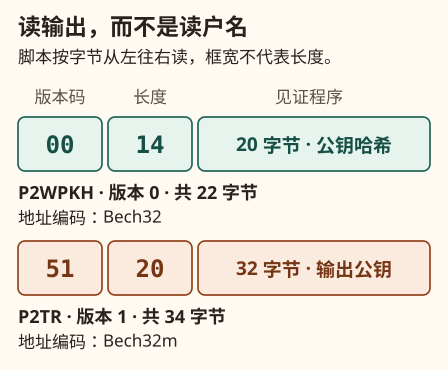
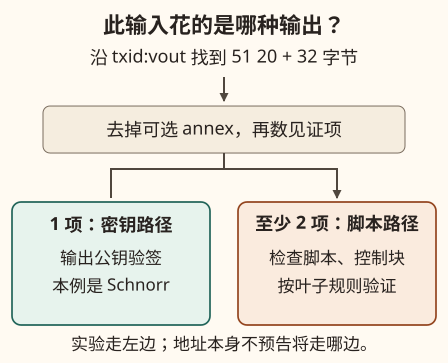

# 第 07 课 · 两个地址，两种花费条件

归集工单上有两笔各 `50 BTC` 的本地测试奖励：第一笔输出的脚本以 `00 14` 开头，第二笔以 `51 20` 开头。值班同事据此在「持有人」栏填了两个人，还说第二个人花钱时不用出示公钥，所以不用签名。两处判断都没有依据。我们让同一个临时钱包分别花掉这两笔钱，看看节点到底凭什么放行。

你在[第 06 课](bitcoin.html)已经用 `txid:vout` 找过前序输出。这次沿同一条引用多走一步：**把旧输出的条件，与新交易那个输入交来的证据配成一对。** 读输出只能说将来要满足什么；读了有效的花费，才能说这一次怎样满足。两步都不能替你填写真实姓名。

## 先看输出：这两个字节不是户号

每个输出都有金额和一段字节，后者叫 `scriptPubKey`，即锁定脚本。付款时把条件写进新输出；它还没被花掉，不需要签收人当场签字。以后谁想把它当作输入，验证节点就按这个旧条件检查。名字里虽然有 `PubKey`，里面却**不一定直接放公钥**。

<figure class="lesson-figure"><a href="../assets/figures/m02/07-output-bytes.svg"></a><figcaption>先读版本，再把第二个十六进制数换算成长度，最后真的数一遍后面有多少字节。只有开头相似不算匹配。</figcaption></figure>

拿第一笔来说。`00` 是脚本操作码 `OP_0`，在这个位置表示见证版本 0；`14` 是十六进制的 `0x14`，意思是推入后面 **20 字节**，不是 14 字节。实际正好有 20 字节，整段长 `1 + 1 + 20 = 22` 字节，才认作原生 **P2WPKH**（Pay to Witness Public Key Hash）。这 20 字节是公钥的 `HASH160`：先 SHA-256，再 RIPEMD-160。有人只交一个公钥哈希能花吗？不能，花费时还得交匹配的公钥，并用对应私钥签出有效签名。

第二笔的 `51` 是 `OP_1`，表示版本 **1**，不是版本 51；`0x20` 表示 32 字节。`51 20` 后紧跟 32 字节，整段 34 字节，才是原生 **P2TR**（Pay to Taproot）。这 32 字节是 Taproot **输出公钥**的 x 坐标编码，不是前一例那样的公钥哈希，也不等于钱包尚未调整的内部公钥。它已经给了验证者一把验签用的钥匙，**没有给花费者一把签名用的私钥**。反过来，看到 32 字节也不能直接填 Taproot：若前面是 `00 20`，那是 v0 的 P2WSH，承诺的是脚本哈希，验证规则又不同。

## 寄给付款人的地址，与写进交易的字节

地址是传递这些条件的一种文本格式，不是另一个链上字段。打开 regtest 的有效见证地址，`bcrt` 是人可读的网络前缀，`1` 是分隔符；后面编码了版本和见证程序，还带六个校验字符。版本 0 的地址使用 **Bech32**；版本 1 至 16 使用校验常数不同的 **Bech32m**。本例的地址分别以 `bcrt1q` 和 `bcrt1p` 开头。编码与版本要配套，不能给 v1 套 v0 的校验规则。交易输出里没有 `bcrt`，也不保存这串地址或它的校验字符。

前缀只能帮你找位置，不能代替校验。稍后实验会把有效地址的**最后一个字符**换成另一个合法字母：看起来还是那个前缀，Core 却报 `isvalid=False`。此时应该停止使用抄错的地址，让来源方重新提供并核对全串；不要帮对方猜最后一位。反面也成立：校验通过，只说明它是本网络的有效地址，**不证明它是工单约定的那一个**。要核销，仍需从可信订单记录取出收款目标和金额，与链上实际输出核对。

## 再看输入：谁出示了什么？

当归集程序构造新交易，输入先用 `txid:vout` 指回奖励。两种**原生**见证输入的 `scriptSig` 都必须为空；它们把用来满足条件的数据放进该输入的见证栈，Core 解码后叫 `vin[i].txinwitness`。这就是本课看到的 SegWit（隔离见证）：不是删掉签名，而是在交易序列化时把它与基础字段分开。不要去归集交易自己的新输出里找旧币的解锁数据。

**第一笔：交两项。** P2WPKH 的栈按顺序是 `[ECDSA 签名及类型字节, 公钥]`。节点先看公钥的 `HASH160` 是否等于旧输出里的 20 字节，还要用公钥对规定的交易摘要验签。若只交对了公钥，任何人都能从公开记录抄它，显然不能因此获准花钱。本钱包给出 33 字节的压缩公钥；它生成的 ECDSA 签名采用长度可能变化的 DER 编码，结尾另有一个签名哈希类型字节。本例 `01` 表示 `SIGHASH_ALL`。签的不是地址字符串，也不是直接把 `txid` 当作消息。

**第二笔：先认旧输出，再数栈项。** 本实验的 Taproot 密钥路径（key path）只交一项 BIP340 **Schnorr 签名**，由旧输出中的公钥来验。默认项长 64 字节，没有附加类型字节。P2WPKH 的 ECDSA 与这里的 Schnorr 都用 secp256k1 曲线，不代表二者的签名格式、摘要计算或验证规则可以互换。

<figure class="lesson-figure"><a href="../assets/figures/m02/07-taproot-paths.svg"></a><figcaption>箭头从旧输出开始。单看一个栈里有两项，不能断言是 P2WPKH，也不能断言是 Taproot 的脚本路径。</figcaption></figure>

Taproot 还允许输出公钥承诺一棵脚本树。同一笔输出若有可用的脚本路径（script path），花费者可以不走上述密钥路径，改为揭示所选叶子的脚本、控制块，以及该叶子需要的栈参数。控制块提供内部公钥等信息和通往根的 Merkle 路径，节点由此核对这片叶子确实受输出公钥承诺，再按叶子规则验证。不是把整棵树公开，也不能说每片叶子都必然要求一枚签名。

读真实 Taproot 见证时还有个顺序：如果栈至少两项且最后一项以 `0x50` 起始，先把这个可选 **annex**（附录）分开；它仍受签名承诺，也仍计入重量。剩一项才是密钥路径，剩至少两项才是脚本路径（末两项是脚本和控制块）；空栈不能解锁。**这些是选择验证规则，不是光数项就已验证通过。** 本实验不构造脚本树或附录。看见一次有效的密钥路径花费，既不能排除还存在别的路径，也不能从一枚签名推断背后只有一位自然人。

## 在临时链上留下两张花费回执

从**仓库根目录**执行。需要 CPython 3.11（只用标准库）和带钱包的 Bitcoin Core **30.5**；`bitcoind` 与 `bitcoin-cli` 均须在 `PATH`，没有这两个程序先看[本卷 Core 安装入口](bitcoin.html#bitcoin-tools)。无需连接钱包、充值或联网同步。源码：[scripts.py](scripts.py)；它调用[共享节点启动器 regtest.py](regtest.py)，不接外部地址、密钥、RPC 或数据目录。每次运行都会重建一条链，旧日志不能拿来当新一轮的输入。

```bash
python3.11 --version
bitcoind --version
bitcoin-cli --version
evidence=$(mktemp -d)
printf '本次日志目录：%s\n' "$evidence"
python3.11 labs/scripts.py > "$evidence/default.log" && cat "$evidence/default.log"
```

先读 `NODE` 行确认是全新、断开 P2P 的回环 regtest。下面列的是**预期关系**，不是要你照抄的运行日志；地址、哈希、签名必须换成本次值。按以下顺序给日志做批注：

1. **从地址找到条件。** `getnewaddress` 向同一个 `script-desk` 临时钱包分别要求 `bech32`、`bech32m`。`validateaddress` 回传 `scriptPubKey`；`reward` 函数把十六进制解成字节，读操作码和长度，比较剩余数据与 RPC 的 `witness_program`。两条 `ADDRESS` 分别应有 `version=0 program_bytes=20`、`version=1 program_bytes=32`。`COPY` 是故意抄错的对照，两次 `isvalid=False`，不会付给错误地址。**我们知道这两个地址来自同一钱包，是因为亲自向同一钱包要了它们，并非编码泄露了归属。**
2. **从条件找到钱。** `generatetoaddress` 把第 1、2 块的奖励分别给这两个地址；`getblock(hash, 2)` 读取块中 coinbase 交易，按完整的脚本找输出，不假定输出下标。两条 `PREV` 应各有一个 `outpoint`、相应脚本类型、`value_sat=5000000000`。再出 100 块，让两笔奖励都成熟。实验只取这两笔指定输入，不叫钱包自动选币。
3. **配对旧输出与新输入。** 对每笔奖励单独构造一笔交易：输入是该 `PREV`，唯一的新输出给同一个本地归集地址，固定为 P2WPKH。每笔输出 `5,000,000,000 − 500 = 4,999,999,500 sat`；没有找零，差额 `500 sat` 是手续费。金额运算全用整数聪，只在 RPC 边界写八位小数 BTC。`signrawtransactionwithwallet` 用钱包签名后，`decoderawtransaction` 把字节解开；脚本检查 `vin` 引用与旧输出完全一致。`WITNESS` 行同时打印本次实际 `items` 和各项长度 `stack_bytes`（按字节，不是十六进制字符数）。第一笔应有两项，末项长 33；第二笔默认只有一项，长 64。
4. **不要把解码当验签。** `testmempoolaccept` 才让节点按当前共识与内存池策略预检。两条 `RECEIPT` 都应是 `fee_sat=500 allowed=True`。预检不会提交；脚本还要 `sendrawtransaction` 交给本地节点，再出一个块。对每条 `IN_BLOCK`，拿 `prev` 回找原来的 `PREV`，再用这笔花费的 `txid` 和 `wtxid` 核对哪一份回执实际进块。最后 `BLOCK` 应报高度 103、`spends=2 id_pairs_match=True`。这里证明的是本轮私链确实收下两笔花费，不是公网付款或客户身份验证。

## 同一笔花费，为什么回执有两个 ID？

把交易想成两种精确的字节视图。传统序列化有版本、输入、输出、锁定时间；对它做两次 SHA-256 得 **txid**。带见证的序列化还包括 marker、flag 和各输入的见证；对完整字节做同样运算得 **wtxid**。在 `decoderawtransaction` 里，后者字段叫 `hash`，不是块哈希。没有见证的普通交易两者相同。本课两笔有见证，两者不同。以后要花某个新输出，用的是 **txid** 加 `vout`，不是 wtxid。

这两种原生输入签名前后 `scriptSig` 都空，所以在这个特定实验里，未签草稿的字节恰好就是签完后的去见证序列化。看 `signed_receipt`：`wire_id(raw)` 从草稿重算 txid，`wire_id(signed)` 从签名成品重算 wtxid，均倒转摘要字节顺序以匹配 RPC 显示。不应把「签名不改 txid」推广给签名会改变 `scriptSig` 的旧式输入。

这两种视图还决定计费口径。设基础大小为 `base_B` 字节，含见证的总大小为 `total_B` 字节：基础部分每字节计 4 个重量单位 WU，多出来的部分每字节计 1 WU。于是 `weight = 4 × base_B + (total_B − base_B) = 3 × base_B + total_B`；虚拟大小 `vsize` 以 vB 计，是 `weight / 4` **向上**取整，不是总字节数除以四。

用本课默认的 Taproot 花费算一遍。一个引用、空 `scriptSig` 的输入占 `32 + 4 + 1 + 4 = 41` 字节；一个新 P2WPKH 输出占 `8 + 1 + 22 = 31` 字节。再加版本 4、输入输出计数各 1、锁定时间 4，基础大小共 **82 B**。见证序列化另加 marker、flag 共 2 B，栈项数 1 B，项长度 1 B，签名 64 B，所以总大小 **150 B**。`3 × 82 + 150 = 396 WU`，即 `99 vB`。用 `RECEIPT kind=P2TR sighash=DEFAULT` 对这四个数。费率约 `500 / 99 ≈ 5.05 sat/vB`；同样给 `500 sat` 手续费的另一笔交易，不一定是同一费率。

## 只改一个签名选项：65 字节还能通过吗？

另一组同事把监控规则写成「Taproot 见证不是 64 字节就报警」。本次仍花同样类型的输出，只给签名 RPC 另选显式 `ALL`。先预测：第二个版本的签名栈会多几项？哪一个 ID 会变？

```bash
# 沿用刚才终端里的 evidence 目录
python3.11 labs/scripts.py --explicit-all > "$evidence/all.log" && cat "$evidence/all.log"
```

这次脚本先对**同一份** Taproot 草稿签 `DEFAULT` 并预检，保留标识，再签 `ALL` 并预检；只提交第二个，不是拿同一枚币付两次。对比**这一份日志里的两条 P2TR 回执**；跨运行会更换钱包和前序输出，直接对比跨轮哈希不能隔离变量。

| 同轮应观测到 | `DEFAULT` | 显式 `ALL` |
| --- | --- | --- |
| 见证栈 | 1 项，64 B | 仍是 1 项，65 B；第 65 字节是 `01` |
| 基础 / 总大小 | 82 / 150 B | 82 / 151 B |
| 重量 / 虚拟大小 | 396 WU / 99 vB | 397 WU / 100 vB |
| 节点预检 | `allowed=True` | `allowed=True` |

显式指定的类型也参与签名摘要计算，不是给旧签名随手贴一个字节。多出的 1 B 在本交易里跨过了整除边界。相同的基础字节产生同一个 `txid`，不同的见证产生不同的 `wtxid`，你应看到 `COMPARE same_base_txid=True same_wtxid=False submit=ALL`。监控若只认 64 字节，会拒绝第二笔有效的密钥路径见证；若只认 64 或 65 字节就放行，又把长度检查当成了验签。既不可由地址猜人，也不可由签名外形判授权。

## 独立作业：修一份把长度当户名的交班单

同事新交来三条记录，和上面钱包的具体密钥无关。甲：`00 20` 后整整 32 字节；乙：`51 20` 后只剩 31 字节，原始记录到此结束；丙：有效 P2TR 前序输出，见证只有一项、65 字节、尾字节 `01`，还未查询节点。他给三条都写了「同一位 Taproot 客户已签」。请逐条改成链上证据真正支持的判断，并说明还缺什么。再从**你自己的** `--explicit-all` 日志找一张可以举证的回执，为丙示范怎样把「外形相符」升级到「本地节点接受」。

交一页文本：保留该次 `NODE`、对应 `PREV`、两条 P2TR 的 `WITNESS` 与 `RECEIPT`、`COMPARE`、匹配的 `IN_BLOCK` 和 `BLOCK`，附上用整数手算的显式 `ALL` 的 WU、vB 及费率。不要交钱包文件、RPC cookie、私钥或任何真实客户记录。

**判据：** 甲是 v0、32 字节的 P2WSH 模板，未给花费见证；乙长度不符，不是完整的 P2TR 输出模板，应查原始脚本而非补零；丙符合显式 `ALL` 的密钥路径外形，缺少对这笔实际交易的有效性验证，更没有人名。你自己的例子须在同轮有相同 txid、不同 wtxid，显式 `ALL` 的节点预检通过且该版本入块，`397 WU → 100 vB → 500 / 100 = 5 sat/vB`。你那笔有效，并不替工单里的丙证明有效。

## 对照原文

- [BIP141：见证程序、交易标识和重量](https://github.com/bitcoin/bips/blob/master/bip-0141.mediawiki)、[BIP143：v0 见证的签名摘要](https://github.com/bitcoin/bips/blob/master/bip-0143.mediawiki)。分别回答「旧输出是哪种程序」「签名覆盖什么」，不是看字段名猜。
- [BIP173：Bech32](https://github.com/bitcoin/bips/blob/master/bip-0173.mediawiki)、[BIP350：版本与 Bech32m 的配对](https://github.com/bitcoin/bips/blob/master/bip-0350.mediawiki)。读校验规则时同时看后者的版本约束。
- [BIP340：Schnorr 签名](https://github.com/bitcoin/bips/blob/master/bip-0340.mediawiki)、[BIP341：Taproot 验证](https://github.com/bitcoin/bips/blob/master/bip-0341.mediawiki)、[BIP342：Tapscript](https://github.com/bitcoin/bips/blob/master/bip-0342.mediawiki)。重点查附录识别顺序、密钥路径签名长度、脚本路径控制块。
- Bitcoin Core 30 系列 RPC：[validateaddress](https://bitcoincore.org/en/doc/30.0.0/rpc/util/validateaddress/)、[signrawtransactionwithwallet](https://bitcoincore.org/en/doc/30.0.0/rpc/wallet/signrawtransactionwithwallet/)、[decoderawtransaction](https://bitcoincore.org/en/doc/30.0.0/rpc/rawtransactions/decoderawtransaction/)、[testmempoolaccept](https://bitcoincore.org/en/doc/30.0.0/rpc/rawtransactions/testmempoolaccept/)。前三个分别解地址、签交易、读字节；最后一个才预检节点是否接受。
