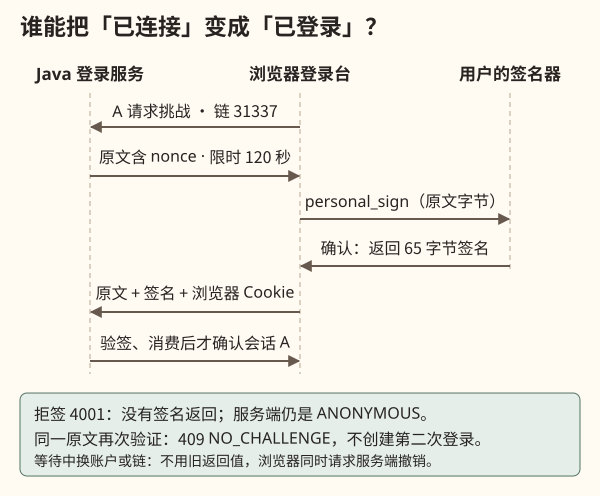

# 第 21 课 · 登录凭证：钱包显示 B，后台认的是谁？

联调单 L-21：操作员用测试账户 A 登录，签名框还开着就切到了 B。收货台若把页头改成 B，却继续用 A 的会话查订单，展示的就不是 B 的数据。这次交付只允许链号 **31337**：一个挑战默认有效 **120 秒**，最多成功消费 **1 次**；拒签产生 **0 次登录**。请交能证明这几件事的服务端答复，而不是一张「钱包已连接」截图。

先修：[02 · 签的是哪些字节](crypto.html)、[04 · 核对网络](networks.html)、[09 · 账户与执行](accounts.html)。这里的 EOA 是由私钥控制、可用签名恢复出公钥来验明地址的外部账户。Java 登录服务不收私钥、助记词或钱包文件。**读这篇静态课文不会请求连接钱包**；需要动手时才启动独立的回环登录台。

## 先分开三件看起来像「同意」的事

| 操作 | 谁答复、答复什么 | 不能据此做什么 |
| --- | --- | --- |
| 连接 | 用户允许钱包通过 Provider 向这个站点展示账户；`eth_requestAccounts` 返回地址列表 | 地址是公开标识；知道地址，甚至界面能读到地址，都不是服务端已验身份 |
| 登录 | 用户读完一份专属挑战，钱包用 EOA 的密钥对登录消息签名；Java 验证后把短会话绑定到该地址 | 签名没有隐藏内容，不是转账、代币额度或委托后台代签的许可 |
| 提交交易 | 交易有自己的编码、序号和费用语义，要广播、被执行才可能改变链上状态 | 本课没有这一步，所以不该寻找交易哈希、块号、gas 回执或余额变化 |

Provider 是页面与钱包之间的请求、事件接口，不是私钥，也不一定是一个 HTTP 节点。EIP-1193 的 `request({method, params})` 成功给方法结果，失败拒绝 Promise；常见 `4001` 表示用户拒绝，**不是 HTTP 状态码**。`eth_accounts` 只读当前对站点可见的账户，可能是空列表。`eth_chainId` 给十六进制 quantity：`0x7a69` 是十进制 `31337`，`0x7a6a` 才是 `31338`。账户列表和网络都可能在页面不刷新时改变；链号也不是独一无二的节点指纹。

<figure class="lesson-figure"><a href="../assets/figures/m06/siwe.svg"></a><figcaption>左侧 Java 只发一次性问题、收原文与证明；右侧签名器只有用户确认才签。中间浏览器能传递结果，不能自己宣布已登录。</figcaption></figure>

## 核对签名器显示的那张原件

SIWE（Sign-In with Ethereum，ERC-4361）给站点登录约定了可读消息格式。这是一张**格式示例**，地址和时间只为读图，不是要粘贴给钱包的输入。真实实验应看到当次随机地址、nonce 和 UTC 时间。

```text
http://127.0.0.1:18121 wants you to sign in with your Ethereum account:
0x52908400098527886E0F7030069857D2E4169EE7

Sign in to the local course desk. No transaction.

URI: http://127.0.0.1:18121/
Version: 1
Chain ID: 31337
Nonce: 88d0287435be44878a65df499fb3c631
Issued At: 2026-01-01T10:00:00Z
Expiration Time: 2026-01-01T10:02:00Z
```

第一行是**发起签名的页面 origin**：含显式 `http`、主机、端口；这里不能填签名器自己的 `localhost:18221`。`URI` 是登录的资源，本例固定在该站的 `/`；地址使用 EIP-55 校验大小写。`Chain ID` 在消息内写十进制，不从签名字节的最后一位猜网络。`Nonce` 来自服务端 16 个随机字节，编码为 **32 个十六进制字符**；它区别两次登录挑战，不是[第 10 课的交易序号](nonce.html)。签名包含这些值而且验证方核对它们，值才有约束力。

以示例时刻计算：`10:01:59Z` 仍在 `[签发, 截止)` 内；**恰好 `10:02:00Z` 就不再接受**，以 Java 的时钟为准。即使还剩 119 秒，只要已成功消费过这份挑战，也不能再换一次会话。反过来，随机 nonce 并不自带过期能力，过期与消费是两项独立检查。本例的短会话也最迟在这张凭证的截止时间失效，不是从点击确认起另加 120 秒。

## 从两个回环进程启动，不带上日常钱包

环境：**JDK 21**，初次准备依赖用 **Maven 3.9.x**；复用[第 17 课](rpc.html)的 Maven classpath 和 **web3j 4.12.3**，浏览器用支持 ES 模块、BigInt 和 `window.open` 的桌面 Chromium/Chrome。以下命令都从**仓库根目录**执行。无需 Anvil、账号充值、钱包扩展或公网 RPC。`18121`、`18221` 须空闲；若地址被占用，请停止自己的旧实验，不要连接未知服务。

```bash
java -version
mvn -version
bash labs/m05/build.sh
# 若本机已缓存完整依赖，可以改用：bash labs/m05/build.sh -o
```

确保终端使用的都是 JDK 21（macOS 可在每个终端执行 `export JAVA_HOME="$(/usr/libexec/java_home -v 21)"; export PATH="$JAVA_HOME/bin:$PATH"`）。第一次构建需要下载依赖；`labs/m05/target/classpath.txt` 就绪后，下面两个服务可离线启动。[启动脚本](m06/login/run.sh)用 JDK 的源码启动器，Java 工作目录是源码旁，勿直接在仓库根目录执行 `java SiweLab.java`。

```bash
# 终端 A：验证方，不生成或持有用户密钥
bash labs/m06/login/run.sh login
```

```bash
# 终端 B：你自己控制的一次性教学签名器
bash labs/m06/login/run.sh signer
```

等到两个终端分别打印 `login http://127.0.0.1:18121/`、`signer http://localhost:18221/`。两者只监听 IPv4 回环，**地址栏不要把 `localhost` 与 `127.0.0.1` 互换**。浏览器另起临时用户资料，关闭同步和常用扩展；不是在已有钱包会话中新开普通标签。可任选与你系统匹配的一条启动方式：

```bash
# macOS：在新终端，用空资料目录启动一个新实例
PROFILE=$(mktemp -d)
open -na 'Google Chrome' --args --user-data-dir="$PROFILE" --disable-extensions --disable-sync --no-first-run http://127.0.0.1:18121/
```

```bash
# Linux（已安装 chromium）：同样新建目录，不复用默认配置
PROFILE=$(mktemp -d)
chromium --user-data-dir="$PROFILE" --disable-extensions --disable-sync --no-first-run http://127.0.0.1:18121/
```

默认路线点 **「连接教学签名器」**。这是主动打开的**独立窗口、不同 origin 和不同 JVM**，不是登录台假造的 `window.ethereum`。签名器启动时在内存创建两个无资金的 secp256k1 测试账户；不会持久化、导入或导出密钥。它只支持本课少数方法，`31337/31338` 是可切换的**教学网络上下文**，不宣称查过任何区块。浏览器核对窗口来源和 origin，签名器只对固定登录格式签名。它没有硬件隔离和生产钱包的安全能力，不要部署、共享或存币；整个演练假定本机、课程代码和这份空浏览器资料可信。

可选的产品接口路线：只在**另一个全新的专用测试资料**中安装你已核验的 EIP-1193 钱包，创建没有资金的测试 EOA，连接你自己的本地链 31337；用登录台的「连接独立测试钱包」。这条路线只运行终端 A，通过 `window.ethereum.request` 调扩展而非终端 B；若扩展要求在线的自建节点，可按[第 04 课](networks.html)准备并核对回环 RPC。没有合适测试扩展就用默认路线，**不去探测、解锁或连接已有钱包**。本课不要求添加主网，也不在错误网络自动发起切链。

## 正常记录：谁才是服务端认定的 A？

1. 教学签名器的首个请求只展示将披露的地址。点「确认请求」，回登录台：钱包地址有了，链号为 `31337`，但页头仍是「未登录」。点「检查服务端会话」应读到 **`200 ANONYMOUS`**。这一刻没有签过消息。
2. 点「请求登录签名」。在独立窗口完整读出待签原文；和登录台的原文比对第一行 origin、地址、链号、nonce、时间。不要只看两端地址的前后四位再决定。使用自己刚启动的空签名器，且所有字段相符，才点「确认请求」。
3. 回登录台点「检查服务端会话」：预期 **`200 AUTHENTICATED`**、本次 A 的完整地址和 `31337`。对照钱包地址时忽略展示大小写差异，不要忽略字节差异。浏览器再开**另一份空资料**只访问同一登录台并点「检查服务端会话」，应为 `200 ANONYMOUS`。第二个普通标签会共享 Cookie，不是独立浏览器会话的证据。
4. 在原资料**截止时间之前**点「复核一次性消费」：页面把刚才的同一原文和签名再交一次验证；预期 **`409 NO_CHALLENGE`**。再查状态仍是上次的 A，不会变成两个会话。这个按钮仅用于本机复核；不会再次弹签名框，也不会延长截止时间。

打开[浏览器端](m06/login/app.js)和[Java 验证服务 / 独立签名器源码](m06/login/SiweLab.java)，按这四行因果关系读：

- **选地址不等于认地址。** `select()` 只在点击后调用 `eth_requestAccounts`；`snapshot()` 用 `eth_accounts` 和 `eth_chainId` 读出当前上下文。`/api/challenge` 以浏览器的匿名 Cookie 找到自己的待验证槽，Java 校验链号、规范化地址，从服务端配置而非客户端 URL 拼 `Challenge.text()`。两个浏览器同报 A，有两个槽和两个随机 nonce。
- **传的是原文字节，不是它的十六进制外观。** 页面按 `TextEncoder` 得到 UTF-8，再编码成 `0x…`，作为 `personal_sign` 的第一个参数，第二个是选定地址。签名器还原原文给人读；实际签名输入按 EIP-191 是 `0x19` 开头的 `Ethereum Signed Message:\n` 前缀、原文字节数的十进制 ASCII、原文字节，再做 Keccak-256 和 secp256k1 ECDSA。不要手工预加前缀再调用 `personal_sign`（会多包一次），不要对 `0x…` 的字符签名。原文换行用 LF，末行无多余换行。
- **真实验签，而不是比较两个页面传来的地址。** `/api/verify` 从同一 Cookie 的槽里重建唯一允许的原文，逐字相同才接着查时间。这样域、URI、链、地址、nonce 与时刻全部绑定；这是只接受本课程固定 SIWE 模板的验法，不是通用 ERC-4361 解析器。`signedBy()` 拆本课 65 字节 `r || s || v`，检查标量和恢复位，`Sign.signedPrefixedMessageToKey()` 据 EIP-191 恢复公钥；取其以太坊地址，与挑战内的地址比较。不需要把私钥发给 Java 来「核验」。
- **发会话与消费是一个状态变更。** 同一个 `synchronized` 临界区覆盖读取待用挑战、验签、置 `pending = null`、登记 `login`。同一份证明再来，不论上一次响应是否顺利抵达浏览器，都不能再消费。已认证的服务端状态以 `HttpOnly; SameSite=Strict` 的不透明随机 Cookie 关联，业务身份来自槽内的 `address`，不是钱包页头的昵称。本机 API 还校验 `Host`、写请求的 `Origin`；单进程内存锁及 HTTP 回环不是多实例生产部署方案。

## 换一个输入：哪些等待结果必须丢掉？

每行从连好的测试签名器开始，点「检查服务端会话」读取独立证据。默认只开**一个登录台标签**和它自己的签名器窗，避免同一资料下的其他标签改动共享会话。

| 改变什么 | 用户动作 | 预期判据 |
| --- | --- | --- |
| 意愿 | 申请新挑战，在签名器点「拒绝请求」 | 登录台显示 `4001`，服务端 `200 ANONYMOUS`；不要在后台替用户再请求签名 |
| 账户 | 先以 A 正常登录，在签名器「切换测试账户」到 B；再申请 B 的签名，**尚未确认**时又切回 A | 两次切换均撤销；读到 `ANONYMOUS`；即使又看见熟悉的 A，也不是重新证明过的 A |
| 网络 | 在 31337 申请签名，尚未确认就「切换测试网络」到 31338 | 旧请求作废，页面显示错链，不能申请新挑战；切回 31337 只恢复申请资格，不自动登录 |
| 时间 | 开新挑战，在签名窗口保留它直到 `Expiration Time` 之后，再确认 | 教学签名器可以对旧原文算出真签名，但 Java 必须给 **`410 EXPIRED`**，读会话仍为 `ANONYMOUS` |

若想快些核对时间边界，可只停终端 A，`SIWE_TTL_SECONDS=8 bash labs/m06/login/run.sh login` 后**刷新登录台、重新连接**（关闭上一次签名器窗口）。允许值是 5–120 秒；八秒是服务端签发到截止的间隔，不是弹窗渲染完成后倒数八秒。若提示 `NO_BROWSER`，说明服务端已重启或浏览器匿名槽已失效；清除登录后申请新挑战，别提交旧签名。若连签名器都打不开，检查两个进程的启动行和浏览器对本站的弹窗设置，不要改用陌生 RPC 或粘贴签名来凑过关结果。

等待最容易出现的错误写法是：`await sign()` 回来后，直接用**此刻**钱包显示的地址设置「已登录」。这里有两层闸：页面收到 `accountsChanged`、`chainChanged` 或 `disconnect` 时，立即递增代数 `epoch`、清除展示与待用证明，并通知服务端 `/api/reset`；提交验证前、验证返回后还要重读钱包快照。即使 A → B → A，旧请求的代数也对不上。页面把发往 Java 的请求串行：若切换发生在已提交 `/api/verify` 的途中，**旧结果不得回填页面，后到的 reset 撤销旧会话**。后端不能隔空知道用户刚刚点了哪个账户；网络断开、撤销尚未获服务端确认时，页面应保持未登录，不能声称远端状态已确认。

## 独立作业：交一份「B 从何时起才算登录」的交班表

改用 **45 秒**期限重启验证方。先让 A 登录；换 B，验证当前会话；故意拒签一次 B 的请求；然后给 B 申请**新的**挑战并确认，立刻复核一次性消费。最后用另一份空资料查询。留下六行：`动作 / Provider 账户标签 / 链号 / 服务端码与状态 / 是否能以 B 身份办事`。另写新旧两张 B 挑战的 nonce 是否相同、各自两条 UTC 时刻相差多少秒；只保存判据和临时地址缩写，不提交 Cookie、原始签名、全量请求捕获、钱包资料或任何密钥。

**过关判据：** 第一次出现 B 的地址时仍不能以 B 身份办事；拒签的挑战不能建立会话；B 的新挑战 nonce 不同，有效窗恰好 45 秒；只有确认并验签成功那行才首次绑定 B，复核为 `409` 而**不撤掉仍有效的 B**。另一份空资料读不到 B。用一句话说明：这套演练只证明特定时刻的 EOA 登录，不证明现实身份、余额、任何代币授权，也不支持合约钱包 ERC-1271 验签。完成后关闭两个浏览器窗口和临时实例；在 A、B 终端各按 `Ctrl-C`。签名器退出丢弃临时密钥，验证方退出丢弃挑战与会话；确认浏览器已退出后可删除自己刚创建的空资料目录。

## 查证原文

- [EIP-1193：Provider 的 request、账户 / 链变化事件与错误码](https://eips.ethereum.org/EIPS/eip-1193)；[MetaMask：personal_sign 参数、消息和字节编码](https://docs.metamask.io/metamask-connect/evm/guides/sign-data/#use-personal_sign)。
- [ERC-4361：消息 ABNF、验证 origin、EOA 与合约账户、会话绑定](https://eips.ethereum.org/EIPS/eip-4361)；[ERC-191：personal_sign 的 0x45 格式](https://eips.ethereum.org/EIPS/eip-191)；[ERC-55：地址校验大小写](https://eips.ethereum.org/EIPS/eip-55)。
- [web3j 4.12.3：Sign 中的前缀、字节长度和公钥恢复](https://github.com/LFDT-web3j/web3j/blob/v4.12.3/crypto/src/main/java/org/web3j/crypto/Sign.java)；[ERC-1271：合约签名有效性接口](https://eips.ethereum.org/EIPS/eip-1271)。
