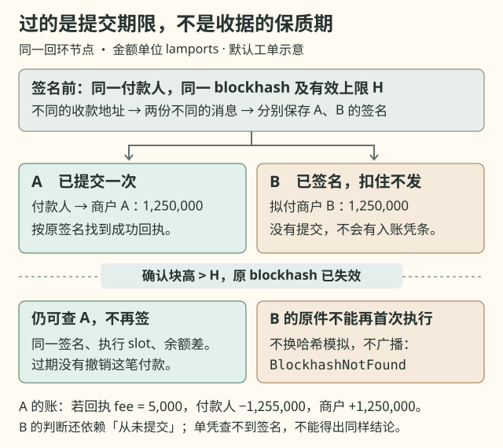

# 第 30 课 · 付款请求没拿到答复，还要再签一次吗？

值班员接到两张付款单，A、B 各拟从同一付款账户付出 **0.00125 SOL**。两张都签过字，用的是同一个近期区块标识（`recentBlockhash`），现在都过了可首次执行的期限。A 已送出，约定的收款地址在那笔成功回执里增加了 **1,250,000 lamports**；B 的原件一直扣在付款服务里，从没送出。可以因为「都过期了」就给两单各重付一次吗？

**不能。A 已付，B 未付。** 1 SOL 等于 10 亿 lamports，A 的增量正好是订单金额。[A 单的原始回执](m08/evidence/payment/A-receipt.json)记录的是已经发生的转账；后来过期，不会让这笔钱退回来。B 能判未付，靠的是本次服务始终没有发送它，不是靠时钟。[过期记录](m08/evidence/payment/expiry.json)里的块高 153 已超过上限 151，只能说明这两份旧原件现在都不能再首次执行。

只改一项交接条件：丢了 B「从没送出」的记录，只知道旧原件已过期，同一节点按原签名也没查到回执。还能判 B 未付吗？不能；它可能在到期前已经执行，眼前的节点却没有那段记录。保留原签名去同一账本查历史，把 B 挂为待核，不因没等到答复就重签。

只想学会判付款，可以[翻到第 31 课：订单状态存在哪个账户](registry.html)。以下选做本地实验，不要准备真实钱包。[第 02 课](crypto.html)讲签名绑定哪份消息，[第 04 课](networks.html)讲先认网络，[第 29 课](rust-order.html)讲如何从字节读订单。此处用 Python 查看原始字段，无需 Rust 编译器。Java 读 `u64` 的 lamports 要保留整数精度，完整范围超过有符号 `long`，可用 `BigInteger`，不要经 `double` 中转。

## 谁的地址、谁的程序、谁的签名

先分清两种「账户」。Solana 用 32 字节地址找到一条记录，其中有 `lamports`（原生余额）、`data`（程序解释的字节）、`owner`（一个程序 ID）和 `executable` 等字段。**程序账户**是调用目标，`executable=true`；**数据账户**承载状态，不是可执行入口。不要想成每个订单自己带了一段代码：一个程序可以操作许多分开的数据账户。本课只用原生转账，两个钱包是数据区为空、由 **System Program** 拥有的普通账户。地址刚生成，不等于链上已经有了这条记录。

三个问题要各找各的证据：

| 问题 | 答案在哪里 | 本单怎样读 |
| --- | --- | --- |
| 谁能按协议修改这条账户的数据或扣走其中的 lamports？ | 账户持久状态的 `owner` | 付款钱包的 owner 是 System Program，不是付款人的公钥。程序还要按自己的规则检查授权。给账户加 lamports 与从中扣款并非同一种权限 |
| 谁签了这份消息？哪些账户在本交易声明为可写？ | 交易消息的 `header`、`accountKeys` 和 `signatures` | 付款人签且可写，收款人不签但可写；可写只是本次允许修改，不代表签了名、一定修改或可任意扣款 |
| 调了谁，指令把哪个账户当作付款方？ | `instructions[].programIdIndex`、`accounts` 和 `data` | 本单调用 System Program 的 `Transfer`，依次传入付款、收款两地址。程序 ID 是执行者，不是收款人 |

`fee payer` 是支付本交易网络费的账户，在本课的 legacy 消息里是 `accountKeys[0]`，必须签名且可写。我们让它恰好也是转出本金的人；其他交易可以由另一账户付费，两种角色不应在业务模型里绑死。签名覆盖序列化的**整份消息**：改收款人、金额或 blockhash，都要重新签。`signatures[0]` 是查交易用的交易 ID，既不是签名者地址，也不是 `recentBlockhash`。订单号 S-30 保存在业务侧，不会自动出现在链上消息里。

## 先存查件号，再交给 RPC

从**仓库根目录**运行，先准备 Python 3.11、Bash、curl 和 tar。安装脚本将 Agave 2.3.13 与 `solders==0.26.0` 放进课程专用缓存，初次需要联网。实验用 `solana-genesis` 建一份新账本，再启动回环 `agave-validator`。付款人是本轮创世时就有余额的临时账户，付款前余额以本笔回执的 `preBalances[0]` 为准；不运行 faucet，也没有从零充值这一步。无需导入任何现有钱包，不要传入公网地址、密钥或助记词。

```bash
bash labs/m08/setup.sh
source labs/m08/env.sh
WORK=$(mktemp -d)
python labs/m08/payment/run.py --out "$WORK/paid" --wait-expiry
```

这是完整版：A、B 两单使用同一临时链和同一付款人，B 的收款地址不同。脚本签好两份，只向 `sendTransaction` 交 A，一直保留**同一活节点**至过期演练结束。不要把一次运行的签名拿到下次的全新账本去查。只练正常支付时，去掉 `--wait-expiry` 并使用新输出目录，即不制作 B、不等过期。

[完整客户端](m08/payment/run.py)的 `draft` 先组装一条原生 SOL 转账指令，再指定费用支付者和签名人。下面摘出关键调用，`payer`、`recipient` 是公钥；`net.payer` 才是本轮的临时签名器。

```python
blockhash, last = net.latest()  # getLatestBlockhash，confirmed；同时取截止块高
ix = transfer(TransferParams(from_pubkey=payer, to_pubkey=recipient, lamports=amount))
tx = Transaction.new_signed_with_payer([ix], payer, [net.payer], blockhash)
signature = str(tx.signatures[0])           # 还没调用 sendTransaction 就知道
wire = base64.b64encode(bytes(tx)).decode("ascii")
```

1. **签名前核对新账户的余额门槛。** 本例向全新地址转入第一笔 SOL。用 `getMinimumBalanceForRentExemption(0)` 查询**零字节数据**账户所需的最低余额。它不是「手续费」，不会从 `amount` 中扣除；全额记到收款账户。若金额小于门槛，客户端在签名前停止。转给已有且余额足够的账户并不是每一笔付款都要再付这个最低数。
2. **把交易 ID 和时限一起落地。** `A-intent.json` 保存本次 `genesisHash`、双方地址、金额、签名、`recentBlockhash`、`lastValidBlockHeight` 和承诺级别；可选的 `B-held.json` 对应另一签名。发前保存的不是口头估计的「还剩 60 秒」。`lastValidBlockHeight` 是 RPC 告诉客户端的有效上限，**不是另一个被签入消息的字段**。
3. **只提交一次。** `before-send.json` 记录提交前的 `confirmed` 块高；大于上限就不再首次提交。小于等于上限也不担保能及时打包。脚本在构造、预检和确认时采用一致的 `confirmed` 视图。`sendTransaction` 正常返回也仅表示节点接收请求，不等于执行、确认或足额收款。这里**故意不用正常广播答复**，不是声称制造了真实网络超时。
4. **恢复端只读。** `recover` 从磁盘重读 A 的凭条，先核对 `getGenesisHash`，再用原签名调用 `getSignatureStatuses`（开启 `searchTransactionHistory`）。只有达到 `confirmed` 或 `finalized` 才用 `getTransaction(commitment="confirmed", encoding="json")` 取原件，并核对同一执行 slot 和错误字段。回复暂缺就再查原签名；超出本地观察时间只记「未知」。代码不为此签第二笔。

## 按索引拆一张成功回执

打开 `$WORK/paid/A-receipt.json`。先读 `meta.err` 而非只看签名是否存在：失败而上链的交易也有签名、可能已确认且付了费，不能证明转账成功。再从 `transaction.message` 认角色。本例是**仅一条指令的 legacy 交易**，没有地址查找表；不要把下表原封不动套给所有交易。

本单头部的三个计数依次为：`numRequiredSignatures=1`、`numReadonlySignedAccounts=0`、`numReadonlyUnsignedAccounts=1`。整张键表先分签名组和非签名组，各组末尾才是只读项。因此第一组仅索引 0 且可写；非签名组的最后一项（索引 2）只读。按相同索引对齐 `preBalances[i]` 和 `postBalances[i]`，账就能对上：

| 索引 | `accountKeys` 中的角色 | 签名 / 可写 | 本交易余额差（lamports；F = `meta.fee`） |
| --- | --- | --- | --- |
| 0 | 付款人，同时是 fee payer | 是 / 是 | `−1,250,000 − F` |
| 1 | 工单指定的收款地址 | 否 / 是 | `+1,250,000` |
| 2 | `11111111111111111111111111111111`（System Program） | 否 / 否 | `0` |

仅看增量仍不够。`programIdIndex=2` 要指向约定的程序，指令 `accounts=[0,1]` 要按这个方向解析。`instructions[0].data` 在 JSON 中是 Base58 **编码**（非加密）；`audit` 解码后用 `struct.unpack("<IQ", ...)` 按小端读 4 字节变体号和 8 字节 lamports。System Program 在这里的变体 `2` 才是 `Transfer`。把解出的金额与订单和收款方的增量都核对，排除看错指令、方向或单位。别的程序有别的格式，不能见到 12 字节就断言是付款。

`owner` 不在这个头部。脚本按键表顺序另外调用 `getMultipleAccounts` 查三者，指定 `minContextSlot=回执的 slot`。在 `A-accounts.json` 中，前两项的 `owner` 是上表的 System Program，`executable=false`；第三项是可执行程序，其 `owner` 是加载器而不是付款人。这里读的是**不早于**回执的账户视图，不是指定历史 slot 的快照；资金变化用交易自身的 `meta`，不用事后连查两次当前余额。复杂交易可能有多条指令、内部调用或多种资产，不可把某个账户的整笔净额都归给某一单。

默认单的**预期关系**：如果这次 `meta.fee` 为 5,000，付款人应少 `1,255,000`，收款人多 `1,250,000`，不是少收了 5,000。成功行形如 `A=MATCH_CONFIRMED_OR_BETTER ...`，下一行给出完整签名；以本轮 JSON 中的费用和下面的复算为准，不抄示意数字。证据目录里没有私钥。

```bash
python - "$WORK/paid" <<'PY'
import json, sys
from pathlib import Path
p = Path(sys.argv[1]); read = lambda name: json.loads((p / name).read_text())
ticket, r = read('A-intent.json'), read('A-receipt.json')
msg, m = r['transaction']['message'], r['meta']; keys = msg['accountKeys']
assert r['transaction']['signatures'][0] == ticket['signature'] and m['err'] is None
for address in (ticket['payer'], ticket['to']):
    i = keys.index(address)
    print(i, address, 'delta_lamports', m['postBalances'][i] - m['preBalances'][i])
print('slot', r['slot'], 'fee_lamports', m['fee'], 'header', msg['header'])
PY
```

## 高度越过上限后，分别查 A 和 B

`processed` 表示该节点在当前所见分支已处理，可能回退；`confirmed` 表示相应块得到超过三分之二活跃权益的直接投票；`finalized` 是达到共识最终锁定后的更强承诺。这三者形容**被观察到的块**，不是三种支付成功状态。例如 `confirmed` 和 `meta.err != null` 完全可以同时出现。单节点实验用真实 RPC 走这些路径，不是对公网多验证者安全性的实测。

`slot` 是分配给出块者的时隙，有的时隙没有产块；`blockHeight` 数的是产生的块。**不要用执行 slot 和 `lastValidBlockHeight` 比大小**。完整版等同一节点 `getBlockHeight(confirmed) > lastValidBlockHeight` 并用 `isBlockhashValid` 确认原哈希已无效；等于上限还没越界。按常见节奏等约一到两分钟，慢机或出块停顿可以更久。等待到脚本的 240 秒观察上限只报未观察到过期，不替节点判过期。没有跳 slot、加速出块或伪造过期哈希。

<figure class="lesson-figure"><a href="../assets/figures/m08/solana-payment.svg"></a><figcaption>两条泳道问的是不同的问题：A 之前是否执行，B 现在还能否首次执行。余额和手续费是默认工单的条件算例；签名、块高和实际手续费在本次归档中。</figcaption></figure>

- **A：过期前就已经确认。** 在 `expiry.json` 中核对 `receiptA` 与 `A-receipt.json` 的第一枚签名、执行 slot、`meta.err`、费用及双方前后余额。过期只挡住用旧消息的首次执行，不会因此撤销之前已经入块的付款。不能趁哈希过期再造一张同额付款单。
- **B：签了、从未提交。** 唯一提交调用拿的是 A 的字节，B 的签名不同。到期后脚本仅对 B 的原字节做 `simulateTransaction`，`sigVerify=true`、`replaceRecentBlockhash=false`，不更新余额、不广播。预期 `validity.value=false`、`simulationB.value.err="BlockhashNotFound"`，B 没有执行回执。结论来自**本地明确没有发 B + 真实越过高度 + 原件的模拟结果**，不是从 `null` 猜出的。
- **真实工单的第三种情况：提交过，但下落不明。** 一次状态 `null` 只表示这个节点此次没找到。可能尚未确认、视图落后，或节点没有那段历史；`searchTransactionHistory=true` 也不能创造已裁掉的历史。即使高度已越界，也只排除了此后在该分支首次执行的可能，不能排除它此前已落地。应查同创世账本的可靠历史和原签名，按订单核对金额与收款人；证据不全就挂起，不因 HTTP 超时或一次 `null` 自动重签。换 blockhash 重签是**另一笔**可能独立执行的交易，不是原交易的查件动作。本课不讨论 durable nonce 交易。

用随课原件核一次金额：在 `A-receipt.json` 里先用收款地址定位 `accountKeys[1]`，再读同一索引上的 `postBalances[1] − preBalances[1] = 1250000 − 0`。付款人是索引 0，`100000000000 − 99998745000 = 1255000`；多减少的 5,000 正好是 `meta.fee`，不从商户那 1,250,000 里扣。在 `expiry.json` 对读：`statusesAB.value[0]` 指向 A 的执行 slot 2；B 的 `simulationB.value.err` 是对旧原件做模拟得到的错误，**不是一张扣了费的失败交易回执**。这些原件来自已关闭的一轮账本，下一轮请使用自己的地址、签名和费用。

## 换输入：连签名都不该产生

```bash
python labs/m08/payment/run.py --out "$WORK/tiny" --lamports 1
```

对本地默认租金配置，全新零数据账户需要的余额大于 1 lamport。预期程序退出 **3**，打印 `HOLD_NEW_ACCOUNT_RENT ... signed=0 sent=0`，目录里只有 `precheck.json`。这是**客户端预检**拒绝，不是上链失败、过期或扣了手续费。首笔付款不应悄悄多付到最低门槛；应另行约定金额或改用双方确认的现有账户。

## 接班作业 · 不看汇总行签收单据

新工单 S-30B 应收 **1,730,009 lamports**。在根目录用已配置的环境执行 `python labs/m08/payment/run.py --out "$WORK/handoff" --lamports 1730009 --wait-expiry`。把 `A-intent.json`、`B-held.json`、`before-send.json`、`A-status.json`、`A-receipt.json`、`A-accounts.json`、`expiry.json` 交给同伴，让他不用签名器或 `A-audit.json` 回答：

1. 这两单为什么共用 blockhash 却不能共用签名？在 A 的公开消息里指出支付费用者、指令的 source / destination、两份账户的 owner 和唯一只读键，分别圈出字段来源。
2. 直接用 A 的原始数组算账。**判据**：商户净增 `1,730,009`，付款人净减 `1,730,009 + 本次 meta.fee`；同一执行 slot 的状态达到约定级别且无执行错误。如果订单复核表**只把应收**改为 `1,730,010`，不重跑付款就应报差额 1 lamport，不能用手续费补差。
3. 在 `expiry.json` 抄下真实的末次可用块高与观察块高，验证严格大于、原哈希无效，并在 A 的两张回执中找回同一签名。**判据**：只能签收 A；B 凭未提交记录和过期模拟退回。若交接时抽走 B 的「从未提交」记录，只剩历史查询为 `null` 和过期证据，就必须改答「不能再首次执行，历史付款待查」，不准凭缺回执再付一次。

## 官方资料

- [Solana 账户结构与修改边界](https://solana.com/docs/core/accounts)、[交易消息、键表顺序与 fee payer](https://solana.com/docs/core/transactions/transaction-structure)：分别校准持久的 owner 与一次交易的权限。
- [SystemInstruction::Transfer 的参数与账户顺序](https://docs.rs/solana-system-interface/1.0.0/solana_system_interface/instruction/enum.SystemInstruction.html#variant.Transfer)、[Agave 2.3.13 的 System Program 实现](https://github.com/anza-xyz/agave/blob/v2.3.13/programs/system/src/system_processor.rs)：可对照签名检查和实际扣款逻辑。
- [RPC 承诺级别](https://solana.com/docs/rpc#configuring-state-commitment)、[确认与到期指南](https://solana.com/developers/cookbook/transactions/confirmation)、[getSignatureStatuses](https://solana.com/docs/rpc/http/getsignaturestatuses)、[simulateTransaction](https://solana.com/docs/rpc/http/simulatetransaction)：按签名恢复，按块高判断首次执行期限，不把模拟当广播。
