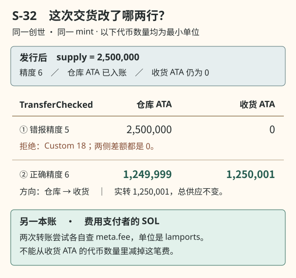

# 第 32 课 · 收货的是哪个账户？用两个 ATA 核销一张交货单

商户要签收 S-32：仓库应交 **1.250001 枚本地测试券**。订单写明了券种的地址，两边的收发账页都属于这个地址所指的券。成功的交货交易中，仓库账页从 2,500,000 减到 1,249,999，商户账页从 0 增到 1,250,001，单位都是这张券的最小单位。券有 6 位小数。签收栏该填多少枚？手续费需要从这个数里扣吗？

签收 **1.250001 枚**。仓库少了 `2,500,000 − 1,249,999 = 1,250,001`，商户多了同样多，除以一百万就是订单的数。券种的地址叫 **mint**：同一个名字、同样的小数位都不能替代它。商户收到的是券；另一位费用支付者付的是 SOL，费用单位是 lamports，不能从券数里减。

只改订单的一栏：假如商户原本订的是**另一个 mint 的券**，同样要 1.250001 枚，能拿眼前两张账页签收吗？不能。两边的数量依然对得上，但对上的是另一种券；交易可以成功而订单没有履行。不要只凭签名或日志中的「转账」字样盖章。

只想读懂收货单，可以[到 M09 目录自选一项独立实验](../plan.html#m09)。以下是选做的本地发券、查账与卷末交接。动手时会用到[从字节精确读整数](rust-order.html)、[按签名找本轮回执](solana-payment.html)、[区别推导地址与写入权限](registry.html)。本地券没有价值、市价或兑付承诺；只用自建单节点账本，不用浏览器钱包、公共 RPC、水龙头或真实地址。

## 先给交接单填对五种地址

Solana 上的代币不是每人钱包账户里额外加了一个余额字段。可以把它想成两张 SQL 表：`Mint` 有一行定义**这是什么资产、总共多少、谁能增发**；`TokenAccount` 每一行记录**哪个 mint、哪位持有人、多少最小单位**。行本身都有地址。这个类比到此为止：能改数据的是运行时指定的程序，不是任意有表名、有主键的客户端。

| 要填的东西 | 本轮怎么认 | 它不代表什么 |
| --- | --- | --- |
| mint 地址 | 新创建的 82 字节账户；数据里的 `decimals=6`，`supply` 是 `u64` | 不是铸币人的地址，也不是把所有代币装在一起的钱包 |
| mint authority、freeze authority | `mintAuthority` 是另一个临时公钥，可签增发；`freezeAuthority=None`，本 mint 没有冻结权限持有人 | 允许增发不等于能从商户的代币账户取走券。这里**保留**增发权，不能宣传固定供应；没有冻结权也不能把它再启用 |
| 仓库与商户的钱包公钥 | 分别是 `sourceOwner`、`destinationOwner`，出现在两个代币账户**数据内**的 `owner` 字段 | 不是这个 mint 的收付款账户地址。接收这笔转账商户不用签，但从自己的账户转出通常要由持有人或已授权的代理签 |
| 仓库与商户的 ATA | 各自是一个已初始化的 165 字节经典代币账户，只装本 mint。RPC 外层的 `owner` 都是经典 Token Program | 不是钱包的 SOL 余额；也不是由 ATA Program 持续拥有。一个持有人还可有其他非 ATA 的代币账户，不能只凭持有人猜本次转入哪一个 |
| 费用支付者 `payer` | 独立的本地签名人，为建户提供 lamports，也支付交易费 | 不是 mint authority、仓库或商户。可代别人创建 ATA，并不因此得到代币的支配权 |

所谓 **associated token account（ATA）** 是「这一钱包、这一代币程序、这一 mint」约定的默认代币账户。把三个公钥的 **32 字节原值**依次作 seeds，在 **Associated Token Account Program** 的 ID 下找 PDA，才得到地址：

```python
address, bump = Pubkey.find_program_address(
    [bytes(wallet), bytes(TOKEN), bytes(mint)], ATA_PROGRAM)
```

与 31 课相同，推得地址不等于该处已有数据。创建时 ATA Program 按同样的 seeds/bump 为自己的 PDA 发起 CPI，借助 System Program 建户、Token Program 初始化数据。创建结束后，能写这行代币数据的是 Token Program，它再按数据中的持有人/代理及指令签名检查能否转账。别把 Token-2022 的 ID 代进去：程序不同，同一钱包与 mint 的推导输入就不同；本课不处理扩展、转账税、转账钩子或包装 SOL。

## 用一张账页区分「发券」和「交货」

先发行 **2.500000** 枚到仓库，再从仓库转给商户。`decimals=6` 表示显示时除以 `10^6`，链上并没有六位小数的浮点字段。增发时总供应和仓库各增 2,500,000；普通转账只在这两个代币账户间移动数量，不增加供应。本实验只有两户且没有其他写入者，所以两户合计正好是供应量；在一般项目里要核**本次转账的两侧差额**，不能声称某两户余额之和等于全网总量。

<figure class="lesson-figure"><a href="../assets/figures/m08/spl-delivery.svg"></a><figcaption>S-32 默认输入的预期余额。两次指令都请求仓库向同一商户转同一数量，失败的一笔也能留下签名和日志。不要把日志里出现的指令名当作付款事件。</figcaption></figure>

## 在新创世上签五笔，保留能离线复核的原件

从**仓库根目录**用同一个 Bash。宿主机 CPython **3.11**；[setup.sh](m08/setup.sh) 安装 Agave **2.3.13** 和 `solders==0.26.0`；首次下载工具要联网。`source` 只为当前 shell 选择程序与 Python 虚拟环境。[localnet.py](m08/localnet.py) 用 `solana-genesis`、`agave-validator` 和当轮随机测试身份建立私有创世、启动回环节点，不用已有钱包配置。创世预载经典 SPL Token **3.5.0** 与 ATA **1.1.1** 的官方程序；本课**不是发布了两个新程序**。输出目录放在私有账本之外，退出会停节点。

```bash
bash labs/m08/setup.sh
source labs/m08/env.sh
T=labs/m08/token
WORK=$(mktemp -d)
python "$T/deliver.py" --out "$WORK/full"
# 此时 validator 已关。第二个命令不连 RPC，不再签也不再付：
python "$T/review.py" "$WORK/full/evidence.json"
```

[deliver.py](m08/token/deliver.py) 的 `--out` 必填，父目录须存在，末级目录**不能存在**。`--issue-raw` 默认 `2500000`；`--due-raw` 默认 `1250001`，是订单要求；`--send-raw` 默认等于 `--due-raw`，是实际请求转的数。三个参数都填**最小单位整数**，不接受小数、负数；本练习要求 `0 < send ≤ issue < 2^64`，`0 < due < 2^64`。始终使用经典 mint、精度 6，失败对照固定传 5。安全起见没有钱包或 RPC URL 参数。

按 [客户端](m08/token/deliver.py) 的发送顺序检查 `evidence.json` 中 `receipts` 的五个键；同一轮**共用一个**节点、mint 和双方 ATA。

1. **`mint`：建户与初始化同一笔。** 先查 `getMinimumBalanceForRentExemption(82)`，让费用支付者提供免租最低余额，System Program 新建由经典 Token Program 拥有的账户；新 mint 的临时 keypair 也签建户。紧跟 `InitializeMint2`，一并确定精度、增发权和无冻结权；两条指令原子生效。新户的建户签名不是日后的增发授权。
2. **`accounts`：建两户。** 对仓库和商户各发一条 ATA `Create`。传入的账户顺序是出资者、待建 ATA、钱包、mint、System Program、Token Program。两户都已存在后，在同一份 `getMultipleAccounts` 回复里看 mint 与两个 ATA，三项数量此时全是 0。
3. **`issue`：真的增发一次。** `MintToChecked` 的可写账户是 mint 和仓库 ATA；授权签名人是 `mintAuthority`。发行完拿一组快照：供应 `2500000`、仓库 `2500000`、商户 `0`。这张成功回执不能叫「商户收货」。
4. **`rejected`：把预期精度写成 5。** 仓库签的数量仍是 `1250001`，源账户余额足够；本地仅为留下失败原件，关闭**这一笔**的客户端预检。链上照常执行 Token Program 的精度检查，预期 `meta.err={"InstructionError":[0,{"Custom":18}]}`（经典程序的 `MintDecimalsMismatch`）。这不是绕过程序检查，也不是默认给线上客户多付一次失败费的策略。
5. **`delivery`：传真实精度 6。** 同一个仓库持有人为正确指令签名；收货 ATA 加 `1250001`，仓库减同数。正常使用预检。两次签的是不同消息、应有不同签名。若发送应答中断，按 30 课在**原节点**查原签名，不以重签或新开节点猜前一笔是否成功。

对应的转账构造很短。`AccountMeta` 是给程序看的权限清单，不是拼在 `data` 后面的账户字节：

```python
accounts = [meta(src, writable=True), meta(mint), meta(dst, writable=True),
            meta(src_owner, signer=True)]
transfer = Instruction(TOKEN, struct.pack("<BQB", 12, sent, decimals), accounts)
```

`12` 是 `TransferChecked` 的指令标签；`<Q` 是 8 字节小端无符号金额，最后一字节才是客户端预期的精度，一共 10 字节。这里 mint 是**只读**，两个 ATA **可写**，源持有人**只读且签名**；付款手续费的签名人另列在交易消息中。程序从已初始化账户检查 mint 一致、精度一致、账户状态与余额允许，并核对授权。检查不会替你判断「这个 mint 是不是客户点的那一种券」或「数量是否达到订单应付」。Java 服务从十进制文本收单，可用 `new BigDecimal(text).movePointRight(decimals).toBigIntegerExact()`，再正数和 `u64` 范围检查；拒绝超精度金额，不要经过 `double` 或对多出的一位四舍五入。

## 从签名字节和回执重算两本账

`deliver.py` 在本轮活节点按**同一签名**再取 `getTransaction(encoding="base64", commitment="confirmed")`，把带完整签名的交易字节、`meta.err`、日志和余额数组一起归档。`accountOrder` 记下多户查询的实参顺序；每份回复带 `context.slot`，并要求不早于相应交易 slot。`minContextSlot` 是下界，不是指定槽位的历史查询。我们能把前后快照归因于这一笔，是因为账本新建、地址唯一且只有实验在写；更一般的归因应看**这笔交易自己的** `preTokenBalances` 和 `postTokenBalances`，多指令交易还须区分针对该订单的指令与其他资金流。

| 经典账户数据偏移（字节，左闭右开） | 怎么读 | 应和哪一栏对上 |
| --- | --- | --- |
| Mint `[0:36]`；`[36:44]`；`44`；`45`；`[46:82]` | 可选增发公钥、`u64 LE` 供应、精度、初始化标记、可选冻结公钥。账户数据里的可选公钥为 4 字节小端标签加 32 字节；`None` 看标签 0，不把空载荷解成授权地址 | 记录长度 `82`；标签 `1` 后的增发公钥须对；精度 `6`、初始化 `1`、冻结标签 `0` |
| Token account `[0:32]`；`[32:64]`；`[64:72]`；`108` | mint 公钥、代币持有人公钥、`u64 LE` 余额、账户状态。余下字段还包括委托、原生代币标志等 | 记录长度 `165`；两个 mint 相同，两个持有人分别匹配，状态为已初始化 `1`；RPC 外层 `owner` 都是 Token Program ID |
| `meta.pre/postTokenBalances` | 用每行 `accountIndex` 在**本交易**的消息公钥数组里定位 ATA，核对 `programId`、`mint`、`owner`、`uiTokenAmount.decimals`，数量取**字符串** `uiTokenAmount.amount` 转整数 | 不按数组行号猜源、目标，不用 `uiAmount` 浮点字段算差 |
| `meta.pre/postBalances` 与 `meta.fee` | 同一交易付款人是索引 0；这些数是 **lamports**，`10^9 lamports = 1 SOL` | 单纯转券时付款人的 lamports 减额等于 `fee`；建 mint/ATA 时还要加转进新账户的存储余额，不把后者报作交易费 |

[review.py](m08/token/review.py) 先从本轮钱包、代币程序和 mint 重算两端 ATA，再读账户原件确认各自属于谁。具体核 `delivery` 时，拿**商户 ATA 的完整公钥**去交易消息的公钥表找位置，记下索引。到 `preTokenBalances` 和 `postTokenBalances` 各找 `accountIndex` 等于它的那一行：先验 mint 和持有人，再把 `uiTokenAmount.amount` 当整数相减，得到商户实收。照样查仓库那一行，改用「转前减转后」，应得相同数量；两个数组的第一行不一定都是商户。这样算的是**这次交易**的变化，而不是商户账户最后有多少。

复核器还验消息签名、解两笔转账指令，把交易内的变化与账户快照对读；逐笔另列付费签名、slot、`feeLamports` 和 `storageLamports`。下表是默认输入的**预期整数**，不是固定签名、slot 或收费表：

| 截面 | `supplyRaw` | `sourceRaw` | `destinationRaw` |
| --- | ---: | ---: | ---: |
| `accounts` 建好空户 | 0 | 0 | 0 |
| `issue` 增发 | 2500000 | 2500000 | 0 |
| `rejected` 错报精度 | 2500000 | 2500000 | 0 |
| `delivery` 正确转账 | 2500000 | 1249999 | 1250001 |

手头没有运行中的节点时，可以先下载[随课的本地原件](m08/evidence/token/evidence.json)，或在仓库根目录运行 `python labs/m08/token/review.py labs/m08/evidence/token/evidence.json`。这份归档里，slot 5 和 6 的交易各付 10,000 lamports；只有后一笔改变了两个 ATA 的代币余额。它不替代读者新建 mint 的作业。

只有最后一张会报 `ORDER MATCH_LOCAL dueRaw=1250001 receivedRaw=1250001 differenceRaw=0`，退出 0。拒绝轮要能展示失败签名、对应日志和三个账户**数据字节**前后一致；不是节点没有处理，费用支付者的 SOL 账仍按该笔 `meta.fee` 结。要取未经摘要化的失败日志：

```bash
python - "$WORK/full/evidence.json" <<'PY'
import json, sys
from solders.transaction import VersionedTransaction
from base64 import b64decode
with open(sys.argv[1]) as f: e = json.load(f)
r = e['receipts']['rejected']; tx = VersionedTransaction.from_bytes(b64decode(r['transaction'][0]))
print(e['genesisHash'], tx.signatures[0], r['slot'], r['meta']['err'], r['meta']['fee'])
print(*r['meta']['logMessages'], sep='\n')
PY
```

**改变一个输入。** 应收不动，只把实际转账减 1 个最小单位，再开一个**新目录、新节点**：

```bash
rc=0; python "$T/deliver.py" --out "$WORK/short" --send-raw 1250000 || rc=$?
test "$rc" -eq 3
```

预期 `delivery.meta.err=null`，两户各有 `1250000`，合计仍等于供应。可订单 `dueRaw − receivedRaw = +1`，必须 `HOLD_AMOUNT`，不能因动作成功就放货。这里金额不符时退出 3 仍会保留完整证据；关掉节点后用 `review.py` 离线重读一样应退出 3，不会重复转账。两个目录的数字可对比，创世、mint、ATA、签名不可拼接。

## 独立作业 · 有余额但没交货的是哪一张签名？

不使用 `review.py` 的最后一行作答。打开少付轮的 `evidence.json`，在 `issue` 与 `delivery` 各找一条成功签名。用上述账户布局分别解 `snapshots.issue.value[2]` 和 `snapshots.delivery.value[2]`：先从 `accountOrder` 确认索引 2 是商户 ATA；再从 `data` 的 base64 原文取 `[0:32]`、`[32:64]` 和 `[64:72]`。把两个公钥解为 base58，金额按小端整数读。写一张四行收据：谁的哪种券、哪张签名只入了仓库、哪张签名才入商户、实收是否达标。用 `delivery.meta.preTokenBalances` 与 `postTokenBalances` 的**目标 ATA**行独立重算。

**答案判据：** 商户数据内 mint 与本轮 `roles.mint` 相同，内部 owner 与 `destinationOwner` 相同，外层 owner 是经典程序。发行后商户仍为 0；普通转账后商户实收 `1250000`，仓库同减 `1250000`，一张应收 `1250001` 的单差 `+1`。提交本轮 `genesisHash`、两张完整签名、两份目标数据和差额。发行签名、SOL 手续费或 UI 的 `1.25` 字样都不能补上那 1 个最小单位。

<span id="m08-checkout"></span>

## 卷末验收 · 工单 S-832：接手人自己选择数量、部署、取证

需求单：给 **832 号单**登记一笔 **9,007,199,254,741,019 个券的最小单位**的应收；只为此次演示发行 **9,007,199,254,741,153**。同时演示一笔 **2,000,032 lamports 的 SOL 付款**和一项每人独立的程序登记。四联用的是同一个工单编号，不是同一笔交易：订单文件不含公钥与链身份，登记的 `ticket` 不是代币数量，SOL 演示不抵券款。另一位同事必须从源码运行，不能粘贴原作者上一次的签名。

从根目录另开干净工作目录。先按 [29 的工具说明](rust-order.html)准备宿主 `rustc` 和 `rustup`、Cargo，按上文安装工具并 `source labs/m08/env.sh`。[31 的构建说明](registry.html)给出锁文件摘要和隔离工具链的 `build.sh`；完整预热后可用 `CARGO_NET_OFFLINE=true bash "$ROOT/registry/build.sh" --offline`。下面各个 `--out` 都是第一次使用，链上各联各启自己的创世。

```bash
CHECK=$(mktemp -d)
ROOT=labs/m08
DUE=9007199254741019
ISSUE=9007199254741153
rustc --edition=2021 -O "$ROOT/order/main.rs" -o "$CHECK/order"
"$CHECK/order" encode 832 open "$DUE" > "$CHECK/832.bin"
"$CHECK/order" decode < "$CHECK/832.bin" > "$CHECK/832.txt"
head -c 11 "$CHECK/832.bin" > "$CHECK/832-short.bin"
rc=0; "$CHECK/order" decode < "$CHECK/832-short.bin" 2> "$CHECK/832-reject.txt" || rc=$?
test "$rc" -eq 2
python "$ROOT/payment/run.py" --out "$CHECK/payment" --lamports 2000032 --wait-expiry
bash "$ROOT/registry/build.sh"
python "$ROOT/registry/run.py" --out "$CHECK/registry" --actor B --ticket 832
python "$ROOT/token/deliver.py" --out "$CHECK/token" --issue-raw "$ISSUE" --due-raw "$DUE"
python "$ROOT/token/review.py" "$CHECK/token/evidence.json" > "$CHECK/token-review.txt"
```

**逐联签收，不相互代证。** 用以下白名单交接；带数字的结论都是对上述输入的判据。版本、地址、签名、slot、费用填**本轮运行值**，不预填样例值：

| 联 | 要交的原件与客户端 | 接手人应该能推翻哪一种误判 |
| --- | --- | --- |
| 29 · 输入 | `832.bin`、`832.txt`、`832-short.bin`、`832-reject.txt` 与 `m08/order/{main.rs,order.rs}` | 完整 12 字节须解出 `id=832 status=Open units=9007199254741019`；只给 11 字节，报长度错误退出 2，不给报价。第 29 课的 `units` 只是约定计数，本单另行约定计的是哪种券 |
| 30 · 原签名 | `payment/` 的 `A-intent.json`、`A-receipt.json`、`A-audit.json`、`B-held.json`、`expiry.json` 与 `m08/payment/run.py` | 接收方实增 `2000032 lamports`。有效期过后，A 的**原签名**仍能定位那次成功付款；B 是已签未送的独立草稿，无 B 回执。解释为何过期不等于 A 失败 |
| 31 · 部署与账户结构 | `registry/manifest.json`（本轮 genesis、program ID、`.so`/锁文件摘要、两个 authority/PDA/bump）；两张 `register` 回执、`revise.json`、`refused.json`、拒绝前后两份数据。交第 31 课的程序源码、锁文件和客户端 | 以本轮 program ID 加 `entry` 与持有人公钥重算 PDA。按 8 字节 discriminator、32 字节 authority、8 字节小端 ticket、1 字节 bump 解出独立两户 A=`3101`、B=`832`；用 B 的签名配 A 的数据账户被拒，日志、失败签名、两户前后数据证明无串写。程序预装于私有创世，不能捏造一笔公开部署交易 |
| 32 · 交货与失败账 | `token/evidence.json`、`token-review.txt`、本课两个 Python 文件。交接单分别抄经典 Token/ATA 程序 ID、本轮 mint 地址及两户地址；附上本节的 82/165 字节布局，不能用 mint 地址填「部署的登记程序 ID」 | 两户合计保持 `9007199254741153`。商户应实收 `9007199254741019`，仓库应余 **134**；精度错报 5 时同一数量应被拒，失败签名和日志可查，三项代币数据不变。实付 lamports 另列。若用 JavaScript `Number` 接收原始整数，这种奇数在 `2^53` 以上会丢精度 |

**让接手人裁决一个新输入。** 发行量、精度和应收都不改，只把本轮计划实转改成 `9007199254741018`。不要重写归档或借原签名查另一条链，另起一轮：

```bash
rc=0; python "$ROOT/token/deliver.py" --out "$CHECK/token-minus-one" \
    --issue-raw "$ISSUE" --due-raw "$DUE" --send-raw 9007199254741018 || rc=$?
test "$rc" -eq 3
```

接手人要交两种相反签收：上一轮足额；新轮交货交易仍成功但应 `HOLD_AMOUNT`，仓库余 **135**、商户少 **1** 个最小单位。两轮都需要保留独立创世与签名；不能互相抵扣。四联之外，共享的 [setup.sh](m08/setup.sh)、[env.sh](m08/env.sh)、[localnet.py](m08/localnet.py) 和四课的运行说明也须随源码版本交给接手人。只拿列出的公开证据，不打包整个临时目录、验证节点 ledger、缓存、`target/`、钱包配置、环境变量或 keypair JSON。

为免把 SBF 工具自动生成的 keypair 文件也拖进交付包，用**逐项列名**而非递归归档。以下在同一个 Bash、从仓库根目录执行；先收源码和四份 Markdown 操作单，再收刚跑的白名单证据。这个包用于命令行复跑，不是整个课程网站的镜像。

```bash
PKG=$(mktemp -d)
tar -cf "$PKG/S-832.tar" \
  labs/{rust-order,solana-payment,registry,spl-delivery}.md \
  labs/m08/{setup.sh,env.sh,localnet.py} labs/m08/order/{main.rs,order.rs} \
  labs/m08/payment/run.py labs/m08/registry/{build.sh,Cargo.toml,Cargo.lock,src/lib.rs,run.py} \
  labs/m08/token/{deliver.py,review.py}
tar -rf "$PKG/S-832.tar" -C "$CHECK" \
  832.bin 832.txt 832-short.bin 832-reject.txt \
  payment/{A-intent,A-receipt,A-audit,B-held,expiry}.json \
  registry/{manifest,register-A,register-B,revise,refused,before-refusal,after-refusal}.json \
  token/evidence.json token-review.txt token-minus-one/evidence.json
(cd "$PKG" && tar -tf S-832.tar && shasum -a 256 S-832.tar > S-832.sha256)
```

接手人在收到的 `S-832.tar`、`S-832.sha256` 所在目录执行 `shasum -a 256 -c S-832.sha256`，来源和成员清单另行确认。解到空目录，从解包根目录 `bash labs/m08/setup.sh`、`source labs/m08/env.sh`；先用 `python labs/m08/token/review.py token/evidence.json` 重看旧证据，再按工单用新的 `CHECK` 从源码复编、换数、签自己的测试交易。**摘要相同**只说明收到的包与该摘要相符，不鉴定作者，更不是共识证明。

**验收边界：** 这里验证的是合成本地订单与单节点 `confirmed` 观察。离线验签说明谁授权了**消息字节**，不认证提供者提供的余额、日志、slot 或创世标签；原始回执与快照仍是节点报告。生产还须由可信订单端独立约定链、具体资产和目标、确认政策并防重复入账。不能拿同事自填的 mint、数量与自造账本作真实收款证明。

## 查证原文

- Solana 官方：[创建 mint](https://solana.com/docs/tokens/basics/create-mint)、[创建代币账户与 ATA 推导](https://solana.com/docs/tokens/basics/create-token-account)、[TransferChecked 怎样检查 mint 和精度](https://solana.com/docs/tokens/basics/transfer-tokens)。教程示例的公钥不是本地地址。
- 本卷固定程序：[Agave 2.3.13 的 SPL 程序版本清单](https://github.com/anza-xyz/agave/blob/v2.3.13/program-test/src/programs.rs)、[经典 Token 3.5.0 账户打包布局](https://github.com/solana-labs/solana-program-library/blob/token-v3.5.0/token/program/src/state.rs)、[指令标签](https://github.com/solana-labs/solana-program-library/blob/token-v3.5.0/token/program/src/instruction.rs)、[转账处理器](https://github.com/solana-labs/solana-program-library/blob/token-v3.5.0/token/program/src/processor.rs)与[程序错误枚举](https://github.com/solana-labs/solana-program-library/blob/token-v3.5.0/token/program/src/error.rs)。不要把这些固定长度移植成对所有代币程序的假设。
- Solana RPC：[getMultipleAccounts](https://solana.com/docs/rpc/http/getmultipleaccounts)、[JSON 返回结构](https://solana.com/docs/rpc/json-structures)。对比同槽上下文的账户快照与一笔交易自己的 `pre/postTokenBalances`。
