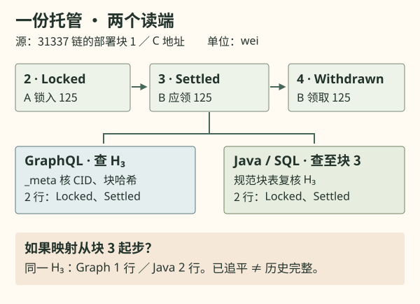

# 第 34 课 · 专用索引：两张账页都追平，就一定相同吗？

客服和 Java 后台各有一张托管报表，都在回答「B 从这份合约累计提走了多少？」客服查到 **125 wei**，截止块 4；后台报 **0 wei**，截止块 3。原始记录是块 2 锁入 125，块 3 把 125 记给 B 应领，块 4 才由 B 提走。值班员该报账目不符，还是先让两边查同一时刻？

**先统一截止块。** 请两边查同一份部署、同一个块 3 的完整哈希：那时 B 有 125 wei 可以领，累计提走却是 **0 wei**。两份不同截止时间的报表不能证明有一边少记。只把查询终点换成同一个块 4 的哈希，其他条件不动，这时又该答多少？累计提走 **125 wei**，剩余应领为 0；说的是合约转出的金额，不一定是 B 扣掉手续费后的钱包净增量。

这是按工单挑选的独立选修。只想看懂报表，可以到这里停；若还想学怎样验证承诺而不收原文，可[另选第 35 课](preimage.html)，不是本题的先修。以下选做双索引实操：用[第 14 课的合约](m04/src/MilestoneEscrow.sol)实际锁款、结算、提款，由两套服务各自从原件建账。[第 18 课](indexing.html)讲扫描书签怎样表示「已查完」，[第 19 课](reorg.html)讲为什么同一高度也要核哈希。只查一笔回执，不必为此多养一份数据库。

## 先写查单合同，不先选数据库

这张单锁定三样东西。**查谁**：链号 31337 上，一笔直接创建交易部署的托管 C，发出日志的地址必须是 C。**查何时**：源节点在高度 N 返回的规范块哈希 H，不是每一方各查一次 `latest`。**查什么**：由部署起至 H 这一段的托管业务日志，每条列出块高、块哈希、交易哈希、块内日志序号、合约、事件种类、涉事人及 wei 原数。两边先交换明细，再计算应领和已领；同一个总数可能来自不同交易。

<figure class="lesson-figure"><a href="../assets/figures/m09/subgraph.svg"></a><figcaption>H₃ 指这一次新链的第 3 块哈希。先在两份账上核对 H₃，再谈为什么其中一份没有 Locked；不能拿另一轮同高度的块作原件。</figcaption></figure>

| 在此块结束时查 | 新增业务日志 | B 在托管中的应领 | 托管累计付给 B |
| --- | --- | --- | --- |
| 1：创建 C | 无 | 0 wei | 0 wei |
| 2：A 锁款 | `Locked(A,125)` | 0 wei | 0 wei |
| 3：A 接受交付 | `Settled(B,125)` | 125 wei | 0 wei |
| 4：B 领取 | `Withdrawn(B,125)` | 0 wei | 125 wei |

这里的 `Withdrawn` 是托管成功转出的毛额，不是 B 支付 gas 后的钱包净增量。若只用本合约这一笔订单，`B 应领 = 给 B 记的 Settled/Refunded − B 的 Withdrawn`。`Locked` 说明资金进了托管，不记作 B 的收入；把三行 `125` 相加会凭空得到 375。若订单走退款分支，要换成付款人 A 作受益人。

## 把回执变成可查的实体

**Subgraph** 可以看成一份可发布的读模型定义，不是一枚新币或一条新链。数据源清单决定看哪些日志，schema 决定留哪些列，映射决定怎样从日志写一行。三者一起编译、部署。这里 Graph Node 从 Anvil 的真实 RPC 取块和日志，执行映射的 WebAssembly，在 PostgreSQL 存实体版本并提供 GraphQL；本地 Kubo 保存 ABI、schema、WASM 与描述它们的清单，不保存客户订单。Java 程序独立从同一个 RPC 读，写同一 PostgreSQL **实例内另一空库**，不读 Graph 的实体表。

打开[清单模板](m09/subgraph/subgraph.template.yaml)。`network: course` 是本地 Graph Node 给 RPC 配的名字，不是网络身份证。实验以[第 16 课读端](m04/handoff.py)核验创建交易、块哈希、合约地址、运行时代码、构造参数和 ABI；再将**本轮实例**的 `address` 和部署块号写入 `source`。不写地址，名字相同的其他合约也可能进账；`startBlock` 推迟则会漏掉真实的旧事件。四个 handler 单独列出，签名里的 `indexed address` 与 ABI 相符。清单并不因为 `startBlock: 1` 就证明那个“1”是本轮发布的块，仍须保留发布清单。

[实体 schema](m09/subgraph/schema.graphql)把每次事件记成不可变的 `Posting`。`amountWei` 用 `BigInt!`，不转换成 `Float` 或 JavaScript `Number`；GraphQL JSON 和 SQL 导出都用十进制字符串。链上 `uint256` 的上界超出 Java `long`，即使还没超过 `long`，先过一次浮点 JSON 中间层也可能丢单位。记录 `kind` 与 `actor`，而非把 `tx.from` 直接叫受益人：默认例子中结算交易由 A 发，`Settled` 中写的却是 B。

[事件映射](m09/subgraph/mapping.ts)只有一个共用写入点。以结算为例：

```typescript
export function handleSettled(event: Settled): void {
  post(event, 'Settled', event.params.payee, event.params.amount)
}
```

1. `graph codegen` 从这一份 ABI 生成有类型的事件包装，`event.params.payee` 读取 indexed 参数，`amount` 读取 `data`。`codegen` 不读区块、不建账；`graph build` 把 AssemblyScript 映射和 schema 编译成可部署工件。
2. `post` 用 `event.block.hash.concatI32(event.logIndex.toI32())` 作主键。本课的事件数在 32 位范围内；`logIndex` 是**这个块内**的序号，每块第一条都能是 0。块哈希与序号组合，只在该部署对应的单链范围内解释。另存交易哈希和完整序号便于追查。映射最后 `row.save()`，不调用订单通知或向钱包转钱。
3. Graph Node 的派生账和 M05 的原始事实表不是同一种历史档案。Graph Node 随规范链恢复与回退，`prune: never` 要求保留本实验的历史版本；[M05 的 `canonical_log`](m05/schema.sql) 则是 Java 自己维护的规范块与日志的联接。这里的 SQL 历史查询是“**当前规范支**至 H 的不可变事实前缀”，不是任意时刻的数据库快照。要保留孤块、回退修正单或追究当时已发出的通知，仍要设计相应的业务表。

## 从空库跑到第 3 块，随后才允许提款

从**仓库根目录**执行。依赖 CPython 3.11、JDK 21、Maven 3.9.x、[M04 锁定的 Forge 1.7.1 与 solc 0.8.28](abi.html#m04-tools)、Node.js 24 与 npm、Docker Engine 与 Compose v2 命令或更高。Graph CLI 0.98.1、graph-ts 0.38.2 及传递依赖使用本课的 npm 锁文件。镜像为 Graph Node v0.45.0（Linux amd64，ARM 宿主需容器引擎支持 amd64）、Kubo v0.34.1 和 PostgreSQL 17.5；另起一只同版 Debian 基础环境容器，只读挂入官方 Linux Anvil 1.7.1 二进制，作为普通用户直接启动链节点，不在这只容器里跑数据库。不要在有对外服务的机器开放管理 API 或解锁的测试 RPC。

```bash
# 首次准备；M04 缓存和 Maven 依赖已齐备时分别跳过相应下载。
bash labs/m04/setup.sh
export PATH="${XDG_CACHE_HOME:-$HOME/.cache}/chain-course/m04/bin:$PATH"
export FOUNDRY_SOLC="${XDG_CACHE_HOME:-$HOME/.cache}/chain-course/m04/bin/solc"
# macOS 多 JDK 环境可用：export JAVA_HOME=$(/usr/libexec/java_home -v 21)
bash labs/m05/build.sh
bash labs/m09/subgraph/setup.sh
```

`setup.sh` 不碰系统 npm：编译依赖在 `${XDG_CACHE_HOME:-$HOME/.cache}/chain-course/m09/subgraph`；镜像在本机 Docker 引擎。首次需网络，准备完成后运行时指定 `--pull never`。复编 M05 时 Maven 缓存齐备可用 `bash labs/m05/build.sh -o`。本实验需空闲宿主回环端口 `18556`（Anvil）、`18557`（PG）、`19340/19341/19342`（Graph 查询、管理、Kubo）。不要停掉别人的节点或数据库来抢端口。

```bash
WORK=$(mktemp -d)
python3 labs/m09/subgraph/run.py --out "$WORK/normal"
```

[入口](m09/subgraph/run.py)为这一轮取独立 Compose 项目名，启动新节点、新库，生成两名临时账户，所有宿主映射都绑定 `127.0.0.1`，Kubo 离线运行；既不读钱包也不导出测试密钥。它用 [M04 编译与部署工具](m04/deployment.py)的同一编译配置重编合约，用原始创建回执和 `handoff` 核对发布；随后真的锁款和结算。不是启动已经有数据的演示站。

此时固定源链头在 3，尚无提款。程序创建本轮 subgraph，以另一个数据库运行原版 [`Scan.java`](m05/src/main/java/course/m05/Scan.java)。它分别从空的派生账追到 3。Graph 从调用 `subgraph_deploy` 之前计时，到查询看见本轮 CID 的游标 3；Java 从启动 `Scan` 之前计时，到其提交并退出。**排除**拉镜像、服务启动、建表、合约与 WASM 编译、上传 IPFS；**包括**各自的调度、Graph 元数据轮询（每 250 ms）或 JVM 启动。Graph Node 的链缓存可能已预热。`report.json.rebuildTo3Ms` 是两种读模型的首次物化墙钟记录，非同构性能跑分，更不是一次空查询的 P99。

默认预期 `AT3 rows=2 creditWei=125 withdrawnWei=0; AT4 rows=3 creditWei=0 withdrawnWei=125` 和 `MATCH_SOURCE`。随后进程清理本项目容器与临时卷，只保留下列可查材料；每轮的地址、CID、哈希、毫秒数都要从自己的输出读，不应照抄别人的数值。

| 输出（在 `--out` 目录） | 复核哪一环 |
| --- | --- |
| `manifest.json`、`handoff.json`、`receipts.json` | 同一次创建、部署块哈希与 C；锁款、结算/退款、提款的原始成功回执。 |
| `project/subgraph.yaml`、`project/Escrow.json`、`project/build/`、`build.log` | 实际地址/起点、ABI、编译后的映射与发布 CID。CID 标识映射部署，**不是**合约地址或区块哈希。 |
| `java-rebuild.txt`、`java-catchup.txt`、`node.log` | Java 首扫、补第 4 块的页日志，以及 Graph Node 处理这份部署的日志；边界拒单时不会有提款或第二次 Java 扫描。 |
| `report.json` | 两边各自的原始视图、同块 RPC 回执解出的行、是否逐字段相等、重建毫秒数与尾部可见延迟。 |

可先离线看一轮[双索引报告](m09/evidence/subgraph/normal.json)和[对应交易回执](m09/evidence/subgraph/receipts.json)。这一轮重建到块 3，Graph 用了 **1,528 ms**，Java 用了 **960 ms**；两份账均含 `Locked` 和 `Settled`。随后块 4 刚出提款回执时，首次采样两端都还差一块。相反，[起点错误的报告](m09/evidence/subgraph/late.json)里，两边都已追平，事件数却不同。比较两种现象时不要跨报告拼哈希。

## 同块读取，并有意留下一个落后的读端

下面是[实际查询程序](m09/subgraph/compare.py)里同一次 GraphQL 请求的核心，变量 `at` 取 `{"hash": "本轮源节点返回的完整块哈希"}`。`_meta` 和实体列表必须**一起**限定块；一个查 `latest` 一个查历史，会把两个时间点印在同一张收据上。

```graphql
query Page($at: Block_height!) {
  _meta(block: $at) { deployment hasIndexingErrors block { number hash } }
  postings(block: $at, first: 10, orderBy: height, orderDirection: asc) {
    height blockHash txHash logIndex address kind actor amountWei
  }
}
```

为什么不用 `first: 1` 看最新一笔？三条原件可能只匹配最后一条，恰好相等无法发现漏扫。这里每块至多一条且总共少于 10 条；大数据集应使用固定块、稳定排序与游标分页，不能把第一页当全集。客户端检查 GraphQL `errors`、`hasIndexingErrors`、`deployment` 与 H；SQL 从 `canonical_log WHERE height <= N` 取明细，同时读 `scan_cursor` 与 `chain_block`，确认游标至少覆盖 N、这个高度的规范哈希确实是 H。两边返回的每行还要能按交易哈希取回成功回执、找到同一个 `logIndex`，并按 C 的 ABI 解出同一角色及整数金额。**这是对本地源的可追溯性，不是独立的共识证明**。链可能重组；查询前后还会按高度复查源哈希。公网要另设最终性和回退策略。

真实提款一出第 4 块，程序暂不启动下一次 Java 扫描。源头 4 时 Java 游标仍为 3，落后 `4−3=1` 块；Graph Node 是常驻消费者，第一次采样可能是 3，也可能已经是 4，不能硬写成一定落后。`afterReceipt4` 同时记录首次采样的块差、从**拿到提款成功回执**到观测到各端追平的墙钟毫秒；Java 是在 Graph 追平后才被主动唤醒，数值包含人为等待。它们适合回答“读端当时够不够新”，不适合声称一个产品天生更快。为了排除“新块覆盖旧回答”，追平后再查 H₃ 和 H₄，前者仍只能有 2 行，后者为 3 行。

```bash
python3 - "$WORK/normal/report.json" <<'PY'
import json, sys
r = json.load(open(sys.argv[1]))
print('rebuild ms:', r['rebuildTo3Ms'], 'lag:', r['afterReceipt4'])
for p in r['pages']:
    print(p['height'], p['hash'], p['match'],
          [(x['kind'], x['amountWei']) for x in p['graph']['postings']])
PY
```

## 只改边界：为什么游标正确却要拒绝签收？

```bash
python3 labs/m09/subgraph/run.py --late-start --out "$WORK/late"
# 预期退出 3；上一轮文件均不动。
```

这轮只把 subgraph 的 `startBlock` 改成 **3**，先不提款。拿本轮源节点的 H₃ 去问两边：游标都已覆盖 H₃，但程序报 `HOLD_VIEW_MISMATCH height=3 graph=1 java=2 receipts=2`。先别看总金额；在 `report.json` 里一行行对，块 3 的 `Settled(B,125)` 两边都有，块 2 的 `Locked(A,125)` 却只有 Java 和原回执有。没有提款，所以两边甚至都可以正确回答「B 已提 0」，但**数额碰巧一致，不代表明细完整**。

再打开本轮 `project/subgraph.yaml`：起点是 3，恰好把缺失事件所在的块 2 排除在外。游标到 3 表示它查到了哪里，不表示从正确的地方开始查。等更多块、重新付款都补不回旧事实；用正确起点部署并重建，再按**本轮**源块哈希核明细，不拿 normal 轮的 H₃ 对 late 轮。

## 独立交接：没有收款方结算的订单

交给同事的单号是 `I-934`，金额 **9,007,199,254,741,034 wei**，付款方等到截止秒改走退款。请从新目录运行 `python3 labs/m09/subgraph/run.py --wei 9007199254741034 --refund --out "$WORK/I934"`。自选一种语言完成一页交班单，不用范例的 `AT3/AT4` 行当答案：列 C、部署 CID、H₃、H₄；按 `(交易哈希, logIndex)` 去三张业务回执定位；分别从 SQL 与 Graph 明细计算**付款方**在两块的应领及累计领取。附实际重建时间、首次采样落后多少块、所用机器/缓存，并指出谁不应该接到“已经收款”的通知。

**过关线：** 块 3 应为 `Locked + Refunded`，两笔不能加成双倍；A 应领全额、累计领取 0，B 两项均 0。块 4 多出 `Withdrawn(A, 全额)`，A 应领归零；报告里第一次和第二次查询同一 H₃ 必须保持相同的两笔事实。两端所有 wei 按字符串或大整数逐位核对。最后在另一新目录只额外传 `--late-start`，指出被漏掉的是哪笔真实回执而不是哪句日志文本。只交一张 GraphQL 截屏、只写“查询很快”或只验证 HTTP 200 均不通过。

**什么时候不加这一份存储？** 已有订单流水、修正单、通知 outbox，而且只为一个 Java 服务按交易哈希查回执，继续用 M05 很可能更省：没有第二套索引需要补历史、告警和迁移。若多个只读应用都要“按受益人和事件种类翻历史”，同一 schema 与可寻址的映射部署才有明确消费者。上线前分别预算历史 RPC 能力、重建窗口、磁盘和版本保留，定义超出容许滞后时谁显示“截至 H”，而不是让 GraphQL 也写入订单或授权交付。

## 查证原文

- [The Graph · Subgraph Manifest](https://thegraph.com/docs/en/subgraphs/developing/creating/subgraph-manifest/)：数据源、`startBlock`、ABI、handler 与索引边界。
- [The Graph · GraphQL API](https://thegraph.com/docs/en/subgraphs/querying/graphql-api/)：按块哈希查历史、`_meta`、分页及未最终块查询的限制。
- [Graph Node v0.45.0 · Docker](https://github.com/graphprotocol/graph-node/tree/v0.45.0/docker)：查询、部署、IPFS 和数据库的职责及运行方式。此课运行完整本地 Graph Node；没有向 The Graph Network 发布、选择第三方 Indexer 或验证其服务承诺。
- [Solidity 0.8.28 · ABI Events](https://docs.soliditylang.org/en/v0.8.28/abi-spec.html#events)：原件如何把 indexed 地址与非 indexed 金额分开编码。
