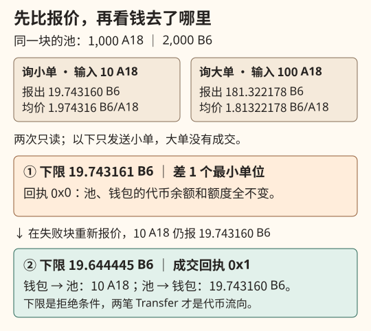

# 第 23 课 · 报价单不是收条：10 枚换多少，100 枚呢？

联调工单 S-23：测试钱包用 **10 A18** 询到 **19.743160 B6**，页面把它乘十，向输入 **100 A18** 的用户显示了 **197.431600 B6**。池里明明还有 2,000 B6，为什么不能这样报价？你要交回三样东西：同一块上两种订单的单价、一笔低于用户下限而回滚的凭证，以及一笔能跟两种代币余额对上的成交。先别改页面的滑点参数：正确的大单报价是 **181.322178 B6**，不是小单的十倍。

先修：[13 · ABI 与整数](abi.html)、[17 · 查回执](rpc.html)、[22 · 代币精度与授权](allowance.html)。本课只用自己在回环节点上新建的两种 `LabToken`；符号不是价格，下文没有真实资产、参考美元价或交易建议。

## 一张账页：池子没有挂单人，靠什么算价？

把**储备**理解为池地址此刻持有的两种代币。我们只做一个方向：钱包付 A18，池给 B6。池子是自动做市商（AMM）：与钱包成交的是按规则行动的合约，不是等待确认订单的人。实验合约把两种可信代币的 `balanceOf(pool)` 直接当作储备。它既不读取外部价格，也不承诺未来还按本次价格卖。

设池里有 `x` 个 A18 最小单位和 `y` 个 B6 最小单位。先不收费，不做整数舍入：收到 `dx`，付出 `dy`，定价规则要求 `(x + dx) × (y − dy) = x × y`。于是 `dy = y × dx / (x + dx)`。为什么量大不按比例多给？把式子除以 `dx`：每单位输入换到的输出是 `y / (x + dx)`，输入越大，分母越大。初始储备是 **1,000 A18 / 2,000 B6**，以整币为单位计，原点附近的不含费边际汇率为 **2 B6/A18**。两千枚是库存，不是「每枚 A18 都能以 2 B6 成交」的承诺。

<figure class="lesson-figure"><a href="../assets/figures/m06/swap.svg"></a><figcaption>读横向两栏时不要移动储备，它们是同一块的两次读取。沿纵向读两张回执时才推进区块：失败不交换代币，成功才改变下一次的报价。</figcaption></figure>

## 手算小单：先扣哪种费，最后舍掉哪一位？

本池的手续费率固定 **30 个基点**（30 bp，1 bp = 0.01%，故为 0.30%）。用户付足 `dx`，但只有 `0.997 × dx` 参与**本次定价**。这 0.30% 留在池里，并非另向钱包收取 B6，也不是用 ETH 支付的 gas。输入 10 A18 时，毛输入是 10，计价输入是 9.97，费对应 0.03 A18。

打开[单向池合约](m06/src/CoursePool.sol)的 `quote`。合约不做小数运算，下面是用原始整数复算的顺序：

```text
x  = 1000 × 10¹⁸       # A18 raw
y  = 2000 × 10⁶        # B6 raw
dx =   10 × 10¹⁸       # A18 raw
withFee = dx × 997
Q = floor(withFee × y / (1000 × x + withFee))  # B6 raw
```

`997 / 1000` 同时留在分子和分母里，**到最后才做一次整除**；不要先把有效输入取整成 9 枚。数字缩写后，小单的 `Q` 等于 `floor(9970 × 2,000,000,000 / 1,009,970)`，得到 **19,743,160 个 B6 最小单位**。被舍掉的约 0.688 是**不足一个最小单位**，不是舍掉 0.688 枚 B6。最终展示除以 `10⁶` 而非 `10¹⁸`；数据表里用整数，展示可以写 `19.74316` 或补足为 `19.743160`。

把 `dx` 换成 100 A18，但暂不成交。下面都是**同一储备的计算预期**，小数的单位不能省：

| 输入（A18） | 本次计价输入（A18） | 报价 Q（B6 raw） | 输出展示（B6） | 平均每付 1 A18 所得（B6/A18） |
| --- | --- | --- | --- | --- |
| 10 | 9.97 | 19,743,160 | 19.743160 | 1.974316 |
| 100 | 99.7 | 181,322,178 | 181.322178 | 1.81322178 |

说「价格影响 9%」前请写清分母。若按**不含费的初始边际价** 2 比，100 枚单的平均汇率折让为 `1 − 1.81322178 / 2 ≈ 9.3389%`，里面**已经包含**手续费。若要隔开曲线造成的影响，就跟**已扣费、尚无曲率影响**的 `2 × 0.997 = 1.994 B6/A18` 比：小单折让约 **0.9872%**，大单约 **9.0661%**（均含末位整除的微小影响）。两种口径都不是用户填写的「滑点容忍」。转到 Java 时，三个原始金额及乘积用 `BigInteger`；不要为了求平均单价就把结算输入转为 `double`。展示用除法与真正决定 `Q` 的整除应分开。

## 用户填 0.50%，链上究竟检查什么？

**报价** `Q` 是在某块用某个方向、输入和储备问得的结果；`eth_call` 没有锁住库存。**价格影响**已经在这份报价里。**滑点容忍**是用户愿意让执行结果比这份报价差多少；**实际滑点**需要等到成交，拿实际输出与下单参照的 `Q` 比。本例两笔交易之间没有其他换手，成功那笔应实收 `Q`，实际滑点为 0，但相对于初始边际价的价格影响并不为 0。

客户端把容忍度转换为**输出币的整数下限** `minOut`，而不是把百分数字符串交给池。这里承诺「实收相对 Q 的降幅不超过 50 bp」：`minOut = ceil(Q × 9950 / 10000)`。小单 `Q × 0.995 = 19,644,444.2` 个 B6 最小单位，下限取 **19,644,445**。向上取整才能不跌穿用户指定的精确比例；允许向下取整的接口边界会差一个最小单位，不能凭 UI 标签猜。这个 50 bp 不是池子的 30 bp，也不是预计一定会少给的钱。

读 `swap(amountIn, minOut)` 的三步，顺序和账页有关：

1. **以执行时的储备重算** `amountOut = quote(amountIn)`。没有「把前端算的输出原样发给用户」这一步。若 `amountOut == 0` 或小于 `minOut`，立刻回滚。两者相等是允许成交的边界。
2. 通过输入币的 `transferFrom(msg.sender, address(this), amountIn)` 拉入全部毛输入。授权的 **spender 是池地址**，所需额度是 10 A18，不是扣费后的 9.97。接着输出币的 `transfer(msg.sender, amountOut)` 从池转给用户。这两次转移在同一笔交易中；本池检查两个布尔返回值，不能把返回 `false` 当作转账成功。
3. 最后池才发 `Swap(trader, amountIn, amountOut)`。两种代币各自发自己的 `Transfer`。外部交易发给池的 `value` 是 0 wei，不表示没有代币流动；回执顶层也不直接给出 `swap` 的返回值。要看代币日志和持仓变化。

## 在本地拿证：先发会失败的一笔，再重报小单

从**仓库根目录**、在 Bash 中运行。需要 Python 3.11 标准库和[第 13 课工具](abi.html#m04-tools)：Forge / Cast / Anvil 1.7.1、solc 0.8.28。初次安装执行 `bash labs/m04/setup.sh`（仅下载并核验编译工具）；已安装不用重下。实验本身不联网，使用 Cancun、chain ID 31337 的一次性 Anvil，只绑定 `127.0.0.1:18623`。端口被占用就先停，不连接已有节点；不需要公共 RPC、浏览器钱包、私钥或助记词。

```bash
export PATH="${XDG_CACHE_HOME:-$HOME/.cache}/chain-course/m04/bin:$PATH"
export FOUNDRY_SOLC="$(command -v solc)"
unset ANVIL
WORK=$(mktemp -d)
set -o pipefail
python3 labs/m06/swap.py | tee "$WORK/s23.log"
```

[驱动程序](m06/swap.py)通过[共享链工具](m06/chain.py)建新链，结束时关闭。先读 `run`：用第一个解锁测试账户分别部署两份[第 22 课的代币实现](m06/src/LabToken.sol)，A18 总量 1,100 枚、18 位小数；B6 总量 2,000 枚、6 位小数。再部署只认这两个地址的池，向池拨入 1,000 A18 和全部 B6，把余下的 100 A18 发给第二个账户（用户钱包）。钱包只在 A18 上批准本次下单额度。用输出的 `PAIR` 行把两个代币地址、池地址和钱包地址对应起来；下次运行这些地址和哈希不要求相同。

沿日志读四个检查点：

1. **`BASE` / 两行 `QUOTE`。** 取授权回执的块号为基准，同时保存块哈希。`state()` 用同一块的五次只读查询拿到池两余额、钱包两余额、钱包对池的 A18 额度；`quoted()` 把小单、大单的 `eth_call` 都固定到该块，用 Python 整数按储备复算返回值。大单即使只有 10 A18 额度也能得到报价：询价不检查钱包，不是可成交性证明。
2. **`REJECT_RECEIPT`。** 在无其他写入时，刻意把小单的下限设成 `Q + 1 = 19,743,161` 个 B6 最小单位。共享发送器给显式 gas，使交易能上这条本地链，而不仅仅被 gas 预估挡下。保存这张原始回执：应有 `transactionHash`、`blockHash`、`status=0x0`、空 `logs`，且 `gasUsed > 0`。`state()` 再读失败块，五个读数应与基准完全相同。**不换币不等于免费**：脚本还把钱包原生 ETH 的减少额对上 `gasUsed × effectiveGasPrice`（wei）。仅看状态位不能诊断任意交易；本课结合输入、未变的储备和已知合约检查顺序，才知道是哪道门槛挡下它。
3. **`REQUEST fill` / `FILL_RECEIPT`。** 在失败块上**重新报价**，同样的 10 A18 应仍报 19,743,160。用这次报价计算下限 19,644,445，再发一笔。两张回执保留在同一条链上，无需删除一个分支。`check_event()` 按「发出日志的合约地址 + 事件签名 topic」挑出每条证据，再逐字核对 indexed 地址与 data 里的整数。找到 `A18.Transfer(钱包→池, 10 × 10¹⁸)`、`B6.Transfer(池→钱包, 19,743,160)`、`池.Swap(钱包, 10 × 10¹⁸, 19,743,160)`，才能与同块余额一起认定交换内容。额外的额度通知不是转账；不要简单按 `logs[0]` 或日志条数核销。
4. **最后一行 `QUOTE`。** 成交块的储备已经变了。再询同样的 10 A18，预期 **19,356,609 个 B6 最小单位**。这是新价格，不是又发生一次成交；不要拿这次报价去解释前一笔的输出。若实验先成交再跑反例，必须重新报价或恢复同一储备，并保证有足够余额和额度，否则会把另一种失败硬说成越过下限。

默认输入下的**对账预期**如下。`STATE_RAW` 中 A18 是 `10⁻¹⁸` 枚一格，B6 是 `10⁻⁶` 枚一格；此表已换成整币展示，只在列名中标单位。图里写 `0x0` 与 `0x1` 是回执状态，不是执行了零笔或一笔报价。

| 观察时点 | 池 A18 | 池 B6 | 钱包 A18 | 钱包 B6 | 钱包给池的额度 A18 |
| --- | --- | --- | --- | --- | --- |
| 同块询价 | 1,000 | 2,000 | 100 | 0 | 10 |
| 下限多 1，回执失败 | 1,000 | 2,000 | 100 | 0 | 10 |
| 放宽下限，回执成功 | 1,010 | 1,980.256840 | 90 | 19.743160 | 0 |

对账时，池的输入增量是 **10** 而非 9.97。按整币单位，成交后的实际储备乘积 `1010 × 1980.256840 = 2,000,059.4084 A18·B6`，高于原来的 `2,000,000 A18·B6`。教科书里的「恒定乘积」用于定价；留池的费用及输出向下取整意味着**实际**储备乘积不减，不是必须严格相等。失败分支则连这笔代币乘积都没有改变。

## 为什么不能拿这几行当通用报价器？

本课是两份已知、无转账扣费、无回调的本地代币，单跳、单向、固定 30 bp，储备用合约当下的代币余额；直接给池转币会改变储备。没有 LP 份额、取回流动性、路由、截止时间或价格预言机，也没有通用资产的兼容与安全保证。不要将任何有价值的资产转给它。`minOut` 只能约束这笔调用的最低代币输出，不能证明报价公允，不能限制 ETH 执行费，也不能替代有效期或网络、地址检查。

Uniswap v2 的参考库里，`quote` 是按储备比例换算，`getAmountOut` 才是带费的单跳兑换输出；本课自行命名的 `CoursePool.quote` 对照的是**后者**，不表示实现了 Uniswap v2。到 v3，流动性提供者可以选择上下价格边界。比如两个头寸分别覆盖 `[1.0, 1.2)` 和 `[1.1, 1.3)` 的教学价格区间；价格在 1.15 时两份流动性都在区间内，在 1.25 时只剩第二份。这些数字仅用来区分谁生效，不代表本池或某个真实交易对。实际 v3 用 tick 表示边界；一次兑换可能跨越已初始化的 tick，使当前活跃流动性发生变化，需要分段推进价格、按该池费率结算。**读出整个 v3 合约两种代币的总余额，不能代入本课的 `x, y, 997` 求输出。** 接实际协议时先辨版本和价格单位，再用其官方报价机制，并明确参考块。

## 独立作业：审一张不同面额的下限申请

测试员提交 S-23B：输入 **25 A18**，钱包只批 25；仍用同一初始储备，仍承诺最多少收 50 bp。请先独立写下 `Q`、拒绝下限、允许下限、成交后五列账页。再从仓库根目录沿用上面的环境，运行：

```bash
python3 labs/m06/swap.py --trade-in 25 | tee "$WORK/s23b.log"
```

交付一份对照：基准块号与块哈希、同块两笔不同大小的报价、两笔提交各自的 `minOut`、交易哈希、回执状态，以及本轮能匹配的代币转移日志地址和金额。失败行还要说明花了多少 wei、为什么额度仍可用。对照原始 `REJECT_RECEIPT` 和 `FILL_RECEIPT`，不要拿第一轮的地址来解第二轮日志。

**答案判据：** 新小单 `Q = 48,637,705` 个 B6 最小单位；下限 48,637,706 失败，下限 **48,394,517** 可成交；大单没有改变，仍报 181,322,178。成功后，池持有 **1,025 A18、1,951.362295 B6**，钱包持有 **75 A18、48.637705 B6**，授权归零。若报表填的是 48.394517 B6，那是填写的下限，不是钱包收到的金额；指出哪一条 `Transfer` 与哪一个余额差能纠正它，才算过关。

## 查证原文

- [Uniswap v2 官方库：对照 `quote` 与 `getAmountOut` 的分子、分母和整除](https://github.com/Uniswap/v2-periphery/blob/master/contracts/libraries/UniswapV2Library.sol)。
- [Uniswap：Concentrated Liquidity，读价格区间、活跃流动性和 ticks](https://developers.uniswap.org/docs/get-started/concepts/liquidity-providers/concentrated-liquidity)。
- [ERC-20：精度、授权、布尔返回值与 Transfer 事件](https://eips.ethereum.org/EIPS/eip-20)；[EIP-658：回执状态码不等于失败原因](https://eips.ethereum.org/EIPS/eip-658)。
