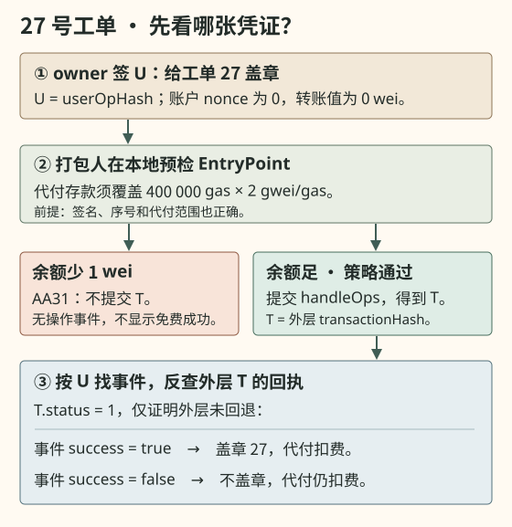

# 第 27 课 · 打包交易成功，为什么工单还没盖章？

活动方出手续费，用户要给 27 号工单盖章。工单被冻结。客服拿到三行记录：「整包已处理（状态 1）」「本次盖章操作失败（false）」「工单台记录 0，代付存款比刚才少了」。该告诉用户「已盖章」，还是告诉活动方「没盖成，所以没花钱」？

**两句都不对：没有盖章，活动方仍花了钱。** 打包人提交的外层交易负责把请求交给入口合约；入口可以如实记下其中一项失败，而不撤销整包。要查这笔工单，看的是它自己的操作结果和工单台的读数，不是外层的 1。要报销，看代付存款前后差了多少；券上限 800,000,000,000,000 wei 不是实付金额。

回到提交前，其他都一样，只把 27 号工单从冻结改为开放。这回外层仍是 1，客服还需要看什么才肯勾「已盖章」？看这次操作是否成功、同块的工单台读数是否从 0 变为 27；两项都对，才记「已盖章，由活动方代付」。这是比较两种初始条件，不是让用户把已经用过的请求再发一遍。

只想读懂谁办事、谁付费，可以转到[第 28 课：可领取与已经到账有什么区别](withdrawal.html)。以下选做本机实验。判断执行结果用[第 12 课的回执](receipts.html)，核费用用[第 11 课的余额差](evm.html)；还会用到[序号](nonce.html)、[ABI 字段](abi.html)、[按来源找日志](indexing.html)和[消息签名](siwe.html)。实验采用 ERC-4337 参考实现 v0.7.0，不用真钱、公共钱包或收费服务。具备相应设施的 L2 也可采用它；它不是 OP Stack 专用交易，本课不测 L2 数据发布费或跨层最终性。

## 别让一个 `txHash` 列承担两种承诺

用户授权「用我的智能账户给工单盖章」，不是「用我的外部账户把一笔普通交易广播到链上」。在这条 4337 路径上，可以把客服手里的字段拆成两层：

| 身份 | 本单实际做什么 | 不能凭它证明什么 |
| --- | --- | --- |
| 账户持有人 `owner` 与智能账户 `sender` | 前者在本地签请求；后者是已部署的 `SimpleAccount` 代理，按自己的验证逻辑认签名，执行 `execute(desk, 0, record(27))` | `owner` 与 `sender` 不是同一地址；签过字不代表入块，也不是给 bundler 一把私钥 |
| 打包人 `bundler` | 收到 UserOperation（一份含调用、费用、nonce、签名的请求），选择操作、形成外层 `handleOps` 交易，用自己的外部账户提交并向网络付外层 gas | 一个包可以有多次操作；交易哈希不是任何一个操作的哈希。获准进入操作池也不等于已上链 |
| 入口合约 `EntryPoint` | 对账户验签、检查序号与预付资金，请 paymaster 判断是否代付。通过后调账户，记录逐操作事件，结算给 `beneficiary`（本例为打包人） | 普通回执的 `status` 只讲整笔外层交易有没有回退。要判断具体操作，还要读入口产生的事件 |
| 代付合约 `paymaster` 与业务合约 `TicketDesk` | 前者限制资助哪个账户、什么调用、最多多少钱；资金来自它在入口合约的存款。后者才决定能否盖章 | 代付不是免 gas，不保证业务成功；余额够也不是业务授权。业务是否生效要按其具体语义核实 |

在数据库里，可把一次操作的检索键记作 `(chainId, entryPoint, userOpHash)`，其上链位置另存 `(blockHash, transactionHash, logIndex)`。这不是普适的业务幂等键：重新报价、换 nonce 重签会得到不同操作；发生重组还要让原位置失效。工单号是另一列业务标识，不用 27 充当链上 nonce。本地只提交一项便于追踪，不意味着两个哈希一一对应。

<figure class="lesson-figure"><a href="../assets/figures/m07/userop.svg"></a><figcaption>按 U 找操作，按 T 找整包。左支停在本机预检；右支只有这包确实入块、回执仍在所查链上，才谈操作结果。图中 U、T 是字段代号，不是可查询的哈希。</figcaption></figure>

## 哪些字节获准使用这张代付券？

本实验固定早于 7702 的 v0.7 格式，不混用其他版本的 ABI 或签名域。账户预先创建，故 `initCode=0x`。先用 ABI 编码业务调用 `record(uint32)` 的参数 27，再将这串字节放入 `SimpleAccount.execute(address,uint256,bytes)`，目的地址是本次部署的工单台，转出原生币为 **0 wei**。把这个完整的 `callData` 交给 [TicketSponsor](m07/userop/Ticket.sol)，只认可事先算好的完整字节串的哈希；不仅比较前四字节的函数选择器。因此即使是同一个账户，请求 `record(28)`、换接收方、改转账值或改成批量执行，都不在这张券的范围内。

另外三道边界都在链上：只有指定 EntryPoint 可以调代付验证；限定一个智能账户，**完整 nonce 必须为 0**（本例 key=0、sequence=0）；入口传给代付验证的最大预付额不得超过合约常量 `CAP_WEI`。实际 nonce 由入口按账户与 key 管理，即便一次已验证的操作执行失败也用掉序号 0。下次想用新序号花同一张券，不会因为存款还有余额就获准。反之，整包验证失败并回退时序号不会被占用。这里的「一次」以这条链的规范状态为准，不是跨链或跨重组的承诺。

最后区分两种钱：`EntryPoint.balanceOf(paymaster)` 是可被本次预扣的 **deposit**，不是 paymaster 地址的普通 ETH 余额；某些公共操作池要求的质押 **stake** 则是另一个条目，不拿来抵本单的 gas。实验先以一笔独立的准备交易 `depositTo(paymaster)` 注资，不把它当成外层操作交易。余额只是支付能力；有人额外注资也不会抬高合约写死的单券上限。这套限制只针对这次封闭实验及其已知的账户/工单实现；现实中的可升级账户还要核对实际代码、升级权限和策略有效期，不要把识别 calldata 当成对未来执行效果的保证。

## 先算准入金额，再算结算金额

v0.7 的 `PackedUserOperation` 把账户验证/执行限额各占 128 位塞进 `accountGasLimits`，优先费/最高费各占 128 位塞进 `gasFees`，都是前者在高位。`paymasterAndData` 在本例是地址 20 字节、代付验证限额 16 字节、`postOp` 限额 16 字节，共 52 字节，没有额外数据。代付验证返回空 `context`，所以没有后续 `postOp` 回调；**最终支出以 EntryPoint 的事件为准**。

| v0.7 预付计算的项目 | 本次输入（gas） | 用在哪里 |
| --- | ---: | --- |
| `verificationGasLimit` | 150000 | 账户验证阶段的限额 |
| `callGasLimit` | 100000 | 账户执行业务调用的限额 |
| `preVerificationGas` | 65000 | 操作分摊的外围开销；本地固定的教学输入，不是实时估价 |
| 代付 `verificationGasLimit` / `postOpGasLimit` | 85000 / 0 | 代付验证 / 代付后处理 |

四项与零项相加是 **400000 gas**。本例把 `maxFeePerGas` 与 `maxPriorityFeePerGas` 都设为 **2 gwei/gas = 2000000000 wei/gas**。于是入口先要求 `400000 × 2000000000 = 800000000000000 wei = 0.0008 ETH`。**少一 wei 即拒绝，恰等于可以过资金检查**，但仍须过授权和范围检查。不要拿预估的实际消耗来代替准入所需预付额。

在本单正常或业务冻结的路径，事件里的 `actualGasCost = actualGasUsed × 2000000000`，未用的预付金额退回代付存款。v0.7 这里会在计量中考虑未用执行 gas 的惩罚，不要把 `actualGasUsed` 解释成工单函数单独消耗的 gas。若改变费率，本实现通常按 `min(maxFeePerGas, maxPriorityFeePerGas + block.basefee)` 计价；本例两字段相等，所以可以按常数复算。外层网络费才是 `receipt.gasUsed × receipt.effectiveGasPrice`；它与该操作归集的费用口径不同，即使只有一个操作也不能用前者覆盖后者。

**数值边界**：128 位是打包宽度，不是 v0.7 入口实际允许的上限。入口对这七个 gas 限额/费率字段作按位 OR，要求各值不超过 `2^120 − 1`，超过即 `AA94`。因此五个 gas 项求和小于 `5 × 2^120`、再乘最高费率小于 `5 × 2^240 < 2^256`；前述预付公式不会在该检查后绕回。本地更窄：预算只接受整数 `[0, 800000000000000]` wei，工单号只接受 `uint32`（0 至 4294967295），合约只代付其中的 27。Java 端用 `BigInteger` 解析、先限范围再拼字段，勿用有符号 `long` 表示任意链上费用字段，也不要对超界输入截高位。

## 在回环链上从一个哈希追到另一个

在**仓库根目录**使用 Bash、Python 3.11 标准库、`lsof`、`curl`、`openssl`、Cast/Anvil 1.7.1、solc 0.8.28。需要工具时按[第 13 课固定版本安装](abi.html#m04-tools)。`prepare.sh` 只下载 `@account-abstraction/contracts@0.7.0` 官方发行包并核对 npm 发布的 SHA-512；缓存齐全后，例程只作离线核验，**不会自动下载**。没有 Node.js、钱包插件、付费 RPC 或公共 bundler 依赖。

```bash
export PATH="${XDG_CACHE_HOME:-$HOME/.cache}/chain-course/m04/bin:$PATH"
export FOUNDRY_SOLC="$(command -v solc)"
unset ANVIL
bash labs/m07/userop/prepare.sh
WORK=$(mktemp -d)
python3 labs/m07/userop/run.py > "$WORK/open.txt" && cat "$WORK/open.txt"
```

每次都在空闲的 **127.0.0.1:18727** 起全新 Anvil（31337，Cancun），节点随机生成临时测试账户，退出即关闭；不接受外部 RPC。部署官方包内 **EntryPoint 与 SimpleAccountFactory 的创建字节码**，由工厂创建单签账户；只把课程的 `TicketDesk` 与 `TicketSponsor` 用 solc 编译。本地入口地址来自部署回执，不是公共链的固定地址，更不能直接拿去配置主网。

顺着[例程 run.py](m07/userop/run.py)读四步：

1. `setup()` 读回 `owner()`、`entryPoint()` 及券上限。`NETWORK` 留下准备块的高度/哈希；`ROLES` 列出本次临时角色。本例第一名节点账户兼做测试注资人、打包人和受偿人，第二名只给操作签名；paymaster 和智能账户仍是不同的合约地址。
2. `build_bundle()` 先将签名留空，调 **本次 EntryPoint 的** `getUserOpHash(op)` 得 U。v0.7 先承诺除签名外的操作字段（动态字段先哈希），再把内部哈希、入口地址和链号作 ABI 编码并哈希。这个版本的 `SimpleAccount` 对 U 使用 Ethereum Signed Message 的 **32 字节消息**前缀验签，因此向本地 `personal_sign` 传 U 的字节，不是字符 `0x…` 的 UTF-8，也不是照抄新版的 EIP-712 签名。拿到 U 只说明可以索引这份请求，不证明有人已经接单。
3. `trace()` 在准备块上先用 `eth_call` 演算完整 `handleOps([op], beneficiary)`。拒绝时没有提交；通过后才调用 `eth_sendTransaction`。**这里只代做组包、预检和提交，不运行 bundler 服务**，没有操作池、广播、信誉/质押检查、竞争排序或公共 RPC 接纳保证。该 `eth_call` 也不会提交或持久化业务的写入；如果业务回退被入口捕获，它仍可能成功返回。
4. 查日志时以 `address=本次入口`、`topics[0]=keccak256(UserOperationEvent(bytes32,address,address,uint256,bool,uint256,uint256))`、`topics[1]=U` 定位。读出这条日志的 **`transactionHash`（T）**再调 `eth_getTransactionReceipt(T)`；核对同一块哈希、`logIndex`、其余两个索引地址和数据。非索引数据恰好四个 32 字节字，依次是 `nonce, success, actualGasCost, actualGasUsed`。最后读回回执所在块的代付存款和工单状态。若使用支持 4337 的 bundler，可用 `eth_getUserOperationReceipt(U)`，其中 `receipt` 仍然是整包的交易回执；普通 `eth_getTransactionReceipt(U)` 查不到不是「交易已失败」。

可以把默认运行的输出当一张查件单，先盖业务章再核费用。输入是用户授权的那次操作编号 U；`LINK` 指向另一编号 T，即打包人发出的交易。打开 T 的 `RAW_RECEIPT`，别停在最上面的状态 1。顺着入口地址和索引参数 U 找到**那一项操作**，读它的 `success`。只有 `opSuccess=true` 且同块的工单读数 `recorded=27`，这张单才办成。即使只装了一项，也不能用 T 顶替 U。

费用另查 `FEE`：`depositBeforeWei − depositAfterWei` 应等于 U 那条事件的 `actualGasCost`（以 wei 计）且大于 0。前者说明谁的钱少了，后者把费用对回这次操作。默认预期汇总是 `RESULT RECORDED outerStatus=1 opSuccess=true nonceAfter=1 recorded=27`；哈希、块号和实际费用请取本轮记录。本实验不据此判断 L2 最终性。

## 换一个输入：是拒单，还是付了费没盖成？

下面各轮新开一条链，不复用上轮的账户或哈希。

```bash
python3 labs/m07/userop/run.py --mode held > "$WORK/held.txt" && cat "$WORK/held.txt"
rc=0; python3 labs/m07/userop/run.py --budget-wei 799999999999999 > "$WORK/short.txt" || rc=$?
cat "$WORK/short.txt"; test "$rc" -eq 3 && grep 'RESULT REJECTED_DEPOSIT' "$WORK/short.txt"
rc=0; python3 labs/m07/userop/run.py --ticket 28 > "$WORK/scope.txt" || rc=$?
cat "$WORK/scope.txt"; test "$rc" -eq 3 && grep 'RESULT REJECTED_SCOPE' "$WORK/scope.txt"
```

| 改变的事实 | 文件内应找到的证据 | 对客服怎么说 |
| --- | --- | --- |
| 27 号工单被冻结 `--mode held` | 有 U、T，`outerStatus=1` 而逐操作 `success=false`；另一个入口事件 `UserOperationRevertReason` 中是工单台的 `TicketHeld()`。`nonceAfter=1 recorded=0`，存款差额仍是正的实际费用 | 打包成功，业务失败，已扣代付费。脚本退出 0 表示正确辨认这个结果，**不是**工单成功；不沿用旧 nonce 重发 |
| 代付存款少 1 wei | `RAW_REVERT` 是节点返回的 `FailedOp(0,"AA31 paymaster deposit too low")` 编码，不是回执。退出 3；`outerTx=absent opEvents=0 depositWei=799999999999999 nonce=0 recorded=0` | 此打包器预检拒绝这项请求；没有对应**操作的外层交易**可查，不虚构 T。链上仍有部署与注资交易 |
| 资金足，但请求工单 28 | `FailedOpWithRevert` 中是 `AA33 reverted` 及代付合约的 `OutsideVoucher()`；退出 3，存款未变 | 拒绝原因是代付范围，不是换一台 RPC 或多存钱就能解决 |

再将 `--budget-wei` 设为 `0`，也应是 `REJECTED_DEPOSIT`，此时余额确实已空；而 `--budget-wei 800000000000001` 会在启动节点之前被参数检查拒绝（退出 2），不是链上拒绝。超时、端口冲突、工具失败、未知 revert 或没有可核对的日志都不能归作上述任何业务状态。公开服务一时查不到哈希，也不能据此断定从未提交；本地「未提交」有脚本控制流和同一节点的前后状态共同支持。

## Safe、4337、7702 是三道不同的问题

| 产品问题 | 可选机制 | 选型时仍须回答 |
| --- | --- | --- |
| 财务、运营、审计三位持有人，谁有权批准？ | Safe 的常规所有者交易路径可设 **2/3 threshold**；两位不同且当前有效的 owner 确认同一笔 Safe 交易才够，重复同一人的签名不算两个 | 达到阈值只是授权条件，不生成免费 gas，也不保证目标执行。已启用的 module 可能走另一条执行路径，需单独审查权限。Safe 可通过匹配模块与 4337 组合；本例 `SimpleAccount` 不是 Safe |
| 用户不持原生币，如何提交、如何限额并对账？ | 4337：账户验签，bundler 提交，EntryPoint 检查与结算，paymaster 按策略代付 | 查操作事件与外层回执，谁获得资助、预算谁承担、什么情况拒绝。无需把阈值或某种特定账户实现写死在打包器里 |
| 要保留已有 EOA 地址，让调用该地址时能执行账户逻辑？ | **EIP-7702**：在支持该升级的链上，EOA 的授权元组可使其代码记录委托指示器，所指代码在该 EOA 的上下文运行；无需搬去一个新合约地址 | 授权绑定链号（规范也允许 0，不能视为单链授权）、实现地址和 nonce，**不是对每个业务目标/金额的一次性许可**。有效委托会跨交易保留，须更改或撤销；即使当次随后的执行失败，已处理的委托也不因此回滚。它本身不设 2/3 阈值，不提供本券的额度，更不自动启用 4337 服务 |

若需求只是「两人盖章才付款」，先设计授权与恢复流程；若是「替新人付一次 gas」，先写清代付范围及拒绝证据；若要延用老地址，再审查委托实现、授权展示、撤销与目标网络支持。三者可以在兼容的版本里配合，却不是互斥的三种钱包品牌。本课的 Cancun 链与 v0.7 用例不执行 7702 授权，也没有测试 Safe 模块，不能把流程对照表贴成兼容证明。

## 独立作业：给客服两张不会报反的凭条

第一位客服只给你一份被冻结工单的 `RAW_RECEIPT`，不许直接引用 `RESULT` 行。保存原始 JSON，标出 U 所在日志的发件合约、索引位置、T、块哈希；按 ABI 数满四个数据字，读出 `actualGasCost`。单凭这张回执能证明「目标合约没有记录工单」吗？补取本轮同块的 `GETTERS` 读数，并用 `FEE` 的前后存款之差复算费用。答案应能同时说明「`status=1`」「事件 `success=false`」「有正费用」「工单台读数仍为 0」四者并不矛盾；最后一项不能只凭没有业务日志。

第二位客服把券余额设为 **0 wei**，仍请求 27。独立留存准备块及入口、U、原始预检错误、退出码与结束时的余额/nonce/日志数；再让余额恰等于预付额，只把工单改为 **4294967295**。两次都应没有 T，但第一份结论依赖 `AA31`，第二份依赖带 `OutsideVoucher()` 的 `AA33`；两次都不能写「交易失败，已收 gas」或「免费成功」。若把工单再加 1，则已不是能编码进 `uint32` 的请求。提交一张两行拒绝凭条，在费用栏明确区分「没有提交这次操作」与「本地部署准备没有成本」——后者不是本实验的结论。

## 核验原文

- [ERC-4337：Account Abstraction Using Alt Mempool](https://eips.ethereum.org/EIPS/eip-4337) 与 [ERC-7769：bundler 的 JSON-RPC](https://eips.ethereum.org/EIPS/eip-7769)。看角色、操作池与双层回执；通行规范可能演进，不用最新版哈希域回算 v0.7 的数据。
- [npm 的 0.7.0 发行记录与完整性摘要](https://registry.npmjs.org/@account-abstraction/contracts/0.7.0)、[同版 EntryPoint.sol](https://github.com/eth-infinitism/account-abstraction/blob/v0.7.0/contracts/core/EntryPoint.sol)、[IEntryPoint 事件 ABI](https://github.com/eth-infinitism/account-abstraction/blob/v0.7.0/contracts/interfaces/IEntryPoint.sol)、[SimpleAccount 的验证与执行](https://github.com/eth-infinitism/account-abstraction/blob/v0.7.0/contracts/samples/SimpleAccount.sol)。对照 `getUserOpHash`、`_getRequiredPrefund`、`_validatePaymasterPrepayment` 和 `_postExecution`，不要只据错误码猜扣款对象。
- [Safe 官方：owners、threshold、常规交易与模块](https://docs.safe.global/advanced/smart-account-concepts)；[EIP-7702：委托元组的处理与持久性](https://eips.ethereum.org/EIPS/eip-7702)。重点对照「谁有权批准」「哪段代码在哪个地址的上下文运行」与「谁付费」。
