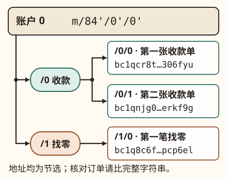
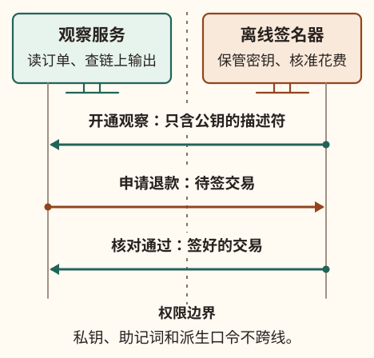

# 第 03 课 · 钱包到底保存什么？

店里换了收款手机。一位客人拿着昨天的第二张单来问：「还付到单上这个地址吗？」单上地址的末尾是 `erkf9g`，新手机上却是 `306fyu`。要答他，得先弄清楚：换手机的时候，究竟什么跟着换了？

## 换了手机，要把钱搬过去吗？

不用。比特币付款时，客人的手机不是把一份「钱」传进店员的手机。**收款地址**是店家给客人的一串字符，告诉他这笔款付到哪里。付款一旦记进那本大家共同核对的账，店里的手机就是关着，记录也在。

钱包帮店主看这本账，找出自己收到、还没花掉的钱。等店主要花钱时，需要用一把秘密的钥匙给付款签字，这把钥匙叫**私钥**。新手机没显示旧收款，不会让那笔钱消失。但如果唯一的钥匙随旧手机一起丢了，又没有备份，记录虽然还在，店主也花不了那笔钱。客人只需要收款地址，不需要钥匙。

## 替店员核对一次

这家店每开一张单，就从同一个钱包取一个新地址。桌上留下两张单，新手机的屏幕也亮着。下面只写末六位，方便对照；这些是公开教学样本，不要真的转账。

| 你看到的记录 | 收款地址的末六位 |
| --- | --- |
| 第一张单的存根 | `306fyu` |
| 第二张单的存根（客人手里那张的底单） | `erkf9g` |
| 新手机屏幕：「收款 · 第一个地址」 | `306fyu` |

同事想把第二张存根改成手机上那串。你会同意吗？用手指从「第二张单」移到「新手机屏幕」：末尾不同，肯定不是同一串。再看屏幕上的字：新机正在显示**第一个**地址，客人拿的却是**第二张**单。该换的是屏幕上选的那一项，不是存根。即使两个地址都归店家，客人如果已经照旧单付款，改存根也不会改掉账上的去向，反倒会让店员查错地方。

现在只改一个条件：店员选回「第二个地址」，末尾果然也变成了 `erkf9g`。这就算对上了吗？还差一步：末六位相同，前面的字符仍可能不同。把新机显示的**完整地址**与第二张存根上的完整地址从头到尾比一遍。全都相同，店员就可以答：「对，我查的就是你原单上的地址。」他还不能说「已经收到钱」——纸上有收款地址，没有付款记录。

要查那笔付款，还得知道翻的是哪一本账：[下一课把两本练习账摆在一起，看看为什么连上了也可能查错](networks.html)。

## 选做：用公开样本查清地址是怎么算出来的

如果想知道收款机为什么不用私钥也能重现旧地址，可以接着看，最后用 Python 自己算一次。**下面用的是 BIP84 公开教学样本，任何人都能算出它的私钥。绝不要往这些地址转账，也不要把自己的助记词或口令输入实验。**

## 第二张单，要走哪个岔口？

刚才屏幕上写的是「第几个」，程序里存的是一个从 `0` 数起的编号，叫**索引**。第一张单是 `0`，第二张是 `1`。还有另一项设置要查：钱包给顾客收款用一列地址，付款时把余款留给自己用另一列。两列各自从 `0` 数起。

<figure class="lesson-figure"><a href="../assets/figures/m01/wallet-paths.svg"></a><figcaption>手指从账户出发，先选分支，再选索引；两条末位都是 0 的路，并不到同一处。</figcaption></figure>

图里的起点是 `m/84'/0'/0'`。从 `m`（整棵密钥树的根）出发，`84'` 选本课的 Bitcoin 单签收款方式，接下来的 `0'` 选 Bitcoin 主网币种，最后的 `0'` 选账户 0。再往后，`/0` 选对外收款这一列，`/1` 选留给自己的找零这一列；最后一个数才是该列的索引。沿这些编号依次选下去，走过的就是**派生路径**。第二张单对应 `m/84'/0'/0'/0/1`。路径是这家钱包采用的约定，不是所有店铺第二张单都得用它。

规范给出了这三个位置各自应得到的完整地址，下面用它们核对程序，不靠前后缀猜：

| 用途 | 账户之后的路径 | 规范给出的完整地址 |
| --- | --- | --- |
| 第一张收款单 | `/0/0` | `bc1qcr8te4kr609gcawutmrza0j4xv80jy8z306fyu` |
| 第二张收款单 | `/0/1` | `bc1qnjg0jd8228aq7egyzacy8cys3knf9xvrerkf9g` |
| 第一笔找零 | `/1/0` | `bc1q8c6fshw2dlwun7ekn9qwf37cu2rn755upcp6el` |

迁机日志里的 `branch=0, index=0` 对应收款列的第一项。第二张订单存的是 `branch=0, index=1`。让新机按这组编号重算，把结果与第二行的完整地址比较；不要反过来拿新结果填旧单。

第三行不是顾客的订单。假设钱包花掉一笔原有的 `50,000 sat`，给供应商 `36,000 sat`，付手续费 `500 sat`。这里的 `sat`（聪）是比特币的最小单位。余下 `50,000 − 36,000 − 500 = 13,500 sat` 还给自己，叫**找零**。若钱包把余款付给 `/1/0` 的地址，报表里就该记「自己的找零」，而不是「又有客人付了 13,500 聪」。（金额示意，并非链上交易。）

## 没把私钥给新机器，它怎么算出同一地址？

先看保管私钥、负责签名的那台设备，叫**签名器**。本例里，它的备份用到按顺序记下的 12 个词，叫**助记词**。按 BIP39 的英语词表，每个词代表 11 位，`12 × 11 = 132` 位里有 128 位初始随机数、4 位校验信息。程序把这串词和当初的派生口令（本例为空）交给 PBKDF2-HMAC-SHA512，算 2,048 轮，得到 64 字节的**种子**。

从同一种子按同一套规则走同一路径，总会得到同一把子私钥和对应公钥。这叫**分层确定性钱包**（HD 钱包）。因此备份可以用来重算钥匙，却不会告诉你哪些钱已经花掉；那要去查账。

假如词句全对，但你给原本的空口令多打了一个字符呢？运算照样会交回 64 字节，不会提示“密码错误”。你用它走 `/0/1` 仍能得到一个格式正确的地址，却不是旧单的那个。**词句校验不校验口令。** 这时要由持有人在受控的离线环境里对照旧地址核实，不是让值班同事收集词句、口令反复试。这里的口令也不是设备 PIN 或钱包文件的解锁密码。

再看收款机。它不需要种子。签名器可以交给它账户的**扩展公钥**：按 BIP32，这里面有公钥和 32 字节的派生参数（链码），没有私钥。路径中带 `'` 的是硬化步骤，仅有上一级扩展公钥走不过去。但给收款机的这份材料已经到了最后一个 `0'`，它只需再走 `/0/1`。这两层没有硬化，所以它能算出第二张订单的**子公钥**；一串普通公钥或收款地址就办不到。

两台机器现在手里有同一个子公钥。它们对 33 字节压缩公钥先算 SHA-256，再算 RIPEMD-160，得到相同的 20 字节哈希。本例的付款条件写成 `00 14` 加这 20 字节：见证版本 0，`0x14` 表示后面有 20 字节，一共 22 字节。这是 BIP84 用的 P2WPKH（原生隔离见证公钥哈希）输出脚本；主网地址则把版本和哈希用 Bech32 编码给人传递。**两边能写出相同的付款条件，不等于两边都能签名满足它。**

## 动手：从两个起点，核对同一张订单

实验文件是 [wallet.py](wallet.py)。从项目根目录开始，用 macOS/Linux 的 Bash 或 Zsh、CPython 3.11（参考版本 3.11.8）。先**联网准备**环境：标准库 `venv` 隔离安装，`pip` 可能从 PyPI 下载 `embit==0.8.0` 及构建依赖。库负责派生和地址编码。请留在同一个终端里跑后续命令。

```bash
cd labs
python3.11 --version
WALLET_ENV=$(mktemp -d)
python3.11 -m venv "$WALLET_ENV"
"$WALLET_ENV/bin/python" -m pip install 'embit==0.8.0'
"$WALLET_ENV/bin/python" -c 'from importlib.metadata import version; print(version("embit"))'
```

最后一行应是 `0.8.0`。现在可以断网，留在 `labs/` 跑以下两条。`first` 和 `second` 选择代码里的两张公开样本订单。脚本不读标准输入或钱包文件，不连节点、不广播；“主网”只是编码这些样本地址时用的网络参数。

```bash
"$WALLET_ENV/bin/python" wallet.py first
"$WALLET_ENV/bin/python" wallet.py second
```

两次的**预期输出**依次如下：

```text
path=m/84'/0'/0'/0/0
address=bc1qcr8te4kr609gcawutmrza0j4xv80jy8z306fyu
watch_only_matches=True
receipt_matches=True
```

```text
path=m/84'/0'/0'/0/1
address=bc1qnjg0jd8228aq7egyzacy8cys3knf9xvrerkf9g
watch_only_matches=True
receipt_matches=True
```

把 `second` 的输出拿到代码旁边，从最后两行倒着读：

- `receipt_matches=True`：`receipt == address`。左边是老订单上**事先存下的字符串**，右边是这次从根走完整路径算的。没有拿新计算结果去填“标准答案”。
- `watch_only_matches=True`：`watch_address == address`。`address` 的起点是 `mnemonic_to_seed(..., password="")` 得到的种子，经过 `HDKey.from_seed`、`root.derive(path)` 取到子公钥。`watch_address` 的起点则是 BIP84 **另外公布**的账户扩展公钥 `PUBLIC_ACCOUNT_ZPUB`；`HDKey.from_base58(...)` 读入它，`derive([branch, index])` 只走 `[0, 1]`。两边最后都用 `script.p2wpkh(...).address(NETWORKS["main"])` 编码。

只有两个比较都为真，脚本才退出 0。这里把两个起点放进同一个进程，方便离线交叉检查；实际的观察服务不应该装入签名材料。程序不打印种子或私钥。

## 两边都同意，为什么还得停？

回到**第一张**收款单：保持旧单上的地址不动，保持索引 `0` 不动，只错选成找零分支 `1`。可以先遮住输出猜一下：哪一项比较会变？跑内置的 `wrong-branch`，然后立刻读退出码：

```bash
"$WALLET_ENV/bin/python" wallet.py wrong-branch
echo "exit=$?"
```

```text
path=m/84'/0'/0'/1/0
address=bc1q8c6fshw2dlwun7ekn9qwf37cu2rn755upcp6el
watch_only_matches=True
receipt_matches=False
exit=1
```

这个 `exit=1` 是我们要找的错：从种子出发、从扩展公钥出发，都走了 `/1/0`，两边确实算出了同一个地址。可旧订单要的是 `/0/0`。遇到这样的输出，先用旧单核对网络、脚本类型、账户、分支和索引，别覆盖旧地址。这些都对，仍复现不了地址，再请持有人离线核对词序和原口令。

## 同一个地址，为什么还不能点“已付”？

假设演练单应收 `30,000 sat`。刚才的程序拔掉网线照样能给出两个 `True`，它只核对了地址。客服要发货，你还需要实际的付款记录。

如果在正确的链上找到一笔付给这个收款地址的 `24,000 sat`，已达到店铺要求的确认数，而且本单没有别的入账呢？还差 `30,000 − 24,000 = 6,000 sat`，应记「部分到账」，不能按全款发货。如果要退款，能查到这笔款的机器也不一定能动它。下图是查账和退款的分工，不是刚才脚本执行过的转账。

<figure class="lesson-figure"><a href="../assets/figures/m01/wallet-roles.svg"></a><figcaption>沿两支向左的箭头读：第一次交回的是看账用的材料，退款时交回的也不是私钥。</figcaption></figure>

图里第一次交接的可以是**只含公钥的描述符**。比如 `wpkh(账户扩展公钥/0/*)`（结构示意，不是可导入的文本）：`wpkh` 选脚本，`/0/*` 让观察服务按索引列出收款脚本，再去节点查账。看找零则另配 `/1/*`。这是扫描规则，不是权限开关：拿到账户级扩展公钥的人也能算它下面的未硬化找零分支。只需看收款时，可以交更窄的收款分支级公开材料。即使不能签名，这些材料也能关联多笔收款，不要贴进公开工单。

退款属于图里的另一次交接。观察服务能准备交易；签名器上的授权人要独立核对目的地址、金额、找零和费用，决定签不签。含私钥的描述符与仅含公钥的描述符不能混发：在本课的单签条件下，对应私钥就能授权花费。多签钱包则要看具体需要哪几把钥匙。签名器的助记词、原派生口令和私钥都不交给观察服务。

## 迁机排障：看得见第 20 张，怎么漏了第 21 张？

再接一张工单（纸上演练，不是 `wallet.py` 的第四个参数）。旧库保留着第 21 张收款单的**完整地址**，路径末尾是 `/0/20`。新节点已同步，新服务也配了正确的收款描述符，却只扫描 `/0/0` 到 `/0/19`，含首尾。值班同事看见“扫描完成，没找到”，提议导入整套私钥。

先数一数：`19 − 0 + 1 = 20`，这批检查了 20 个地址，**一次都没有检查索引 20**。不换种子、不请签名器，把收款分支的上界至少扩到 `20`。先用公开材料算出 `/0/20` 和旧单整串比；对上之后，再让节点或索引器从该单可能收款之前重扫相应历史。仅让服务从现在起监听新块，会漏掉以前的付款。扫到匹配的输出，就核对金额、确认情况后更新订单；没扫到就记“在已检查范围内未找到”，不能把“地址对上了”当成收据。

所以迁机时要分开留两份东西：钱包的观察配置（网络、脚本、分支、索引和历史起点），以及业务库的“订单号 → 收款地址”记录。种子能重算钥匙，不能告诉你哪位客户下了哪一单。假如移交方只给一个 BTC 地址，你只能查那个付款目标，没法从中列出相邻订单或恢复签名能力。

那只给一个 EVM 地址呢？普通外部账户（EOA）的地址是 `0x` 加 40 个十六进制字符，表示 20 字节。它不包含链 ID、派生路径或私钥。把这个地址交给财务，可以约定在哪条链查账，不能让财务替账户签名。要恢复 EOA 的签名能力，持有人得有原私钥或能还原它的备份及解锁条件；合约账户由合约逻辑控制，更不存在“这个合约地址的私钥”。别把一个地址当成 BTC 描述符，更别把两者当成签名器备份。

## 独立作业：给恢复工单划出验收线

移交单写着：“观察服务重装后，只导入了收款分支。第二张收款单能对上，第一笔找零不在报表里。请把助记词发给值班工程师。”请写一张**不含秘密**的处置单：

1. 在本地留下工具版本、`second` 与 `wrong-branch` 的实际路径、完整公开样本地址、两个比较结果及退出码。每次运行后立刻用 `echo $?` 取退出码。不要交终端历史、完整描述符或恢复材料。
2. 写下你拒绝交付什么、准备给观察服务补什么、从哪里重扫。如果需求从“查报表”变成“签退款”，改交谁处理？单个 EVM 或 BTC 地址为何不够？

**对答案：** 第二单应走 `/0/1`，退出 0；负例应走 `/1/0`，两路同意但旧单不认，退出 1。补报表靠的是找零分支的公开脚本、足够的索引范围和对应的历史扫描，不是私钥。财务若要退款，交给有授权的签名器核对并签名；地址匹配既不是签名权，也不是付款凭证。学完下一课，再把这个判断带到[卷末验收：接手一张异常付款工单](networks.html#卷末验收接手一张异常付款工单)。

## 可对照的规范

- [BIP39：助记词与可选口令](https://github.com/bitcoin/bips/blob/master/bip-0039.mediawiki) 和 [BIP32：树、链码与硬化边界](https://github.com/bitcoin/bips/blob/master/bip-0032.mediawiki)。
- [BIP84：路径、P2WPKH 与本课三个地址的原始测试向量](https://github.com/bitcoin/bips/blob/master/bip-0084.mediawiki#test-vectors)。
- [BIP380：输出脚本描述符的脚本表达式和密钥表达式](https://github.com/bitcoin/bips/blob/master/bip-0380.mediawiki)；[Ethereum 官方：外部账户与合约账户](https://ethereum.org/en/developers/docs/accounts/)。
- [embit 0.8.0 发布页](https://pypi.org/project/embit/0.8.0/)列出安装包与实现后端。本实验只使用这个版本的库，不使用在线派生工具。
