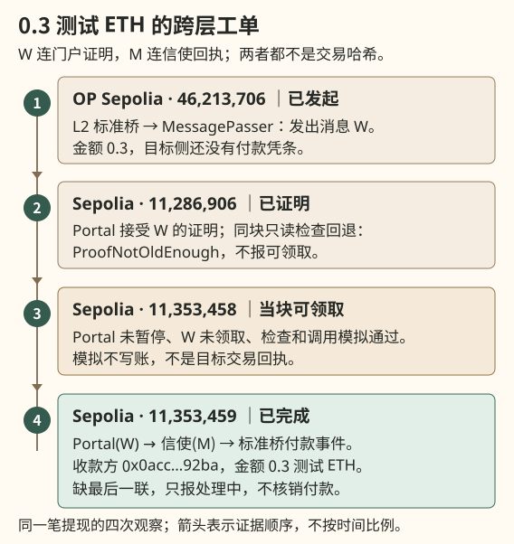

# 第 28 课 · 提现 0.3 测试 ETH：哪张回执才算到账？

客服正在核 W-28：用户从 OP Sepolia 申请把 **0.3 测试 ETH** 提到 Sepolia。目标链第 **11,353,458** 块的记录写着：这笔还没人领，允许领取，照原参数模拟领取也成功；标准桥却没有这笔付款的回执。客服该填「可以领」还是「已经付给收款人」？两句话差在哪一件事上？

填**「截至这个块，可以领，尚未领」**。模拟是拿这个块的账本试算「如果这样办会怎样」，不是提交交易，收款人不会因此多 0.3。源链第 46,213,706 块的成功记录能证明用户已经发起申请，也不能替目标链签收。

只把查询截止位置往后移一块：第 **11,353,459** 块有了真正的领取回执。门户处理的是同一笔提款，信使转发的是该笔的消息，约定的标准桥记明向指定地址支付 **0.3 测试 ETH**。同一工单现在怎么填？可以写「本笔桥付款已完成」，凭的是对得上的付款记录，不是因为时间又过了一块。也不能由此说收款人的整块余额恰好净增 0.3。

只想读懂这张凭条，可以到[选修 M08：换一种账本看付款](../plan.html#m08)，不必先跑实验。以下是选做的离线取证与卷末工单，不创建钱包、不签名。动手时会用到[按 ABI 解出调用参数](abi.html)、[用块哈希定位回执](rpc.html)、[区分执行链和结算链](rollup.html)、[复算 L2 费用](l2-fees.html)；卷末预算单另用[代付预留不等于实付](userop.html)。本案仅适用 OP Sepolia（11155420）→ Ethereum Sepolia（11155111）官方 Standard Bridge 的原生测试 ETH，不是 ERC-20，也不是 Portal 直接付款。

## 把三张交易凭条串成一条消息，而不是一次数据库提交

L2 和 L1 各有自己的执行和排序。L2 桥把金额、发起人、收款人编码成给对端桥的一次 `finalizeBridgeETH` 调用，再交给信使封装；`L2ToL1MessagePasser` 将最外层提款记入 L2 状态并发出 `MessagePassed`。L1 不会因为 Java 服务读到这条日志就自动划款。

证明人向 L1 Portal 提供包含这条提款的存储证明及关联的输出根证据。Portal 在本路线的争议游戏机制下登记该证明；这不等于争议游戏已经兑现所有最终化条件。后来有人用一份合格的证明发起 L1 最终化交易，Portal 尝试调用 L1 信使，信使再调 L1 标准桥。外层交易发起人、证明人、原提款人、L1 收款人是四种角色；本例它们恰好是同一地址，**不是**跨链关联条件。

<figure class="lesson-figure"><a href="../assets/figures/m07/withdrawal.svg"></a><figcaption>块高只在各自的链内比较。第 3 站是历史块状态上的只读调用，并没有第 4 笔交易；只有最后一站有真正的目标侧付款回执。</figcaption></figure>

| 角色 | 本案事件从哪里读 | 能回答什么 |
| --- | --- | --- |
| L2 标准桥 `0x4200000000000000000000000000000000000010` | `ETHBridgeInitiated(from,to,amount,extraData)` | 业务请求的双方、原始 wei 金额；不是目标侧付款 |
| L2 信使 `0x4200000000000000000000000000000000000007` 与 MessagePasser `0x4200000000000000000000000000000000000016` | 后者的 `MessagePassed` 载有 L2 信使为 sender、L1 信使为 target 的提款 | 最外层提款身份 **W** 及发往信使的原始字节；target 在这层还不是用户 |
| L1 Portal `0x16fc5058f25648194471939df75cf27a2fdc48bc` | `WithdrawalProven(W,…)`、`WithdrawalProvenExtension1(W,prover)`；后来 `WithdrawalFinalized(W,success)` | 证明提交者、提款是否已由门户处理、对信使的调用是否成功 |
| L1 信使 `0x58cc85b8d04ea49cc6dbd3cbffd00b4b8d6cb3ef` | `RelayedMessage(M)` | 版本 1 的信使消息 **M** 成功中继，不是提款身份 W |
| L1 标准桥 `0xfbb0621e0b23b5478b630bd55a5f21f67730b0f1` | `ETHBridgeFinalized(from,to,amount,extraData)` | 在成功回执里核对这次桥付款的对象与毛额；不是钱包在整块里的净变化 |

这次发起、证明、最终化有**三个不同 tx hash**。重跑同一笔业务不能按姓名、近似时间、相同金额或两条链上相同的高度关联。本案按注册的链和合约选事件，再连两把键：

1. **W** = `keccak256(abi.encode(nonce,sender,target,value,gasLimit,data))`。取 `MessagePassed` 的三个 indexed 字以及非 indexed 区内的 `value / gasLimit / data`，重新 ABI 编码求哈希；本案 W 是 `0xb143bca24a74d3c50838ebe3c5ad9627437b6d0535e77c4e5d29bea43d4c8976`。用 W 在 Portal 的证明与最终化事件中找同一条记录。
2. 上式中的 `data` 是整段 `relayMessage(...)` 调用数据。对本案的 **v1** 编码，**M** 是带函数选择器的这段字节的 Keccak，得 `0x27f93c6ccfe1490f3aea9fb557ccfd91d5df73aa77f71e48c69c30a6ccb446b6`。检查内层的发送方是 L2 桥、目标是 L1 桥、方法是 `finalizeBridgeETH`，且双方地址、金额、`extraData` 与发起事件吻合。这才知道以后应在**哪座桥**查**谁的款**。不要把信使的 nonce 与提款的 nonce 当成同一个计数器，也不要把 Java 的标准 SHA3-256 当成以太坊 Keccak。

工程上的索引可留 `(L2 chainId, L1 chainId, Portal, W)` 作跨层业务键；每个事实另存 `(chainId, blockHash, txHash, logIndex)`。一次交易可以携带多条消息；这个读端有意只接受每个指定事件唯一的两份工单，遇到重复候选即报错，不挑第一条。生产索引还要处理重组：发现块锚点被换掉，应撤回对应观察并重新取证，不是删掉旧记录后继续亮绿灯。

## 把时间列变成证据列

这是 **W-28 / A** 的历史截面，时间均为 UTC。不是操作教程，也不是从今日区块倒推的预计到账时间。

| 截至哪个块 | 当时能拿出的证据 | 对客服的答案 |
| --- | --- | --- |
| [OP Sepolia 发起交易](https://testnet-explorer.optimism.io/tx/0x56e83bf393c9a260b41892b54bcb58473ef8d7d7be5aa8fc600cfed886559f2b)，46,213,706，2026-07-16 19:25:52 | 成功源回执；桥请求 `300000000000000000` wei；MessagePasser 打出的 W 可重算 | **已发起，处理中**。没有任何目标侧领取或入账证据 |
| [Sepolia 证明交易](https://sepolia.etherscan.io/tx/0x631b3461e0bfec4e6ec118df7d46268892ab9436eea9cd2dd7c01a3d89d1b8fa)，11,286,906，07-16 19:50:24 | 同一 W 的证明事件和提交者；在这个块末调用 `checkWithdrawal(W,prover)` 仍回退，错误数据 `0xd9bc01be` 对应 `OptimismPortal_ProofNotOldEnough()` | **已证明，仍在处理**。证明被接受，不代表领取条件已齐 |
| Sepolia 11,353,458，07-26 08:20:48 | 同一历史块：`paused()=false`、`finalizedWithdrawals(W)=false`、`checkWithdrawal(W,prover)` 未回退；用实际提款参数与提交者模拟 `finalizeWithdrawalTransactionExternalProof` 也未回退 | **在这个块末可领取，尚未领**。这是一个可领取截面，未声称它是最早可领取的块；模拟没有交易哈希，不能写成已付款 |
| [Sepolia 最终化交易](https://sepolia.etherscan.io/tx/0x89e2ec2db5014d83494e3084d93fdf2509c334e14fd6605aaa1275c3cfe7cb1e)，11,353,459，07-26 08:21:00 | 成功目标回执，Portal 的 W 与 success=true，信使的 M，以及 L1 标准桥确认向 `0x0acc1db853dace5f7a16b6d7d5b6888ab28292ba` 支付 0.3 测试 ETH | **本条桥付款已完成**。不是两链交易相等，也不是确认该钱包此后仍保有这些钱 |

资格要以该部署、该证明提交者、该块上的协议检查为准：证明需要成熟，对应争议游戏也要满足可接受结果与最终化条件，还应考虑暂停、先前已领取等状态。即使人已等了很久，也可能根本没提交证明；即使资格已具备，也未必有人提交最终化。本案从证明到目标交易隔了 **9 天 12 时 30 分 36 秒**，其中可能有可领未领的时间，绝不能据此设置一个通用等待期。迁移到其他 OP Stack 网络、Arbitrum 或其他版本时重新查部署和规则，不照搬这个天数。

## 为什么「目标交易 status=1」仍不是收款凭条？

L1 外层成功只说明这笔外层交易没有整体回滚；应再读 `WithdrawalFinalized.success`。它为 true 也只表示 Portal 对直接 target（本例为信使）的调用成功。信使有自己的成功/失败事件；某些下游失败可以被上层捕获，并非总会冒泡成外层 `status=0`。若只见 `FailedRelayedMessage` 或无法确认对应的 `RelayedMessage(M)`，应区分门户已处理与内层未证实，不能让用户在源链重发同一付款。

把 L1 目标回执摊开，按「谁处理了什么」从外到内读，日志出现的先后不重要。`logIndex=545` 是 Portal 的记录：拿第 1 步算出的 W 与它比，`success=true` 才能认定门户已成功调用信使。`544` 是信使的记录：用第 2 步算出的 M 找到同一条 `RelayedMessage`，说明这条消息已成功转给桥。**谁收了多少钱要到 `543` 才有答案**：先核发出事件的是约定的 L1 标准桥，再比 `to` 和 `amount` 是否等于源请求里的收款人和 `300000000000000000 wei`。三个位置是本交易在该块的日志索引，不是三笔付款。

为什么桥的日志反而在前？内层调用先返回，外层稍后才记事件。官方 `finalizeBridgeETH` 先记桥事件，再向 `_to` 发送 `_amount`；**发送失败会回退，该次桥调用的日志也留不下来**。因此本例用成功回执与三项对应的证据认账。兼容旧接口的 `ETHWithdrawalFinalized` 只是同一笔付款的另一种通知，不再加一次；原生 ETH 也没有 ERC-20 的 `Transfer` 日志。

用余额作一次反证。`0.3 × 10¹⁸ = 300000000000000000 wei` 是桥的付款毛额。收款人恰好还付了这笔最终化的 gas，`311828 × 1965426057 = 612874876502196 wei`。但收款地址在上述相邻两块末的余额差是 **598830284543880678 wei**，竟然大于付款毛额。本块这位地址还提交了[另一笔不同门户交易](https://sepolia.etherscan.io/tx/0x80c0bfa14d9e07535091d1a4ece9722694a37987d7d534274fd0e2c8032f9ee3)。区块级净变化混合了别的活动，既不能顶替本交易的桥事件，也不该拿来否定已经核实的 0.3。这里没有声称验证了钱包的每一笔账。

## 离线重放：同一个 W，到哪一站能改状态？

在**仓库根目录**使用 Bash、CPython 3.11 和 Foundry **cast 1.7.1**（只用 `cast keccak`，不用 RPC、节点或钱包）。第一次准备 `cast` 时按[第 13 课固定安装步骤](abi.html#m04-tools)运行 `bash labs/m04/setup.sh`，需要联网；已有该版就不重装。实验数据已经随课归档。

```bash
export PATH="${XDG_CACHE_HOME:-$HOME/.cache}/chain-course/m04/bin:$PATH"
WORK=$(mktemp -d)
python3 labs/m07/withdrawal/track.py --case A > "$WORK/w28-full.txt" && cat "$WORK/w28-full.txt"
for view in source-only proof ready without-payment; do
  python3 labs/m07/withdrawal/track.py --case A --view "$view" > "$WORK/w28-$view.txt" || break
  tail -1 "$WORK/w28-$view.txt"
done
```

[读端 track.py](m07/withdrawal/track.py) 只读[证据包 A](m07/withdrawal/case-A.json)。`receipt()` 将块哈希、交易哈希、日志锚点和发出地址钉在同一条链上；`tail()` 按 ABI 偏移抽出原始 bytes，`replay()` 用这段字节复算 W 与 M。`observation()` 把方法、参数和 `blockHash + requireCanonical:true` 与归档请求逐一匹配，避免把别的证明人或 `latest` 的调用结果混进来。`checkWithdrawal` 没有返回值：**成功的空数据 `0x`** 与 RPC `error` 是两件事；还用布尔 getter 和完整调用模拟作交叉检查。只读模拟即使返回成功，也不能替代资产层的事件。

输入包来自 **2026-11-22 07:03 UTC** 的只读采集。`receipts` 保存 `eth_getTransactionReceipt` 的原始 result，L2 来自 `https://sepolia.optimism.io`，L1 来自 `https://ethereum-sepolia-rpc.publicnode.com`；`blocks` 是相应块对象中 number、hash、parentHash、timestamp 的摘录，不是完整区块。`reads` 包含 `https://sepolia.gateway.tenderly.co` 的 `eth_call` / `eth_getBalance` 请求参数与 JSON-RPC 响应；`simulate` 取对应实际 L1 交易的 from、to、gas、input（作 data）、value，在它的父块上只读执行。OP 浏览器的 Withdrawals 索引用于**发现线索**，其状态文案不进入判定。证据包是历史 RPC 回答，不是自行验证的共识证明或以 receiptsRoot 复核过的默克尔证明。若要按需向归档服务复核，使用包中的链、方法及同一块哈希，节点没有历史状态就记不可用；不要改成 `latest`。默认复跑不需要这些服务。

正常输入的关键输出预期如下（哈希和金额取自档案，不会随本机时间改变）：

```text
DELIVERY portal=True messenger=True bridgePayment=True
BALANCE payeeBlockDeltaWei=598830284543880678 finalizer=0x0acc1db853dace5f7a16b6d7d5b6888ab28292ba finalTxFeeWei=612874876502196
RESULT COMPLETED asset=testETH
```

四个对照只改变可见证据，不伪造新块。`source-only` 完全不用 L1 档案，最后一行是 `RESULT PROCESSING reason=no_L1_evidence`；`proof` 只看到证明块和当块检查，结论是 `proof_not_old_enough`；`ready` 看到领取预检，返回 `RESULT CLAIMABLE as_of=READY not_paid_yet=true`；`without-payment` 在同一成功目标回执中**遮去 L1 标准桥发出的全部日志**，包括兼容旧事件，故看到 `portal=True messenger=True bridgePayment=False`，返回 `RESULT PROCESSING reason=payment_not_established`。这最后一种是「我们缺原件」，**不是**声称实际付款失败，也不能沿用旧的可领取状态让人再次提交。各视图成功读到自洽的证据时退出 0，包括谨慎的「处理中」；输入/锚点不符或工具缺失是读端错误，非零退出，不得当作业务失败回执。

## 独立作业 · 去掉一联，余额能补签吗？

新同事只交了 A 的目标外层成功截图、收款地址的块末余额与一个 `RelayedMessage`，要求报「净收了 0.598830284543880678 测试 ETH」。不拿完整输出照抄：先运行 `--view without-payment`，写出保留哪些事实、还要补什么；再用完整包补证。按 `before + 本桥毛额 − 本笔最终化费 + 其他净变动 = after` 手算「其他净变动」。

**答案判据：** 两份报告使用同一 W、M、目标块/交易哈希。第一份仅认门户与信使成功，不核销付款；第二份写清 `ETHBridgeFinalized` 的 emitter、`logIndex=543`、收款地址和 **300000000000000000 wei**。余额两端分别是 **19626928681315265398** 和 **20225758965859146076 wei**，以上等式的残差是 **299443159420382874 wei**；不能把这项也算进本桥金额。交 `$WORK/w28-without-payment.txt`、`$WORK/w28-full.txt` 和一行算式，不附钱包资料。

<span id="m07-checkout"></span>

## 卷末验收 · X-728：两份工单能不能共用一个成功勾？

交接对象既维护跨层客服台，又维护黑客松演示的代付预算。交两份报告：**B 是另一笔公开测试网历史提现**，**S 是本地智能账户的新预算请求**。不接受 A 的截图，不把 B 的提款 W、S 的用户操作 hash、bundler 外层 tx hash 互当主键；两份工单只共用一个交接编号。

**B 联 · 跨层状态报告。** 另一位用户申请 **0.2 测试 ETH**，[证据包 B](m07/withdrawal/case-B.json) 独立附有[发起](https://testnet-explorer.optimism.io/tx/0x8e8df0fd1c425711d2ffe6b90f3ef7994421914942caec1280ffa862203c9bf7)、[证明](https://sepolia.etherscan.io/tx/0x44adb1b8c1e5aad74bede6e7639468c32819fbca48052572921bef6d9773f1c7)、[最终化](https://sepolia.etherscan.io/tx/0xd206d3a94b95ea2b9e05624aec2f466211717d180775886e6cb3baa48ec66c0c) 三个公开索引入口。从根目录分开保存截面，同时查这次源链执行费与数据费。

```bash
for view in source-only proof ready without-payment full; do
  python3 labs/m07/withdrawal/track.py --case B --view "$view" > "$WORK/B-$view.txt" || break
  tail -1 "$WORK/B-$view.txt"
done
python3 - <<'PY'
import json
r = json.load(open('labs/m07/withdrawal/case-B.json'))['receipts']['source']
print('executionWei', int(r['gasUsed'], 16) * int(r['effectiveGasPrice'], 16))
print('l1DataWei', int(r['l1Fee'], 16) if 'l1Fee' in r else 'unknown')
PY
```

**B 联判据：** 交 `(chainId, blockHash, txHash)`、各阶段可回答的问题、W/M、最终收款地址、金额及单位。L2 高度 **46,151,208** 已发起不等于 L1 入账；这份 L2 回执本身没有逐笔 L1 批次发布交易或 safe/finalized 头的历史轨迹，不补写这些时间。源链费用已知两项分别为 **151165782000 wei** 与 **19211488249 wei**，不是两次扣除本金，也不据此把未记载费用项默认为零。L1 **11,277,009** 接受证明但检查回退；**11,334,819** 的领取预检通过；目标块 **11,334,820** 的 `logIndex=161` 才有匹配的桥付款事件：收款 `0x1ed703b60d9cce105135e04cd344d8bb6dfee2c9`，**200000000000000000 wei**。本案 W 从 `0x2982289e` 开始、M 从 `0x346466e1` 开始，交完整值。遮掉桥日志时结论必须降回「付款未证实，处理中」，不因区块古老、领取预检通过或余额上升而核销。

**S 联 · 两张预约共用一份预算。** 测试活动的账面余额是 **1,200,000,000,000,000 wei**，其中 **400,000,000,000,037 wei** 已经为另一张未结单预留，不能动用。本次只允许[第 27 课](userop.html)的本地账户给 27 号工单盖章，所需预留仍是 **400,000 gas × 2 gwei/gas**。先减去旧预约，再预测新单能否受理。下例把算出的**可用额**存入本地 EntryPoint；旧预约是工单给定的账务输入，不伪造第二笔链上操作。

```bash
bash labs/m07/userop/prepare.sh
available=$((1200000000000000 - 400000000000037))
rc=0; python3 labs/m07/userop/run.py --budget-wei "$available" > "$WORK/S-budget.txt" || rc=$?
cat "$WORK/S-budget.txt"
test "$rc" -eq 3 && grep 'RESULT REJECTED_DEPOSIT' "$WORK/S-budget.txt"
```

**S 联判据：** 可用额为 **799,999,999,999,963 wei**，比所需的 **800,000,000,000,000 wei** 少 **37 wei**。若只看账面余额，会错批这一单；若把所需预留记成实付，又会错记一笔开支。交出差额算式、允许的账户/目标/方法、paymaster 和 `AA31` 拒绝凭证。没有为这次操作提交外层交易，也没有 `UserOperationEvent`；只有准备环境的部署和注资交易。两联分别签收：B 有目标桥的付款证据，S 没有提交。不能拿 B 的 Sepolia 最终化交易给 S 填外层哈希。

## 查证原文

- [Superchain Registry：固定版本的 OP Sepolia 配置](https://github.com/ethereum-optimism/superchain-registry/blob/c3944bfa1d25d38c60f8e0763d8a8af0ee815e37/superchain/configs/sepolia/op.toml)，校准链号、Portal 与 L1 标准桥地址；[OP Stack 提款规范](https://specs.optimism.io/protocol/withdrawals.html)给出 MessagePasser 预部署和提款字段。文档中早期输出预言机的例子不是本案的证明检查接口。
- [Fault Proof OptimismPortal：证明、领取资格与最终化](https://specs.optimism.io/fault-proof/stage-one/optimism-portal.html)，查 `checkWithdrawal`、proof maturity、game validity 和 `finalizeWithdrawalTransactionExternalProof`；不要把文档上的示例时限当作当块状态。
- [OP Stack：Standard Bridge 与信使](https://docs.optimism.io/app-developers/guides/bridging/standard-bridge)、[StandardBridge.sol：finalizeBridgeETH](https://github.com/ethereum-optimism/optimism/blob/develop/packages/contracts-bedrock/src/universal/StandardBridge.sol)、[Hashing.sol：版本化消息和提款哈希](https://github.com/ethereum-optimism/optimism/blob/develop/packages/contracts-bedrock/src/libraries/Hashing.sol)。工作树源码用于解释接口，历史结论取自已归档的块与回执。
